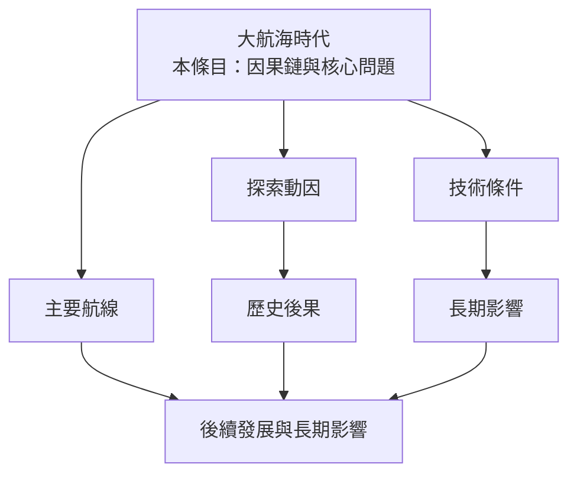

# 大航海時代

> 隸屬：第一層 [歷史](../README.md)　·　相關分類：[絲綢之路](../絲綢之路/README.md)、[工業革命](../工業革命/README.md)　·　子分類總表見 [README](README.md)

> 對應維基百科：[中文維基百科：地理大发现](https://zh.wikipedia.org/wiki/%E5%9C%B0%E7%90%86%E5%A4%A7%E5%8F%91%E7%8E%B0)　·　[English Wikipedia: Age of Discovery](https://en.wikipedia.org/wiki/Age_of_Discovery)

大航海時代指十五至十七世紀歐洲國家與商人系統性遠洋探索、開闢新航路的時期。它解決的敘事問題是：歷史如何從區域史（歐洲史、亞洲史各自發展）轉為全球史——此前各大陸之間只有零星接觸，此後世界第一次被航線連成單一網絡。

「大航海」與「地理大發現」兩個名稱各有立場：前者強調航海技術與探險過程，後者是歐洲中心的說法（對美洲原住民而言並無「發現」）。因此本分類在敘事上同時記錄兩面：探險的成就與殖民的代價，缺一即失真。

## 核心問題

本分期要回答：為什麼是十五世紀的伊比利半島率先跨越大洋？答案是一組條件的疊加——政治上，葡萄牙與西班牙王權穩定、有動力繞開威尼斯與鄂圖曼控制的地中海貿易；經濟上，香料（胡椒、丁香在歐洲是高價奢侈品）與黃金的誘因巨大；技術上，羅盤、星盤、卡拉維爾帆船與艦載火砲讓遠洋從冒險變成可計算的投資。1494 年《托爾德西里亞斯條約》更顯示：探險已制度化為國家項目，由教宗裁定兩國瓜分未知世界的分界線。

因此大航海時代不只是探險史，而是「航線—情報—資本—武力」四位一體的系統：每次航行都產生海圖與水文資料，資料降低下次航行的成本，成本降低吸引更多資本，武力則保證投資的回收。這個自我強化的循環，正是它與歷代零星遠航的根本差別。

## 因果鏈

1. 1453 年鄂圖曼攻陷君士坦丁堡，傳統絲路貿易成本上升，西歐尋找直達印度的新路線。
2. 葡萄牙沿非洲西岸逐步南下，1488 年迪亞士抵達好望角，證明繞行非洲可行。
3. 1492 年哥倫布西行抵達美洲，1498 年達伽馬抵達印度卡利卡特，兩條新航路同時打開。
4. 新航路帶來殖民擴張與物種交流（美洲作物玉米、馬鈴薯外傳，歐洲疾病摧毀原住民人口）。
5. 白銀自美洲流入全球造成價格革命，海洋霸權輪替（葡西、荷、英），世界市場成形，為工業革命鋪路。

## 子分類的定位與相互驅動

### 探索動因

香料與黃金解釋「為何值得去」，宗教傳播解釋「為何理直氣壯」，商業競爭解釋「為何不能等」，技術進步解釋「為何做得到」。四者缺一不可：只有誘因而無技術，探險只是空想；只有技術而無誘因，資本不會投入。

### 技術條件

羅盤解決方向問題，航海術（測緯度、推算航程）解決「我在哪裡」的問題，造船（卡拉維爾與卡瑞克帆船）解決逆風與載重的問題，火砲解決「遇到抵抗怎麼辦」的問題。技術條件的每一項進步都直接擴大可行航線的範圍。

### 主要航線

達伽馬開通好望角航線、麥哲倫船隊 1519 至 1522 年完成首次環球、哥倫布四次西航開啟美洲航線，而鄭和 1405 至 1433 年七下西洋則展示了另一種可能：國家主導、以朝貢而非殖民為目的的遠航，因政策轉向而中止。比較這幾條航線，可以看出政治意志與資本結構如何決定遠航的持續性。

### 歷史後果

新航路重繪貿易地圖，殖民擴張把美洲與東南亞納入歐洲經濟，物種交流（哥倫布交換）改寫全球農業，價格革命（美洲白銀使歐洲物價在一個多世紀上漲數倍）則動搖了舊的地租經濟。四者互相驅動：航線帶來移民與作物，作物養活更多人口，人口與白銀共同推高通貨膨脹。

### 長期影響

世界市場使「在哪裡生產」開始由全球價格決定，海洋霸權成為國家興衰的關鍵變數，原住民災難（美洲原住民人口在疫病與勞役下銳減九成左右）則是這段歷史最沉重的帳。全球史觀正是為了公正處理這種不對稱的互動而產生的史學方法。

## 範例

以馬尼拉大帆船貿易為例：1565 年起，西班牙以墨西哥白銀經太平洋換取中國絲綢與瓷器，每年一至兩艘大帆船往返阿卡普爾科與馬尼拉。這條航線把美洲白銀直接注入中國——明中後期「一條鞭法」之所以能以白銀折算賦稅，正因為海外白銀供給充足。一場在歐洲展開的探險，最終改變了中國的財政制度：這正是大航海時代「全球連動」的具體證明。

## 容易混淆之處

- 「哥倫布證明地球是圓的」：錯誤，當時受過教育者普遍已知地圓，爭議在於地球周長估算，哥倫布恰恰算錯了。
- 「鄭和下西洋屬於大航海時代」：時間上前後相接，但目的與制度完全不同，通常作為比較對象而非同一運動。
- 「地理大發現是中性的成就敘事」：對美洲、非洲與大洋洲社會而言，這是瘟疫、奴役與人口銳減的時代，必須併陳。
- 「價格革命只發生在歐洲」：白銀是全球流通的，中國的物價與賦稅制度同樣受影響。

## 深入議題
- 航線的競爭本質上是情報的競爭：葡萄牙把印度航線的海圖列為國家機密，荷蘭人揚（Houtman）靠間諜取得資料後才於 1595 年首航——科技史與間諜史在這裡是同一門課。
- 『發現』的敘事至今仍有遺緒：地名（新阿姆斯特丹、麥哲倫海峽）與紀念日爭議顯示，十五至十七世紀的航線仍在被當代政治重新詮釋。
- 閱讀提示：本頁因果鏈給出骨架，子分類條目給出血肉，對應維基百科條目提供可查證的細節；三層閱讀由粗到細，遇到年代與人名疑義時以最後一層為準。
- 寫作體例：涉及估計值（傷亡、產量、年代區間）時一律標示『約』或『估計』，並在可行時給出區間而非單點——歷史結論的可信度取決於不確定性的誠實呈現。
- **分期是敘事工具而非自然事實**：任何切分年代都有利弊，大航海時代的起訖在史學界本就存在多種方案，敘事時宜標明所採用的標準。
- **比較史的方法陷阱**：以大航海時代為標尺衡量不同地區時，須注意各地條件差異，避免把單一地區的經驗當成普遍規律。
- **證據的層級**：一手史料、考古證據與二手詮釋的可信度不同，涉及具體年代與人名時應回到可查證的來源。
- **長時段與短時段的互補**：布勞岱式的長時段結構（地理、經濟）與事件史（人物、戰役）各有解釋力，本分類刻意兩者並用。
- **研究的前沿**：大航海時代的相關研究仍在更新，新出土資料、新統計資料或新方法（如量化史學、數位人文）都可能改寫既有結論。
- **給初學者的閱讀順序**：先掌握本頁的因果鏈，再進入子分類條目，最後以對應維基百科條目查證細節——由框架到細節，比反方向更省力。

## 與相鄰分類的關聯
- **工業革命**：大航海時代提供工業革命所需要的長時段背景，工業革命則回頭檢驗大航海時代敘事的因果是否成立——兩者互為對照組。
- **絲綢之路**：大航海時代提供絲綢之路所需要的長時段背景，絲綢之路則回頭檢驗大航海時代敘事的因果是否成立——兩者互為對照組。
- **文明興衰**：大航海時代提供文明興衰所需要的長時段背景，文明興衰則回頭檢驗大航海時代敘事的因果是否成立——兩者互為對照組。
- **與第一層 [歷史] 入口頁**：本分類是第一層分類樹的分支，跨分類的查詢建議先回到入口頁再下行，避免漏掉同層的相近概念。

## 概念結構圖

## 連結定義

[歷史]: ../README.md
[絲綢之路]: ../絲綢之路/README.md
[工業革命]: ../工業革命/README.md
