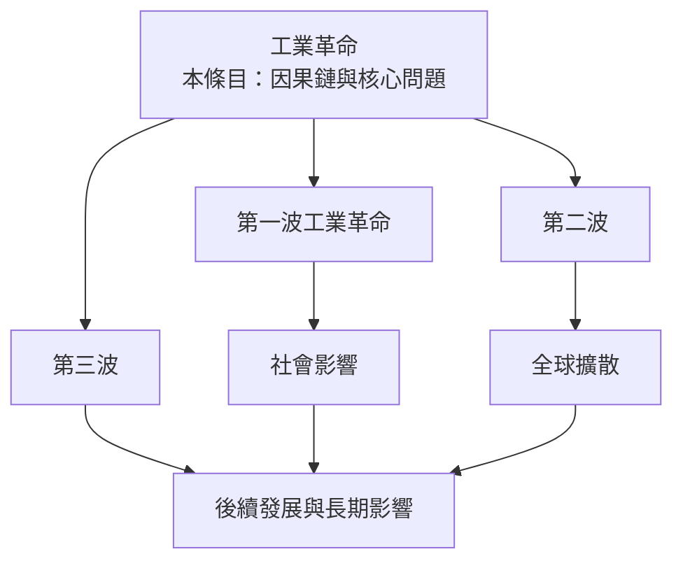

# 工業革命

> 隸屬：第一層 [歷史](../README.md)　·　相關分類：[大航海時代](../大航海時代/README.md)、[資訊時代](../資訊時代/README.md)　·　子分類總表見 [README](README.md)

> 對應維基百科：[中文維基百科：第一次工业革命](https://zh.wikipedia.org/wiki/%E7%AC%AC%E4%B8%80%E6%AC%A1%E5%B7%A5%E4%B8%9A%E9%9D%A9%E5%91%BD)　·　[English Wikipedia: Industrial Revolution](https://en.wikipedia.org/wiki/Industrial_Revolution)

工業革命指十八世紀後半起，生產方式由手工與人力畜力轉為機器與化石燃料動力的根本轉型，起於英國，逐步擴散全球。它解決的敘事問題是：人類經濟如何跳出「馬爾薩斯陷阱」——即技術進步總被人口增長吃掉、人均所得長期停滯的狀態。工業革命之後，人均所得與人口首次同時持續上升。

「革命」一詞容易誤導：轉型在英國延續約八十年，且是三波浪潮的疊加——蒸汽與紡織、電力與鋼、電子與資訊。把它理解為一場持續的、分波的動力與組織變革，比「某年某地爆發」更接近事實。

## 核心問題

本分期要回答：為什麼是英國、為什麼是十八世紀？主流解釋是一組條件同時到位：煤礦淺藏易開（能源）、殖民市場與海上貿易（需求與原料）、圈地運動釋出勞動力（人力）、專利制度與寬容的工匠文化（創新激励）、以及國家財政能力（融資）。紡織業是突破口，因為它需求確定、工序可拆解、最適合機械化——1764 年哈格里夫斯的珍尼紡紗機、1769 年阿克賴特的水力紡紗機、1779 年克隆普頓的騾機，十年內把紡紗產量提高數十倍。

動力是第二突破口。瓦特在 1776 年取得分離冷凝器專利，使蒸汽機的熱效率大幅提高，蒸汽動力於是能離開煤礦（其原始用途是抽水）進入工廠。工廠制度則是組織革命：把工人、機器與動力集中在同一屋簷下，以時鐘與紀律管理生產，「上班」自此成為社會的基本節奏。

## 因果鏈

1. 大航海時代累積的殖民地市場與資本，使英國紡織品供不應求，工資高企推動以機器替代人力。
2. 蒸汽機與紡織機械結合，工廠制度確立；煤與鐵互相推動（煉鐵用煤、採煤用蒸汽機），形成能源—材料閉環。
3. 鐵路與蒸汽船壓低運輸成本，擴大市場半徑，市場擴大又反過來投資更多機器——規模經濟的自我強化。
4. 十九世紀末第二波以電力與鋼為核心，化工與汽車接續，大企業與研發實驗室制度化創新。
5. 二十世紀第三波以電子與資訊、自動化、網際網路為核心，生產力轉向知識處理，最終連結到資訊時代。

## 子分類的定位與相互驅動

### 第一波工業革命

蒸汽與紡織提供動力與需求，煤與鐵提供能源與材料，工廠制度提供組織。三者互相鎖定：沒有蒸汽機就沒有深煤礦，沒有焦炭煉鐵就沒有便宜機器，沒有工廠就無法調度數百名工人協同作業。

### 第二波

電力與鋼讓動力可分配、結構可承重，化工把副產品變成產業（合成染料、化肥），汽車與化工則把標準化與流水線推向極致。第二波的關鍵是「科學直接進入生產」：德國以工業實驗室追上英國，證明創新可以被組織出來。

### 第三波

電子與資訊把控制權交給電路，自動化取代重複體力勞動，網際網路壓低協作與交易成本。第三波還在進行中，其社會後果（零工經濟、平台壟斷、人工智慧）構成資訊時代的主題。

### 社會影響

都市化把人口吸入曼徹斯特這類工業城市，工人階級在惡劣勞動條件中形成自我組織（工會、工廠法、社會主義思想），壽命與健康的先降後升則顯示：技術紅利需要制度（公共衛生、勞動立法）才能轉為福祉。

### 全球擴散

殖民地經濟被整編為原料供應地與商品市場，等級分工（核心製造、邊陲供料）塑造了至今未解的南北差距，而非西方工業化（日本明治維新之後的追趕）則證明工業化模式可以移植，但政治條件必須重造。

## 範例

以鐵路為例：1825 年斯托克頓至達靈頓鐵路通車，1830 年利物浦至曼徹斯特鐵路以蒸汽機車「火箭號」確立商業模式。此後三十年英國鐵路里程超過一萬公里，運輸成本降到馬車的幾分之一，鮮奶與報紙得以當日送達遠方城市。鐵路同時反向驅動上游：對鋼軌、橋樑、信號系統的需求，直接催生了貝塞麥轉爐煉鋼法（1856 年）。一項運輸創新帶動一項材料創新——這種跨產業的連鎖正是工業革命的推進方式。

## 容易混淆之處

- 「工業革命始於瓦特發明蒸汽機」：紐科門蒸汽機早於 1712 年用於煤礦；瓦特是改良者而非發明者。
- 「工業革命使所有人立即變富」：初期工人實際工資停滯甚至下降，紅利要等到十九世紀中後才普遍化。
- 「工業革命等於使用機器」：核心是動力來源與生產組織的系統性重構，單件機器古已有之。
- 「三波工業革命可以截然切分」：它們在時間與空間上重疊，英國進入第二波時德國與美國才開始第一波。

## 深入議題
- 『大分流』（Great Divergence）辯論是近年核心議題：彭慕蘭主張十八世紀中葉前江南與英格蘭的生活水準相近，分流要等到煤與殖民地的結合——此說強迫修正歐洲中心式的原因清單。
- 衡量工業革命不能只看產值：實際工資、身高（營養指標）、識字率與城市死亡率等『生活水準史』指標，常常與產量曲線背離，這種背離本身就是研究對象。
- 閱讀提示：本頁因果鏈給出骨架，子分類條目給出血肉，對應維基百科條目提供可查證的細節；三層閱讀由粗到細，遇到年代與人名疑義時以最後一層為準。
- 寫作體例：涉及估計值（傷亡、產量、年代區間）時一律標示『約』或『估計』，並在可行時給出區間而非單點——歷史結論的可信度取決於不確定性的誠實呈現。
- **分期是敘事工具而非自然事實**：任何切分年代都有利弊，工業革命的起訖在史學界本就存在多種方案，敘事時宜標明所採用的標準。
- **比較史的方法陷阱**：以工業革命為標尺衡量不同地區時，須注意各地條件差異，避免把單一地區的經驗當成普遍規律。
- **證據的層級**：一手史料、考古證據與二手詮釋的可信度不同，涉及具體年代與人名時應回到可查證的來源。
- **長時段與短時段的互補**：布勞岱式的長時段結構（地理、經濟）與事件史（人物、戰役）各有解釋力，本分類刻意兩者並用。
- **研究的前沿**：工業革命的相關研究仍在更新，新出土資料、新統計資料或新方法（如量化史學、數位人文）都可能改寫既有結論。
- **給初學者的閱讀順序**：先掌握本頁的因果鏈，再進入子分類條目，最後以對應維基百科條目查證細節——由框架到細節，比反方向更省力。

## 與相鄰分類的關聯
- **大航海時代**：工業革命提供大航海時代所需要的長時段背景，大航海時代則回頭檢驗工業革命敘事的因果是否成立——兩者互為對照組。
- **資訊時代**：工業革命提供資訊時代所需要的長時段背景，資訊時代則回頭檢驗工業革命敘事的因果是否成立——兩者互為對照組。
- **戰爭史**：工業革命提供戰爭史所需要的長時段背景，戰爭史則回頭檢驗工業革命敘事的因果是否成立——兩者互為對照組。
- **與第一層 [歷史] 入口頁**：本分類是第一層分類樹的分支，跨分類的查詢建議先回到入口頁再下行，避免漏掉同層的相近概念。

## 概念結構圖

## 連結定義

[歷史]: ../README.md
[大航海時代]: ../大航海時代/README.md
[資訊時代]: ../資訊時代/README.md
