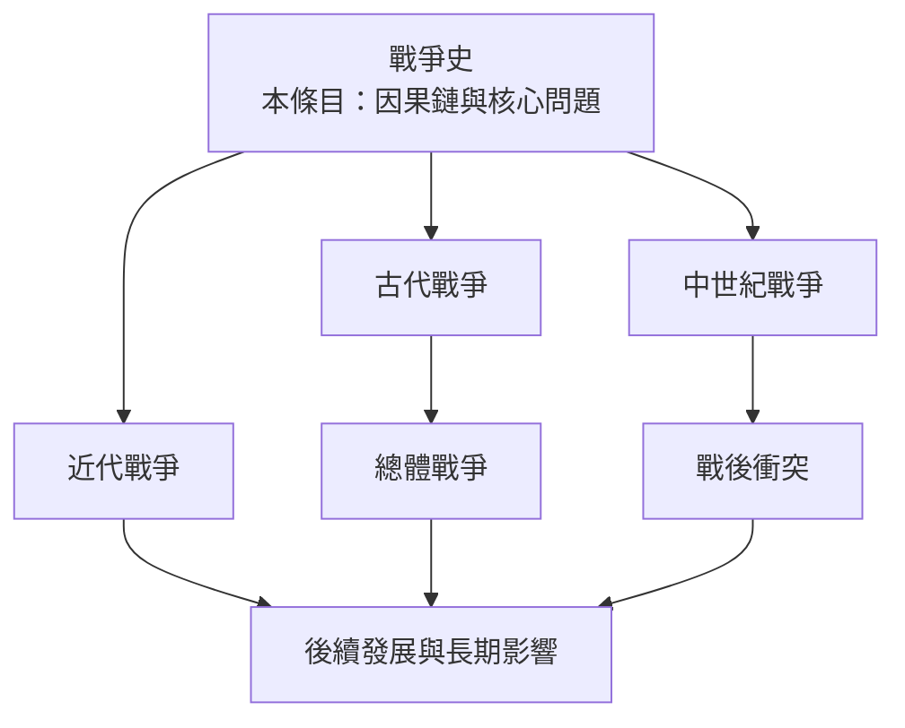

# 戰爭史

> 隸屬：第一層 [歷史](../README.md)　·　相關分類：[政治革命](../政治革命/README.md)、[文明興衰](../文明興衰/README.md)　·　子分類總表見 [README](README.md)

> 對應維基百科：[中文維基百科：军事史](https://zh.wikipedia.org/wiki/%E8%BB%8D%E4%BA%8B%E5%8F%B2)　·　[English Wikipedia: Military history](https://en.wikipedia.org/wiki/Military_history)

戰爭史研究戰爭作為社會現象的演變：武器與戰術、軍隊組織、動員制度，以及戰爭如何反過來塑造國家與社會。它解決的敘事問題是：政治史裡大量「疆界改變、政權更替」的結果都由戰爭決定，若不系統地處理戰爭的技術與組織條件，歷史敘事就只剩成敗而無因果。

軍事史與戰爭史有分工：前者偏重作戰本身（戰役、兵器、將道），後者把戰爭放回社會脈絡——誰當兵、誰付帳、誰受害。本分類採後者的廣義，並以「戰爭的後果」收尾，因為戰後的死亡統計、經濟崩潰與國際秩序重組，往往比戰場勝負更深刻地改寫歷史。

## 核心問題

本分期要回答的核心問題是：戰爭的形態由什麼決定？答案是技術、組織與財政三者的組合。火藥普及前，戰爭靠人力與馬匹；火砲摧毀了城牆的價值，催生常備軍與中央集權；鐵路與電報使大規模動員可行，總體戰於是把整個社會變成戰爭機器；核武之後，大國戰爭變成不可承受的選項，衝突轉入代理人戰爭與冷戰對峙。

戰爭史因此有一條隱含的因果鏈：技術改變戰場的勝負條件，勝負條件改變軍隊組織，軍隊組織改變國家財政與社會動員方式，動員方式又改變社會結構（如義務兵役與公民權的綁定）。理解這條鏈，就能理解為何軍事史學者常說「戰爭造就國家，國家也造就戰爭」。

## 因果鏈

1. 古代城邦以重裝步兵與方陣作戰，戰爭是公民的季節性義務；帝國則以職業軍團擴張，戰爭成為常態產業。
2. 中世紀騎士封建動員讓位給火藥與常備軍，君主靠火砲摧毀貴族城堡，中央集權國家成形。
3. 法國大革命的全民徵兵（1793 年八十萬大軍）顯示政治革命能釋放前所未見的動員能量，革命戰爭與民族戰爭自此連結。
4. 工業革命供給機關槍、鐵路與化工炸藥，第一次世界大戰成為總體戰爭：戰場膠著、經濟崩潰、帝國解體。
5. 第二次世界大戰與核武確立「大戰不可行」，衝突轉為韓戰、越戰等代理人戰爭，直至今日的俄烏戰爭與網路資訊戰。

## 子分類的定位與相互驅動

### 古代戰爭

城邦戰爭（如希臘重裝步兵會戰）與征服戰爭（如亞歷山大遠征）代表兩種規模邏輯：前者保衛公民共同體，後者靠職業軍團建立帝國。羅馬擴張把戰爭收益（土地、奴隸、貢賦）制度化了，但也埋下軍閥干政的種子。

### 中世紀戰爭

十字軍把宗教動員與軍事遠征結合，百年戰爭（1337–1453）見證長弓與火砲終結騎士霸權，蒙古西征則展示了機動騎射與情報組織在十三世紀的壓倒性優勢。三者共同說明：中世紀並非軍事停滯，而是舊組織逐步被新技術瓦解的過程。

### 近代戰爭

宗教戰爭（如 1618–1648 年的三十年戰爭）以慘烈代價換取《西發里亞和約》的主權國家框架，王朝戰爭使戰爭趨於有限與專業，革命戰爭則再次打開總動員之門。近代戰爭史是「克制與失控」的拉鋸，直接為二十世紀的災難鋪路。

### 總體戰爭

第一次世界大戰把工業國的產能變成絞肉機：凡爾登戰役十個月內雙方傷亡逾七十萬。第二次世界大戰擴大為種族滅絕與戰略轟炸的全面戰。冷戰對峙則以核威懾取代直接開戰——總體戰爭的可能性反過來終結了總體戰爭。

### 戰後衝突與戰爭的後果

韓戰與越戰展示有限戰爭與游擊戰的政治侷限，中東戰爭與俄烏戰爭反映冷戰遺留的斷層線。而死亡與流離（二十世紀戰爭死亡逾一億人、難民潮重塑國界）、經濟崩潰（戰債與惡性通膨如 1923 年德國）與國際秩序重組（國聯、聯合國、布列敦森林體系）構成戰爭的長期帳單。將領與軍事統帥則提供「個人決策在結構中能起多大作用」的檢驗場。

## 範例

以亞歷山大的高加米拉之戰（西元前 331 年）為例：亞歷山大以約四萬七千兵力對抗波斯帝國號稱百萬（現代估計十餘萬）的大軍。他不與波斯主力正面消耗，而是以斜線陣型牽制敵方中央，親率夥伴騎兵直搗大流士三世的指揮中樞，迫其棄陣而逃。此戰說明古代戰爭的關鍵不在兵力而在指揮體系的存亡——這條原則經漢尼拔、到拿破崙、再到現代「斬首作戰」概念，一脈相承，也使本分類的將領研究與組織研究互相驅動。

## 容易混淆之處

- 「戰爭史等於戰役史」：戰役只是節點，動員、財政與後果才是主幹。
- 「技術決定一切」：機關槍在殖民戰爭已現威力，歐洲列強直到一戰才付學費——組織與教條的惰性同樣關鍵。
- 「冷戰等於沒有戰爭」：韓戰、越戰、阿富汗戰爭都是冷戰的熱戰形式，只是代理人開槍。
- 「將領是戰爭勝負的主因」：結構條件（補給、兵員、工業）通常比個人天才更具解釋力。

## 深入議題
- 戰爭與國家形成的共生是當代顯學：蒂利的名言『戰爭造就國家，國家也造就戰爭』把財政—軍事國家（fiscal-military state）放在歐洲興起的核心位置。
- 傷亡數字的社會史：一戰後的『失落的世代』改變了法國與英國的性別結構與勞動市場，戰爭的人口學後果比戰役結果持續更久。
- 閱讀提示：本頁因果鏈給出骨架，子分類條目給出血肉，對應維基百科條目提供可查證的細節；三層閱讀由粗到細，遇到年代與人名疑義時以最後一層為準。
- 寫作體例：涉及估計值（傷亡、產量、年代區間）時一律標示『約』或『估計』，並在可行時給出區間而非單點——歷史結論的可信度取決於不確定性的誠實呈現。
- **分期是敘事工具而非自然事實**：任何切分年代都有利弊，戰爭史的起訖在史學界本就存在多種方案，敘事時宜標明所採用的標準。
- **比較史的方法陷阱**：以戰爭史為標尺衡量不同地區時，須注意各地條件差異，避免把單一地區的經驗當成普遍規律。
- **證據的層級**：一手史料、考古證據與二手詮釋的可信度不同，涉及具體年代與人名時應回到可查證的來源。
- **長時段與短時段的互補**：布勞岱式的長時段結構（地理、經濟）與事件史（人物、戰役）各有解釋力，本分類刻意兩者並用。
- **研究的前沿**：戰爭史的相關研究仍在更新，新出土資料、新統計資料或新方法（如量化史學、數位人文）都可能改寫既有結論。
- **給初學者的閱讀順序**：先掌握本頁的因果鏈，再進入子分類條目，最後以對應維基百科條目查證細節——由框架到細節，比反方向更省力。

## 與相鄰分類的關聯
- **政治革命**：戰爭史提供政治革命所需要的長時段背景，政治革命則回頭檢驗戰爭史敘事的因果是否成立——兩者互為對照組。
- **文明興衰**：戰爭史提供文明興衰所需要的長時段背景，文明興衰則回頭檢驗戰爭史敘事的因果是否成立——兩者互為對照組。
- **歷史災難**：戰爭史提供歷史災難所需要的長時段背景，歷史災難則回頭檢驗戰爭史敘事的因果是否成立——兩者互為對照組。
- **與第一層 [歷史] 入口頁**：本分類是第一層分類樹的分支，跨分類的查詢建議先回到入口頁再下行，避免漏掉同層的相近概念。

## 概念結構圖

## 連結定義

[歷史]: ../README.md
[政治革命]: ../政治革命/README.md
[文明興衰]: ../文明興衰/README.md
[將領與軍事統帥]: 將領與軍事統帥.md
[第一次世界大戰]: 第一次世界大戰.md
[越戰]: 越戰.md
[孫子兵法]: 孫子兵法.md
[美國獨立戰爭]: 美國獨立戰爭.md
