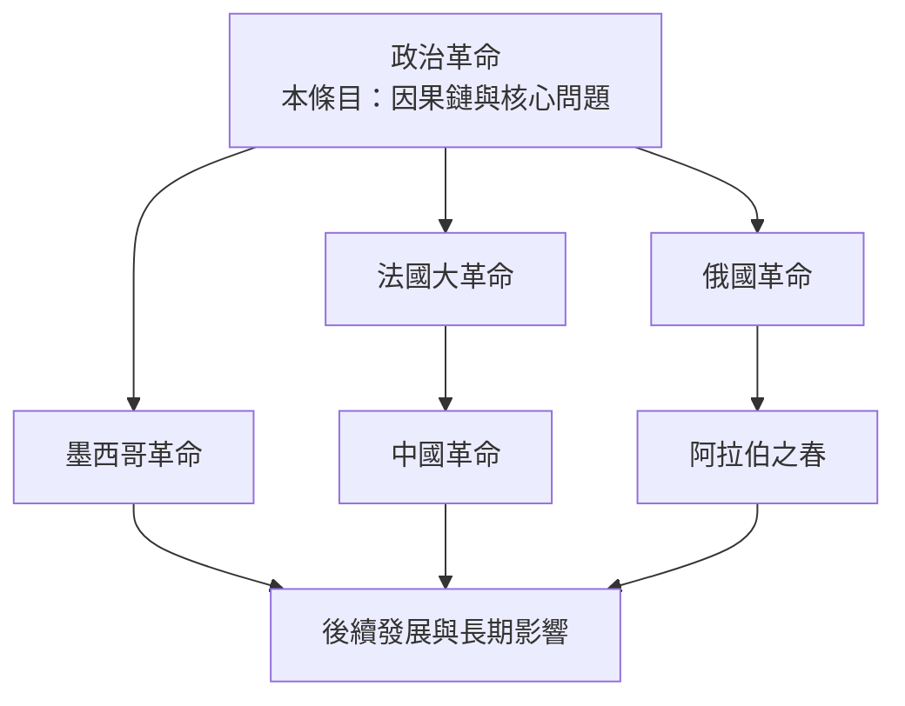

# 政治革命

> 隸屬：第一層 [歷史](../README.md)　·　相關分類：[戰爭史](../戰爭史/README.md)、[文明興衰](../文明興衰/README.md)　·　子分類總表見 [README](README.md)

> 對應維基百科：[中文維基百科：革命](https://zh.wikipedia.org/wiki/%E9%9D%A9%E5%91%BD)　·　[English Wikipedia: Revolution](https://en.wikipedia.org/wiki/Revolution)

政治革命指以急遽、非法（相對舊秩序而言）的方式推翻政權並重建政治規則的過程。它與政變、王朝更替的差別在於：革命改變的不只是掌權者，而是「權力從何而來」的原理——從君權神授改為人民主權。因此革命史處理的是現代政治合法性的誕生過程。

本分類解決的敘事問題是：為什麼十八世紀末以來，世界各地的政權更替越來越常以「革命」的形式發生？答案是美國獨立（1776）與法國大革命（1789）確立了新範式：人民有權廢除舊制度、重新制定憲法。此後的俄國革命、墨西哥革命、辛亥革命到阿拉伯之春，都是在這個範式下的變奏。

## 核心問題

本分期要回答：革命為何成功或失敗？比較研究給出三個變數。第一是社會基礎：誰在革命陣營裡（工人、農民、中產、軍隊）決定革命能動員多少力量。第二是革命路徑：是上層改良失控、群眾運動升級，還是外來政權崩潰造成的權力真空。第三是革命後秩序：推翻舊政權只需數月，建立新制度往往需要數十年，甚至滑回獨裁（法國的恐怖統治、蘇聯的黨國體制）。

革命研究因此有一條隱含對照：法國大革命與俄國革命提供了「激進路線」的完整樣本——從溫和立憲滑向激進專政；美國獨立與辛亥革命提供了另一種對照——前者建立憲政而後奴隸制問題爆發為內戰，後者推翻帝制但迅速陷入軍閥割據。放在一起比較，才能看出制度遺產（有無議會與法律傳統）對革命後果的巨大影響。

## 因果鏈

1. 舊制度財政破產：法國因援助美國獨立戰爭而債台高築，1789 年被迫召開三級會議徵稅，引爆革命。
2. 溫和改革失敗後激進派掌權：巴士底獄被攻佔、君主制被廢、共和與恐怖接連登場，拿破崙最終收攏秩序並輸出革命原則。
3. 拿破崙戰爭喚醒各地的民族與憲政意識，革命成為十九至二十世紀政治變革的主要劇本。
4. 1917 年俄國在戰爭崩潰中相繼發生二月革命與十月革命，內戰後建立蘇維埃政權，提供「革命建黨」的新模式。
5. 辛亥革命（1911）終結帝制、墨西哥革命（1910–1920）推動土地改革、阿拉伯之春（2011）重演「起義—鎮壓—內戰」劇本，革命比較因此成為必要的研究方法。

## 子分類的定位與相互驅動

### 法國大革命

舊制度（absolute monarchy 的財政與等級社會）、巴士底（1789 年 7 月 14 日群眾攻佔象徵王權暴力的監獄）、共和與恐怖（1793–1794 年羅伯斯比與革命法庭）、拿破崙（1799 年霧月政變後以《民法典》固化革命成果）構成完整的激進革命生命週期，是所有後續革命的參照系，詳見 [法國大革命](法國大革命.md)。

### 俄國革命

二月革命推翻沙皇卻陷入兩個政權並立的僵局，十月革命由布爾什維克以「和平、土地、麵包」奪權，內戰（1918–1922）確立紅軍與黨國體制，新經濟政策（1921）則是意識形態向現實的讓步。俄國革命證明：紀律政黨能把混亂的群眾運動轉化為可持久的政權。

### 墨西哥革命

薩拉帕薩起義與潘喬・潘蒂亞・比亞代表農民武裝的力量，土地改革（1917 年憲法第 27 條）把「土地與自由」寫進法律，新政制度則顯示革命政權如何以一黨制度穩定統治數十年。它是二十世紀第一場成功的社會革命，卻也預示了革命制度化的保守化。

### 中國革命與阿拉伯之春

辛亥革命（1911 年 10 月 10 日武昌起義）在數月內使各省脫離清廷，但共和迅速讓位給軍閥，說明「推翻」與「重建」之間的斷裂；[辛亥革命](辛亥革命.md)因此常與法國大革命並列為「未完成的革命」。阿拉伯之春的四國樣本（突尼西亞相對平穩、埃及軍方回歸、敘利亞內戰）則提供了最新的革命路徑比較材料。

### 革命比較與革命領袖

社會基礎、革命路徑、革命後秩序三變數構成比較框架；[革命領袖](革命領袖.md)則提醒：羅伯斯比、列寧、孫中山等人的個人選擇在關鍵時刻有真實作用，但只有放在結構條件中才可解釋。

## 範例

以法國大革命的財政起點為例：1788 年法國財政赤字達國家預算的兩成以上，其中近半用於支付舊債利息——相當比例源自援助美國獨立戰爭的借款。財政總監內克爾無法在不觸怒特權等級的情況下開源，國王路易十六遂被迫召集一百七十五年未開的三級會議。第三等級代表要求按人頭表決而非按等級表決，遭拒後自行成立國民議會——革命的程序自此啟動。一場為借錢而召開的會議，改寫了此後兩百年的政治合法性原理。

## 容易混淆之處

- 「革命都是突然爆發的」：法國大革命的財政危機累積了數十年，突發的只是引爆點。
- 「革命必然走向更自由的政體」：法國的恐怖統治與蘇聯的黨國體制顯示革命常滑向新的專政。
- 「革命與內戰可以清楚區分」：俄國、中國與西班牙的案例中兩者互相滲透，只能依起點與性質大致劃分。
- 「革命領袖單獨決定成敗」：沒有布爾什維克的組織與一戰的崩潰，列寧無法掌權；結構與人物必須併看。

## 深入議題
- 革命紀念政治：巴士底日、十月革命節與雙十節顯示，革命不只在發生時塑造歷史，也在每年的儀式中被反覆重寫——紀念日研究是革命史與記憶研究的交口。
- 『革命吞噬其子女』的母題（維尼名言）值得結構化檢驗：激進派的崛起與清洗並非宿命，而與戰爭壓力、組織資源的封鎖程度高度相關。
- 閱讀提示：本頁因果鏈給出骨架，子分類條目給出血肉，對應維基百科條目提供可查證的細節；三層閱讀由粗到細，遇到年代與人名疑義時以最後一層為準。
- 寫作體例：涉及估計值（傷亡、產量、年代區間）時一律標示『約』或『估計』，並在可行時給出區間而非單點——歷史結論的可信度取決於不確定性的誠實呈現。
- **分期是敘事工具而非自然事實**：任何切分年代都有利弊，政治革命的起訖在史學界本就存在多種方案，敘事時宜標明所採用的標準。
- **比較史的方法陷阱**：以政治革命為標尺衡量不同地區時，須注意各地條件差異，避免把單一地區的經驗當成普遍規律。
- **證據的層級**：一手史料、考古證據與二手詮釋的可信度不同，涉及具體年代與人名時應回到可查證的來源。
- **長時段與短時段的互補**：布勞岱式的長時段結構（地理、經濟）與事件史（人物、戰役）各有解釋力，本分類刻意兩者並用。
- **研究的前沿**：政治革命的相關研究仍在更新，新出土資料、新統計資料或新方法（如量化史學、數位人文）都可能改寫既有結論。
- **給初學者的閱讀順序**：先掌握本頁的因果鏈，再進入子分類條目，最後以對應維基百科條目查證細節——由框架到細節，比反方向更省力。

## 與相鄰分類的關聯
- **戰爭史**：政治革命提供戰爭史所需要的長時段背景，戰爭史則回頭檢驗政治革命敘事的因果是否成立——兩者互為對照組。
- **文明興衰**：政治革命提供文明興衰所需要的長時段背景，文明興衰則回頭檢驗政治革命敘事的因果是否成立——兩者互為對照組。
- **朝代**：政治革命提供朝代所需要的長時段背景，朝代則回頭檢驗政治革命敘事的因果是否成立——兩者互為對照組。
- **與第一層 [歷史] 入口頁**：本分類是第一層分類樹的分支，跨分類的查詢建議先回到入口頁再下行，避免漏掉同層的相近概念。

## 概念結構圖

## 連結定義

[歷史]: ../README.md
[戰爭史]: ../戰爭史/README.md
[文明興衰]: ../文明興衰/README.md
[法國大革命]: 法國大革命.md
[辛亥革命]: 辛亥革命.md
[革命領袖]: 革命領袖.md
