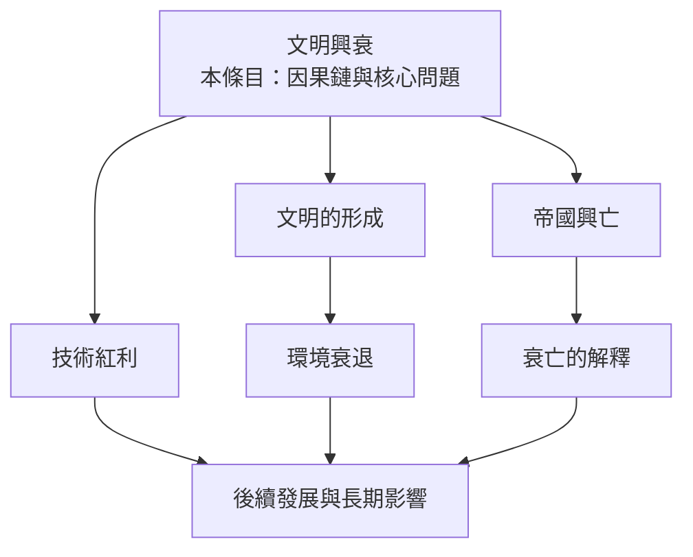

# 文明興衰

> 隸屬：第一層 [歷史](../README.md)　·　相關分類：[青銅器時代](../青銅器時代/README.md)、[鐵器時代](../鐵器時代/README.md)　·　子分類總表見 [README](README.md)

> 對應維基百科：[中文維基百科：文明](https://zh.wikipedia.org/wiki/%E6%96%87%E6%98%8E)　·　[English Wikipedia: Societal collapse](https://en.wikipedia.org/wiki/Societal_collapse)

文明興衰研究兩個對稱的問題：複雜社會如何從小型聚落長出來（興起），以及成熟的社會為何解體或急速簡化（衰落）。此處「文明」指具有城市、階級分工、專職管理者與書寫系統的社會形態；「衰亡」則指政治整合與物質複雜度的顯著下降，未必是人口滅絕。

本分類解決的敘事問題是：傳統史學以王朝與事件為主軸，容易把興衰歸因於個別君主的賢愚。把視角拉高到文明尺度，才能看出環境、技術、制度與外來衝擊如何共同決定社會的承載極限——吉本寫《羅馬帝國衰亡史》、湯恩比提出挑戰與應戰說、現代學者以氣候與生態資料重檢古典崩潰，都是這條研究脈絡的環節。

## 核心問題

本分期要回答的核心問題是：社會複雜度是一種要持續付費的投資。城市、官僚、軍隊、灌溉系統都需要剩餘產品養活；當剩餘的來源（土壤、水源、貿易路線、勞動力）萎縮而複雜度的成本仍在上升，社會就面臨岔路——收縮、改革，或解體。考古學家泰恩特（Joseph Tainter）把這概括為「複雜性的邊際報酬遞減」：每多一層制度能解決的問題越來越少，成本卻越來越高。

因此興衰研究圍繞四組變數：技術紅利（農業革命、技術擴散如何提高承載力）、環境條件（土壤、氣候、疫病如何設下上限）、制度品質（繼承規則、稅收與治理如何決定應變能力）、以及文明接觸（交流帶來養分，征服帶來斷裂）。同一套變數既能解釋美索不達米亞鹽鹼化，也能解釋羅馬西部行省的瓦解。

## 因果鏈

1. 史前聚落在沃土地帶累積農業剩餘，城市革命（人口向城鎮集中、分工專門化）啟動，國家與階級隨之出現。
2. 國家以徵稅與文字管理剩餘，帝國憑征服擴大規模，但繼承危機與分裂統一循環週期性打斷整合。
3. 農業革命與技術擴散不斷提高承載力，創新常態化（科學與專利）使部分文明跳出馬爾薩斯限制。
4. 土壤耗竭、疫病與氣候波動（如 536 年全球火山降溫事件）在薄弱制度下放大為系統性危機，資源衝突加劇。
5. 文明接觸輸送技術與作物也輸送疫病與軍事壓力；當調適失敗，社會簡化為更小更散的政治單位，直到下一次技術紅利重啟循環。

## 子分類的定位與相互驅動

### 文明的形成

史前聚落提供物質基礎，城市革命（約西元前四千紀的兩河與埃及）提供組織形態，國家與階級提供治理結構。三者依序解鎖：沒有剩餘就養不起非農人口，沒有城市就沒有專職官吏，沒有官吏就無法維持大型工程與防務。

### 帝國興亡

征服與治理是帝國的兩面：擴張靠軍事，維持靠行政與稅收。繼承危機是帝國最脆弱的時刻——羅馬三世紀危機五十年間換了約二十位皇帝，分裂與統一的循環（如中國的分合）則顯示整合成本與紅利的長期拉鋸。

### 技術紅利

農業革命（新石器時代的作物馴化到十八世紀的輪作與化肥）每一波都提高土地養人數量，技術擴散讓後發地區跳級，創新常態化（學會、專利、實驗室）則使紅利從偶發變成持續。技術紅利是唯一能長期抵銷環境衰減的力量。

### 環境衰退

土壤耗竭（兩河灌溉導致鹽鹼化）、疫病與氣候（黑死病、小冰期）與資源衝突（伐木、水權）是三大壓力源。它們本身極少單獨終結文明，但會在制度脆弱時充當「最後一根稻草」——這正是環境說必須與制度說合併使用的原因。

### 文明接觸與衰亡的解釋

文化交流傳播了冶鐵、字母與作物，強制同化與在地化則決定征服之後社會是融合還是斷裂。衰亡的解釋目前三分：環境說（資源與氣候）、制度說（統治能力衰退）、競爭說（外敵與貿易路線改變），成熟的敘事通常三者並用。

## 範例

以復活節島為例：波里尼西亞人約於西元 1200 年前後抵達，數百年間人口成長至數千至上萬，並運送數十噸的摩艾石像——這需要大量人力、木材橇具與豐盛食物，顯示社會曾高度組織。約 1600 年前後棕櫚林消失（伐木、鼠類啃食種子），居民失去造船木材，近海漁獲銳減，社會轉入雞隻圈養與內部衝突，人口銳減，石像豎立停止。此案例常被引為環境說的典型，但後續研究指出歐洲人到來後的奴隸貿易與疫病才是人口崩潰的關鍵——這場學術辯論本身，正示範了「環境說」與「競爭說」必須併陳的方法原則。

## 容易混淆之處

- 「文明衰亡等於人口消失」：多數案例是政治整合與複雜度下降，人口常存續並重組（如馬雅低地北部仍在繁榮）。
- 「環境崩潰必然導致社會崩潰」：荷蘭低地與日本江戶林政顯示制度得當可長期調適。
- 「興衰是命運循環」：湯恩比式循環論缺乏機制；現代研究偏好可檢驗的變數（承載力、繼承規則）。
- 「征服是文明終結的原因」：征服常只是壓垮已衰弱體制的最後一擊，前因在內部。

## 深入議題
- 量化驗證正在進入本領域：以湖泊沉積物的花粉分析重建植被變化、以冰芯與石筍重建降水，使『環境說』的檢驗脫離推測——自然科學與史學的方法混血是本分類的活躍前沿。
- 崩潰的定義本身有爭議：泰恩特強調衰亡是『複雜度下降』而非悲劇，部分社群在政治簡化後生活品質反而改善——『後古典繁榮』的研究正在改寫衰亡敘事的價值預設。
- 閱讀提示：本頁因果鏈給出骨架，子分類條目給出血肉，對應維基百科條目提供可查證的細節；三層閱讀由粗到細，遇到年代與人名疑義時以最後一層為準。
- 寫作體例：涉及估計值（傷亡、產量、年代區間）時一律標示『約』或『估計』，並在可行時給出區間而非單點——歷史結論的可信度取決於不確定性的誠實呈現。
- **分期是敘事工具而非自然事實**：任何切分年代都有利弊，文明興衰的起訖在史學界本就存在多種方案，敘事時宜標明所採用的標準。
- **比較史的方法陷阱**：以文明興衰為標尺衡量不同地區時，須注意各地條件差異，避免把單一地區的經驗當成普遍規律。
- **證據的層級**：一手史料、考古證據與二手詮釋的可信度不同，涉及具體年代與人名時應回到可查證的來源。
- **長時段與短時段的互補**：布勞岱式的長時段結構（地理、經濟）與事件史（人物、戰役）各有解釋力，本分類刻意兩者並用。
- **研究的前沿**：文明興衰的相關研究仍在更新，新出土資料、新統計資料或新方法（如量化史學、數位人文）都可能改寫既有結論。
- **給初學者的閱讀順序**：先掌握本頁的因果鏈，再進入子分類條目，最後以對應維基百科條目查證細節——由框架到細節，比反方向更省力。

## 與相鄰分類的關聯
- **青銅器時代**：文明興衰提供青銅器時代所需要的長時段背景，青銅器時代則回頭檢驗文明興衰敘事的因果是否成立——兩者互為對照組。
- **鐵器時代**：文明興衰提供鐵器時代所需要的長時段背景，鐵器時代則回頭檢驗文明興衰敘事的因果是否成立——兩者互為對照組。
- **歷史災難**：文明興衰提供歷史災難所需要的長時段背景，歷史災難則回頭檢驗文明興衰敘事的因果是否成立——兩者互為對照組。
- **與第一層 [歷史] 入口頁**：本分類是第一層分類樹的分支，跨分類的查詢建議先回到入口頁再下行，避免漏掉同層的相近概念。

## 概念結構圖

## 連結定義

[歷史]: ../README.md
[青銅器時代]: ../青銅器時代/README.md
[鐵器時代]: ../鐵器時代/README.md
