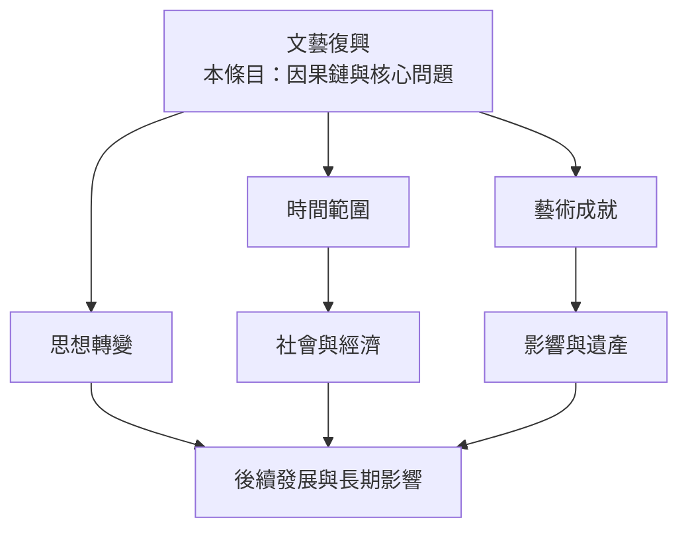

# 文藝復興

> 隸屬：第一層 [歷史](../README.md)　·　相關分類：[中世紀](../中世紀/README.md)、[科學革命](../科學革命/README.md)　·　子分類總表見 [README](README.md)

> 對應維基百科：[中文維基百科：文艺复兴](https://zh.wikipedia.org/wiki/%E6%96%87%E8%89%BA%E5%A4%8D%E5%85%B4)　·　[English Wikipedia: Renaissance](https://en.wikipedia.org/wiki/Renaissance)

文藝復興指十四至十六世紀起於義大利、擴及歐洲的文化運動：重新研讀古典希臘羅馬文本、以人為中心重新安排知識與藝術的秩序。它解決的敘事問題是：中世紀與近代之間如何過渡——「文藝復興」一詞正是史家布克哈特以降為這個過渡命名的工具，宣稱在此期間「人」從宗教框架中被重新發現。

然而這個名稱本身需要被批判地使用：「復興」（rebirth）暗示中世紀是黑暗的空白，但事實上古典文本的大量回傳（如 1400 年代人文主義者蒐抄手稿、1453 年後希臘學者攜典籍西遷）正是依賴中世紀修道院與翻譯運動的累積。本分類因此同時處理成就與神話兩面。

## 核心問題

本分期要回答：為什麼是義大利城邦、為什麼是十四世紀？答案是經濟與政治條件的特定組合。佛羅倫斯與威尼斯以毛紡與轉口貿易累積財富，銀行（如梅迪奇家族）把商業利潤轉為政治影響力；這些城市共和國沒有強大王權，富裕市民以「美術贊助」競逐聲望——資助藝術家成為展示權力的方式。布魯內萊斯基 1420 至 1436 年間為佛羅倫斯主教座堂建成巨大圓頂，兼顧古典形式與工程創新，正是這種「錢、市、藝」三方共力的產物。

因此文藝復興的核心機制可以概括為：商業財富 × 城市自治 × 古典範本 × 贊助制度。四者缺一，作品不會出現；而機制一旦運轉，就產生自我強化——名作提升城市聲望，聲望吸引更多人才與訂單，於是「文藝復興」從佛羅倫斯擴散到羅馬、威尼斯，再越過阿爾卑斯山進入北歐。

## 因果鏈

1. 中世紀後期商業復興與城市自治累積財富，義大利市民階級需要新的榮耀語言，轉向古典範本。
2. 人文主義者系統蒐抄與校勘古典文本，人文主義把修辭、歷史與道德哲學抬升為教育核心（studia humanitatis）。
3. 透視法與油畫技法把數學與材料科學帶入繪畫，藝術從行會工藝升格為知識事業；美術贊助提供經濟引擎。
4. 對古典文本與原始語言（希伯來文、希臘文）的批判性研讀，直接促發宗教改革（伊拉斯謨校勘《新約》1516 年版）。
5. 觀察與數學並重的風格由達文西傳承，經哥白尼與伽利略放大為科學革命；世俗化與科學現代化就此接續。

## 子分類的定位與相互驅動

### 時間範圍

14 至 16 世紀是通行框架，但各國進程差異極大：義大利先起，北歐晚約百年且與印刷術、宗教改革深度綁定；分期差異（如「義大利文藝復興」與「北方文藝復興」分立）提醒我們不要把單一城市經驗當成全歐時間表。

### 藝術成就

透視法（布魯內萊斯基示範、阿爾伯蒂 1435 年寫成《繪畫論》系統化）使平面能呈現三維空間；古典人文主義提供題材與審美；油畫技法（凡・艾克兄弟改良）以慢乾油彩實現層疊光影。三者合流，使繪畫從符號圖像變成「可研究的自然之窗」。

### 思想轉變

人文主義提供價值重心（人的尊嚴與現世成就），宗教改革把它導向信仰內部（個人直面經文），科學革命則把「觀察自然」制度化。三者在時間上接續、在方法上同源：都以「回到源頭、親身檢驗」為號召。

### 社會與經濟

銀行與商業（複式簿記、匯票）供養了整個文化工程，城市共和提供不受宮廷束縛的自由空氣，美術贊助把市場競爭引入藝術——藝術家從行會學徒變成有簽名的天才，這個身分轉變是現代「藝術家」概念的起點。

### 影響與遺產

科學現代化把數學化的自然觀交給後續世紀，世俗化把教育與政治從教會壟斷中釋出，跨國藝術（印刷圖冊、旅行藝術家）使風格成為可流通的商品。遺產的另一面是帝國與殖民——「文明」的標準自此也被用作支配的藉口。

## 範例

以《雅典學院》（拉斐爾，1509–1511，梵蒂岡簽字廳濕壁畫）為例：畫面把柏拉圖與亞里斯多德置於拱頂正中，兩人分別指天與指地，象徵理念論與經驗論；周圍安排蘇格拉底、第歐根尼、歐幾里得等古代哲人，而以同代人達文西、米開朗基羅的形象入畫。一幅教廷委託的作品，卻以異教哲學家為主角、以當代藝術家化身古代賢者——這正是文藝復興「古典與基督教並置、古代與當代互喻」精神的具體樣本，也顯示贊助人（教宗尤利烏斯二世）對古典主題的接受度已發生根本變化。

## 容易混淆之處

- 「文藝復興是突然的再生」：它承接中世紀大學、翻譯與商業的長期累積，「黑暗中世紀」對照是後設敘事。
- 「文藝復興等於反宗教」：多數贊助人與藝術家是虔誠信徒；世俗化是長期傾向，不是當事人的立場宣言。
- 「達文西是典型的文藝復興人」：他是極端罕見的例外，以其衡量整個時代會失真。
- 「文藝復興只發生在義大利」：北方的印刷、版畫與宗教改革同屬這場轉型的必要部分。

## 深入議題
- 女性與文藝復興是必須補上的視角：伊莎貝拉・埃斯特作為贊助人、索福尼斯瓦・安圭索拉作為宮廷畫家，顯示『文藝復興人』的定義長期偏向男性——修正中的敘事仍在進行。
- 印刷術與文藝復興的關係比『傳播工具』更深：校勘學（textual criticism）之所以可能，正是因為同一文本的多個印本可以並排比對——技術改變的不只是速度，還有學問的形態。
- 閱讀提示：本頁因果鏈給出骨架，子分類條目給出血肉，對應維基百科條目提供可查證的細節；三層閱讀由粗到細，遇到年代與人名疑義時以最後一層為準。
- 寫作體例：涉及估計值（傷亡、產量、年代區間）時一律標示『約』或『估計』，並在可行時給出區間而非單點——歷史結論的可信度取決於不確定性的誠實呈現。
- **分期是敘事工具而非自然事實**：任何切分年代都有利弊，文藝復興的起訖在史學界本就存在多種方案，敘事時宜標明所採用的標準。
- **比較史的方法陷阱**：以文藝復興為標尺衡量不同地區時，須注意各地條件差異，避免把單一地區的經驗當成普遍規律。
- **證據的層級**：一手史料、考古證據與二手詮釋的可信度不同，涉及具體年代與人名時應回到可查證的來源。
- **長時段與短時段的互補**：布勞岱式的長時段結構（地理、經濟）與事件史（人物、戰役）各有解釋力，本分類刻意兩者並用。
- **研究的前沿**：文藝復興的相關研究仍在更新，新出土資料、新統計資料或新方法（如量化史學、數位人文）都可能改寫既有結論。
- **給初學者的閱讀順序**：先掌握本頁的因果鏈，再進入子分類條目，最後以對應維基百科條目查證細節——由框架到細節，比反方向更省力。

## 與相鄰分類的關聯
- **中世紀**：文藝復興提供中世紀所需要的長時段背景，中世紀則回頭檢驗文藝復興敘事的因果是否成立——兩者互為對照組。
- **科學革命**：文藝復興提供科學革命所需要的長時段背景，科學革命則回頭檢驗文藝復興敘事的因果是否成立——兩者互為對照組。
- **大航海時代**：文藝復興提供大航海時代所需要的長時段背景，大航海時代則回頭檢驗文藝復興敘事的因果是否成立——兩者互為對照組。
- **與第一層 [歷史] 入口頁**：本分類是第一層分類樹的分支，跨分類的查詢建議先回到入口頁再下行，避免漏掉同層的相近概念。

## 概念結構圖

## 連結定義

[歷史]: ../README.md
[中世紀]: ../中世紀/README.md
[科學革命]: ../科學革命/README.md
