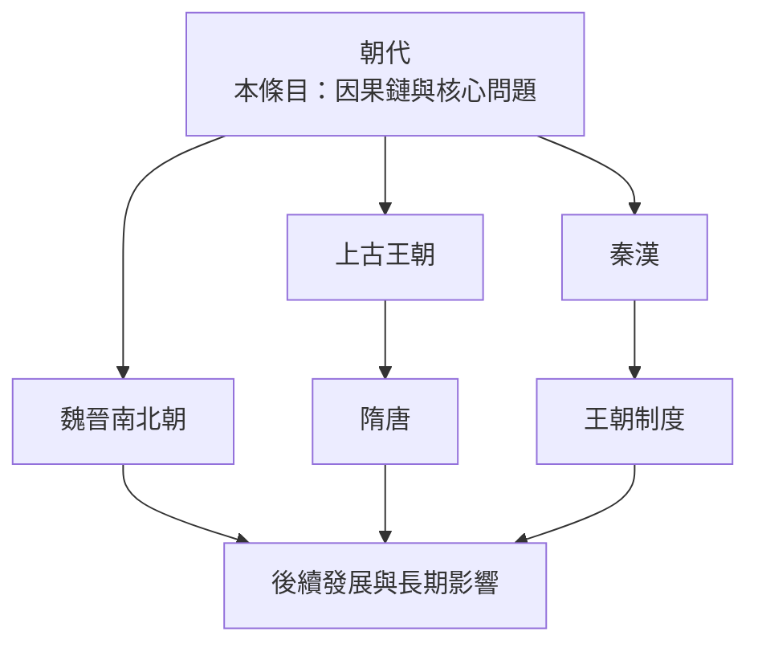

# 朝代

> 隸屬：第一層 [歷史](../README.md)　·　相關分類：[文明興衰](../文明興衰/README.md)、[考古年代學](../考古年代學/README.md)　·　子分類總表見 [README](README.md)

> 對應維基百科：[中文維基百科：朝代](https://zh.wikipedia.org/wiki/%E6%9C%9D%E4%BB%A3)　·　[English Wikipedia: Dynasty](https://en.wikipedia.org/wiki/Dynasty)

朝代（dynasty）指由同一血緣家族連續掌握君位的統治時期，也是中國史分期的基本單位。以「夏—商—周—秦—漢…」的序列敘事，解決的是一個紀年問題：在缺乏西元紀年傳統的史學裡，朝代提供了人人可用的時間座標（如「安史之亂發生在唐中期」）。

但朝代作為分期工具有內建偏差：它把「家族存續」當作歷史的斷點，於是兩漢被分為西漢東漢、宋被分為南北宋，但漢獻帝與光武帝之間的社會連續性，遠大於王莽新朝前後的斷裂；反過來，遼金元與宋並存的時代，單一「正統」敘事會掩蓋多政權並立的實況。本分類在使用朝代框架的同時，也檢視這個框架本身。

## 核心問題

本分類要回答兩個層次的問題。第一是描述層次：每個朝代的建立、盛衰與亡因是什麼？通行的解釋軸包括土地兼併、外戚宦官干政、邊族壓力與財政崩潰。第二是結構層次：為什麼中國的王朝會週期性崩解又重組（約兩三百年的「王朝循環」），而羅馬之後的西歐再未重現同等規模的整合？主流答案指向幾項中國特有的制度——世襲官僚與選官（科舉）、中央官制對軍權的拆分、以及「天命」意識形態讓改朝換代有現成的合法性劇本。

王朝制度因此是本分類的樞紐：中央官制決定政令如何下達，選官決定誰來做官，戶口與賦役決定國家能抽取多少資源。三者一旦失靈（東漢賣官、明代衛所逃亡），王朝的財政與軍事基礎就塌陷——朝代興衰說到底是這套制度的運轉與磨損史。

## 因果鏈

1. 夏商以宗教性王權整合聚落，西周以封建宗法分封諸侯，制度紅利換來三百年秩序，其後諸侯坐大。
2. 春秋戰國的戰爭競爭催生官僚制與郡縣制雛形，秦以法家路線統一，卻因動員過度二世而亡。
3. 秦漢確立「皇帝—官僚—編戶齊民」的帝國模板：西漢與之，東漢困於豪族與外戚宦官循環。
4. 魏晉南北朝（三國、兩晉、南北朝）是門閥與部族的長期均勢，隋唐以科舉與府兵重新整合，唐中期藩鎮與五代則再次拆解。
5. 宋元明清精緻化中央集權（宋代文官、元代行省、明清內閣與軍機處），財政與人口在清代同登高峰，卻在十九世紀遭遇工業化的西方而失調。

## 子分類的定位與相互驅動

### 上古王朝

夏商（二里頭與殷墟考古互證）、西周（封建宗法）、春秋戰國（禮樂秩序瓦解、百家爭鳴）構成帝國前的實驗期。上古王朝的封建制在戰國競爭中證明無法動員資源，於是為秦的郡縣制讓路——這是制度選擇的第一個分岔。

### 秦漢與魏晉南北朝

秦漢（見 [秦](秦.md)、[秦漢](秦漢.md)）確立帝國模板並輸出「大一統」意識形態；三國與兩晉顯示繼承制度失靈（外戚、宦官、八王之亂）如何引發長期分裂；魏晉南北朝的門閥政治與胡漢融合，則為隋唐的重建準備了制度與人口材料。

### 隋唐

隋（大運河、科舉創設）與唐（貞觀至開元的盛世、羈縻體系）是帝國整合的高峰；唐中期藩鎮與五代（見 [五代](五代.md)）展示軍權下放的自毀。隋唐的教訓直接塑造宋的「重文輕武」設計——制度記憶以矯枉過正的方式傳承。

### 王朝制度與君主

中央官制（三公九卿到三省六部再到內閣軍機處）一路走向君主集權，選官從察舉、九品中正到科舉，逐步把仕途從門閥手中奪回；戶口與賦役（編戶、租庸調、兩稅法、一條鞭法、攤丁入畝）記錄國家汲取技術的演進。[君主與統治者](君主與統治者.md)提供個人層次的檢驗：漢武帝、唐太宗、明太祖的作為都深刻改寫了制度，但沒有人能脫離結構獨行。

## 範例

以唐代安史之亂（755–763）為例：玄宗為經略邊疆，在緣邊設十節度使，授予范陽等鎮節度使安祿山集兵、財、政於一身的權力。755 年安祿山以十五萬兵自范陽南下，兩京陷落，玄宗奔蜀；亂事八年方平，但藩鎮割據、戶口銳減（在籍人口由五千二百餘萬跌至一千七百餘萬）成為定局。此例說明朝代興衰的典型結構：一項原本理性的邊防制度，因監察與制衡配套闕如，反過來掏空王朝——隨後宋以樞密院與禁軍制度矯正，卻付出軍事效能低落的代價。制度問題在朝代之間接力，正是王朝循環的內在紋理。

## 容易混淆之處

- 「朝代等於國家」：朝代是統治家族的任期，政權並立時（宋遼金）「一個朝代」的敘事會失真。
- 「王朝循環是宿命」：循環是制度結構的產物，清代人口與財政高峰顯示各朝表現差異巨大。
- 「夏朝已由考古證實」：二里頭遺址與文獻夏的對應尚有爭議，敘事需區分文獻與考古證據。
- 「亡國必因昏君」：明亡牽涉小冰期、白銀波動與財政崩潰，崇禎的決策只是其一環。

## 深入議題
- 『唐宋變革』說（內藤湖南）主張唐宋之間發生從貴族社會到平民社會的結構斷裂，是漢學界爭論數十年的分期命題——朝代框架與社會結構框架在此正面交鋒。
- 游牧政權的視角：遼、金、元、清都不是『外來插曲』，新清史與內亞轉向提醒我們，以農耕王朝為正統的敘事會漏掉一半的帝國經驗。
- 閱讀提示：本頁因果鏈給出骨架，子分類條目給出血肉，對應維基百科條目提供可查證的細節；三層閱讀由粗到細，遇到年代與人名疑義時以最後一層為準。
- 寫作體例：涉及估計值（傷亡、產量、年代區間）時一律標示『約』或『估計』，並在可行時給出區間而非單點——歷史結論的可信度取決於不確定性的誠實呈現。
- **分期是敘事工具而非自然事實**：任何切分年代都有利弊，朝代的起訖在史學界本就存在多種方案，敘事時宜標明所採用的標準。
- **比較史的方法陷阱**：以朝代為標尺衡量不同地區時，須注意各地條件差異，避免把單一地區的經驗當成普遍規律。
- **證據的層級**：一手史料、考古證據與二手詮釋的可信度不同，涉及具體年代與人名時應回到可查證的來源。
- **長時段與短時段的互補**：布勞岱式的長時段結構（地理、經濟）與事件史（人物、戰役）各有解釋力，本分類刻意兩者並用。
- **研究的前沿**：朝代的相關研究仍在更新，新出土資料、新統計資料或新方法（如量化史學、數位人文）都可能改寫既有結論。
- **給初學者的閱讀順序**：先掌握本頁的因果鏈，再進入子分類條目，最後以對應維基百科條目查證細節——由框架到細節，比反方向更省力。

## 與相鄰分類的關聯
- **文明興衰**：朝代提供文明興衰所需要的長時段背景，文明興衰則回頭檢驗朝代敘事的因果是否成立——兩者互為對照組。
- **考古年代學**：朝代提供考古年代學所需要的長時段背景，考古年代學則回頭檢驗朝代敘事的因果是否成立——兩者互為對照組。
- **戰爭史**：朝代提供戰爭史所需要的長時段背景，戰爭史則回頭檢驗朝代敘事的因果是否成立——兩者互為對照組。
- **與第一層 [歷史] 入口頁**：本分類是第一層分類樹的分支，跨分類的查詢建議先回到入口頁再下行，避免漏掉同層的相近概念。

## 概念結構圖

## 連結定義

[歷史]: ../README.md
[文明興衰]: ../文明興衰/README.md
[考古年代學]: ../考古年代學/README.md
[秦]: 秦.md
[秦漢]: 秦漢.md
[五代]: 五代.md
[君主與統治者]: 君主與統治者.md
