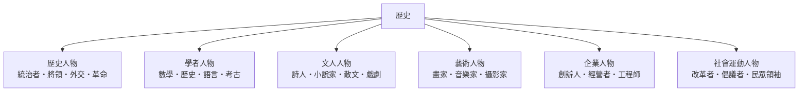

# 歷史

> 分類範圍：以歷史學的研究者與歷史人物群像為核心的分類部門——君主與統治者、將領與軍事統帥、外交官與使節、革命領袖，以及學者、文人、藝術與企業人物——並說明史料與詮釋如何共同構成歷史知識。　·　隸屬第一層：[人]　·　相關分類：[世界史]、[國別史]、[考古年代學]　·　子分類總表見 [README]

> 對應維基百科：[中文維基百科：历史学](https://zh.wikipedia.org/wiki/%E5%8E%86%E5%8F%B2%E5%AD%A6)　·　[English Wikipedia: History](https://en.wikipedia.org/wiki/History)

歷史部門研究**過去如何被研究**：史料從何而來、考證如何進行、詮釋如何受當代影響。它同時收錄在歷史上留下印記的人——統治者、將領、外交官、革命者、學者、文人與企業家——因為歷史知識的原料正是他們的行動與留下的文本。本概念的問題是：**人如何成為史料，而史料如何成為歷史**。

## 核心問題：史料的層次

歷史材料的可靠性可分三層：

1. **一手史料**：當時留下的文本、器物、遺址與口述——證據本身，但會受記錄者的位置與目的影響。
2. **二手敘述**：後來的整理、編年與研究——需追溯其引用的一手材料。
3. **詮釋**：因果框架與論述——最易受當代問題意識影響，也最需要被檢視。

成熟的歷史學訓練，本質上是**不斷把結論往證據層回推**的能力。

## 因果鏈

1. **檔案與史料的制度化**：檔案館、博物館與口述史蒐集，使「過去」成為可被研究的對象。
2. **考證與年表的建立**：文字學、金石學、碳十四測年與古地磁，把散落的材料接成一條時間軸。
3. **專業史學的成形**：大學科系、專業期刊與同儕評審，讓歷史學成為有方法規範的學科。
4. **口述史與微觀史**：把注意力從帝王將相移到普通人的日常，使史料結構改變。
5. **後現代與後殖民的反思**：史料的沉默與偏誤被納入分析，歷史學的方法論因此持續修正。

## 子分類的定位與相互驅動

- [歷史人物] 是歷史的行動面：權力、戰爭、外交與革命的承載者。
- 學者、文人、藝術與企業人物提供**觀察者與創造者**的視角——制度、文本、作品與組織同樣是史料。
- 社會運動人物提醒：歷史的變動往往由被動員的集體推動，而非單一人物。

## 範例：一則史料的完整處理鏈

以一份十八世紀的貿易契約為例：

1. **取得**：確認紙張纖維、墨料與騎縫章，判斷是否為原件而非後摹。
2. **釋讀**：辨認字體與古拉丁文地名，比對其他文書的同一表述。
3. **定位**：以船期、關稅表與公司帳冊交叉斷定日期與地點。
4. **比較**：與同類契約、議價紀錄對照，估計價格是否屬常態。
5. **詮釋**：連結同期航海與殖民制度，說明契約背後的權力關係。
6. **書寫**：在敘述中標明哪些是文件明載、哪些是研究者推斷——**史料與詮釋的分層，是歷史寫作的基本倫理**。

## 容易混淆之處

- **歷史不等於過去本身**：歷史是被研究、被敘述的過去，敘述總會带上當代的問題意識。
- **史料豐富不等於解釋正確**：檔案多的是記錄權力者的機構，沉默者的聲音需要靠其他方法補。
- **年代對齊是理解的基礎**：同一事件在不同地區的曆法不同，未換算的年表會造成虛假的先後關係。
- **人物評價不是道德判決**：把後世價值直接套在古人身上，是歷史寫作最常見的失真。

## 技術要點

- **檔案的批判閱讀**：檔案反映的是記錄機構的職能與偏向，非「真相本身」。
- **內證與外證**：文本內容與形式（紙張、墨、格式、簽押）互相支持或互相矛盾。
- **年代學工具**：碳十四、熱釋光、古地磁與樹輪校正共同建立時間框架。
- **口述史的運用**：記憶是重建的素材，需標明受訪者的位置與敘述結構。
- **論述分析**：辨認被強調與被省略的內容，可看出史料背後的權力關係。
- **註釋與引用規範**：註明出處、版本與頁碼，是後人覆核的唯一基礎。

## 常見的論爭

1. **史學與政治的關係**：國家敘事、認同政治與史學專業化的拉扯，在各國持續上演。
2. **數位人文與演算法**：文本探勘能大規模統計，卻可能犧牲個案細節與詮釋深度。
3. **口述史的代表性**：受訪者的選擇本身就是一種偏誤，抽樣與代表性問題至今沒有標準解。

## 延伸閱讀

- [歷史人物]：本概念的主軸條目。
- [世界史]、[國別史]：主要的敘事框架。
- [考古年代學]：絕對與相對年代的技術基礎。
- [文獻保存]：史料的保存制度。

## 連結定義

[人]: ../人/README.md
[README]: README.md
[世界史]: ../世界史/README.md
[國別史]: ../國別史/README.md
[考古年代學]: ../考古年代學/README.md
[文獻保存]: ../文獻保存/README.md
[歷史人物]: 歷史人物.md

- **延伸參考**：相關專著與通史，是深入理解本主題的入口。

- **延伸參考**：通史著作與史料選讀，是進入本領域的常規路徑。
- **方法提示**：引用史料時應標明版本、年代與出處，否則後人無法覆核。
