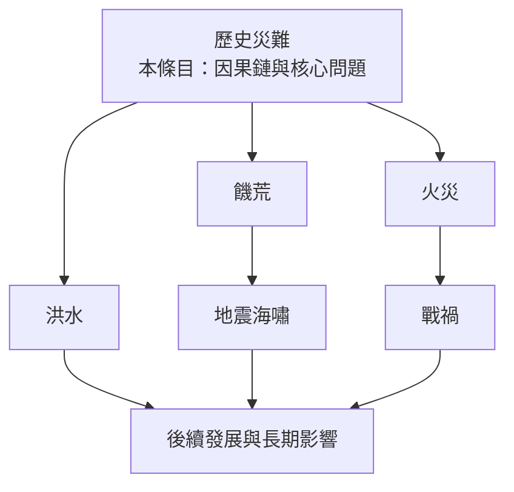

# 歷史災難

> 隸屬：第一層 [歷史](../README.md)　·　相關分類：[文明興衰](../文明興衰/README.md)、[戰爭史](../戰爭史/README.md)　·　子分類總表見 [README](README.md)

> 對應維基百科：[中文維基百科：自然灾害](https://zh.wikipedia.org/wiki/%E8%87%AA%E7%84%B6%E7%81%BE%E5%AE%B3)　·　[English Wikipedia: Natural disaster](https://en.wikipedia.org/wiki/Natural_disaster)

歷史災難研究對人類社會造成大規模傷亡與財產損失的災害事件——饑荒、火災、洪水、地震海嘯，以及人為的戰禍——在歷史進程中的位置。它解決的敘事問題是：傳統史學以戰爭與政治為主軸，但許多時代的轉折其實由災害驅動（黑死病改寫十四世紀歐洲勞動市場），若不系統處理災難，因果鏈會缺一大段。

「災難」的定義必須放在社會脈絡裡：地震本身是自然現象，「災難」是地震與脆弱的房屋、疏散體系相遇的結果。因此本分類不只記錄事件，也記錄「為什麼同一強度的災害在不同時代死傷如此懸殊」——這正是災害史與救災制度研究的交會點。

## 核心問題

本分期要回答：災難如何成為歷史的驅動力？有三條主要路徑。第一是人口路徑：大災害急遽減少人口，改變勞動力稀缺度，進而改變階級議價（黑死病後西歐工資上漲、農奴制鬆動）。第二是政治路徑：救災成敗直接影響政權正當性（清代「盛世滋生人丁」的承諾在道光大饑荒中破產；1931 年江淮水災削弱國民政府威信）。第三是知識路徑：1755 年里斯本地震引發「天譴論」危機，伏爾泰《老實人》質疑樂觀主義，現代地震學與世俗災害觀由此萌芽。

因此歷史災難的核心分析框架是「致災因子 × 脆弱性」：同一因子（旱、澇、震），在制度健全的社會只造成經濟損失，在儲備耗竭、資訊封鎖的社會則演變為數百萬人死亡的災難。研究歷史災難，等於研究各社會的脆弱性結構。

## 因果鏈

1. 農業社會的糧食安全繫於單一季候，氣候波動（旱、澇、寒）首先轉為歉收。
2. 歉收加上運輸阻絕、儲備不足或戰亂，升級為饑荒——愛爾蘭大饑荒（1845–1852）即「馬鈴薯晚疫病 × 殖民地單一作物 × 教條式自由貿易政策」的複合產物。
3. 高密度城市使火災與洪水成為系統性風險：倫敦大火（1666）燒毀城內約一萬三千餘棟房屋，卻催生了磚石建築法規與現代火險業。
4. 地震海嘯沿板塊斷層週期性重擊人口帶：1755 里斯本、1920 汾州（約二十萬人死亡，二十世紀最致命地震之一）、2011 日本東北（海嘯引發福島核災）。
5. 人為戰禍與災難互為放大器：圍城、焦土與封鎖把戰爭轉為饑荒；災後資源爭奪又常引發衝突。現代救災體系（國際法、保險、預警）正是這些教訓的制度化累積。

## 子分類的定位與相互驅動

### 饑荒

愛爾蘭大饑荒（死亡逾百萬、移民逾百萬）示範「作物病害 × 政策」的致命組合；中國饑荒記錄了氣候與治理的長期拉鋸；華北旱災（1876–1879 年丁戊奇荒，死亡估逾千萬）顯示鐵路未達與賑濟體系缺失的代價。饑荒研究直接推動了阿馬蒂亞・森的「饑荒是權利失效」理論。

### 火災

倫敦大火促成 1667 年《重建法》與現代消防制度，芝加哥大火（1871）推動鋼骨與防火規範，森林大火（如 1871 年威斯康辛佩什蒂戈大火）則提醒：城市化與林業政策本身製造新風險。火災史是「災難驅動法規」最清晰的樣本。

### 洪水

黃河決口（1855 年銅瓦廂改道使河道北徙，改寫華北水系）顯示大型水利工程的自反性；1931 年江淮水災是二十世紀最致命的自然災害之一，死亡估計數十萬乃至上百萬；歐洲洪水（如 1953 年北海風暴潮）則推動了荷蘭三角洲工程等系統性防禦。

### 地震海嘯

1755 里斯本（約三萬人死亡、城市盡毀）開啟地震學與神義論辯論；1920 汾州（海原）地震在黃土窯洞區造成災難性塌陷；2011 日本地震引發的海嘯與核事故，則把「複合型災害」與長期核安全問題推入議程。三次事件相距一個半世紀，恰好對照出預警、建築法規與應急體系的進化。

### 戰禍

三次大規模戰爭（兩次世界大戰與其間的區域戰爭）造成的死亡遠超同世紀自然災害；屠城（揚州、南京等）記錄戰爭暴力的極限；戰後饑荒（如 1945 年後的歐亞糧荒）顯示「人禍」常以「天災」的形式收尾。戰禍研究與戰爭史互相供給材料。

## 範例

以 1755 年 11 月 1 日里斯本地震為例：諸聖節上午，教堂擠滿信眾時強震襲擊，隨後海嘯與連燒數日的大火接連而至，死亡人數估計三萬上下。首相龐巴爾侯爵以「埋葬與餵養優先、重建隨後」的鐵腕救災聞名，並向各教區發放問卷記錄震感——被視為現代地震調查的先聲。思想界同時震動：伏爾泰以此事件寫《老實人》反駁「一切皆善」的樂觀主義，盧梭則指出城市高度集中本身即是脆弱性。一場自然事件，同時推動了科學方法、救災行政與世俗哲學——這正是「災難驅動後續研究」的完整樣本。

## 容易混淆之處

- 「災難死亡數字是精確的」：歷史災害死亡數多是後世估計，區間寬，引用時須標示不確定性。
- 「天災與人禍可以二分」：多數大災難是自然因子與社會脆弱性的複合（饑荒尤其如此）。
- 「災難只帶來倒退」：倫敦大火後的建築法規、里斯本後的地震學顯示災難常催生制度與知識。
- 「現代技術已消除災難風險」：人口向海岸與斷層帶集中，暴露量反而上升，風險形態在變而非消失。

## 深入議題
- 饑荒的政治經濟學：森（Amartya Sen）以孟加拉 1943 年大饑荒論證『饑荒發生於民主失效』——糧食總量充足而分配失效，此框架成為發展經濟學的支柱之一。
- 災害記憶與韌性：日本的『津波石』碑與『防火線』城市規劃顯示，社會可以把災難經驗制度化解碼為空間與儀式——災害史因此也研究『遺忘』。
- 閱讀提示：本頁因果鏈給出骨架，子分類條目給出血肉，對應維基百科條目提供可查證的細節；三層閱讀由粗到細，遇到年代與人名疑義時以最後一層為準。
- 寫作體例：涉及估計值（傷亡、產量、年代區間）時一律標示『約』或『估計』，並在可行時給出區間而非單點——歷史結論的可信度取決於不確定性的誠實呈現。
- **分期是敘事工具而非自然事實**：任何切分年代都有利弊，歷史災難的起訖在史學界本就存在多種方案，敘事時宜標明所採用的標準。
- **比較史的方法陷阱**：以歷史災難為標尺衡量不同地區時，須注意各地條件差異，避免把單一地區的經驗當成普遍規律。
- **證據的層級**：一手史料、考古證據與二手詮釋的可信度不同，涉及具體年代與人名時應回到可查證的來源。
- **長時段與短時段的互補**：布勞岱式的長時段結構（地理、經濟）與事件史（人物、戰役）各有解釋力，本分類刻意兩者並用。
- **研究的前沿**：歷史災難的相關研究仍在更新，新出土資料、新統計資料或新方法（如量化史學、數位人文）都可能改寫既有結論。
- **給初學者的閱讀順序**：先掌握本頁的因果鏈，再進入子分類條目，最後以對應維基百科條目查證細節——由框架到細節，比反方向更省力。

## 與相鄰分類的關聯
- **文明興衰**：歷史災難提供文明興衰所需要的長時段背景，文明興衰則回頭檢驗歷史災難敘事的因果是否成立——兩者互為對照組。
- **戰爭史**：歷史災難提供戰爭史所需要的長時段背景，戰爭史則回頭檢驗歷史災難敘事的因果是否成立——兩者互為對照組。
- **大航海時代**：歷史災難提供大航海時代所需要的長時段背景，大航海時代則回頭檢驗歷史災難敘事的因果是否成立——兩者互為對照組。
- **與第一層 [歷史] 入口頁**：本分類是第一層分類樹的分支，跨分類的查詢建議先回到入口頁再下行，避免漏掉同層的相近概念。

## 概念結構圖

## 連結定義

[歷史]: ../README.md
[文明興衰]: ../文明興衰/README.md
[戰爭史]: ../戰爭史/README.md
