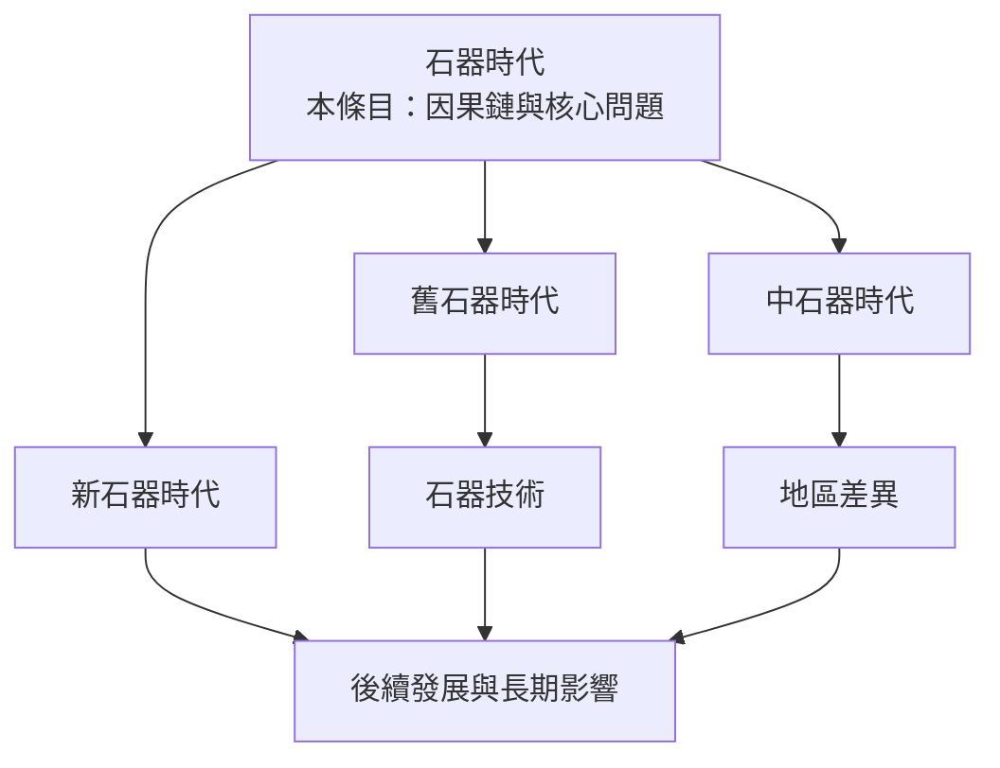

# 石器時代

> 隸屬：第一層 [歷史](../README.md)　·　相關分類：[青銅器時代](../青銅器時代/README.md)、[鐵器時代](../鐵器時代/README.md)　·　子分類總表見 [README](README.md)

> 對應維基百科：[中文維基百科：石器時代](https://zh.wikipedia.org/wiki/%E7%9F%B3%E5%99%A8%E6%99%82%E4%BB%A3)　·　[English Wikipedia: Stone Age](https://en.wikipedia.org/wiki/Stone_Age)

石器時代是人類史的最長段落——從約三百多萬年前最早的石器到金屬工具普及，佔人類歷史的九成九以上。它以「三時代法」（石器、青銅、鐵）為首段：1810 年代丹麥學者湯姆森在國家博物館按工具材質分層陳列，首次讓史前史有了可操作的分期依據，解決了「沒有文字的過去如何敘事」的問題。

石器時代內部再分為舊石器（打製石器、獵採經濟）、中石器（冰期末的過渡）與新石器（磨製石器、農業起源、陶器）。三段的分界不只是工具技術，更是經濟方式的更替——從依賴野生資源到自主生產食物，這是物種史上最大的生活方式變革之一。

## 核心問題

本分期要回答：考古學家如何從石頭讀出歷史？方法是「操作鏈」（chaîne opératoire）分析——從原料採集、打片步驟到使用與廢棄，重建每個環節，據此推斷製作者的技術能力、教學傳承甚至移動路線。例如阿舍利手斧的對稱性顯示幾何概念與神經控制能力；勒瓦婁哇技術（預先修整石核再剝取規格化石片）顯示抽象的計畫能力。石器因此是史前認知演化的硬證據。

分期依據則有兩套：技術（打製對磨製）與經濟（獵採對農耕）。兩者大體對應但不重合——近東農業出現時磨製石器尚未普及，日本繩文時代磨製石器與獵採並存。因此本分類在敘事上保持兩套標準並列，避免「技術單線演化」的誤導。

## 因果鏈

1. 約三百萬年前東非出現最早的打製石器（奧杜威工業），擴大食性範圍，支持腦容量增長。
2. 約一百七十萬年前阿舍利手斧傳播至非洲—歐亞；約三十萬年前勒瓦婁哇技術與智人的出現相互映照。
3. 舊石器晚期（約五萬年前起）象徵性爆炸：洞穴遺址（拉斯科、阿爾塔米拉）、骨器與遠距離交換網絡顯示語言與社會複雜化。
4. 末次冰期結束（約一萬一千年前），中石器時代的細石器與沿海聚落因資源帶移動而興起，半遊牧成為普遍策略。
5. 新石器革命：約一萬年前的肥沃月彎、約八千年前後的中國與中美洲各自馴化作物，農業起源帶來定居、人口成長、陶器與社會分化，最終導向青銅器時代的複雜社會。

## 子分類的定位與相互驅動

### 舊石器時代

打製石器是技術載體，獵採經濟是組織方式（小規模流動群、分享規則），洞穴遺址（同時是居址與藝術空間）提供行為證據。三者的搭配顯示：舊石器人類已具備計畫、教學與象徵思維，並非「原始」的同義詞。

### 中石器時代

細石器（小型規格化石刃，可鑲嵌於骨柄）提高材料效率，沿海聚落（貝塚）記錄對水生資源的開發，半遊牧反映季節性移動的彈性。中石器是「舊的經濟、新的環境」的調適期，常被忽視卻是理解農業起源的關鍵背景。

### 新石器時代

磨製石器適合墾土與木作，農業起源改寫人口與社會結構（定居→人口成長→村落→分層），陶器則是儲存、烹煮與早期「風格」的載體。新石器技術與經濟互相鎖定：沒有定居就難以累積笨重陶器，沒有富餘就無從支撐專職工匠。

### 石器技術

打製技術（直接錘擊、間接打擊、壓剝）、石片技術（以石片為工具主體的傳統，東亞常見）與磨製技術（費工但耐久、可修鈍重磨）構成技術光譜。技術分類讓不同遺址可跨時代比較，是三時代法之外的精細化工具。

### 地區差異

東亞舊石器以石片傳統著稱（與歐洲手斧傳統的差異至今仍在解釋），歐洲舊石器因研究傳統深厚而成為分期標尺（舍利、阿舍利、莫斯特、奧瑞納…），非洲舊石器則不斷提供最早的證據（如摩洛哥傑貝依羅胡約三十萬年前的智人化石與石器）。地區比較防止分期框架被歐洲經驗壟斷。

## 範例

以法國拉斯科洞穴（約一萬七千年前）為例：洞內繪有六百餘幅彩繪與一千五百餘幅線刻，以礦物顏料（氧化鐵、二氧化錳）配合油脂繪製，題材以野馬、野牛、鹿為主，其中「大黑牛」長逾五公尺。作畫需搭建腳手架、調配顏料、在照明有限的深處工作——這是一場需要分工與計畫的集體工程。拉斯科顯示：尚未擁有農業與金屬的人類，已具備象徵思維、美學投入與社會動員能力。這一證據直接反駁「石器時代等於野蠻」的直覺，也是舊石器晚期「象徵性爆炸」的代表作。

## 容易混淆之處

- 「石器時代的人只用石器」：木、骨、角、纖維同樣重要，只因易腐而罕存；石器只是倖存的證據。
- 「三時代適用於全世界」：澳洲原住民與部分美洲社會未曾進入金屬時代，「時代」不必然是單線階梯。
- 「舊石器與新石器由年份切分」：分界是經濟方式（農業）與技術（磨製）的局部出現，各地時間相差數千年。
- 「農業一定改善生活」：早期農民骨骼顯示營養與疾病負擔加重；農業的好處是長期的人口與社會可能性。

## 深入議題
- 基因組革命改寫了石器時代的敘事：古 DNA 顯示尼安德塔人與智人有混血、農民與採集者在歐洲層層混合——『取代』的簡單劇本已被『混合』取代。
- 實驗考古（以燧石複製打製、以原始犁複製墾殖）把石器研究從『看』升級為『做』：工匠的肌肉記憶與失敗率，是文字記錄永遠不會提供的證據。
- 閱讀提示：本頁因果鏈給出骨架，子分類條目給出血肉，對應維基百科條目提供可查證的細節；三層閱讀由粗到細，遇到年代與人名疑義時以最後一層為準。
- 寫作體例：涉及估計值（傷亡、產量、年代區間）時一律標示『約』或『估計』，並在可行時給出區間而非單點——歷史結論的可信度取決於不確定性的誠實呈現。
- **分期是敘事工具而非自然事實**：任何切分年代都有利弊，石器時代的起訖在史學界本就存在多種方案，敘事時宜標明所採用的標準。
- **比較史的方法陷阱**：以石器時代為標尺衡量不同地區時，須注意各地條件差異，避免把單一地區的經驗當成普遍規律。
- **證據的層級**：一手史料、考古證據與二手詮釋的可信度不同，涉及具體年代與人名時應回到可查證的來源。
- **長時段與短時段的互補**：布勞岱式的長時段結構（地理、經濟）與事件史（人物、戰役）各有解釋力，本分類刻意兩者並用。
- **研究的前沿**：石器時代的相關研究仍在更新，新出土資料、新統計資料或新方法（如量化史學、數位人文）都可能改寫既有結論。
- **給初學者的閱讀順序**：先掌握本頁的因果鏈，再進入子分類條目，最後以對應維基百科條目查證細節——由框架到細節，比反方向更省力。

## 與相鄰分類的關聯
- **青銅器時代**：石器時代提供青銅器時代所需要的長時段背景，青銅器時代則回頭檢驗石器時代敘事的因果是否成立——兩者互為對照組。
- **鐵器時代**：石器時代提供鐵器時代所需要的長時段背景，鐵器時代則回頭檢驗石器時代敘事的因果是否成立——兩者互為對照組。
- **考古年代學**：石器時代提供考古年代學所需要的長時段背景，考古年代學則回頭檢驗石器時代敘事的因果是否成立——兩者互為對照組。
- **與第一層 [歷史] 入口頁**：本分類是第一層分類樹的分支，跨分類的查詢建議先回到入口頁再下行，避免漏掉同層的相近概念。

## 概念結構圖

## 連結定義

[歷史]: ../README.md
[青銅器時代]: ../青銅器時代/README.md
[鐵器時代]: ../鐵器時代/README.md
