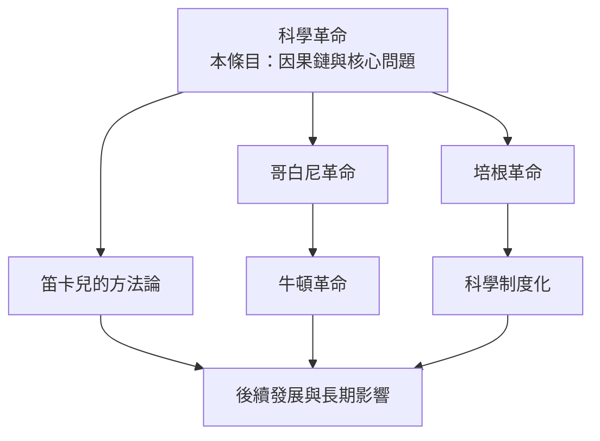

# 科學革命

> 隸屬：第一層 [歷史](../README.md)　·　相關分類：[文藝復興](../文藝復興/README.md)、[工業革命](../工業革命/README.md)　·　子分類總表見 [README](README.md)

> 對應維基百科：[中文維基百科：科学革命](https://zh.wikipedia.org/wiki/%E7%A7%91%E5%AD%A6%E9%9D%A9%E5%91%BD)　·　[English Wikipedia: Scientific Revolution](https://en.wikipedia.org/wiki/Scientific_Revolution)

科學革命指約 1543 年（哥白尼《天體運行論》）至 1687 年（牛頓《原理》）之間，歐洲知識界以數學、觀察與實驗重構自然認識的運動。它解決的敘事問題是：古代權威（亞里斯多德、蓋倫）的知識體系為何、如何被替換——答案是一套新的知識方法（數學化、實驗化、可重複驗證）取代了引經據典的注釋傳統。

「革命」一詞由孔多塞與柯瓦雷等史家定調，但也有修正意見：占星術、煉金術與宗教動機（牛頓的神學研究）同屬當事人的知識世界，新舊方法是長期共存而非瞬間替換。本分類在敘述成就的同時保留這層複雜性。

## 核心問題

本分期要回答：為什麼這場替換發生在此時的歐洲？條件包括——文藝復興的人文主義使人重讀原始文本並發現權威彼此矛盾；印刷術使數據與圖表可精確複製；大航海帶來新大陸動植物，證明古籍並未窮盡世界；宗教改革削弱了單一權威；數學教育（商業算術、代數）培養了量化習慣。天文學是突破口，因為它有精確數據（第谷的觀測）、有明顯的理論矛盾（托勒密體系的補丁越來越多）、且預測直接服務於曆法與占星。

科學革命的方法論核心可壓縮為兩句：宇宙以數學寫成（伽利略），知識以實驗與歸納重建（培根）。兩者分別處理「自然可否被認識」與「如何認識」，由笛卡兒與牛頓以不同路線整合為機械論世界觀。

## 因果鏈

1. 哥白尼以日心說簡化行星運動計算（1543），起初只是技術性假說，卻把「地球是否特殊」變成可辯論的問題。
2. 第谷的精確觀測由克卜勒轉為橢圓軌道定律（1609、1619），理論與數據首次嚴絲合縫。
3. 伽利略以望遠鏡觀測（1610）展示木星衛星與月面起伏，並以實驗與理想化方法為力學奠基；教會衝突（1633 年審判）顯示新知識與權威體制的張力。
4. 培根提出歸納法與實驗綱領，笛卡兒以懷疑方法與演繹推理建立另翼路徑，兩者共同訓練出「方法自覺」。
5. 牛頓以萬有引力與微積分統一天地力學（1687），機械論世界確立；學院與學會、期刊、實驗室隨之把知識生產制度化，工業革命的技術土壤由此累積。

## 子分類的定位與相互驅動

### 哥白尼革命

日心說解決了行星逆行的幾何尷尬，數學化宇宙把天文學從「解釋現象」升級為「預測位置」，教會衝突則迫使新知識思考自身與信仰的界線（伽利略區分《聖經》教導「如何上天堂」而非「天如何運行」）。哥白尼革命的真正遺產是方法論的示範：數據可以否決常識與權威。

### 培根革命

歸納法（從重複觀察上升到一般結論，並以反例檢驗）與實驗科學（人工安排條件以逼問自然）把知識生產變成有程序的工程，自然哲學的目標也從「理解永恆本質」轉為「認識自然以支配自然」。培根綱領直接催生了皇家學會（1660）的實驗文化。

### 笛卡兒的方法論

演繹推理（從明晰自明的公理推出結論）、懷疑方法（凡可疑者暫判為假，直到找到不可懷疑者）與心物區分（物質世界是完全的機械，心靈另屬一域）為機械論提供哲學基礎。培根與笛卡兒分別代表經驗與理性兩翼，牛頓的「不杜撰假說、以現象歸納」是兩翼的合流。

### 牛頓革命

萬有引力把蘋果落體與月球繞地統一進同一條 $F = G \dfrac{m_1 m_2}{r^2}$ ，微積分提供處理連續變化的數學語言，機械論世界則宣稱：只要知道初始條件與定律，宇宙就是可計算的。這套世界觀統治自然科學兩百年，也塑造了啟蒙時代對社會「定律」的想像。

### 科學制度化

學院與學會（倫敦皇家學會 1660、法國科學院 1666）提供評議與優先權認定，期刊（《哲學會刊》1665 起）使成果可公開累積，實驗室把實驗從個人奇觀變成可複製的常規。制度化使革命成果不再依賴個別天才——這正是科學革命能持續為工業革命供血的原因。

## 範例

以海王星的發現（1846）為例：勒維耶分析天王星軌道的殘差，依牛頓力學計算出未知行星應在的位置，柏林天文台伽勒在他指示的度數附近一小時內找到海王星，偏差不足一度。雖然晚於科學革命兩百年，這件事是牛頓範式的加冕禮：一顆肉眼從未見過的行星，先被紙筆「發現」再被望遠鏡確認。它示範了科學革命確立的方法鏈——精確觀測、數學模型、可檢驗預測、公開驗證——如何讓知識的成長變成可以排程的日常事務。

## 容易混淆之處

- 「科學革命是反宗教的」：牛頓、波以耳都是虔誠信徒；衝突存在（伽利略案），但宗教動機同樣驅動研究。
- 「哥白尼立即改變一切」：日心說最初預測精度並不勝出，其勝利要等到克卜勒與伽利略之後。
- 「培根與笛卡兒對立」：英國經驗論與大陸理性論是重點不同，實際科學實踐兩者並用。
- 「牛頓發明微積分無爭議」：與萊布尼茲的優先權之爭持續終身，兩人記號體系各有淵源。

## 深入議題
- 『科學革命是否存在』的後設辯論：夏平（Steven Shapin）以『根本沒有那樣一場革命』刺探既定敘事，逼史學界區分『當事人沒這樣自稱』與『事後建構的分期』兩個層面。
- 儀器史是革命的隱骨架：望遠鏡、顯微鏡、氣壓計與真空泵把『感官的延伸』變成公共證據——誰能操作儀器、誰能見證實驗，決定了誰的知識算數。
- 閱讀提示：本頁因果鏈給出骨架，子分類條目給出血肉，對應維基百科條目提供可查證的細節；三層閱讀由粗到細，遇到年代與人名疑義時以最後一層為準。
- 寫作體例：涉及估計值（傷亡、產量、年代區間）時一律標示『約』或『估計』，並在可行時給出區間而非單點——歷史結論的可信度取決於不確定性的誠實呈現。
- **分期是敘事工具而非自然事實**：任何切分年代都有利弊，科學革命的起訖在史學界本就存在多種方案，敘事時宜標明所採用的標準。
- **比較史的方法陷阱**：以科學革命為標尺衡量不同地區時，須注意各地條件差異，避免把單一地區的經驗當成普遍規律。
- **證據的層級**：一手史料、考古證據與二手詮釋的可信度不同，涉及具體年代與人名時應回到可查證的來源。
- **長時段與短時段的互補**：布勞岱式的長時段結構（地理、經濟）與事件史（人物、戰役）各有解釋力，本分類刻意兩者並用。
- **研究的前沿**：科學革命的相關研究仍在更新，新出土資料、新統計資料或新方法（如量化史學、數位人文）都可能改寫既有結論。
- **給初學者的閱讀順序**：先掌握本頁的因果鏈，再進入子分類條目，最後以對應維基百科條目查證細節——由框架到細節，比反方向更省力。

## 與相鄰分類的關聯
- **文藝復興**：科學革命提供文藝復興所需要的長時段背景，文藝復興則回頭檢驗科學革命敘事的因果是否成立——兩者互為對照組。
- **工業革命**：科學革命提供工業革命所需要的長時段背景，工業革命則回頭檢驗科學革命敘事的因果是否成立——兩者互為對照組。
- **資訊時代**：科學革命提供資訊時代所需要的長時段背景，資訊時代則回頭檢驗科學革命敘事的因果是否成立——兩者互為對照組。
- **與第一層 [歷史] 入口頁**：本分類是第一層分類樹的分支，跨分類的查詢建議先回到入口頁再下行，避免漏掉同層的相近概念。

## 概念結構圖

## 連結定義

[歷史]: ../README.md
[文藝復興]: ../文藝復興/README.md
[工業革命]: ../工業革命/README.md
