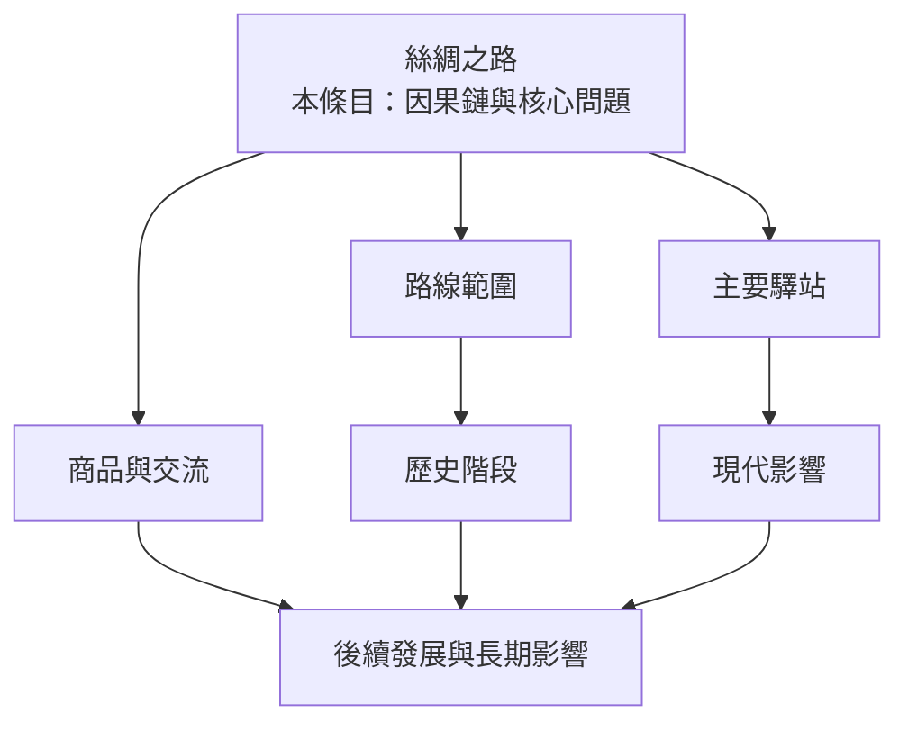

# 絲綢之路

> 隸屬：第一層 [歷史](../README.md)　·　相關分類：[大航海時代](../大航海時代/README.md)、[文明興衰](../文明興衰/README.md)　·　子分類總表見 [README](README.md)

> 對應維基百科：[中文維基百科：丝绸之路](https://zh.wikipedia.org/wiki/%E4%B8%9D%E7%BB%B8%E4%B9%8B%E8%B7%AF)　·　[English Wikipedia: Silk Road](https://en.wikipedia.org/wiki/Silk_Road)

絲綢之路指連接東亞、中亞、西亞與地中海世界的陸海貿易網絡，活躍期約自西元前二世紀至十五世紀。它解決的敘事問題是：在歐亞大陸還沒有統一政權的時代，商品、技術與思想如何跨越數千公里流動——答案是靠一串短程接力：沒有商人走完全程，但每一站都有人在自己的路段上交易，網絡整體就完成了長距離傳輸。

「絲綢之路」這個名稱是十九世紀德國地理學家李希霍芬（Richthofen）提出的，帶有美化色彩：路上流動的不只是絲綢，還有香料、馬匹、紙張、玻璃、宗教與瘟疫（十四世紀黑死病極可能循此網絡西傳）。本分類以「網絡」而非「道路」為核心意象——它是多條路線、多種商品、多個中介族群構成的系統。

## 核心問題

本分期要回答：絲路網絡為何興、為何衰？興起的條件是政治整合與安全供給：張騫於西元前 138 至 126 年出使西域，漢武帝隨後設河西四郡、經略塔里木盆地，沿途驛站與屯田使長途商旅風險降到可承受。網絡的維持取決於沿線政權是否穩定且對貿易課稅而非劫掠——匈奴、突厥、回鶻、蒙古先後扮演「秩序提供者」。衰落的條件則是替代路線（十五世紀大航海時代的海運成本遠低於駝隊）與政治碎片化（鄂圖曼控制西端後，明廷轉向海禁與朝貢貿易）。

因此絲路史的核心變數是「運輸成本與沿途安全」，這也解釋了為何絲路貿易以高值低重商品（絲、香料、寶石、紙）為主——單峰駝載重有限，只有每公斤價值極高的貨物才值得跨越沙漠。

## 因果鏈

1. 張騫鑿空西域（前 138–126），漢與中亞的使節貿易開啟陸上絲路；絲綢、漆器西行，葡萄、苜蓿、良馬東來。
2. 貴霜、薩珊與唐先後經營中段，敦煌、撒馬爾罕等綠洲城邦以過境稅致富，佛教沿網絡東傳（犍陀羅藝術→龜茲→敦煌→長安）。
3. 唐代繁榮：長安成為百萬人口國際都市，胡商、胡樂、胡餅融入日常；安史之亂後唐勢力退出中亞，網絡重心南移。
4. 蒙古帝國（十三世紀）首次把整條路線置於單一政權之下，驛站（站赤）制度使馬可孛羅式的全程旅行成為可能，技術（印刷、火藥、指南針）大規模西傳。
5. 黑死病循網絡蔓延、元末戰亂切斷中段；十五世紀海運興起、明廷改行朝貢體制，陸上絲路轉為區域性貿易，網絡讓位給大航海時代的新航線。

## 子分類的定位與相互驅動

### 路線範圍

陸上絲路沿塔里木盆地南北兩緣翻越帕米爾，海上絲路經南海、印度洋連通廣州與波斯灣，草原絲路走歐亞草原帶，西南絲路（茶馬古道方向）經雲南通緬印。四條路線互為備援：陸路受阻時海路承接（宋元時期海上絲路即為主幹），路線多樣性是網絡韌性的來源。

### 主要驛站

長安（起點與國際都會）、敦煌（河西咽喉與莫高窟藝術寶庫）、喀什（塔里木西端的集散地）、撒馬爾罕（粟特商人的母港、草原與綠洲路線的樞紐）。驛站城市的興衰直接反映路線變遷——研究它們等於讀網絡的流量記錄。

### 商品與交流

絲綢（中國的專利商品與東羅馬的硬通貨）、瓷（宋元外銷大宗，至今海上沉船滿載）、香料（由海路輸送的高值貨）、宗教與藝術（佛教東傳、伊斯蘭教西漸、摩尼教與景教沿途棲息）。商品承載文化：絲綢織法西傳促進了拜占庭與波斯的絲織業，造紙術經怛羅斯之戰（751）後的俘虜工匠傳入撒馬爾罕。

### 歷史階段

漢代開通（政治護航下的初創）、唐代繁榮（貿易與宗教交流的高峰）、元代延伸（蒙古治世下的全程貫通）、明代衰落（海運替代與政策內收）。四階段構成完整的興衰曲線，是「網絡生命週期」的教科書案例。

### 現代影響

絲路經濟帶（2013 年起的中國倡議）把古代網絡重新命名為地緣經濟工程，文化認同（絲路沿線國家的世界遺產申報）與考古（敦煌文書、粟特文書、沉船打撈）持續改寫認識，旅遊（敦煌與撒馬爾罕的世界遺產觀光）則把遺產轉為收入。古代網絡為現代區域合作提供了象徵資源。

## 範例

以粟特商人為例：粟特人來自澤拉夫善河流域（今烏茲別克撒馬爾罕一帶），四五世紀起壟斷絲路中段貿易，建立從撒馬爾罕到長安的商站網絡。敦煌與吐魯番出土的粟特文書顯示：他們以家族商站接力，父在武威、子在敦煌、兄弟在長安，信件以粟特文往返報告行情；「薩保」（商隊首領）甚至成為北朝隋唐的官職名。粟特人還是文化中介——安伽墓的石榻融合波斯與中原紋樣，而他們使用的阿拉美系字母成為回鶻文進而蒙古文的源頭。一個沒有國家的商業族群，靠制度化的信用與網絡維繫了數百年的長程貿易，正是「接力式全球化」的最佳註腳。

## 容易混淆之處

- 「絲路是一條固定的路」：實為隨政治與季節變動的路網，綠洲之間有多條可選路徑。
- 「絲路貿易是中國直達羅馬」：貿易以短程接力為主，貨物經多次轉手加價，羅馬與漢未必知曉彼此存在。
- 「絲路只運絲綢」：馬匹、香料、紙、玻璃、金屬器與奴隸同樣大宗；名稱是後人浪漫化的結果。
- 「絲路輸送的都是好東西」：技術與思想之外，瘟疫（黑死病）也循網絡傳播——網絡是中性的放大器。

## 深入議題
- 文書勝過傳說：敦煌藏經洞（1900 年發現）的五萬餘件文書與吐魯番出土契約，把絲路研究從『馬可孛羅式遊記』轉為檔案史——價格、借貸與訴訟記錄遠比遊記可靠。
- 『絲路』名稱的政治生命：李希霍芬的發明、赫爾曼的推廣到當代『一帶一路』的挪用，一個十九世紀的學術名詞如何變成地緣政治品牌，本身就是一段值得研究的接受史。
- 閱讀提示：本頁因果鏈給出骨架，子分類條目給出血肉，對應維基百科條目提供可查證的細節；三層閱讀由粗到細，遇到年代與人名疑義時以最後一層為準。
- 寫作體例：涉及估計值（傷亡、產量、年代區間）時一律標示『約』或『估計』，並在可行時給出區間而非單點——歷史結論的可信度取決於不確定性的誠實呈現。
- **分期是敘事工具而非自然事實**：任何切分年代都有利弊，絲綢之路的起訖在史學界本就存在多種方案，敘事時宜標明所採用的標準。
- **比較史的方法陷阱**：以絲綢之路為標尺衡量不同地區時，須注意各地條件差異，避免把單一地區的經驗當成普遍規律。
- **證據的層級**：一手史料、考古證據與二手詮釋的可信度不同，涉及具體年代與人名時應回到可查證的來源。
- **長時段與短時段的互補**：布勞岱式的長時段結構（地理、經濟）與事件史（人物、戰役）各有解釋力，本分類刻意兩者並用。
- **研究的前沿**：絲綢之路的相關研究仍在更新，新出土資料、新統計資料或新方法（如量化史學、數位人文）都可能改寫既有結論。
- **給初學者的閱讀順序**：先掌握本頁的因果鏈，再進入子分類條目，最後以對應維基百科條目查證細節——由框架到細節，比反方向更省力。

## 與相鄰分類的關聯
- **大航海時代**：絲綢之路提供大航海時代所需要的長時段背景，大航海時代則回頭檢驗絲綢之路敘事的因果是否成立——兩者互為對照組。
- **文明興衰**：絲綢之路提供文明興衰所需要的長時段背景，文明興衰則回頭檢驗絲綢之路敘事的因果是否成立——兩者互為對照組。
- **朝代**：絲綢之路提供朝代所需要的長時段背景，朝代則回頭檢驗絲綢之路敘事的因果是否成立——兩者互為對照組。
- **與第一層 [歷史] 入口頁**：本分類是第一層分類樹的分支，跨分類的查詢建議先回到入口頁再下行，避免漏掉同層的相近概念。

## 概念結構圖

## 連結定義

[歷史]: ../README.md
[大航海時代]: ../大航海時代/README.md
[文明興衰]: ../文明興衰/README.md
