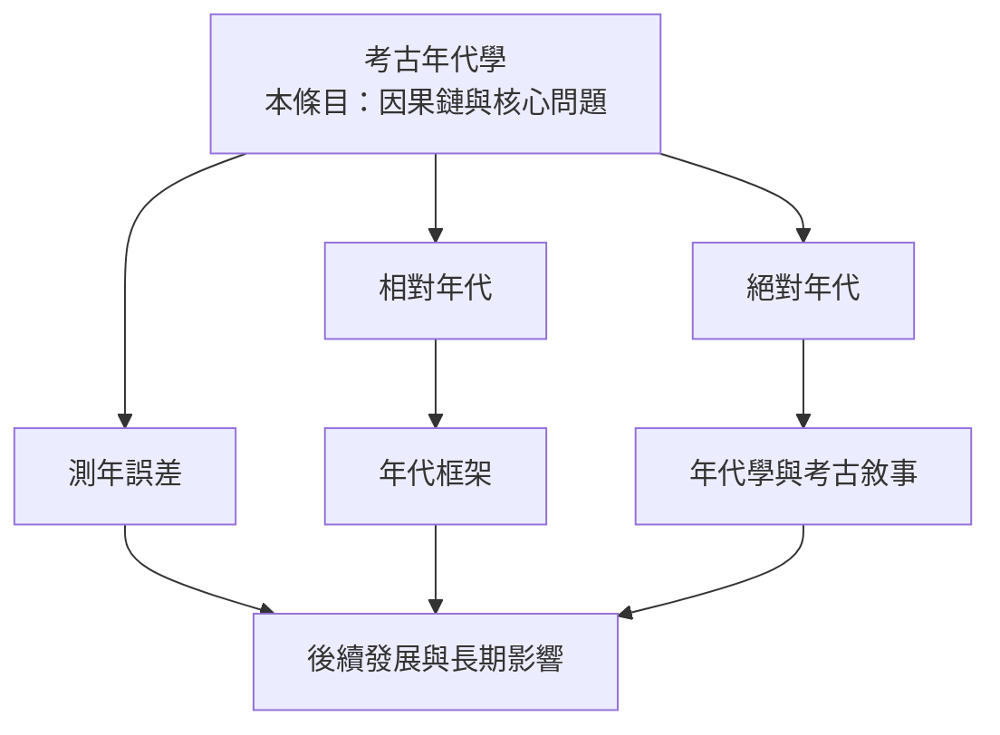

# 考古年代學

> 隸屬：第一層 [歷史](../README.md)　·　相關分類：[石器時代](../石器時代/README.md)、[朝代](../朝代/README.md)　·　子分類總表見 [README](README.md)

> 對應維基百科：中文維基百科尚無獨立對應條目（相關條目：考古學）　·　[English Wikipedia: Chronological dating](https://en.wikipedia.org/wiki/Chronological_dating)

考古年代學是為遺物與遺址賦予年代的方法總集，分兩大類：相對年代（判定先後順序）與絕對年代（給出以年計的數值）。它解決的敘事問題是：史前無文字，古代文獻又多所缺漏，若沒有可靠的年代測定，「過去」就只是一堆無法排序的物件——三時代法能成立、文明比較能對齊，全賴年代學打底。

本分類同時關注測年的社會後果：每一次測年革命都改寫敘事。1950 年代碳十四測年問世後，歐洲巨石建築比埃及金字塔更古老的推斷動搖了「文明單源傳播論」；1980 年代校準曲線修正使既有碳十四年集體下修，史前史教科書全面改版。年代數字不是中性的事實，它們直接支撐著「誰先誰後、何處起源」的重大論斷。

## 核心問題

本分期要回答：考古學家如何把一塊陶片變成一個年代？方法依賴程度由低到高有三層。第一層是地層學原理：埋藏依時序堆疊，上層晚於下層（疊壓關係）；第二層是類型學與共生關係：以器物形制演變排序，並用共存遺物互相錨定；第三層是物理化學測年：碳十四（有機物，約五萬年上限）、熱釋光（陶器燒製時間）、鉀氬法（火山岩，百萬年尺度）、古地磁（地磁場方向記錄）等。實務上以相對框架搭骨、絕對測年定點，兩層互相校正。

誤差管理是第二個核心問題。校準曲線（碳十四年代對日曆年代的非線性對應，因大氣碳十四濃度波動而必要）使「碳十四年」不等於「日曆年」；樣本偏差（木柴的「老木效應」——用百年老樹心材測年會偏老）與方法上限（碳十四過約五萬年剩餘訊號過弱）限制解析度。因此嚴謹的報告必須附誤差區間與樣本脈絡，單一數字不是年代學。

## 因果鏈

1. 地層疊壓與生物地層（化石序列）提供相對順序，文化層（人類活動堆積）界定遺址的居住期次。
2. 類型學排序與文化層對照，使不同遺址可併排比較，史前文化譜系成形。
3. 碳十四（1949 年利比首次應用）首次給出絕對數值，熱釋光與鉀氬法分別補足陶器與百萬年尺度，舊石器與新石器的年代骨架確立。
4. 校準曲線（以樹輪、珊瑚、冰芯建立）修正系統偏差，測年誤差的量化使結論從「大概」變成「區間」。
5. 年代框架與古地磁、古生物對比互鎖，年代對照表使全球譜系可橫向對齊；文明起始年代與年代爭議（夏商周斷代等）則顯示測年直接介入史學論戰。

## 子分類的定位與相互驅動

### 相對年代

地層疊壓是原理層（關係必真），生物地層以化石群定位層位（精細但依賴物種存續知識），文化層把「自然堆積」與「人的歷史」接合。相對年代先於絕對測年兩百年成形，至今仍是發掘報告的骨架。

### 絕對年代

碳十四以有機體死亡後碳十四衰變（半衰期約 5730 年）計年，熱釋光測陶器最後受熱以來累積的輻射劑量，鉀氬法以火山岩中鉀四十衰變為氬四十測定噴發年代——三者分別覆蓋近五萬年、數萬年與百萬年以上，組成互補的測年工具箱。

### 測年誤差

校準曲線處理大氣系統性波動，樣本偏差處理「測的東西不等於你想知道的東西」（老木效應、擾動混入），方法上限界定各法的適用邊界。誤差研究的成熟，使「碳十四年代 ± xx 年 BP」成為可溝通的標準語言（BP 為距 1950 年的年數）。

### 年代框架

年代對照表（如以王朝、文化、測年三軸並列的總表）使跨區域敘事可行，古地磁（地磁極性倒轉序列，如布容—松山界線）為深時提供全球同步的「磁帶」，古生物對比以哺乳動物群演替校核層序。框架層的工作把各地孤立測年點縫合成時間之網。

### 年代學與考古敘事

文明起始年代（城市、文字、冶金的最早證據年代）決定「最早文明在哪裡」的敘事，舊石器年代依賴鉀氬與古地磁的接力，年代爭議（如夏代是否可被考古證實、二里頭年代與文獻夏年的對應）顯示：年代學不是中性的工具，它本身是史學論戰的主戰場。[考古學家](考古學家.md)——如發明碳十四測年的利比（Willard Libby，1960 年獲諾貝爾化學獎）——則提醒方法背後都有具體的人與機構。

## 範例

以夏商周斷代工程（1996–2000）為例：該計畫綜合碳十四測年（以系列樣本縮小誤差，如對豐鎬、琉璃閣遺址成組樣本做貝葉斯統計）、天文推算（「懿王元年天再旦於鄭」被解讀為西元前 899 年的日環食，用於校準西周王年）與金文曆譜，得出武王克商約在公元前 1046 年、夏代約前 2070 至前 1600 年的年表。工程結論在學界引發持續辯論：批評者質疑某些測年樣本的脫落層位與天文解讀的唯一性。這場辯論示範了年代學的現代形態——多方法交叉、誤差區間公開、結論可被新證據修正；也顯示「把傳說時代對上日曆」本身，就是測年技術與史學詮釋的複合工程。

## 容易混淆之處

- 「碳十四年代就是日曆年代」：需經校準曲線換算，未校準的 BP 年與日曆年可差數百年。
- 「相對與絕對年代可以互相取代」：絕對測年昂貴且需合適樣本，多數遺址仍以相對框架為主幹。
- 「測年是對單一器物做的」：多數方法測的是樣本（骨、炭、陶），器物年代由層位與共存關係推得。
- 「誤差小表示一定正確」：樣本若非原位（擾動、混入），測得再準也量錯了對象——脈絡正確比數字精確優先。

## 深入議題
- 加速器質譜（AMS）測年把碳十四所需的樣本量從數十克降到毫克級，使『直接測文物本身』成為可能—— radiocarbon dating 的方法史與考古學敘事的更新互相咬合。
- 系列測年與貝葉斯統計（如 OxCal 軟體）以多個相關樣本的層序約束單點誤差，是把相對年代與絕對年代『融合』起來的當代標準做法。
- 閱讀提示：本頁因果鏈給出骨架，子分類條目給出血肉，對應維基百科條目提供可查證的細節；三層閱讀由粗到細，遇到年代與人名疑義時以最後一層為準。
- 寫作體例：涉及估計值（傷亡、產量、年代區間）時一律標示『約』或『估計』，並在可行時給出區間而非單點——歷史結論的可信度取決於不確定性的誠實呈現。
- **分期是敘事工具而非自然事實**：任何切分年代都有利弊，考古年代學的起訖在史學界本就存在多種方案，敘事時宜標明所採用的標準。
- **比較史的方法陷阱**：以考古年代學為標尺衡量不同地區時，須注意各地條件差異，避免把單一地區的經驗當成普遍規律。
- **證據的層級**：一手史料、考古證據與二手詮釋的可信度不同，涉及具體年代與人名時應回到可查證的來源。
- **長時段與短時段的互補**：布勞岱式的長時段結構（地理、經濟）與事件史（人物、戰役）各有解釋力，本分類刻意兩者並用。
- **研究的前沿**：考古年代學的相關研究仍在更新，新出土資料、新統計資料或新方法（如量化史學、數位人文）都可能改寫既有結論。
- **給初學者的閱讀順序**：先掌握本頁的因果鏈，再進入子分類條目，最後以對應維基百科條目查證細節——由框架到細節，比反方向更省力。

## 與相鄰分類的關聯
- **石器時代**：考古年代學提供石器時代所需要的長時段背景，石器時代則回頭檢驗考古年代學敘事的因果是否成立——兩者互為對照組。
- **朝代**：考古年代學提供朝代所需要的長時段背景，朝代則回頭檢驗考古年代學敘事的因果是否成立——兩者互為對照組。
- **青銅器時代**：考古年代學提供青銅器時代所需要的長時段背景，青銅器時代則回頭檢驗考古年代學敘事的因果是否成立——兩者互為對照組。
- **與第一層 [歷史] 入口頁**：本分類是第一層分類樹的分支，跨分類的查詢建議先回到入口頁再下行，避免漏掉同層的相近概念。

## 概念結構圖

## 連結定義

[歷史]: ../README.md
[石器時代]: ../石器時代/README.md
[朝代]: ../朝代/README.md
[考古學家]: 考古學家.md
