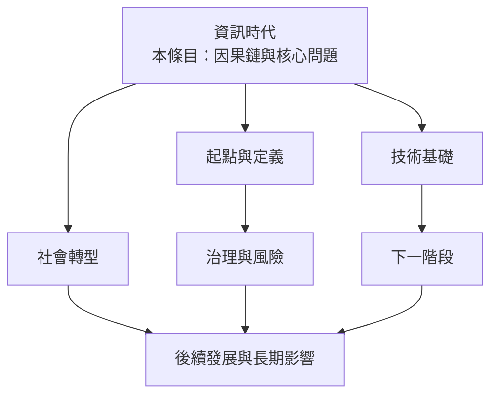

# 資訊時代

> 隸屬：第一層 [歷史](../README.md)　·　相關分類：[工業革命](../工業革命/README.md)、[科學革命](../科學革命/README.md)　·　子分類總表見 [README](README.md)

> 對應維基百科：[中文維基百科：信息时代](https://zh.wikipedia.org/wiki/%E4%BF%A1%E6%81%AF%E6%97%B6%E4%BB%A3)　·　[English Wikipedia: Information Age](https://en.wikipedia.org/wiki/Information_Age)

資訊時代指經濟與社會的核心資源由物質能量轉為資訊處理能力的分期，通常以 1970 年代為起點（微處理器商業化、軟體產業成形），貫穿網路普及（1990 年代）至今。它解決的敘事問題是：工業革命之後的歷史如何分期——若以「生產什麼」為軸，農業、工業之後正是「資訊與服務」；若以「誰掌握關鍵資源」為軸，土地、資本之後是資料與算力。

與前兩次動力革命不同，資訊革命不改變能量的來源，而是改變「決策與協調」的成本：搜尋、複製、傳播、運算的邊際成本趨近於零。這個特徵決定了本時代的全部主要現象——從知識經濟到平台壟斷，從遠距工作到資訊戰，都是「協調成本崩塌」的下游效應。

## 核心問題

本分期要回答：為什麼起點落在 1970 年代？三個條件疊加。第一是硬體：1971 年英特爾 4004 微處理器把運算器縮進一顆晶片，摩爾定律（積體電路電晶體數約每兩年倍增）使算力成本指數下降。第二是軟體與組織：作業系統與資料庫使個人電腦（Apple II，1977；IBM PC，1981）可被非專家使用，辦公室自動化從口號變成日常。第三是網路：TCP/IP 於 1983 年成為 ARPANET 標準，1991 年全球資訊網（WWW）開放，1990 年代末網際網路進入消費市場。算力、易用性與連通性三者共振，「數位化」自此從技術議題變成社會議題。

本分類的第三軸是風險與治理：協調成本崩塌同時崩塌了「把事情藏起來」的成本結構——隱私（資料可被無限複製比對）、資訊戰（以敘事為武器的低成本攻擊）與平台壟斷（網路效應使贏者通吃）都由此而生。資訊時代因此是「紅利與治理赤字同時擴大」的時代。

## 因果鏈

1. 半導體與摩爾定律使運算、儲存、通訊成本持續暴跌，數位化（把類比資訊轉為可運算的位元）具備經濟可行性。
2. 個人電腦、作業系統與辦公軟體普及，組織的資訊處理內化；1970 至 1990 年代知識工作者的生產工具完成換代。
3. 網路普及（WWW、寬頻、行動網路）把孤立的電腦連成平台，搜尋、社群、電子商務重組零售、媒體與人際網絡。
4. 雲端（以租用方式取得算力與儲存）壓低創業門檻，知識經濟與遠距工作擴張，同時數位落差在接取與素養兩個層面固化。
5. 資料成為關鍵資源，資訊戰、隱私與平台壟斷成為治理主題；人工智慧與物聯網把「讀取資料」升級為「自動決策」，後數位化的社會形態仍在展開。

## 子分類的定位與相互驅動

### 起點與定義

1970 年代（微處理器與個人電腦的十年）作為起點比「1990 年上網」更能捕捉連續性：沒有二十年的算力積累，網路不會有可用的終端。數位化是手段，網路普及是放大器——起點段的工作在於把「什麼算資訊時代的證據」定清楚（資訊業產值、就業結構、專利構成）。

### 技術基礎

半導體（晶片製程、快取與並行架構）供給算力，作業系統（UNIX、Windows、Linux）供給可程式化的通用介面，雲端把算力變成水電般的計量服務。三層是硬體—系統—服務的堆疊，每層的成本下降都放大上層的應用空間。

### 社會轉型

知識經濟（價值由專業知識與資料驅動）改變產業構成，遠距工作（協作工具使辦公室變成可選項，2020 年疫情將其常態化）改變城市與通勤，數位落差（接取、技能、用途三個層次的不平等）則是轉型的成本分配問題。三者合觀才能回答「資訊化讓誰受益」。

### 治理與風險

資訊戰（社群媒體上的操弄與認知作戰，如 2016 年後各國選舉干預調查）以低成本攻擊高價值的社會信任，隱私（GDPR 於 2018 年生效，確立資料最小化與被遺忘權）是個人與平台的第一線契約，平台壟斷（網路效應下的贏者通吃，各國反壟斷調查接連展開）挑戰傳統的市場界定。治理工具（法規、標準、稽核）正在追趕技術。

### 下一階段

人工智慧（深度學習自 2012 年起的能力躍升，把模式識別變成通用工具）與物聯網（感測器使物理世界持續產生資料流）互為燃料：物聯網供應資料，人工智慧消化資料並回頭控制物理系統。後數位化（數位工具隱形化、成為環境的預設）則是社會適應的終點想像——當技術不再被稱為「科技」，本分期才算完成。

## 範例

以維基百科為例：2001 年上線時，百科全書由專家編寫、出版社發行，一套百科的更新以「版」計（大英百科第三版到第十五版間隔數十年）。維基百科以開放協作把編寫成本降到近零，目前條目逾六千萬篇、語言三百餘種，且持續以分鐘為單位更新。它示範了資訊時代的核心機理：當複製、傳播與協調的成本崩塌，業餘的分散協作可以在品質上逼近甚至超越專業的集中生產——同時也暴露治理難題（破壞、觀點偏差、編輯者性別失衡）。一個產品的誕生與爭議，完整涵蓋本分類的紅利與風險兩面。

## 容易混淆之處

- 「資訊時代等於有電腦的時代」：大型電腦 1950 年代已存在，關鍵是算力普及與連通，不是機器的存在。
- 「網路必然增加民主參與」：同樣的基礎設施也供給資訊戰與極化，效果取決於治理設計。
- 「數位落差只是有沒有網路」：接取之外，技能與使用方式（消費型對創造型使用）的落差更為深層。
- 「雲端是虛無縹緲的」：雲端是實體資料中心、光纖與能源的具體系統，其碳足跡與地緣分布是真實的政治經濟問題。

## 深入議題
- 半導體的地理學：從矽谷到台積電的製程分工顯示，『資訊』的物質基礎高度集中在少數幾個節點——供應鏈地緣政治是本分類與當代時事最直接的介面。
- 『注意力經濟』是資訊時代的第二敘事軸：當資訊免費，稀缺的變成注意力與信任——媒體史、心理學與平台治理因此在此交會。
- 閱讀提示：本頁因果鏈給出骨架，子分類條目給出血肉，對應維基百科條目提供可查證的細節；三層閱讀由粗到細，遇到年代與人名疑義時以最後一層為準。
- 寫作體例：涉及估計值（傷亡、產量、年代區間）時一律標示『約』或『估計』，並在可行時給出區間而非單點——歷史結論的可信度取決於不確定性的誠實呈現。
- **分期是敘事工具而非自然事實**：任何切分年代都有利弊，資訊時代的起訖在史學界本就存在多種方案，敘事時宜標明所採用的標準。
- **比較史的方法陷阱**：以資訊時代為標尺衡量不同地區時，須注意各地條件差異，避免把單一地區的經驗當成普遍規律。
- **證據的層級**：一手史料、考古證據與二手詮釋的可信度不同，涉及具體年代與人名時應回到可查證的來源。
- **長時段與短時段的互補**：布勞岱式的長時段結構（地理、經濟）與事件史（人物、戰役）各有解釋力，本分類刻意兩者並用。
- **研究的前沿**：資訊時代的相關研究仍在更新，新出土資料、新統計資料或新方法（如量化史學、數位人文）都可能改寫既有結論。
- **給初學者的閱讀順序**：先掌握本頁的因果鏈，再進入子分類條目，最後以對應維基百科條目查證細節——由框架到細節，比反方向更省力。

## 與相鄰分類的關聯
- **工業革命**：資訊時代提供工業革命所需要的長時段背景，工業革命則回頭檢驗資訊時代敘事的因果是否成立——兩者互為對照組。
- **科學革命**：資訊時代提供科學革命所需要的長時段背景，科學革命則回頭檢驗資訊時代敘事的因果是否成立——兩者互為對照組。
- **戰爭史**：資訊時代提供戰爭史所需要的長時段背景，戰爭史則回頭檢驗資訊時代敘事的因果是否成立——兩者互為對照組。
- **與第一層 [歷史] 入口頁**：本分類是第一層分類樹的分支，跨分類的查詢建議先回到入口頁再下行，避免漏掉同層的相近概念。

## 概念結構圖

## 連結定義

[歷史]: ../README.md
[工業革命]: ../工業革命/README.md
[科學革命]: ../科學革命/README.md
