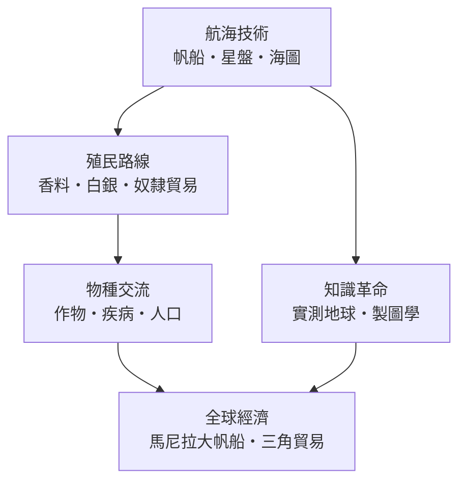

# 地理大發現

> 隸屬：[近代史] › [近代史]　·　狀態：初稿

> 對應維基百科：[中文維基百科：地理大发现](https://zh.wikipedia.org/wiki/%E5%9C%B0%E7%90%86%E5%A4%A7%E5%8F%91%E7%8E%B0)　·　[English Wikipedia: Age of Discovery](https://en.wikipedia.org/wiki/Age_of_Discovery)

地理大發現指 15 至 17 世紀歐洲航海者系統性開闢大西洋、印度洋與太平洋航路的時代：1488 年迪亞士繞過好望角、1492 年[哥倫布]西航抵美洲、1498 年達伽馬抵印度、1519 至 1522 年麥哲倫船隊完成環球。

它的動力是經濟（繞開[中古世界]陸上香料商路的伊斯蘭中介）、技術（[航海技術]的成熟）與政治（伊比利王權的資助與教宗仲裁），三者在葡萄牙與西班牙合流，使遠洋探險從偶然變成政策。

本子分類下設三個孫分類：[航海技術]處理工具革命，[殖民路線]處理貿易與殖民體系，[物種交流]處理生態與人口的全球重寫。合起來，這是人類第一次把地球連成一張網。

## 技術與理論的關聯

- 技術鏈：卡拉維爾帆船（風帆可逆風行駛）、星盤與象限儀測緯度、航行日誌與波特蘭海圖累積成可複製的航線知識。
- 財政鏈：探險以合夥契約（asiento、特許公司）融資，股份與保險機制使高風險遠航可持續，是近代金融的先聲。
- 政治鏈：1494 年《托爾德西里亞斯條約》以教宗仲裁分界，殖民權利首度成為國際法議題。
- 人口鏈：天花與麻疹使美洲原住民人口在百餘年內減少逾半，勞動力缺口引出大西洋奴隸貿易。
- 白銀鏈：1545 年波托西銀礦開採後，白銀經馬尼拉大帆船流入中國換絲綢，全球貨幣循環就此打通。
- 知識鏈：麥哲倫船隊（1519 至 1522 年）以實測證明地球尺度，文藝復興的宇宙觀被航行改寫，製圖學（墨卡托投影，1569 年）為遠洋導航定標。

## 孫分類

| 孫分類 | 狀態 |
| --- | --- |
| [航海技術] | 初稿 |
| [殖民路線] | 初稿 |
| [物種交流] | 初稿 |

## 範例

麥哲倫—埃爾卡諾船隊是地理大發現的技術總檢驗：五船二百七十人於 1519 年自塞維亞出發，穿過以十八天硬闖的麥哲倫海峽，橫渡太平洋（四個月未見大陸，船員以牛皮與鼠充飢），1521 年麥哲倫死於菲律賓馬克坦，維多利亞號最終載十八人於 1522 年返航，滿載香料仍獲利。地球的尺度從此由船 log 而非書本決定。

波托西（今玻利維亞）1545 年發現巨型銀礦，十七世紀產銀占全球六成。白銀一部分經歐洲、一部分經阿卡普爾科—馬尼拉大帆船流入明帝國（以銀納稅的一條鞭法正需白銀）。一座安第斯山城把中南美、歐洲與東亞的貨幣市場焊在一起。

## 前因後果

- 前因：[中古世界]的陸上商路利潤被中介層分割，伊比利王權在收復失地運動後尋求新財源。
- 瓶頸：遠洋導航與風向系統未被掌握，投資風險無法分散。
- 解法：帆船與儀器進步、合夥融資與王室特許，使風險與收益重新定價。
- 後果：全球貿易網與殖民主義成形，[宗教改革]時代的歐洲獲得新的資源池，最終支撐[革命時代]與[工業化]的資本積累。

## 與相鄰分類的關聯

- 與[航海技術]的關係：工具與知識的革命是航行可行的前提。
- 與[殖民路線]的關係：航路的價值由貿易與殖民體系兌現。
- 與[物種交流]的關係：接觸的生態後果重塑兩半球的農業與人口。
- 與[近代史]的關係：地理大發現是近代全球化的第一引擎。
- 與[國際貿易]的關聯：特許公司與全球套利是近代貿易制度的起點。

## 容易混淆之處

- 「發現」是歐洲中心的說法：美洲有數千萬原住民、非洲印度洋早有航路網，歐洲人加入而非開創一切。
- 哥倫布不是為「證明地圓」而航行：地圓當時已是共識，爭議在地球周長估算與航距。
- 地理大發現不只屬於西葡：荷、英、法在 17 世紀接手並系統化，荷蘭東印度公司（1602 年）才是常態化殖民的第一模板。

## 技術要點

- 分期以航路突破為錨（1488、1492、1498、1522），配合特許公司時代（1600 年後）的系統化。
- 沉船考古（如聖荷西號、巴達維亞號）直接保存貿易品組合與船體技術。
- 航海日誌與海圖的版本學重建知識傳播路徑。
- 白銀流入量以船貨清單與中國銀價資料雙向校驗。
- 古 DNA 與骨骼同位素追蹤美洲人口崩潰與非洲奴隸的遷移。
- 樹輪與冰芯資料顯示 16 世紀美洲人口銳減後農地還林、二氧化碳下降（「哥倫布交換假說」）。

## 常見的論爭

- 大發現動力論：香料利潤說、十字軍宗教說與王權財政說的比重仍有爭論。
- 美洲人口規模：前接觸人口從一千萬到一億的估計差距，直接影響「大滅絕」敘事。
- 白銀是否「害了」明朝：白銀供給波動與明末財政危機的因果強度，經濟史界意見不一。

## 延伸閱讀

- [航海技術]：本子分類的技術軸。
- [殖民路線]：本子分類的經濟軸。
- [物種交流]：本子分類的生態軸。
- [近代史]：所屬概念總覽。

## 連結定義

[近代史]: 近代史.md
[航海技術]: 航海技術.md
[殖民路線]: 殖民路線.md
[物種交流]: 物種交流.md
[哥倫布]: 地理大發現.md
[中古世界]: ../古代史/中古世界.md
[宗教改革]: 宗教改革.md
[革命時代]: 革命時代.md
[工業化]: 工業化.md
[國際貿易]: ../../社會/國際貿易/README.md