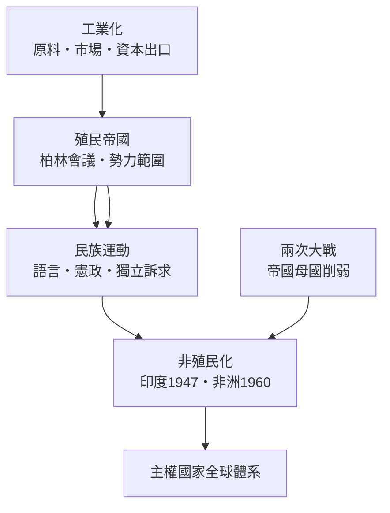

# 帝國興衰

> 隸屬：[近代史] › [近代史]　·　狀態：初稿

> 對應維基百科：中文與英文維基百科均無對應條目（參考：帝國興衰 相關主題文獻）

帝國興衰指 19 世紀歐洲（與美日）以工業實力展開的新一輪帝國擴張，及其在民族主義與兩次大戰衝擊下的瓦解：1870 至 1914 年歐洲列強控制地球陸地表面的比例從一成升至八成五，1914 至 1962 年間則幾乎全部退潮。

其結構是三位一體：工業需要原料與市場（棉花、橡膠、錫、傾銷市場）、財政需要海外投資出口、國族主義需要「偉大」的證明。[帝國興衰]下的[殖民警與帝國]（殖民帝國）是擴張的組織形態，[民族運動]是被統治者的回應，[非殖民化]是體系的終局。

本子分類的時間弧線清晰：1885 年柏林會議瓜分非洲（高點）→ 1919 年凡爾賽委任統治（帝國的偽裝）→ 1947 年印度獨立（轉折）→ 1960 年非洲獨立年（潮水）→ 1960 至 1975 年葡屬非洲與印支戰爭（尾聲）。

## 技術與理論的關聯

- 新帝國主義的技術條件：奎寧防瘧、馬克沁機槍、蒸汽砲艦與電報使「小部隊統治大疆域」首次可行（Cain 與 Hopkins 稱為「紳士資本主義」的海外延伸）。
- 經濟與政治的混合動因：原料與市場（霍布森、列寧的解釋）、戰略要地（印度航路上的埃及與南非）、國內政治（帝國主義作為社會安撫工具）三說並立。
- 1885 年柏林會議以「有效佔領」原則瓜分非洲，非洲邊界的九成以上由殖民者劃定，成為獨立後衝突的長期來源。
- 1919 年凡爾賽體系的「委任統治」把德屬與奧斯曼領地交給英法等「先進國家」代管，帝國主義以國際聯盟的名義延續。
- 1947 年印度與巴基斯坦獨立是轉折點：戰後英國財政無力維持印度，甘地與國大黨的非暴力動員使統治成本失去正當性。
- 1960 年十七個非洲國家獨立（「非洲年」），去殖民化在十五年內基本完成，主權國家體系自此真正全球覆蓋。

## 孫分類

| 孫分類 | 狀態 |
| --- | --- |
| [殖民警與帝國] | 初稿 |
| [民族運動] | 初稿 |
| [非殖民化] | 初稿 |

## 範例

柏林會議（1884 至 1885 年）是帝國主義的行政化：十四國代表（無一名非洲人）確立「有效佔領」與剛果自由邦的「自由貿易」原則，此後二十五年非洲地圖被完全改寫。剛果在利奧波德二世的私人統治下（1885 至 1908 年）人口估計減少數百萬至一千萬，1908 年因橡膠暴行醜聞被迫移交比利時政府——殖民暴行的揭露本身也是早期國際人權運動的案例。

印度的兩面：1857 年大起義後英國直接統治（東印度公司 1858 年被收歸王冠），鐵路（1947 年達六萬五千公里）與英語行政網把次大陸整合成一個市場與一個政治單位；但同一網絡也承載了[甘地]的非暴力動員——鐵路與電報既是帝國的血管，也是反抗者的神經。

## 前因後果

- 前因：[工業化]製造的原料需求、資本出口與軍事優勢。
- 瓶頸：帝國治理成本與正當性隨民族主義傳播而上升。
- 解法（擴張期）：委任統治、間接統治與經濟特許權降低直接成本。
- 後果：兩次大戰掏空帝國母國，[民族運動]以憲政與武裝兩路兌現獨立，[非殖民化]在 1947 至 1975 年間完成，世界進入主權國家的普世體系。

## 與相鄰分類的關聯

- 與[殖民警與帝國]的關係：擴張的組織形態與其內部邏輯。
- 與[民族運動]的關係：帝國的語言與制度反而成為反抗的資源。
- 與[非殖民化]的關係：體系的終局與遺產（邊界、債務、語言）。
- 與[工業化]的關聯：工業實力是擴張的物質基礎。
- 與[世界史]的關聯：帝國興衰是「世界體系」理論的核心案例。

## 容易混淆之處

- 帝國主義不等於只有非洲：印度、東南亞、太平洋與拉丁美洲的經濟支配同屬其範圍。
- 殖民帝國不是同質體系：英屬間接統治、法屬同化政策、葡屬長期武裝統治的路徑差異極大。
- 去殖民化不等於 1960 年一次完成：阿爾及利亞（1962 年）、安哥拉與莫三比克（1975 年）、辛巴威（1980 年）各循不同時程。

## 技術要點

- 量化基礎：殖民地面積與人口的年度序列、帝國貿易與投資份額（英帝國占英國海外投資近半）。
- 委任統治與國際聯盟檔案（1919 至 1939 年）是帝國主義國際化的核心史料。
- 反抗運動檔案：印度國大黨年會紀錄、非洲民族主義報刊與法屬西非工會檔案。
- 邊界研究：非洲殖民邊界的直線比例（逾四成為經緯線或直線）與獨立後衝突的相關性。
- 橡膠與棉花供應鏈研究（剛果、東非）使「帝國經濟學」可量化。
- 後殖民理論（法農、薩依德）與計量帝國史（Acemoglu 等的制度長波研究）構成當代兩大解釋傳統。

## 常見的論爭

- 帝國是否「有利可圖」：霍布森—列寧的利潤說與近年計量研究（多數帝國對母國整體是淨成本）相持。
- 去殖民化的動力：民族主義內生壯大，或二戰與冷戰的外部衝擊（美蘇反殖民姿態）孰為主。
- 殖民遺產的因果：制度移植說（ settler mortality 研究）與壓榨說對「殖民遺產決定發展」的強度有重大分歧。

## 延伸閱讀

- [殖民警與帝國]：擴張的組織形態。
- [民族運動]：被統治者的動員。
- [非殖民化]：體系的終局。
- [世界史]：長時段中的帝國。

## 連結定義

[近代史]: 近代史.md
[帝國興衰]: 帝國興衰.md
[殖民警與帝國]: 殖民警與帝國.md
[民族運動]: 民族運動.md
[非殖民化]: 非殖民化.md
[工業化]: 工業化.md
[世界史]: ../世界史/README.md
[甘地]: ../../人/政治人物/甘地.md