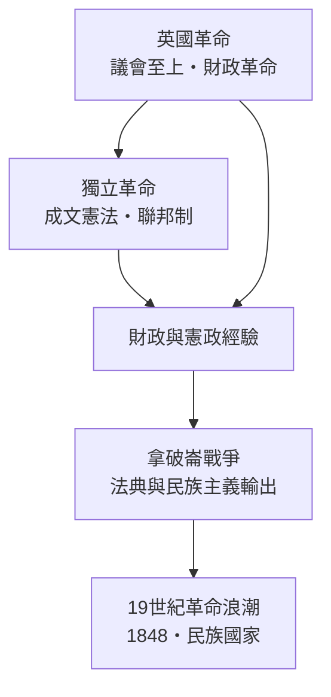

# 革命時代

> 隸屬：[近代史] › [近代史]　·　狀態：初稿

> 對應維基百科：[中文維基百科：時代革命](https://zh.wikipedia.org/wiki/%E6%99%82%E4%BB%A3%E9%9D%A9%E5%91%BD)　·　[English Wikipedia: Revolution of Our Times](https://en.wikipedia.org/wiki/Revolution_of_Our_Times)

革命時代（約 1640 至 1804 年，霍布斯鮑姆擴展至 1848 年）是主權從君主轉向「民族」的時代：[英國革命]確立議會至上，[獨立革命]示範依契約建國，[法國革命]把主權在民與民族動員推向極端。

時代的共同燃料是財政危機：戰爭成本膨脹使舊制度（王室專制＋等級會議）既徵不到稅也借不到錢，英國以議會擔保的公債解決，法國則以召開三級會議引爆政治革命。

本子分類下設三個孫分類：[英國革命]、[法國革命]與[獨立革命]，分別代表憲政、激進民主與成文憲法三條路線，合起來是現代政治的語法書。

## 技術與理論的關聯

- 英國路線（1640 至 1688 年）：內戰、處死國王、克倫威爾共和、復辟，最終以 1688 年光榮革命與《權利法案》（1689 年）把主權鎖進「議會＋有限君權」的憲政。
- 英國財政革命：1694 年英格蘭銀行成立，國債以議會信用擔保，政府借貸成本驟降——這是英國能打贏十八世紀所有大戰的幕後技術。
- 美國路線（1775 至 1783 年）：以「無代表不納稅」的契約邏輯獨立，1787 年制憲以成文憲法、分權與聯邦制示範如何「從零設計共和國」。
- 法國路線（1789 至 1804 年）：從三級會議到《人權宣言》、恐怖統治、[拿破崙]與《拿破崙法典》，革命的三段式（自由—恐怖—秩序）成為此後所有革命的模板。
- 民族動員：法國 1793 年大規模徵兵（levée en masse）使全民戰爭首次出現，戰爭與民族認同從此綁定。
- 觀念傳播：報刊、俱樂部與小冊子使政治語言大眾化，1790 年代「左／右」（依議會座位）、「恐怖」等詞彙進入日常政治。

## 孫分類

| 孫分類 | 狀態 |
| --- | --- |
| [英國革命] | 初稿 |
| [法國革命] | 初稿 |
| [獨立革命] | 初稿 |

## 範例

1688 年光榮革命的制度成果可濃縮為三份文件：《權利法案》（1689 年，國王不得擅徵稅與擱置法律）、《叛亂法案》與此後的《王位繼承法》（1701 年）。加上 1694 年英格蘭銀行與長期國債，英國用三十年建成「議會信用」機器——1713 年後英國政府借貸利率從兩位數降到 3 至 4%，而法國同期常在 6% 以上。財政能力的差距，決定了十八世紀每一次英法戰爭的結局。

[法國革命]的「8 月之夜」（1789 年 8 月 4 日）：國民議會在一次激情會議中廢除封建特權、什一稅與賣官制。一夜之間，千年舊制度的法律結構被宣布終結——革命的速度不是因為計畫周密，而是因為舊制度的正當性在財政崩潰與饑荒輿論中已經失效。

## 前因後果

- 前因：[宗教改革]後的主權國家體系與戰爭金融化，使「誰來批准徵稅」成為憲政核心問題。
- 瓶頸：舊制度財政破產、貴族特權與市民財產權衝突激化。
- 解法：英國以議會信用、美國以成文憲法、法國以主權在民，各用不同方式把「人民」寫進制度。
- 後果：拿破崙把法典與民族國家模板輸出全歐，1848 年革命浪潮與 19 世紀民族統一運動直接繼承本時代；同時工業化需要新的勞動與市場秩序，通向[工業化]與[帝國興衰]。

## 與相鄰分類的關聯

- 與[英國革命]的關係：憲政與財政技術是本時代的英國路線。
- 與[法國革命]的關係：主權在民的政治語法出自法國。
- 與[獨立革命]的關係：成文憲法與聯邦制是美國路線。
- 與[工業化]的關聯：英國的財政與財產權制度是工業投資的前提。
- 與[政治革命]的關聯：革命人物與事件的專題總表。

## 容易混淆之處

- 「光榮革命」並不無血：愛爾蘭與蘇格蘭隨後有激烈戰事，「光榮」是英格蘭中心的說法。
- 法國革命不是單一事件：1789 至 1799 年是革命，1799 至 1815 年是帝國，兩者常被混為一談。
- 美國獨立不是純粹的民主革命：奴隸制在憲法中被保留，婦女與無產者多無投票權。

## 技術要點

- 分期以三場革命為軸（1640／1776／1789），以 1848 年為收束錨點。
- 議會紀錄與請願書使「輿論形成」可量化（如英國 1780 年代廢奴請願簽名數）。
- 財政史資料（國債利率、稅收結構）是檢驗革命原因的核心證據。
- 俱樂部與報刊檔案（雅各賓俱樂部通訊網）重建動員網絡。
- 大西洋史視角把英法美（加海地）串成一個互動場，海地革命（1791 至 1804 年）是奴隸自我解放的關鍵缺頁。
- 革命遺產的比較：憲法文本的語料分析追蹤《人權宣言》對 19 世紀各國憲法的影響。

## 常見的論爭

- 法國革命起因：階級鬥爭論（馬克思派）、政治文化論（傅歇的修辭研究）與財政危機論（博蘭等）長期並立。
- 英國革命是否「革命」：修正派（以之名英國內戰）主張其保守性，與傳統「第一次資產階級革命」說對峙。
- 恐怖統治的必然性：是戰爭環境的產物，還是意識形態（盧梭式公意）的內在傾向，仍是史學熱題。

## 延伸閱讀

- [英國革命]：憲政路線。
- [法國革命]：民主路線。
- [獨立革命]：憲法路線。
- [近代史]：所屬概念總覽。

## 連結定義

[近代史]: 近代史.md
[英國革命]: 英國革命.md
[法國革命]: 法國革命.md
[獨立革命]: 獨立革命.md
[工業化]: 工業化.md
[帝國興衰]: 帝國興衰.md
[宗教改革]: 宗教改革.md
[政治革命]: ../政治革命/README.md
[拿破崙]: ../../人/政治人物/拿破崙.md