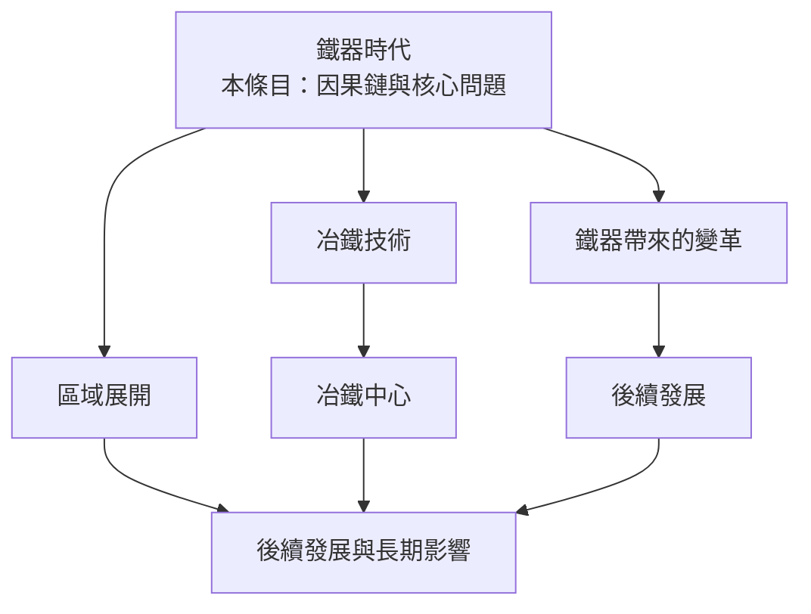

# 鐵器時代

> 隸屬：第一層 [歷史](../README.md)　·　相關分類：[青銅器時代](../青銅器時代/README.md)、[石器時代](../石器時代/README.md)　·　子分類總表見 [README](README.md)

> 對應維基百科：[中文維基百科：铁器时代](https://zh.wikipedia.org/wiki/%E9%93%81%E5%99%A8%E6%97%B6%E4%BB%A3)　·　[English Wikipedia: Iron Age](https://en.wikipedia.org/wiki/Iron_Age)

鐵器時代指以鐵為主要工具與兵器材料的時期，約始於西元前 1200 年前後（近東與南亞），逐步擴及歐、亞、非。它解決的敘事問題是：青銅文明為何被金屬技術更「退步」（早期鐵器硬度常不及青銅）的材料取代——答案是資源經濟：鐵礦分布遠比銅錫礦廣泛，一旦冶鐵技術普及，地方社群便能自產金屬，不再依賴長程貿易與青銅分配體系。

鐵器時代因此常與「青銅時代晚期崩潰」（約前 1200 年地中海東岸宮殿體系瓦解）相接：貿易網絡斷裂使錫供給中斷，鐵從應急替代品轉為主材料。這個替換不只是材料史，更是權力再分配史——金屬生產從宮殿壟斷下放到村落鐵匠。

## 核心問題

本分期要回答：鐵器改變了什麼？三層答案。第一是技術層：冶鐵的難點在溫度與碳含量控制——塊煉鐵（約 1200℃ 固態還原）得到海綿鐵，須反覆鍛打除渣；生鐵冶煉（液態、高碳）需要更高爐溫與鼓風技術，中國約於春秋戰國之際（前六至前四世紀）率先規模化，以鑄鐵範具批量生產農具；煉鋼（控碳至約 0.5–1.5%）則是長期目標，百煉鋼與淬火技術逐步累積。第二是經濟層：廉價金屬農具（鐵犁、鐵鎬）使深翻黏土、墾殖森林可行，農業剩餘增加，人口與戰爭規模同步上升。第三是政治層：金屬貨幣（呂底亞前七世紀鑄幣、戰國布幣刀幣）與廉價兵器共同催生更大規模的國家動員。

鐵器時代的分期依據因此是「普及」而非「出現」：最早的鐵器（隕鐵飾品早在青銅時代就有）與鐵器成為生產主力之間，常隔數百年。比較各地「鐵器時代」的起訖，必須先問以哪一層標準計時。

## 因果鏈

1. 青銅時代晚期的貿易網絡崩潰與錫供給中斷，迫使近東社群轉向廣布的鐵礦，冶鐵技術（鍛打、滲碳、淬火）成熟。
2. 廉價鐵工具與武器擴散：武器革命使非精英也能武裝，農業工具使墾殖擴張，兩者共同削弱青銅時代的宮殿壟斷。
3. 生鐵冶煉與高爐在中國成熟，鑄鐵農具規模化，支撐戰國的人口與軍事競爭；金屬貨幣使經濟交換突破實物限制。
4. 冶鐵中心（炭火冶煉與水力鼓風的結合）沿礦區與運輸線成形，區域展開：歐洲鐵器時代（哈爾施塔特、拉坦諾文化）、中國鐵器時代（戰國至漢）、非洲鐵器（諾克文化約前五世紀起，部分地區跳過青銅期）。
5. 中世紀煉鋼（大馬士革鋼、中國灌鋼）累積技術，產業革命以焦炭冶鐵與攪煉法把鐵產量提高一個數量級，合金技術（合金鋼、不鏽鋼）完成金屬史的最後一躍。

## 子分類的定位與相互驅動

### 冶鐵技術

生鐵冶煉、鍛鐵與煉鋼是三條技術路線：中國走「生鐵—鑄造—退火脫碳」路線，優點是量產；西亞歐洲走「塊煉—鍛打—滲碳」路線，優點是早期品質。兩條路線的差異源於爐型與鼓風條件，最終在近代冶金的科學化中合流。

### 鐵器帶來的變革

武器革命（鐵劍與鐵簇降低武裝成本，希臘重裝步兵與戰國武卒都有物質基礎）、農業工具（曲柄鐵犁與牛耕使華北黃土與歐洲重黏土大規模開墾）、金屬貨幣（可計數、可分割的價值載體）三者互相放大：農業剩餘供養軍隊，軍隊保護貿易，貿易需要貨幣。

### 區域展開與冶鐵中心

歐洲鐵器時代以哈爾施塔特（約前 800–450）與拉坦諾（前 450 起）文化為標尺，中國鐵器時代以戰國鑄鐵與漢代鐵官為代表，非洲鐵器（如麥羅埃冶鐵遺址）顯示技術可獨立發展。冶鐵中心則是技術的地理節點：高爐、炭火冶煉（木炭到煤炭的燃料轉換）與礦區運輸的結合，決定哪裡會長出工業城市——後來的英國煤鐵帶是這條邏輯的終點。

### 後續發展

中世紀煉鋼（烏茲鋼、灌鋼法）積累了控碳的經驗知識，產業革命（焦炭高爐 1709 年由達比應用、攪煉法 1784 年由科特應用）把鐵從手工業變成重工業，合金技術（十九世紀末的合金鋼、1913 年的不鏽鋼）使「鐵」的範疇最終擴展為整個工程金屬家族。鐵器時代因此沒有明確的結束——它只是被重工業化吸收。

## 範例

以戰國鐵犁與漢代鐵官為例：約前四世紀起，中國以生鐵鑄造的犁鏵配合牛耕推廣於華北，深翻使單產提高；鐵製工具同時用於水利（都江堰約前 256 年建成）與戰爭（鐵劍逐漸取代青銅劍）。西漢武帝於前 117 年前後設鹽鐵官營，全國設鐵官四十八處，把冶鐵納入國家財政——前 81 年鹽鐵會議的辯論（後輯為《鹽鐵論》）正是圍繞這套體制的得失展開。一種金屬技術，先改變田畝產量，再進入國家財政與思想論戰：這是「技術→經濟→政治」因果鏈的完整切片，也是鐵器時代與朝代興衰互相驅動的實例。

## 容易混淆之處

- 「鐵比青銅硬所以取代青銅」：早期塊煉鐵常不如優質青銅；取代的動力是資源可得性與成本，不是單純性能。
- 「鐵器時代全球同時開始」：近東約前 1200 年、中國約前六世紀規模化、撒哈拉以南非洲約前五世紀起，相差數百年甚至上千年。
- 「各地都經歷青銅期再到鐵期」：撒哈拉以南部分地區直接進入鐵器時代，「三時代法」不是普遍律。
- 「隕鐵不算鐵器時代」：隕鐵製品早於冶鐵數百年，但屬稀有禮器，與冶鐵技術無關，分期以冶鐵普及為準。

## 深入議題
- 冶鐵遺址的田野證據：爐渣（slag）的化學成分與數量是判斷產量與技術路線的硬指標——冶金考古學以『垃圾』重建產業，是本分類最活躍的方法分支。
- 『鐵與帝國』的命題值得雙向檢驗：羅馬以鐵器軍團擴張，也以解除武裝（行省禁兵）統治——同一技術同時是帝國的引擎與風險。
- 閱讀提示：本頁因果鏈給出骨架，子分類條目給出血肉，對應維基百科條目提供可查證的細節；三層閱讀由粗到細，遇到年代與人名疑義時以最後一層為準。
- 寫作體例：涉及估計值（傷亡、產量、年代區間）時一律標示『約』或『估計』，並在可行時給出區間而非單點——歷史結論的可信度取決於不確定性的誠實呈現。
- 閱讀提示：本頁因果鏈給出骨架，子分類條目給出血肉，對應維基百科條目提供可查證的細節；三層閱讀由粗到細，遇到年代與人名疑義時以最後一層為準。
- 寫作體例：涉及估計值（傷亡、產量、年代區間）時一律標示『約』或『估計』，並在可行時給出區間而非單點——歷史結論的可信度取決於不確定性的誠實呈現。
- 閱讀提示：本頁因果鏈給出骨架，子分類條目給出血肉，對應維基百科條目提供可查證的細節；三層閱讀由粗到細，遇到年代與人名疑義時以最後一層為準。
- 寫作體例：涉及估計值（傷亡、產量、年代區間）時一律標示『約』或『估計』，並在可行時給出區間而非單點——歷史結論的可信度取決於不確定性的誠實呈現。
- **分期是敘事工具而非自然事實**：任何切分年代都有利弊，鐵器時代的起訖在史學界本就存在多種方案，敘事時宜標明所採用的標準。
- **比較史的方法陷阱**：以鐵器時代為標尺衡量不同地區時，須注意各地條件差異，避免把單一地區的經驗當成普遍規律。
- **證據的層級**：一手史料、考古證據與二手詮釋的可信度不同，涉及具體年代與人名時應回到可查證的來源。
- **長時段與短時段的互補**：布勞岱式的長時段結構（地理、經濟）與事件史（人物、戰役）各有解釋力，本分類刻意兩者並用。
- **研究的前沿**：鐵器時代的相關研究仍在更新，新出土資料、新統計資料或新方法（如量化史學、數位人文）都可能改寫既有結論。
- **給初學者的閱讀順序**：先掌握本頁的因果鏈，再進入子分類條目，最後以對應維基百科條目查證細節——由框架到細節，比反方向更省力。

## 與相鄰分類的關聯
- **青銅器時代**：鐵器時代提供青銅器時代所需要的長時段背景，青銅器時代則回頭檢驗鐵器時代敘事的因果是否成立——兩者互為對照組。
- **石器時代**：鐵器時代提供石器時代所需要的長時段背景，石器時代則回頭檢驗鐵器時代敘事的因果是否成立——兩者互為對照組。
- **文明興衰**：鐵器時代提供文明興衰所需要的長時段背景，文明興衰則回頭檢驗鐵器時代敘事的因果是否成立——兩者互為對照組。
- **與第一層 [歷史] 入口頁**：本分類是第一層分類樹的分支，跨分類的查詢建議先回到入口頁再下行，避免漏掉同層的相近概念。

## 概念結構圖

## 連結定義

[歷史]: ../README.md
[青銅器時代]: ../青銅器時代/README.md
[石器時代]: ../石器時代/README.md
