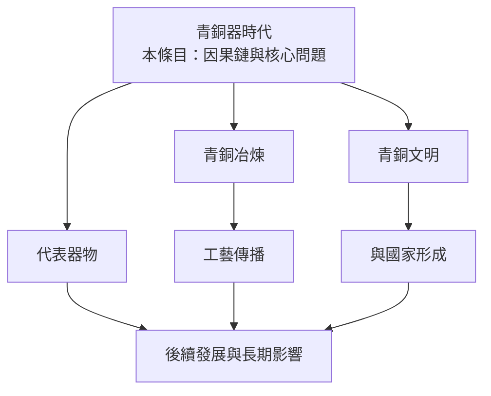

# 青銅器時代

> 隸屬：第一層 [歷史](../README.md)　·　相關分類：[石器時代](../石器時代/README.md)、[鐵器時代](../鐵器時代/README.md)　·　子分類總表見 [README](README.md)

> 對應維基百科：[中文維基百科：青铜时代](https://zh.wikipedia.org/wiki/%E9%9D%92%E9%93%9C%E6%97%B6%E4%BB%A3)　·　[English Wikipedia: Bronze Age](https://en.wikipedia.org/wiki/Bronze_Age)

青銅器時代指以銅錫合金（青銅）為核心材料、以城市與早期國家為核心組織形態的時期，約自西元前 3300 年（近東）至前 1200 年（愛琴與地中海東岸）；各地的起訖相差甚遠。它解決的敘事問題是：複雜社會（城市、官僚、文字、稅收）第一次大規模出現是在什麼物質條件下完成的——答案是金屬化與農業剩餘的結合，使專職統治者、工匠與士兵首次成為可持續的職業。

青銅的政治意義大於工具意義：銅錫礦源稀少且常相距千里，冶煉與分配必須依賴長程貿易與集中管理，於是「誰掌握金屬」成為早期王權的物質基礎。烏爾第三王朝的貢賦清單、商代王室的鑄銅作坊、克里特米諾斯宮殿的線形文字 B 倉庫記錄，都是同一邏輯的各地版本。

## 核心問題

本分期要回答：青銅如何塑造最早的國家？因果起點是冶煉技術。銅的熔點約 1085℃，人類先以孔雀石等氧化礦在坩堝中還原出紅銅（純銅軟、少實用），約前四千紀發現銅錫合金——青銅硬度與鑄造性能大幅提升。冶煉爐（豎爐、鼓風）與合範鑄造（中國的陶範、西亞的失蠟法）構成技術核心。因為礦源遠（錫多來自中亞與波希米亞，供給路線長達數千公里）、技術專（冶工需長期培訓），金屬生產天然傾向集中，剩餘產品向中心匯聚，戰爭與徵稅的規模隨之升級，文字（記帳需求）應運而生。

青銅時代因此是「技術—貿易—國家」三位一體的系統：金屬需要貿易網絡，網絡需要安全保障，保障需要軍事與行政，軍事與行政又需要金屬與剩餘。這個系統在各地以不同比例組合——兩河的宮殿經濟、埃及的法老再分配體制、中國的宗族分封、安第斯的卡拉爾早期複雜社會（尚無金屬，是重要反例）——正因為有反例，我們才能區分「哪些是青銅的必然、哪些是文化的選擇」。

## 因果鏈

1. 農業剩餘在沃土地帶累積，聚落規模增長，對儲存與記錄的需求催生陶器與原始標記系統。
2. 銅錫合金技術成熟，銅錫合金成為權力材料；礦脈開採（如塞普勒斯銅礦、康瓦爾錫礦）與冶煉爐技術把採礦、冶煉、運輸連成產業鏈。
3. 兩河、埃及、中國（安第斯為無金屬的重要反例）各自形成宮殿或王權中心，禮器與兵器成為青銅的兩大用途，貨幣原型（金屬錠、貝幣並行）開始出現。
4. 技術擴散（冶金知識隨工匠移動）與本地化（各地以本地合金配方與紋樣改造）使青銅文明成網絡；失傳與復興（如某些地區冶金技術隨貿易中斷而衰退）顯示網絡的脆弱。
5. 剩餘產品供養官僚與軍隊，戰爭與徵稅制度化，文字成熟以管理資源；約前 1200 年體系性危機（海洋民族、貿易網絡瓦解、錫供給斷絕）使部分地區轉入鐵器時代。

## 子分類的定位與相互驅動

### 青銅冶煉

銅錫合金的配比（一般錫含量約百分之十上下，硬度隨含錫量上升）是核心工藝，冶煉爐（從坩堝到豎爐與鼓風技術）決定產量與規模，礦脈開採（豎井、巷道、選礦）則是產業鏈的起點。三者構成冶金學的第一個完整工業體系。

### 青銅文明

兩河（蘇美—阿卡德—巴比倫：城邦到帝國、楔形文字）、埃及（尼羅河再分配經濟、金字塔國家）、中國（二里頭到商周：陶範鑄造與宗法禮制）、安第斯（卡拉爾與早期複雜社會，無金屬無文字卻有公共工程與權威）構成四種原型。比較它們可以分離出「國家形成」的必要條件與充分條件。

### 代表器物

禮器（商代司母戊鼎重逾八百公斤，是王權與祭祀合一的極致）、兵器（劍、矛、車馬器使軍事組織升級）、貨幣原型（金屬錠、環錢與貝幣並存，顯示價值載體的過渡）。器物是制度的化石：鑄造一件大鼎需要數百人協作與資源調度，器物規格即國家能力刻度。

### 工藝傳播

技術擴散（失蠟法西傳、馬車技術自草原南下）遵循「工匠帶著配方移動」的路徑，本地化（中國以陶範大批量鑄造、西亞以鍛打製作薄片飾物）顯示同一技術的不同社會用法，失傳與復興（如不列顛在貿易中斷後冶金的退化）提醒我們：技術不是一旦擁有就永遠擁有。

### 與國家形成

剩餘產品（誰的剩餘、如何集中）決定統治的物質基礎，戰爭與徵稅（防禦與掠奪的雙重需求）決定組織的規模，文字（最早多為會計與王銘）決定管理的半徑。三者把「青銅」與「國家」綁在一起——這正是為何本子分類放在青銅器時代而非一般性的國家理論之下。

## 範例

以商代司母戊（后母戊）鼎為例：此鼎出土於河南安陽殷墟，通高 133 公分、重 832.84 公斤，以陶範分鑄接合而成，需先分別鑄出器耳與鼎身再合範澆鑄，一次澆鑄估計需要數百公斤銅錫料與數百名工匠、役夫協同。它不是兵器也不是工具，而是祭祀禮器——把整個社會的採礦、冶煉、運輸、工匠組織與宗教權威凝結在一件器物上。對照同期兩河：烏爾的王陵以金銀器與鑲嵌工藝見長，規格遠小於商鼎。兩種風格對照出「青銅時代」的彈性：同樣的合金技術，在黃河邊長成了重器禮制，在兩河長成了宮殿金銀工藝——技術相同，制度選擇不同。

## 容易混淆之處

- 「青銅器時代全球同步」：近東約前 3300 年起，中國約前二千紀，美洲多數地區始終未進入金屬時代。
- 「青銅取代石器」：石、骨、木工具在整個青銅時代仍是日常主力，青銅主要供給精英與軍事。
- 「青銅是純銅」：紅銅（純銅）早於青銅；青銅是銅錫（或有鉛）合金，性能與鑄造性均優於純銅。
- 「青銅時代只有青銅」：同期另有城市、文字、馬車與長程貿易的成熟；金屬只是這套系統最可辨識的化石。

## 深入議題
- 青銅時代晚期體系（約前 1400–1200 的埃及—赫梯—巴比倫『大國俱樂部』）靠阿馬爾那書信維繫外交——王弟式稱呼與聯姻條約顯示，最早的國際體系是家族式的。
- 船難是絕佳的時間膠囊：土耳其烏魯布倫（Uluburun，約前 14 世紀）沉船滿載十噸銅錠與一噸錫，一次航運就把『青銅需要長程貿易』的推論變成實物證據。
- 閱讀提示：本頁因果鏈給出骨架，子分類條目給出血肉，對應維基百科條目提供可查證的細節；三層閱讀由粗到細，遇到年代與人名疑義時以最後一層為準。
- 寫作體例：涉及估計值（傷亡、產量、年代區間）時一律標示『約』或『估計』，並在可行時給出區間而非單點——歷史結論的可信度取決於不確定性的誠實呈現。
- **分期是敘事工具而非自然事實**：任何切分年代都有利弊，青銅器時代的起訖在史學界本就存在多種方案，敘事時宜標明所採用的標準。
- **比較史的方法陷阱**：以青銅器時代為標尺衡量不同地區時，須注意各地條件差異，避免把單一地區的經驗當成普遍規律。
- **證據的層級**：一手史料、考古證據與二手詮釋的可信度不同，涉及具體年代與人名時應回到可查證的來源。
- **長時段與短時段的互補**：布勞岱式的長時段結構（地理、經濟）與事件史（人物、戰役）各有解釋力，本分類刻意兩者並用。
- **研究的前沿**：青銅器時代的相關研究仍在更新，新出土資料、新統計資料或新方法（如量化史學、數位人文）都可能改寫既有結論。
- **給初學者的閱讀順序**：先掌握本頁的因果鏈，再進入子分類條目，最後以對應維基百科條目查證細節——由框架到細節，比反方向更省力。

## 與相鄰分類的關聯
- **石器時代**：青銅器時代提供石器時代所需要的長時段背景，石器時代則回頭檢驗青銅器時代敘事的因果是否成立——兩者互為對照組。
- **鐵器時代**：青銅器時代提供鐵器時代所需要的長時段背景，鐵器時代則回頭檢驗青銅器時代敘事的因果是否成立——兩者互為對照組。
- **文明興衰**：青銅器時代提供文明興衰所需要的長時段背景，文明興衰則回頭檢驗青銅器時代敘事的因果是否成立——兩者互為對照組。
- **與第一層 [歷史] 入口頁**：本分類是第一層分類樹的分支，跨分類的查詢建議先回到入口頁再下行，避免漏掉同層的相近概念。

## 概念結構圖

## 連結定義

[歷史]: ../README.md
[石器時代]: ../石器時代/README.md
[鐵器時代]: ../鐵器時代/README.md
