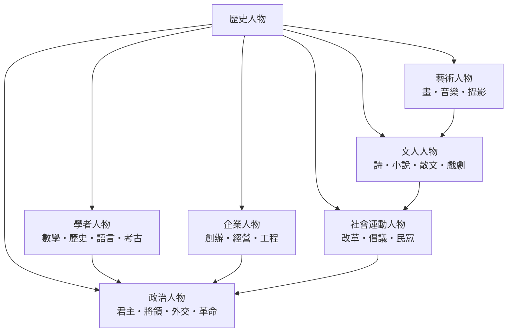

# 歷史人物

> 分類範圍：以具名個人為單位，敘述其在政治、學術、文藝、經營與社會運動中的角色，並說明制度、事件與技術如何製造、放大或淘汰「被記住的人」。　·　隸屬第一層：[人]　·　相關分類：[科學家]、[藝術家]、[宗教領袖]　·　子分類總表見 [README]

> 對應維基百科：[中文維基百科：歷史人物](https://zh.wikipedia.org/wiki/%E5%8E%86%E5%8F%B2%E4%BA%BA%E7%89%A9)　·　[English Wikipedia: Historical figure](https://en.wikipedia.org/wiki/Historical_figure)

「歷史人物」不是一個職業名稱，而是一種**被記錄下來的個人身分**。它與「人」的概念差別很大：任何人都會出生、活著、死去，但只有在特定條件下，個人才會變成歷史人物——名字被寫下、事蹟被敘述、影響被承認。這套條目要處理的問題因此是：**什麼條件決定了誰被記住、怎樣被記住，以及記住的方式如何反過來塑造社會對權力、知識與價值的理解**。

## 核心問題：歷史記憶的生產機制

歷史人物的存在依賴三個環節：

1. **記錄**：文字、印刷、肖像、碑刻、檔案，把個人從時間中固定下來。[司馬遷] 以紀傳體把人物寫進正史，是中文世界最典型的記錄技術。
2. **敘事**：把零散事蹟編成有因果、有性格、有評價的故事；人物因故事而具有可傳播的形狀。
3. **合法性**：只有被當代或後世認定為「重要」的人，故事才會被反覆複述、考訂與教材化。

因此，歷史人物是被**制度**製造出來的產物：官僚制度需要它的忠臣與能臣，教科書需要它的典範與教訓，博物館需要它的作者與收藏家，媒體需要它的英雄與反面教材。

## 因果鏈

1. **口述與銘刻**：在沒有文字的階段，個人的事蹟靠口傳與墓碑保留，記憶的範圍與部落、氏族或城邦的邊界一致。
2. **文字與官僚記錄**：文字行政出現後，官吏的行為被登記，個人的"政績"與"過失"第一次可以脫離其人而留存，忠臣、循吏與酷吏這些類型隨之出現。
3. **修史與紀傳體**：編纂王朝正統史，把個人納入紀、表、書、世家、列傳的體例，中國歷史人物的基本敘事單位由此定型。
4. **印刷與傳記**：印刷術讓傳記、尺牘、逸聞與文集得以流通，個人名聲第一次可以脫離其所在的城市與家族而傳播。
5. **博物館與檔案館**：19 世紀的制度使物質遺存與文書得到系統性收藏與研究，[達文西] 這類"生前默默無聞、死後被重估"的人物由此出現。
6. **大眾傳媒與政治符號**：報紙、電影與廣播把人物形象標準化，烈士、叛徒與英雄成為可批量使用的公共符號。
7. **數據與網絡時代**：社交平臺與搜索讓"知名度"可量化，但也讓短暫的爭議人物快速聚集與消散，記憶的週期明顯縮短。

## 子分類的定位與相互驅動

| 子分類 | 核心資產 | 歷史定位與互相驅動 |
| --- | --- | --- |
| [政治人物] | 權力、合法性、強制力 | 一切制度變革的執行者與抵抗者；其行動往往需要[學者人物] 的合法性論證與[社會運動人物] 的動員支持 |
| [學者人物] | 方法、證據、命名 | 為其他子分類提供證據、標準與概念；制度給予他們職位與經費，政治人物則提供保護與資源 |
| [文人人物] | 語言、敘事、記憶 | 把時代的價值得以保存與傳播；其寫作常為政治行動提供理由與象徵 |
| [藝術人物] | 形式、感知、想像 | 以非文字方式塑造集體感受；需要[企業人物] 的贊助與市場，也回饋城市與國家的形象 |
| [企業人物] | 資本、組織、技術 | 把技術與商品轉化為大眾生活；其成就在政治上依賴國家制度與和平環境 |
| [社會運動人物] | 議題、號召、組織 | 挑戰既有秩序並提出替代方案；常被既有政治人物吸收、鎮壓或改造 |

各子分類下的孫分類（數學家、詩人、畫家等）見 [README] 的總表。六個子分類並非並列的清單，而是一個**互相供養又互相限制的系統**：[甘地] 需要理論論證，也需要報刊與組織；[愛迪生] 需要工程師與資本，也需要制度化的專利；[莎士比亞] 需要劇團、商業城市與印刷商；[拿破崙] 需要軍隊、官僚與工程師。理解一個人物，往往同時就是理解他周圍的那張網。

## 歷史人物與其他分類的邊界

- 與 [科學家] 的界線不在職務而在**方法的可反駁性**：科學家以重複實驗與公開批評維持其地位，歷史人物則以敘事與象徵維持其地位。
- 與 [藝術家] 的界線在**署名與市場**：藝術家有作品與風格可被辨認，歷史人物則有生平與作用。
- 與 [宗教領袖] 的界線在**超越性的宣稱**：宗教領袖往往聲稱其權力來自神授或啟示，因而承擔不同的說服義務。

## 容易混淆之處

- **歷史人物不等於「名人」**。知名度可能來自短期爭議，歷史地位則要求持久的名聲、可靠的記錄與對後續的影響。
- **被記住不等於被理解**。歷史上許多人物是後世重新塑造的產物，其"形象"往往比其本人更一致、更簡潔。
- **缺席者值得注意**。歷史人物的清單幾乎完全由男性、精英與掌權者構成，勞動者、女性與被壓迫者的缺席本身就是一種歷史事實。
- **年代越遠，細節越少**。關於早期人物的敘事，往往是後人依據少量線索與當代需要補成的。

## 延伸閱讀

- [事]：個人所參與的具體事件，是理解其作用的基本單位。
- [時]：時代與時期，界定人物活動的時間框架。
- [地]：城市與國家，決定了人物活動的空間條件。
- [物]：作品、器物與檔案，是人物留下痕跡的物質形式。
- [科學史]：知識與制度的變遷，如何改變了人物的可能。
- [考古年代學]：年代判定與遺物斷代的方法。
- [文明興衰]：長時段結構，與個人敘事互補的解釋框架。

## 為什麼要寫「歷史人物」而不是「名人傳記」

1. **它處理的首先是歷史學問題**：誰被記住、為什麼被記住、以什麼形式被記住。
2. **它把人物放回制度**：沒有官僚制度、出版市場或大學，就沒有今天這些人物類型。
3. **它拒絕英雄敘事的單一因果**：個人的作用必須同時被解釋為個人能力與結構條件的乘積。
4. **它也保存缺席者**：把誰沒有留下名字，與誰留下名字一起記錄下來，是這套條目自我提醒的責任。
## 連結定義

[人]: ../人/README.md
[事]: ../事/README.md
[時]: ../時/README.md
[地]: ../地/README.md
[物]: ../物/README.md
[README]: README.md
[科學家]: ../科學家/科學家.md
[藝術家]: ../藝術家/藝術家.md
[宗教領袖]: ../宗教領袖/README.md
[科學史]: ../科學史/README.md
[文明興衰]: ../文明興衰/README.md
[考古年代學]: ../考古年代學/README.md
[政治人物]: 政治人物.md
[學者人物]: 學者人物.md
[文人人物]: 文人人物.md
[藝術人物]: 藝術人物.md
[企業人物]: 企業人物.md
[社會運動人物]: 社會運動人物.md
[司馬遷]: ../人/司馬遷.md
[達文西]: ../人/達文西.md
[甘地]: ../人/甘地.md
[拿破崙]: ../人/拿破崙.md
[愛迪生]: ../人/愛迪生.md
[莎士比亞]: ../人/莎士比亞.md
