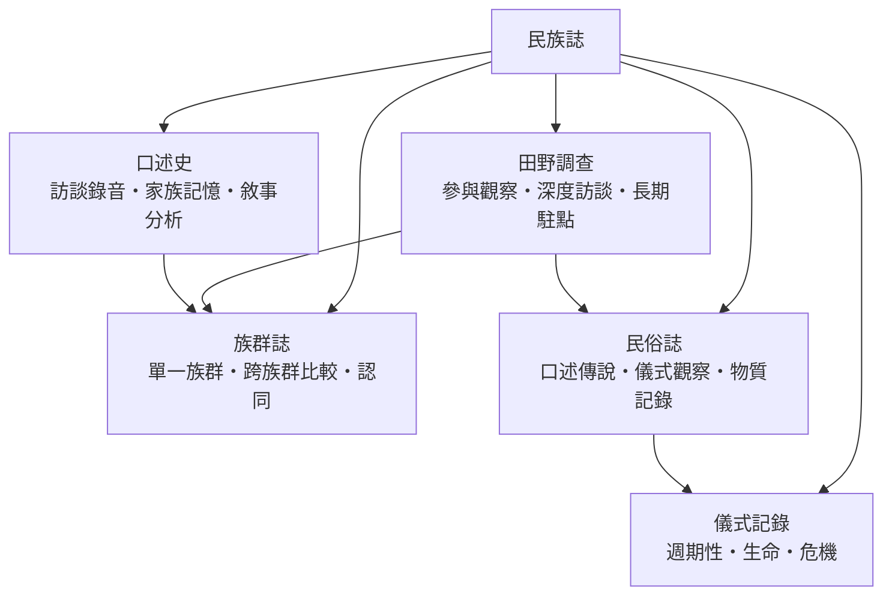

# 民族誌

> 分類範圍：以「把一群人寫清楚」為目標的方法學部門——田野調查、族群記錄、民俗與儀式的記錄技術，以及口述史的採集與分析。　·　隸屬第一層：[人]　·　相關分類：[人類學]、[社會學]、[民俗學]　·　子分類總表見 [README]

> 對應維基百科：[中文維基百科：民族誌](https://zh.wikipedia.org/wiki/%E6%B0%91%E6%97%8F%E8%AA%8C)　·　[English Wikipedia: Ethnography](https://en.wikipedia.org/wiki/Ethnography)

民族誌是一種**產品**，也是一套**方法**。作為產品，它是對一個人群的系統性描述；作為方法，它是取得這份描述的全部技術——住進去、聽懂話、記錄、核對、寫作、回饋。本概念要處理的問題是：**一段關於他人的描述，要具備什麼才值得信賴；而寫作的行為本身又如何影響被寫的人**。

## 核心問題：描述的信度

民族誌與遊記、報導的分界，在於三個可檢查的承諾：

1. **在場**：描述者親自長期接觸，接觸的時間、語言與方式可被檢查。
2. **方法**：取樣、訪談與記錄有明說的程序，他人可以重複或質疑。
3. **位置**：作者承認自己的身分、立場與限制，並說明它們可能造成的偏差。

這三項承諾使民族誌成為**可以失敗但無法造假**的文類——讀者永遠知道該從哪裡開始懷疑。

## 因果鏈

1. **殖民地誌與博物館時代**：早期的異民族記述服務於行政與收藏，材料的品質參差，且帶著單向的權力關係。
2. **田野方法的標準化**：長期駐點與參與觀察被確立為學科入門，描述的責任從「聽說」轉到「親證」。
3. **寫作的自覺**：一九八〇年代的反思浪潮指出民族誌是「寫作的產物」，方法章與多聲部文本成為新的標準。
4. **合作與回饋**：被研究社群成為讀者、合作者與署名者；回譯、授權與共同發表成為倫理常態。
5. **多媒介與數位田野**：影音記錄、社群媒體與線上社群擴大了田野的場域，也帶來新的同意與保存問題。

## 子分類的定位與相互驅動

- [田野調查] 是**方法的底座**：無論寫族群還是寫儀式，證據都從田野來。
- [族群誌] 是**主體的骨架**：把一群人的語言、生計、親屬與政治寫成整體。
- [民俗誌] 與 [儀式記錄] 是**專題的深化**：前者收集流傳的內容，後者跟蹤發生的行為。
- [口述史] 是**記憶的通道**：當文獻缺席或偏斜時，被訪者的敘事是歷史的最後證人。

## 範例：一次長期駐點的時間表

以一份標準的田野計畫為例，可看出方法的運作節奏：

1. **前期**：文獻調查、語言準備、許可與倫理審查；與當地機構建立合作關係。
2. **入場**：居住安排、身分說明、報導人網絡的初步建立；這一階段以「被接納」為目標，不以「採集」為目標。
3. **中期**：日常參與觀察、系譜與居住圖的繪製、焦點訪談的展開；筆記每天整理。
4. **關鍵事件**：婚喪、節慶與糾紛一旦發生即全程記錄；行程為事件讓路。
5. **收束**：離場前的核對訪談（把已寫成草稿的描述拿回給報導人檢查）、資料整理與承諾的回饋。
6. **寫作**：方法章交代全部上述內容——**方法章不是附錄，而是信度的證明**。

## 三個承諾的檢查表

1. **在場**的檢查：田野時間總量、語言能力、居住方式是否都寫在方法章。
2. **方法**的檢查：受訪者如何選出、訪談幾場、如何核對，是否可追溯。
3. **位置**的檢查：作者與被寫者的關係（研究者？族人？專案顧問？）是否明說。

三項都過，描述才進入「可被批評」的狀態——而可被批評，正是民族誌相對於傳說的優點。

## 容易混淆之處

- **民族誌不等於人類學**：民族誌是方法與文類；社會學、教育學、設計研究也都生產民族誌。
- **「客觀」不是免除立場，而是明示立場**：聲稱沒有立場的描述反而無法被檢查。
- **口述不等於不可信**：記憶有結構、有選擇，但這些選擇本身就是資料；問題是把記憶當成事實，而不是不聽記憶。
- **田野時間無法用技術完全替代**：影音與感測設備擴大了記錄能力，但信任與互動仍需時間累積。

## 延伸閱讀

- [人類學]：方法所屬的學科框架。
- [社會學]：以問卷與統計互補的姊妹方法。
- [民俗學]：流傳內容的專門研究。
- [宗教學]：儀式與信仰記錄的鄰接領域。

## 連結定義

[人]: ../人/README.md
[README]: README.md
[人類學]: ../人類學/人類學.md
[社會學]: ../社會學/README.md
[民俗學]: ../民俗學/README.md
[宗教學]: ../宗教學/README.md
[田野調查]: 田野調查.md
[族群誌]: 族群誌.md
[民俗誌]: 民俗誌.md
[儀式記錄]: 儀式記錄.md
[口述史]: 口述史.md
