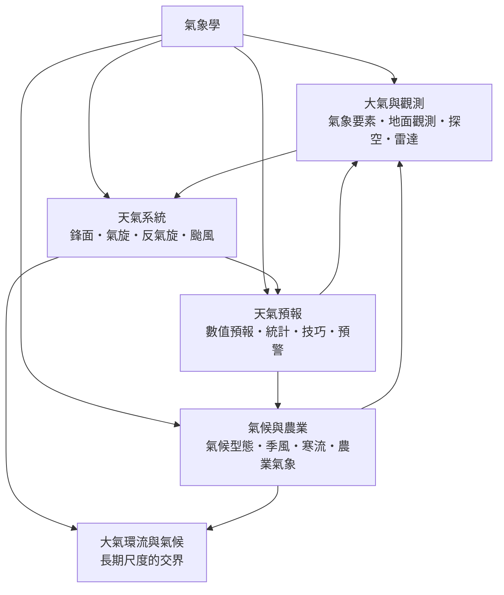

# 氣象學

> 隸屬：第一層 [天]、[理]　·　相關分類：[地球與大氣科學]、[大氣環流]、[海洋學]　·　子分類總表見 [README]

> 對應維基百科：[中文維基百科：氣象學](https://zh.wikipedia.org/wiki/%E6%B0%94%E8%B1%A1%E5%AD%A6)　·　[English Wikipedia: Meteorology](https://en.wikipedia.org/wiki/Meteorology)

氣象學研究**大氣的狀態、過程與短期變化**，核心任務是回答「明天天氣如何」這個人類最古老也最日常的科學問題。它以溫度、氣壓、濕度、風與降水等 [氣象要素] 為語言，以 [地面觀測]、[探空] 與 [雷達] 為感官，以流體力學與熱力學為骨架，最後把所有的量測與物理法則濃縮成 [數值預報] 這台「大氣的計算機模擬」。

這門學科的發展史是一部**觀測與理論互相拉抬**的歷史。十六世紀末溫度計與氣壓計相繼發明，使天氣第一次變成可量測的數字；十九世紀電報把各地觀測即時匯總，天氣圖與 [鋒面] 概念由此誕生；二十世紀中葉，電腦讓大氣方程式可以被數值求解，預報從經驗藝術轉為科學工程；衛星時代再把全球大氣放進同一張照片裡。今天，七到十天的預報可信度已高於五十年前的兩到三天，這是二十世紀應用科學最安靜也最成功的成就之一。

氣象學與 [氣候] 研究的分工在於時間尺度：氣象學處理小時到兩週的天氣，氣候學處理數十年以上的統計行為；兩者共用同一套物理，但在 [全球暖化] 時代，極端天氣與氣候變遷的交界正是目前研究最密集的地帶。

## 核心問題

1. **大氣現在的狀態是什麼？** 這是 [大氣與觀測] 回答的問題：以 [地面觀測]、[探空] 與 [雷達] 建立全球的即時快照。
2. **這些觀測如何被組織成天氣系統？** 這是 [天氣系統] 回答的問題：[鋒面]、[氣旋] 與 [反氣旋] 的結構與生命史，以及 [颱風] 這個最強烈的天氣機器。
3. **未來的天氣如何推算？** 這是 [天氣預報] 回答的問題：[數值預報] 的物理方程式、[統計方法] 的修正、[預報技巧] 的量化與 [災害預警] 的傳播。
4. **天氣與農業、生產如何對接？** 這是 [氣候與農業] 回答的問題：[季風] 與 [寒流] 的規律如何決定耕作曆，[農業氣象] 如何把預報變成農事決策。

## 因果鏈

1. **儀器讓天氣變成數字**：十七世紀初伽利略與托里切利時代的溫度計與氣壓計，把「冷熱」「陰晴」的主觀描述轉成可記錄、可比較的量。
2. **電報讓觀測可以賽跑**：十九世紀中葉，電報網使風暴的即時追蹤成為可能；[1854年] 克里米亞戰爭中的風暴預警失敗，直接促成國家氣象服務的成立。
3. **天氣圖讓系統現形**：[1861年] 前後，費茲羅伊等人繪製同步天氣圖，[鋒面] 與氣旋的概念在皮葉克尼斯父子的挪威學派手中成型（1917 年前後）。
4. **動力學讓預報有方程式**：理查森在 [1922年] 出版《用數值方法做天氣預報》，雖然手算失敗，卻確立了以流體力學方程式預報天氣的路線。
5. **電腦讓方程式跑得動**：[1950年] 前後，查尼等人以最早的電腦完成首次成功的數值預報；[數值預報] 從此成為氣象學的中樞。
6. **衛星與雷達補齊全球視野**：1960 年首枚氣象衛星 TIROS-1 升空，[雷達] 網路使降水結構可即時成像，觀測從點擴展到面與全球。
7. **統計後處理提高可用性**：模式輸出與地面實況之間的偏差，以 [統計方法] 訂正；集合預報量化不確定性，[預報技巧] 因此有嚴格的評分體系。
8. **預警把預報變成防災**：從 [颱風] 警戒到豪雨特報，[災害預警] 把科學產出轉成社會行動；同時 [全球暖化] 使極端天氣事件的歸因研究成為新前沿。

## 子分類的定位與相互驅動

- [大氣與觀測] 是**感官**：沒有足夠密度的觀測，一切理論與模式都是空轉；觀測網每一次加密，預報技巧就往上跳一階。
- [天氣系統] 是**骨架**：[鋒面] 與 [氣旋] 的概念模型把雜亂的觀測整理成有生命史、可追蹤的系統，[數值預報] 的初始場也要靠這些概念被理解。
- [天氣預報] 是**中樞**：它同時餵養與消耗觀測——觀測資料經同化進入模式，模式輸出又決定下一步往哪裡加密觀測。
- [氣候與農業] 是**出口**：[季風] 的到達時間、[寒流] 的頻率直接進入 [作物栽培] 的決策，[氣候型態] 的長期特徵則決定一個地區能種什麼，預報的社會價值在此兌現。
- 向外，氣象學與 [大氣環流]、[海洋學]、[全球暖化] 共享能量收支與環流的物理，構成 [地球與大氣科學] 的核心帶。

## 範例：一次颱風路徑預報是怎麼做出來的

1. **觀測蒐集**：[地面觀測] 站、船隻、浮標與探空氣球提供初始場，衛星雲圖與 [雷達] 描繪 [颱風] 的核心結構。
2. **資料同化**：把數十萬筆觀測轉成模式的初始狀態——這一步的品質直接決定預報起點。
3. **集合預報**：模式以數十個略為不同的初始場與物理設定各跑一次，路徑呈現扇形不確定區。
4. **訂正與人為判斷**：以 [統計方法] 訂正系統性偏差，預報員結合局部經驗決定官方路徑與風雨預測。
5. **發布與傳播**：警戒區、強度與時間軸以 [災害預警] 形式對外發布，供 [農業氣象] 與防災單位採取行動。
6. **檢驗回饋**：事後以 [預報技巧] 評分逐次檢討，誤差回頭改進觀測策略與模式物理。

## 容易混淆之處

- **氣象不是氣候**：氣象是短期大氣狀態，氣候是長期統計；「一天很冷」不能反駁全球暖化。
- **預報不確定性不是「不準」**：集合預報給出的是機率，扇形路徑圖的意義是分布而非單一答案。
- **氣旋與颱風的關係**：[颱風] 是強度達標的熱帶 [氣旋]，各地稱呼（颶風、氣旋性風暴）不同，機制相同。
- **「鋒面過境」不等於「冷空氣到」**：鋒面是兩氣團的界面，過境時的天氣變化順序有固定結構。
- **模式不是黑箱作弊**：[數值預報] 建立在流體力學與熱力學定律上，其進步是可歸因於解析度、觀測與物理改進的科學過程。

## 延伸閱讀

- [地球與大氣科學]：氣象學所屬的上層概念。
- [大氣環流] 與 [海洋學]：長期環流與海洋—大氣交互作用。
- [全球暖化] 與 [極端天氣]：氣候變遷下的天氣極端化。
- [作物栽培]：氣象資訊的農業出口。
- [竺可楨]：中國近代氣象學與物候觀測的奠基者。

## 連結定義

[天]: ../天/README.md
[理]: ../理/README.md
[README]: README.md
[地球與大氣科學]: ../地球與大氣科學/README.md
[大氣環流]: ../大氣環流/README.md
[海洋學]: ../海洋學/README.md
[全球暖化]: ../全球暖化/README.md
[極端天氣]: ../極端天氣/README.md
[作物栽培]: ../作物栽培/README.md
[竺可楨]: ../人/氣象學家/竺可楨.md
[大氣與觀測]: 大氣與觀測.md
[氣象要素]: 氣象要素.md
[地面觀測]: 地面觀測.md
[探空]: 探空.md
[雷達]: 雷達.md
[天氣系統]: 天氣系統.md
[鋒面]: 鋒面.md
[氣旋]: 氣旋.md
[反氣旋]: 反氣旋.md
[颱風]: 颱風.md
[天氣預報]: 天氣預報.md
[數值預報]: 數值預報.md
[統計方法]: 統計方法.md
[預報技巧]: 預報技巧.md
[災害預警]: 災害預警.md
[氣候與農業]: 氣候與農業.md
[氣候型態]: 氣候型態.md
[季風]: 季風.md
[寒流]: 寒流.md
[農業氣象]: 農業氣象.md
[氣候]: 氣候型態.md
[1854年]: ../時/1854年.md
[1861年]: ../時/1861年.md
[1922年]: ../時/1922年.md
[1950年]: ../時/1950年.md
