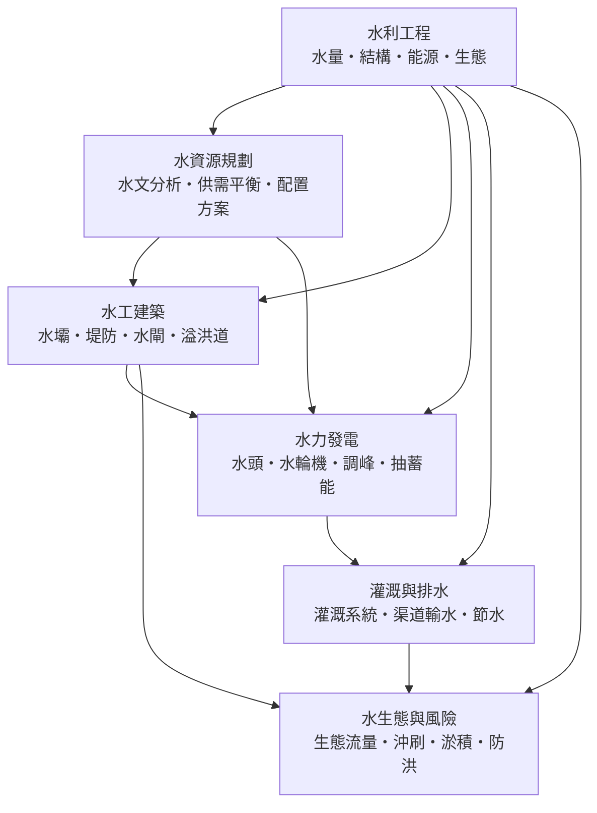

# 水利工程

> 隸屬：第一層 [工]　·　相關分類：[土木工程]、[流體力學]、[灌溉]、[再生能源]　·　子分類總表見 [README]

> 對應維基百科：[中文維基百科：水利工程](https://zh.wikipedia.org/wiki/%E6%B0%B4%E5%88%A9%E5%B7%A5%E7%A8%8B)　·　[English Wikipedia: Hydraulic engineering](https://en.wikipedia.org/wiki/Hydraulic%20engineering)

水利工程是**規劃、設計、建造與管理「改變水的時空分布」之人工系統**的學科：水庫、堤防、水閘、溢洪道、灌渠、電廠與排水網都屬於它的領域。水的天然節律與人類需求並不同步——河川在汛期送來過量的水、在旱季幾乎斷流，而農田與城市需要的是穩定的供水、電網需要的是可控的出力。水利工程的本質，就是把時間上的錯配與空間上的錯配，用一整套結構與調度規則「校正」過來。

它與近親 [土木工程] 的差別在**工作對象會流動**：橋梁對抗的是相對穩定的重力與風，水利工程對抗的是會沖刷、會淤積、會滲透、會結冰也會蒸發的活水。因此水利工程必須同時掌握 [流體力學] 的運動規律、泥沙運動的長期趨勢，以及 [水圈] 在流域尺度上的水量平衡；一座壩建成的瞬間，河流就開始改寫自己，而工程師必須預先寫好這個「改寫的劇本」。

## 核心問題

水利工程要回答的問題，可收斂為五個互相咬合的子問題。

1. **有多少水**：流域在一年、十年、百年尺度上會送來多少水量與洪峰？這是 [水文分析] 的領域，答案來自長期流量記錄、降雨逕流模型與頻率分析。估錯了，水庫不是溢頂就是空轉。
2. **要多少水**：城市、農田、電網、生態系各自要求什麼水量、水質與時程？供水承諾與 [灌溉] 需求之間如何取捨？這是 [供需平衡] 與 [配置方案] 的問題，涉及 水權制度與分配規則。
3. **怎麼擋、怎麼放**：攔水的壩體要抗住多大的靜水壓力與揚壓力？超過庫容的洪水從哪裡安全宣洩？這是 [水工建築] 的力學與結構問題，核心是「擋得住、也放得出」。
4. **怎麼發電、怎麼送水**：落差與流量如何轉成出力？渠道沿途損失多少水？這把 [水力發電] 與 [灌溉與排水] 連起 [電機工程] 與農業系統。
5. **代價是什麼**：攔河之後，下游沖刷、水庫淤積、生態流量被擠占、[全球暖化] 下的極端水文如何重新檢驗設計？這是 [水生態與風險] 的領域，決定了「建不建、建多大、怎麼運轉」。

這五個問題彼此牽制：提高蓄水位可以多發電、多蓄水，卻加大淹沒範圍與壩體造價；放大溢洪道可以降低潰壩風險，卻抬高成本並限制庫容。**水利工程的本質，是在水量、結構、能源與生態之間找出一個可被計算、可被監測、可被長期管理的平衡點。**

## 因果鏈

1. **灌溉先行**：人類最早的水利工程不是壩，而是灌渠。約西元前 256 年前後，蜀郡太守 [李冰] 主持修建 [都江堰]，以「無壩引水、魚嘴分水、飛沙堰排沙」的設計，讓成都平原旱澇由人——它證明：**懂得水的去留規則，比硬擋住水更重要。**
2. **靜水力學的量化**：托里切利與 [帕斯卡] 在 17 世紀確立流體靜壓規律之後，「壩底壓力有多大」第一次成為可以計算的量，坅工重力壩開始從經驗斷面走向設計斷面。
3. **能量與流動的方程**：[1738年] [伯努利] 把壓力與流速聯繫起來，水頭、流量與功率之間出現了定量關係；水車到水輪機的躍升由此獲得理論基礎，反擊式水輪機在 19 世紀中葉成熟。
4. **混凝土與拱的時代**：[水泥] 與 [鋼筋混凝土] 工業化之後，壩體從堆石與坅工走向整體混凝土結構；拱壩把靜水壓力傳往兩岸岩體，材料的強度與地形的地質條件第一次被同一套力學串起來。
5. **頻率分析的普及**：20 世紀水文學界把 [機率統計] 導入極值分析，設計洪水從「史上最大」變成「重現期 X 年」；溢洪道、堤防高度的設計標準從此有了一致的語言，防洪風險可以被定義、比較與交易。
6. **大水庫與系統調度**：[1936年] [胡佛水壩] 竣工，把壩高推到 221 公尺、也把「一座壩＝防洪＋供水＋發電＋淤沙庫容」的多目標樞紐概念制度化；流域從單一工程變成梯級系統，[調峰] 與跨流域調水成為新的運轉問題。
7. **抽蓄能與電網耦合**：電網負載曲線的尖谷差越來越大，核電與風光等間歇性能源又缺可調度性，於是把水抽上高位水庫、尖峰時再放水的 [抽蓄能] 從配角變成電網穩定的主力工具，水利工程與 [電機工程] 深度耦合。
8. **生態與風險的轉向**：壩下游的河床刷深、三角洲退縮、迴游魚類消失，加上氣候變遷使「重現期」本身漂移，逼使設計者把 [生態流量] 寫進水庫操作規線、把不確定性寫進風險評估；「水利」一詞的範圍，從取水擋水擴大到管理水的整個生態與社會後果。

## 子分類的定位與相互驅動

- [水資源規劃] 是**量的層**：它用 [水文分析] 回答「河裡有多少水」，用 [供需平衡] 回答「各方要多少水」，再用 [配置方案] 把兩者接起來。沒有這一層，後面所有的壩與渠都是盲目的——壩蓋太大只是昂貴的擺設，蓋太小則是長期的災難。
- [水工建築] 是**結構層**：把「該擋的水」變成可以蓋出來的壩、堤、閘與溢洪道。它依賴 [流體力學] 給出壓力與滲流、依賴 [材料工程] 給出混凝土與岩石的強度，同時它的洩流能力又回頭限制了水庫可以宣稱的防洪庫容。
- [水力發電] 是**能量層**：把水頭與流量換成千瓦，再把千瓦透過 [調峰] 與 [抽蓄能] 對上電網的時刻表。它讓水利工程從「花錢的公共設施」變成「賺錢的能源資產」，也讓水庫的操作規線必須同時服務水與電兩個主人。
- [灌溉與排水] 是**使用層**：水離開樞紐之後如何流到田裡、如何從田裡退出去，決定了水利工程最終服務多少人口。渠道的蒸發與滲漏損失倒逼 [節水] 技術，田間排水不良則會把灌溉變成鹽化與澇災。
- [水生態與風險] 是**後果層**：壩建好之後河流的長期反應——下游沖刷、水庫淤積、生態流量被擠占、極端洪水的重現期漂移——會回頭修改規劃假設與建築操作規則。它不是附加的道德裝飾，而是前四層的邊界條件。

五者的關係可用一句話概括：**規劃定水量，建築定結構，發電定節奏，灌溉定落點，生態定極限。**

## 範例

**範例一：一座流域樞紐的完整取捨。** 假設某河年逕流量 60 億立方公尺、汛期三個月占七成：

- [水資源規劃] 端出方案：水庫有效庫容 15 億立方公尺，汛期騰出 5 億立方公尺作防洪庫容，供水與 [灌溉] 各分配 10 億與 8 億立方公尺。
- [水工建築] 依此定形：91 公尺高的重力壩、表孔 [溢洪道] 按「重現期一萬年」洪水校核、左右岸取水口分別接供水與灌渠。
- [水力發電] 在壩後裝 3 部 60 百萬瓦機組，依電網 [調峰] 需求在晚間尖峰集中發電，水庫水位因此在日內以 1 至 2 公尺擺動。
- [灌溉與排水] 則把水接進 120 公里幹渠，並以 [田間排水] 防止下坡田區地下水位上升造成的鹽化。
- [水生態與風險] 最後設規則：枯水季強制下洩不小於 12 立方公尺每秒的 [生態流量]，並規定每 5 年監測壩下游河床高程與庫區淤積速率。

**任何一項改動都會穿層**：若電網要求加大 [調峰] 能力，水庫日變幅增大，取水口的進水穩定度與下游 [生態流量] 的脈衝都要重新檢核。

**範例二：無壩引水的古老智慧。** [都江堰] 不建高壩，而在河道分水處以魚嘴把岷江分成內外兩江：內江供灌、外江走洪，飛沙堰利用彎道環流把泥沙甩回外江。枯水期六成水入內江，洪水期六成水走外江，分水比例由水力學自動完成，兩千多年不需人工調度也能維持。這說明水利工程的高境界未必是更大的結構，而是**更聰明的水力設計**。

**範例三：抽蓄能的電價帳。** 某抽蓄電站上下池落差 500 公尺，循環效率約 75%：夜間以離峰電價每度 1.5 元抽水，次日尖峰以每度 4.5 元放水發電。每度往返損失 25%，但價差 3 元足以覆蓋損失與設備折舊——這正是 [抽蓄能] 在風光占比升高後大規模擴建的經濟邏輯。

## 容易混淆之處

- **水利工程不等於「蓋壩」**：壩只是工具之一；引水、分洪、退水、節水與制度設計同樣是水利工程，而且常是更省錢的那一半。都江堰無壩而利兩千年，就是最好的反例。
- **防洪庫容不等於總庫容**：水庫不能全程滿蓄——汛前必須騰空庫容等洪水，被騰出的空間才是防洪能力；把「總庫容」說成「防洪能力」是最常見的誤讀。
- **重現期不是周期**：「百年一遇洪水」指每年有 1% 機率發生，不代表每隔一百年才來一次，也可能十年內來兩次。
- **水頭與落差不是同一件事**：有效 [水頭] 是進出口總水頭之差，要扣掉引水道的摩擦損失與尾水位變動，通常小於地形高差。
- **發電大不等於能源效益高**：徑流式電廠裝機大但受季節流量限制，容量因數可能不到 40%；比較電廠要看發電量與可調度性，不能只看裝機容量。
- **淤積不是維護問題，是壽命問題**：水庫庫容會被泥沙永久侵占，淤滿即失效；疏浚的單價遠高於「讓泥沙排到壩下」，所以排沙設計必須在選址與結構階段就定案。

## 延伸閱讀

- [土木工程]：水利工程的上位工程學科，共用結構、地質與施工方法。
- [流體力學]：靜水壓力、伯努利方程與滲流理論的來源。
- [灌溉]：農業用水系統的直接上位概念。
- [水圈]：流域水量平衡的自然背景。
- [河川]：被工程對象化的河流本身。
- [再生能源]：水力發電在能源轉型中的位置。
- [電機工程]：發電機、變壓與電網調度的對接領域。
- [防災工程]：防洪風險與韌性設計的鄰接領域。
- [機率統計]：頻率分析與不確定性量化的數學工具。
- [水土保持]：從源頭減少泥沙與洪峰的姊妹學科。
- [李冰]、[都江堰]、[胡佛水壩]：兩個相隔兩千年的工程範式。

## 連結定義

[工]: ../工/README.md
[README]: README.md
[土木工程]: ../土木工程/README.md
[流體力學]: ../流體力學/README.md
[灌溉]: ../灌溉/README.md
[再生能源]: ../再生能源/README.md
[水圈]: ../水圈/README.md
[河川]: ../河川/README.md
[防災工程]: ../防災工程/README.md
[全球暖化]: ../全球暖化/README.md
[機率統計]: ../機率統計/README.md
[電機工程]: ../電機工程/README.md
[材料工程]: ../材料工程/README.md
[水土保持]: ../水土保持/README.md
[水泥]: ../物/水泥.md
[鋼筋混凝土]: ../物/鋼筋混凝土.md
[李冰]: ../人/工程師/李冰.md
[都江堰]: 都江堰.md
[胡佛水壩]: 胡佛水壩.md
[帕斯卡]: ../人/數學家/帕斯卡.md
[伯努利]: ../人/數學家/伯努利.md
[1738年]: ../時/1738年.md
[1936年]: ../時/1936年.md
[水資源規劃]: 水資源規劃.md
[水文分析]: 水文分析.md
[供需平衡]: 供需平衡.md
[配置方案]: 配置方案.md
[水工建築]: 水工建築.md
[溢洪道]: 溢洪道.md
[水力發電]: 水力發電.md
[水頭]: 水頭.md
[調峰]: 調峰.md
[抽蓄能]: 抽蓄能.md
[灌溉與排水]: 灌溉與排水.md
[田間排水]: 田間排水.md
[節水]: 節水.md
[水生態與風險]: 水生態與風險.md
[生態流量]: 生態流量.md
