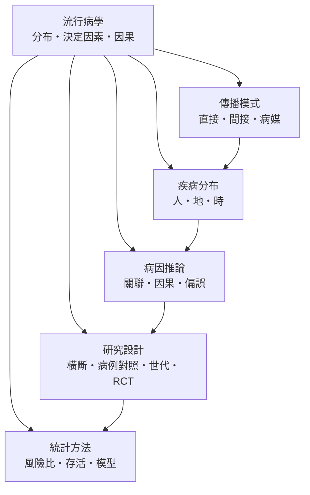

# 流行病學

> 隸屬第一層 [醫]　·　相關分類：[公共衛生]、[機率統計]、[微生物學]　·　子分類總表見 [README]

> 對應維基百科：[中文維基百科：流行病学](https://zh.wikipedia.org/wiki/%E6%B5%81%E8%A1%8C%E7%97%85%E5%AD%A6)　·　[English Wikipedia: Epidemiology](https://en.wikipedia.org/wiki/Epidemiology)

流行病學是研究**健康狀態在人群中的分布與決定因素**的基礎科學——字面意義是「研究加諸人群（epi- demos）之事」。臨床醫師問「這位病人為什麼生病」，流行病學家問「為什麼是**這些人**、在**這個地方**、在**這個時候**生病」。它提供公共衛生的證據引擎：疾病監測靠它描述分布、病因探究靠它設計比較、疫苗與藥物政策靠它評估效果。因為流行病學幾乎不做實驗（你不能讓一群人吸菸二十年），它發展出整套從觀察資料推論因果的方法論——這套方法如今已被經濟學、社會學與機器學習借走，成為所有觀察性科學的通用文法。

## 核心問題：分布、決定因素與因果

流行病學的兩大問題意識來自其定義的兩半：

1. **描述流行病學**：疾病如何依「人、地、時」分布？——誰（年齡、性別、職業）、哪裡（地理、聚落）、何時（季節、趨勢）。這是偵測與假設生成的階段。
2. **分析流行病學**：什麼因素決定這個分布？——暴露與疾病之間的關聯是否為因果？這是假設檢驗的階段。

連接兩者的通用度量是風險與率：發病率（incidence，單位時間新病例）與盛行率（prevalence，某時點現有病例）。兩者的近似關係為：盛行率 $\approx$ 發病率 $\times$ 平均病程——慢性病盛行率高但發生率未必高，正是因為病程長。

## 因果鏈

1. **瘟疫時代的經驗觀察**：古代已有「疾病成群出現」的記錄，但缺乏測量工具；隔離與檢疫靠直覺而非數據。
2. **約翰·斯諾的地圖調查**：[約翰斯諾] 在 [1854年] 倫敦霍亂疫情中以死亡地點與水源對應，完成流行病學史上第一次系統性的空間比較——「比較暴露組與未暴露組」的方法原型。
3. **統計的引入**：十九世紀末起，生命統計、死亡率標準化與抽樣方法讓「人群」可以被量化比較； Farr 與後繼者建立現代生命登記制度。
4. **吸菸與肺癌之戰**：[1948年] 起 Doll 與 Hill 開展英國醫師世代研究，並輔以病例對照研究，確立吸菸致肺癌——在無法做實驗的情況下，建立「觀察性證據也能支持因果」的方法論標準。
5. **因果判準的系統化**：Hill 於 1965 年提出九項因果判準（時間順序、強度、劑量反應、一致性等），使因果推論從爭論變成有程序的評估。
6. **研究設計的層級化**：橫斷面 → 病例對照 → 世代研究 → 隨機對照試驗的證據金字塔成形，臨床與公共衛生決策開始分級引用證據。
7. **生物統計深化**：風險比、存活分析（Cox 迴歸）、多變項模型與敏感度分析，讓混淆因子、偏誤可以被建模與校正。
8. **分子與數位流行病學**：基因定序追蹤病原傳播鏈、廢水監測、社群訊號與即時監測，把流行病學的時間解析度從「週」推進到「小時」。

## 子分類的定位與相互驅動

- [疾病分布] 是**觀察層**：以人、地、時描述疾病現況，產生最初的假設——一切調查的起點。
- [病因推論] 是**判斷層**：把「相關」與「因果」分開，處理混淆因子與各種偏誤；沒有這一層，分布觀察只會產生無限多的假解釋。
- [研究設計] 是**工具層**：不同問題需要不同設計——罕見病用病例對照、慢性暴露用世代、效果評估用隨機對照；設計的選擇直接決定結論強度。
- [傳播模式] 是**機制層**：傳染病特有的動力學——直接接觸、環境介質、動物宿主、病媒各有不同的防控切入點，並以基本再生數 $R_0$ 量化傳播潛力。
- [統計方法] 是**語言層**：風險比、存活分析與多變項模型把上述所有比較變成可計算、可信賴區間約束的數字。

## 範例：一次疫情調查的流行病學全流程

1. **監測異常**（疾病分布）：某校三天內 120 名學生嘔吐腹瀉，遠超基線。
2. **描述流行病學**：繪製發病時間曲線（epidemic curve）——陡升陡降的點狀爆發形態，指向**共同單一暴露**（如某餐）而非人傳人。
3. **分析調查**：以病例對照設計比較病例組與健康組的飲食史，計算各食物的關聯強度。
4. **統計與推論**：炒飯的風險比 $\text{OR} = 8.5$ （ $95\%$ 信賴區間 $3.2 \sim 22.6$ ），顯著高於其他項目。
5. **病因確認**：環境採樣在炒飯檢出蠟樣芽孢桿菌，與米飯高溫放置有關——流行病學假設與實驗室證據會合。
6. **介入與傳播分析**：若為傳染性病原，則估算 $R_0$ 與潛伏期以決定隔離範圍；本例為食物中毒，改以廚房流程改善收尾。

## 容易混淆之處

- **流行病學不是「治療流行病」**：它是測量與推論的方法學，疾病本身可以是傳染病、癌症或車禍。
- **相關不等於因果**：冰淇淋銷售與溺水同季上升——共同的「夏天」是混淆因子；因果判斷需要設計與判準，不是相關係數。
- **盛行率高不等於風險高**：盛行率混雜了病程長短；比較風險應看發病率。
- **隨機對照試驗並非萬能**：倫理（不能讓人吸菸）、可行性（無法隨機分配城市）限制其範圍——觀察性研究因此永遠必要。

## 延伸閱讀

- [公共衛生]：流行病學的應用母體，決策端。
- [機率統計]：統計方法論的數學基礎。
- [微生物學]：病原體鑑定與傳染病流行病學的實驗室夥伴。
- [瘟疫大流行]：大流行史中的流行病學里程碑。
- [疫苗學]：疫苗效果評估（保護力、效果）的方法來源。
- [資料科學]：即時監測與預測模型的新工具箱。

## 連結定義

[醫]: ../醫/README.md
[README]: README.md
[公共衛生]: ../公共衛生/README.md
[機率統計]: ../機率統計/README.md
[微生物學]: ../微生物學/README.md
[瘟疫大流行]: ../瘟疫大流行/README.md
[疫苗學]: ../疫苗學/README.md
[資料科學]: ../資料科學/README.md
[疾病分布]: 疾病分布.md
[病因推論]: 病因推論.md
[研究設計]: 研究設計.md
[傳播模式]: 傳播模式.md
[統計方法]: 統計方法.md
[約翰斯諾]: ../人/醫學家/約翰斯諾.md
[1854年]: ../時/1854年.md
[1948年]: ../時/1948年.md
