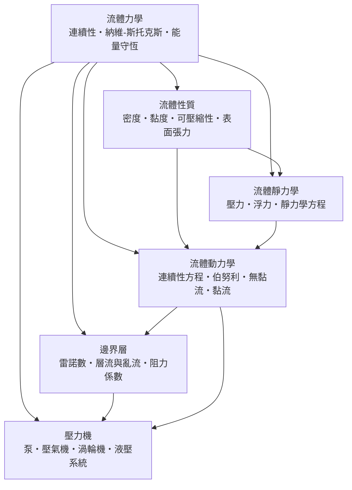

# 流體力學

> 隸屬：第一層 [理]　·　相關分類：[物理學]、[微積分]、[熱力學]　·　子分類總表見 [README]

> 對應維基百科：[中文維基百科：流體力學](https://zh.wikipedia.org/wiki/%E6%B5%81%E4%BD%93%E5%8A%9B%E5%AD%A6)　·　[English Wikipedia: Fluid mechanics](https://en.wikipedia.org/wiki/Fluid_mechanics)

流體力學研究**液體與氣體的受力、運動與平衡**。它與剛體力學的根本差別在於：流體沒有固定形狀，任一剪應力都會使它連續變形，因此描述流體不能只追蹤一個物體，而必須追蹤一整個場——每個位置、每個時刻的速度、壓力與密度。這使得流體力學的數學主體從代數方程變成**偏微分方程**：連續性方程寫質量守恆，動量方程寫牛頓第二定律在流體微團上的形式。流體力學因此成為 [微積分] 在物理中最壯觀的應用場之一，也是 [熱力學]、聲學、大氣科學與幾乎所有工程分支的共同基礎。

流體力學的歷史是一部「從靜到動、從簡到繁」的歷史。靜的部分最早成熟：[托里切利] 在 1643 年用水銀柱證明大氣有壓力並造出真空，[帕斯卡] 據此建立靜壓傳遞定律。動的部分則由 [1738年] 出版《流體力學》的 [伯努利] 與 [歐拉] 的歐拉方程開啟；到了 19 世紀，[納維] 與 [斯托克斯] 把黏性納入動量方程，寫出今日所謂的納維－斯托克斯方程，而 [1883年] [雷諾] 的實驗則揭示了流動分層流與亂流兩種性質迥異的狀態。此後一百多年，流體力學的主要難題始終沒變：方程寫得出來，解不一定解得動——這直接催生了邊界層理論、相似律與計算流體力學。

## 核心問題

流體力學的核心可以壓縮成三條守恆律加上一條本構關係。

1. **質量守恆（連續性方程）**：流體不會無中生有，流入控制體的質量等於流出量加蓄存量。不可壓縮時寫成 $\nabla \cdot \mathbf{u} = 0$ ，即速度場無散度。
2. **動量守恆（納維－斯托克斯方程）**：對流體微團套用牛頓第二定律，
   $$
   \rho \left( \frac{\partial \mathbf{u}}{\partial t} + \mathbf{u} \cdot \nabla \mathbf{u} \right) = -\nabla p + \mu \nabla^2 \mathbf{u} + \rho \mathbf{g}
   $$
   左邊是加速度（含非線性的對流項 $\mathbf{u} \cdot \nabla \mathbf{u}$ ），右邊是壓力梯度、黏性力與重力。這一條方程是整個學科的中樞。
3. **能量守恆**：流動中壓力能、動能與熱之間的轉換，理想無損時化約為伯努利方程 $p + \frac{1}{2}\rho v^2 + \rho g h = \text{常數}$ 。

與剛體力學的關鍵差異在「對流項」：流體自己在動，觀察者跟著流體移動時，加速度會多出 $\mathbf{u} \cdot \nabla \mathbf{u}$ 這個非線性項。所有困難——亂流、激波、混沌——都源於它。

## 因果鏈

1. **靜力學先行**：大氣壓力被證實之前，連「空氣有多重」都是疑問。[托里切利] 的水銀柱實驗（1643 年）與 [帕斯卡] 的高山實驗確立了壓力概念與流體靜力學方程，抽水、氣壓計、潛水等問題有了定量基礎。
2. **伯努利的能量觀點**：[1738年] [伯努利] 在《流體力學》中把壓力與速度聯繫起來，指出流得快的地方壓力低——第一次讓「流動」成為可計算的對象。
3. **歐拉場的語言**：[歐拉] 放棄追蹤個別質點，改以「固定點上看流速」的場描述寫出無黏流的動量方程（1755 年），流體力學正式成為偏微分方程的學科。
4. **黏性被納入**：[納維]（1822 年）與 [斯托克斯]（1845 年）在動量方程中加入黏性項，得到普適的納維－斯托克斯方程，理論與實測的鴻溝開始可以縫合。
5. **雷諾的實驗分岔**：[1883年] [雷諾] 以染色水流觀察到，管流在流速超過某臨界值時突然由整齊的層流轉為雜亂的亂流；他提出的無因次比值（雷諾數）成為判準，相似律由此誕生。
6. **邊界層理論救場**：理論算出的阻力與實測差了幾十倍（達朗貝爾悖論），普朗特在 1904 年指出黏性只在貼壁薄層內要緊，邊界層概念把「精確方程」與「工程可用」接了起來。
7. **升力與航空**：環量與庫塔－儒科夫斯基定理解釋機翼升力，配合邊界層與阻力預測，[飛機] 的氣動設計從試錯變成計算。
8. **數值時代**：方程解析解有限、亂流無封閉理論，於是將納維－斯托克斯方程離散化求解的計算流體力學（CFD）成為飛機、汽車、天氣預報的主戰場；混沌理論也正是在此脈絡中成形。

## 子分類的定位與相互驅動

- [流體性質] 是**原料層**：密度、黏度、可壓縮性、表面張力是方程裡的係數與分類的判準——沒有黏度就沒有黏流，沒有壓縮性就無從區分液壓與氣動。
- [流體靜力學] 是**地基**：壓力概念、靜壓分布與浮力先於一切流動問題；液壓系統、船舶吃水、大氣結構都建立在它之上。
- [流體動力學] 是**中樞**：連續性方程與伯努利方程給出流動的骨架，無黏流與黏流的區分則決定用哪一套近似。
- [邊界層] 是**現實層**：真實流體貼壁不滑移，摩擦與分離、層流與亂流、阻力大小全由邊界層決定，是理論通往實驗數據的橋。
- [壓力機] 是**工程出口**：泵、壓氣機、渦輪機與液壓系統把流體當作傳能介質，是流體力學反哺 [機械工程] 與動力產業的形式。

五者的次序：先定量流體的性質（係數），才能寫方程；靜力學是動力學的 $\mathbf{u} = 0$ 特例；動力學的方程在貼壁處退化為邊界層理論；而一切能量轉換的工程化，最終落在壓力機械上。

## 範例

**範例一：水塔出水速度。** 水面距出水口 $10\,\mathrm{m}$ ，取 $g = 9.8\,\mathrm{m/s^2}$ 。伯努利方程在大水箱水面（ $v \approx 0$ ）與出水口之間給出托里切利公式
$$
v = \sqrt{2gh} = \sqrt{2 \times 9.8 \times 10} \approx 14\,\mathrm{m/s}
$$
若管徑 $5\,\mathrm{cm}$ ，流量 $Q = vA = 14 \times \frac{\pi (0.025)^2}{1} \approx 0.0275\,\mathrm{m^3/s}$ ，即每分鐘約 $1.6\,\mathrm{m^3}$ 。同一公式也解釋了為什麼捏扁水管口會讓水柱射得更遠：截面縮小使流速加大、靜壓降低。

**範例二：雷諾數判流態。** 直徑 $d = 2\,\mathrm{cm}$ 的水管， $20\,^\circ\mathrm{C}$ 水的 $\rho \approx 1000\,\mathrm{kg/m^3}$ 、 $\mu \approx 1.0 \times 10^{-3}\,\mathrm{Pa \cdot s}$ 。流速 $1\,\mathrm{m/s}$ 時
$$
Re = \frac{\rho v d}{\mu} = \frac{1000 \times 1 \times 0.02}{0.001} = 20000
$$
遠超管流臨界值約 2300，故為亂流；若把管徑縮到 $2\,\mathrm{mm}$ 且流速 $0.1\,\mathrm{m/s}$ ，則 $Re = 200$ ，為層流。同樣的公式用在 $30\,\mathrm{m/s}$ 的氣流繞過 $0.1\,\mathrm{m}$ 的球上， $Re \approx 2 \times 10^5$ ——足球在臨界雷諾數附近，這就是「電梯球」與「香蕉球」的物理。

**範例三：液壓千斤頂。** 小活塞面積 $1\,\mathrm{cm^2}$ 、大活塞面積 $100\,\mathrm{cm^2}$ 。在 [帕斯卡] 定律 $p_1 = p_2$ 之下，施力 $200\,\mathrm{N}$ 可舉起
$$
F_2 = F_1 \frac{A_2}{A_1} = 200 \times 100 = 20000\,\mathrm{N}
$$
約等於兩噸重物。代價是小活塞必須移動 $100$ 倍的距離——液壓系統放大的是力，不是功。

## 容易混淆之處

- **壓力高不等於推力大**：伯努利方程裡流速快處壓力低，常被誤讀成「快氣流吸得住紙片是因為壓力大」；恰恰相反，是外側靜壓高把紙片推過去。
- **流線不是質點軌跡**：流線是某瞬間速度場的切線族；只有在穩態流動中兩者才重合。
- **伯努利方程有適用範圍**：它假設無黏、不可壓縮、沿同一條流線；跨過風扇或泵，總壓會增加，不能直接套用。
- **雷諾數不是唯一的判準**：亂流與否還受擾動、粗糙度與自由流湍流度影響；臨界雷諾數只是經驗區間。
- **升力不只來自「上表面路徑較長」**：等時間假說是錯的；升力的正確來源是機翼使氣流偏轉、產生環量與壓差。

## 延伸閱讀

- [物理學]：流體力學所屬的上層學科。
- [微積分]：偏微分方程的數學基礎，納維－斯托克斯方程的語言。
- [熱力學]：可壓縮流、激波與能量守恆的上層理論。
- [氣象學]：把流體力學用於大氣的天氣科學。
- [機械工程]、[航空工程]、[水利工程]：流體機械、飛行器與水工結構的應用出口。
- [牛頓]：動量方程的原始出發點。

## 連結定義

[理]: ../理/README.md
[README]: README.md
[物理學]: ../物理學/README.md
[微積分]: ../微積分/README.md
[熱力學]: ../熱力學/README.md
[氣象學]: ../氣象學/README.md
[機械工程]: ../機械工程/README.md
[航空工程]: ../航空工程/README.md
[水利工程]: ../水利工程/README.md
[牛頓]: ../人/物理學家/牛頓.md
[歐拉]: ../人/數學家/歐拉.md
[帕斯卡]: ../人/數學家/帕斯卡.md
[伯努利]: ../人/數學家/伯努利.md
[托里切利]: ../人/物理學家/托里切利.md
[納維]: ../人/工程師/納維.md
[斯托克斯]: ../人/物理學家/斯托克斯.md
[雷諾]: ../人/工程師/雷諾.md
[1738年]: ../時/1738年.md
[1883年]: ../時/1883年.md
[飛機]: ../物/飛機.md
[流體性質]: 流體性質.md
[流體靜力學]: 流體靜力學.md
[流體動力學]: 流體動力學.md
[邊界層]: 邊界層.md
[壓力機]: 壓力機.md

