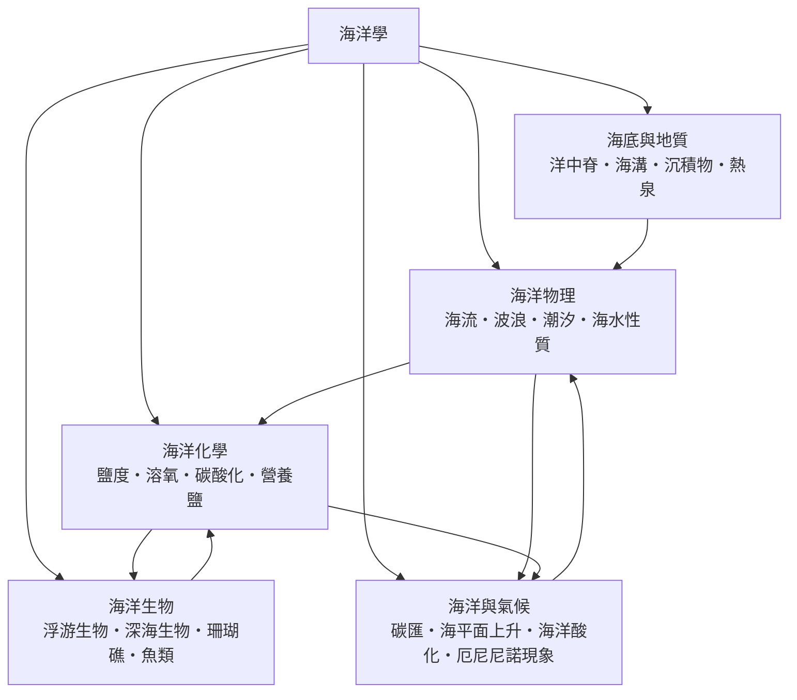

# 海洋學

> 隸屬：第一層 [理]　·　相關分類：[地質學]、[物理學]、[地球與大氣科學]、[氣象學]　·　子分類總表見 [README]

> 對應維基百科：[中文維基百科：海洋學](https://zh.wikipedia.org/wiki/%E6%B5%B7%E6%B4%8B%E5%AD%A6)　·　[English Wikipedia: Oceanography](https://en.wikipedia.org/wiki/Oceanography)

海洋學是研究**海洋這個水體系統**的科學：它如何形成、如何運動、裡面有什麼、如何與大氣和固體地球交換物質與能量。海洋學不是「研究海洋的學問」這種籠統說法，而是一門以**量測、量測、再量測**為骨幹的實證學科——從測深、溫鹽度測量、生物拖網，到衛星高度計與 Argo 剖面儀，每一項結論都要求可重複的觀測。

海洋的重要性可以只用一個數字說明：地球表面約 71% 被海洋覆蓋，海水總體積約 $13.7 \times 10^8\ \mathrm{km^3}$ ，而大氣的質量僅相當於海洋的約 0.5%。海洋因此是地球系統裡最大的**熱庫**、最大的**碳庫**、最大的**生物圈棲地**，也是最大的「記憶體」——它把氣候的歷史以溫度、鹽度、氣體成分的形式保存下來。

海洋學的科學地位有兩個特殊處。第一，它橫跨**物理、化學、生物、地質**四大領域，因此任何單一學科都無法獨自解釋海洋。第二，它的觀測對象龐大且不可重複：同一片海，鑽孔一次就少一點；因此海洋學依賴系統性的探勘計畫（探測船、深海鑽探、浮標陣列）與衛星遙測，把「點」的觀測拼成「面」甚至「體」的推論。

## 核心問題

海洋學的核心問題可以濃縮成四問，構成一條閉環。

1. **海洋裡的水從哪來、到哪去？** 這是水循環與總體積平衡的問題，由 [海洋物理] 的 [海流] 與 [海洋化學] 的 [鹽度] 共同回答：河流注入、降水、蒸發與冰蓋消融各佔多少，以及這些淡水如何改變密度、進而驅動 [海流]。
2. **能量如何在海洋中傳遞？** 這是 [海洋物理] 的 [波浪]、[潮汐] 與溫度結構問題：太陽短波輻射在哪些深度被吸收、海表熱量如何向下傳輸、以及為什麼溫躍層能像蓋子一樣把深層水封住。
3. **海洋裡有什麼、靠什麼維生？** 這是 [海洋生物] 的問題：[浮游生物] 靠營養鹽與光合作用支撐海洋食物網，而 [深海生物] 卻能在無光、高壓、低溫環境中依賴 [熱泉] 的化學能生存。
4. **海底是怎麼形成的？** 這是 [海底與地質] 的問題：[洋中脊] 持續湧出新的洋殼、[海溝] 把洋殼送回地幔（[馬里亞納海溝] 是最深的代表）、[沉積物] 記錄著環境變化的年表。

這四問互相咬合：海流決定營養鹽與熱量的輸送，因此直接控制生物生產力；生物生產力決定碳的固定量，因此影響 [碳匯] 與大氣 CO₂；海底擴張決定海盆形狀，因此決定上面那層水體的體積與通道形狀。

## 因果鏈

1. **航海的實用需求**：早期海洋學的第一推力來自航海安全——水深、潮流與磁偏角不測清楚，船就會擱淺。
2. **[莫里] 的制度化**：[莫里] 在 19 世紀把海底地形測量與洋流觀測變成國家級的常設工作，海洋研究第一次有了「資料基礎」。
3. **[挑戰者號] 的標本化**：[1872年] 起的挑戰者號探險以拖網、測深與水溫記錄建立全球第一份海洋資料集，海洋生物學的分類學基礎由此奠定。
4. **物理海洋的成形**：20 世紀初，埃克曼的漂流計算與渦度平衡把「洋流為何會偏轉」變成可推導的力學問題，海洋從描述性學科轉為機制學科。
5. **板塊構造的驗證**：海底擴張假說預測洋中脊兩側的磁條帶對稱與年齡梯度，1960 年代海底測量直接驗證了它，海洋地質學因此成為地球科學的證據核心。
6. **觀測時代的轉向**：從 1960 年代的深海鑽探（[1960年] 的挑戰者深淵首航）到今日的 Argo 浮標陣列與衛星高度計，海洋學進入「即時、全域、可連續」階段。
7. **氣候耦合的確立**：海洋熱含量、海表溫度與 [厄尼尼諾現象] 被證實與大氣環流互相驅動，海洋學不再是「獨立的另一半地球科學」，而是氣候系統的組成要素。
8. **全球計畫的制度化**：國際計畫如世界海洋環流實驗與全球海洋觀測網，把海洋學從少數國家的探勘推向共有的全球基礎設施。

## 子分類的定位與相互驅動

- [海洋物理] 是**引擎**：它提供速度場、溫度場、密度場這三個所有海洋過程都必須依附的「地形」。海流把熱量與營養鹽重新分配，因此物理海洋的任何修正都會改寫化學與生物的結論。
- [海洋化學] 是**翻譯器**：它把物理量（溫度、鹽度、壓力）與生物需求（氧、營養鹽、碳酸根）接在同一個量測系統裡；鹽度與溶氧的年度序列是海洋健康的核心指標。
- [海洋生物] 是**結果的呈現**：哪裡有魚、哪裡有珊瑚、哪裡有藻華，是物理與化學條件的綜合結果，也是人类獲得蛋白質與經濟利益的直接來源。
- [海底與地質] 是**舞台與檔案**：它既造出海盆與洋流的通道（地形影響流速），又以沉積物保存環境變化的證據（沉積速率可作時鐘）。
- [海洋與氣候] 是**回饋迴路**：海洋吸收熱與 CO₂，改變大氣；大氣又回頭改變海洋表層，形成閉環，這是近代海洋學最重要的研究方向。

## 範例：一次溫鹽剖面能告訴我們什麼

以典型的中緯度外海（以 [大西洋] 為例）夏季的溫鹽剖面為例，從海面到 1,000 公尺：

1. **表層**：溫度約 $18\ \mathrm{^\circ C}$ ，鹽度約 $35.5$ PSU（實用鹽度單位，每千克海水中的鹽分克數），此層混合活躍，溫度與鹽度變化劇烈。
2. **溫躍層**：從約 200 公尺延伸到 1,000 公尺，溫度由 $18\ \mathrm{^\circ C}$ 降到約 $4\ \mathrm{^\circ C}$ 。密度隨溫度下降而上升，卻因鹽度變化不足以抵銷，形成**密度躍層**，像一道蓋子把深層水封在下方。
3. **深層水**：1,000 公尺以下溫度約 $2$ 至 $4\ \mathrm{^\circ C}$ ，鹽度約 $34.9$ PSU。深層水的實際下沉並不是因為它比上層「更重」，而是由於高緯度冬季對流把冷水與鹽水一起帶到底，形成**深層水形成區**。
4. **推論一（養分）**：躍層之下的營養鹽（硝酸鹽、磷酸鹽）因生物不易取得而累積，因此深層水「養分豐富但缺光」；一旦與躍層混合，就會在下一次冬季混合時被帶回表層，啟動春季藻華。
5. **推論二（碳）**：表層水在低溫高 CO₂ 條件下能溶解更多 CO₂，但生物吸收與沉降讓表層維持相對低 CO₂；隨後深層水上湧時帶出溶解的無機碳，形成**碳泵**的一部分。
6. **推論三（生物）**：魚類與浮游生物的分層決定漁業資源的時空分布——表層是浮游植物與小型魚類，深層夜間上移的魚類則是漁撈的主要對象。

同一次溫鹽剖面就同時解釋了化學、生物與氣候三個子分類的問題，這正是海洋學作為整合學科的具體樣貌。

## 容易混淆之處

- **海洋學不等於「海洋生物學」**：後者只研究海洋中的生物；海洋學還包含海水的物理性質、海底地質與氣候交換。
- **海洋氣候不是天氣**：海洋上颱風是短期天氣現象，而海洋與氣候的相互作用指數十年尺度的統計關係。
- **潮汐不是海流的同義詞**：潮汐是天文强迫（主要來自月球與太陽引力）驅動的週期性振動，海流則主要由風與密度差驅動，兩者可以疊加。
- **「海平面上升」不只是水變多**：全球平均海平面上升由海水熱膨脹（占約一半）與冰蓋融化（另一半）共同造成，且各地區上升速率並不相同。
- **熱泉不是「海底火山噴火」**：熱泉是水與岩漿高溫交換後由裂隙流出的液態水與沉澱物，溫度可超過 300 度攝氏而不沸騰。
- **碳匯不是永久封存**：海洋吸收的碳有一部分會隨深層水上湧重新釋放回大氣，淨效益取決於生物泵效率。

## 延伸閱讀

- [地球與大氣科學]：海洋在大氣與固體地球之間的耦合背景。
- [地質學]：海底地質與地質年代的方法論姊妹篇。
- [物理學]：流體力學與熱力學的共同語言。
- [生物學] 與 [古生物]：海洋生物的演化與化石紀錄。
- [全球暖化]：海洋在氣候變遷中最主要的吸熱與吸碳角色。

## 連結定義

[理]: ../理/README.md
[README]: README.md
[地質學]: ../地質學/README.md
[物理學]: ../物理學/README.md
[地球與大氣科學]: ../地球與大氣科學/README.md
[氣象學]: ../氣象學/README.md
[生物學]: ../生物學/README.md
[古生物]: ../古生物/README.md
[全球暖化]: ../全球暖化/README.md
[海洋物理]: 海洋物理.md
[海洋化學]: 海洋化學.md
[海洋生物]: 海洋生物.md
[海底與地質]: 海底與地質.md
[海洋與氣候]: 海洋與氣候.md
[海流]: 海流.md
[波浪]: 波浪.md
[潮汐]: 潮汐.md
[鹽度]: 鹽度.md
[碳匯]: 碳匯.md
[厄尼尼諾現象]: 厄尼尼諾現象.md
[浮游生物]: 浮游生物.md
[深海生物]: 深海生物.md
[洋中脊]: 洋中脊.md
[海溝]: 海溝.md
[沉積物]: 沉積物.md
[熱泉]: 熱泉.md
[莫里]: ../人/海洋學家/莫里.md
[挑戰者號]: ../物/挑戰者號.md
[大西洋]: ../地/大西洋.md
[馬里亞納海溝]: ../地/馬里亞納海溝.md
[1872年]: ../時/1872年.md
[1960年]: ../時/1960年.md
