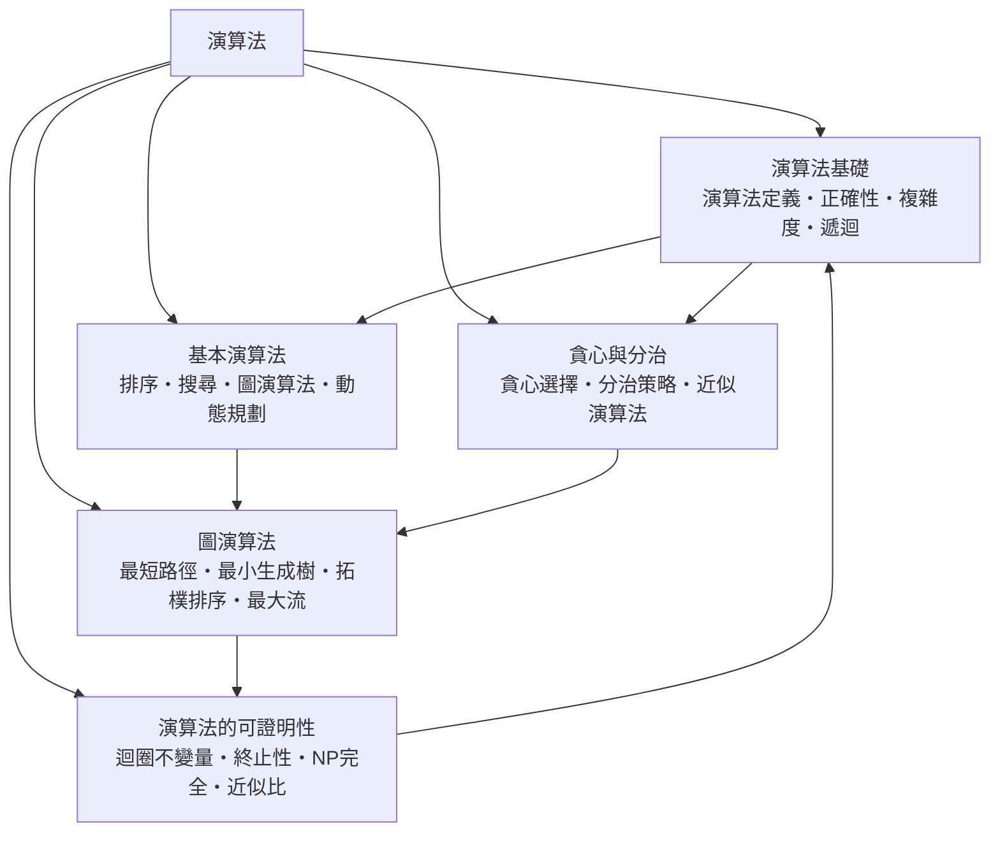

# 演算法

> 隸屬：第一層 [工]　·　相關分類：[電腦]、[程式設計]、[離散數學]、[數學]　·　子分類總表見 [README]

> 對應維基百科：[中文維基百科：算法](https://zh.wikipedia.org/wiki/%E7%AE%97%E6%B3%95)　·　[English Wikipedia: Algorithm](https://en.wikipedia.org/wiki/Algorithm)

演算法是**解決一類問題的有限步驟描述**：給定合法的輸入，經過一串明確且可重複的操作，產生正確的輸出。「明確」意味著每一步在有限時間內可執行、只依賴當前狀態與輸入，不含「直覺」或「隨便選一個」這類無法形式化的指示。

演算法與程式碼不是同一件事。演算法是解決問題的**想法**，程式碼是這個想法在特定語言與機器上的**實現**。同一個排序概念可以寫成十分鐘的插入排序，也可以寫成高度最佳化的並行排序；兩者複雜度同為平方級，但實務效能相差數個數量級。因此本分類討論的是「思路與其代價」，實作層的細節則歸入 [程式設計]。

## 核心問題

演算法要回答的核心問題只有兩個：**對不對**，以及**快不快**。前者是正確性（輸出必須符合規格），後者是複雜度（時間與空間隨輸入規模如何增長）。

一個典型的演算法規格包含五個部分：輸入條件、輸出規格、正確性敘述、複雜度分析與終止性。前四項常被忽略，但沒有它們，演算法只是「碰巧能用的程式碼」。

複雜度的比較以漸近notation表達：只保留輸入規模 $n$ 增長時的主導項。

$$
T(n) = c_1 n + c_2 n^2 + c_3 \log n + c_4 \;\Rightarrow\; T(n) = O(n^2)
$$

上式表示當 $n$ 變大時，二次項壓過一次項與對數項。演算法分析的重點因此不在某個具體輸入的執行時間，而在**增長階**； $O(n \log n)$ 的排序在 $n = 10^6$ 時可能比 $O(n^2)$ 的排序快上數個數量級。

## 因果鏈

1. **機械計算的出現**：19 世紀的差分機與打孔卡系統把「計算步驟」具體化，讓「用符號描述計算」有了實際對象；[巴貝奇] 的分析機設計更直接包含了程式分支與記憶體。
2. **可計算性的刻畫**：1936 年 [圖靈] 用圖靈機定義了「可計算」的邊界，回答了「機器到底能算什麼」，演算法從此有了精確的計算模型。
3. **實用演算法的累積**：排序、搜尋、圖表演算法隨著電子計算機的普及被系統化整理，形成演算法的「工具箱」；[1959年] [狄克斯特拉] 的最短路徑演算法是其中的代表。
4. **複雜度理論的成形**：把執行時間抽象成輸入規模的函數後，人們發現不同問題的複雜度落成幾個階層， $P$ 、 $NP$ 與 [1971年] [科布漢] 定理建立了 [NP完全] 的概念。
5. **難題的務實處理**：既然最壞情況不可解，實務轉向近似解（[近似演算法]）、隨機化與啟發式方法，並以 [近似比] 衡量解的品質保證。
6. **新負載帶來新演算法**：大資料、圖資料與機器學習帶來排序、搜尋與最佳化的新變體，動態規劃與貪心方法在排程與資源分配中持續扮演要角。
7. **實證與理論的張力**：現代實務常以啟發式演算法換取實測效能，卻難以給出最壞情況保證，如何在正確性、可證明性與速度之間取捨，仍是演算法研究的核心張力。

## 子分類的定位與相互驅動



- [演算法基礎] 是**詞彙表**：定義、正確性、複雜度與遞迴，是其餘四個子分類共同使用的語言。
- [基本演算法] 是**工具箱**：排序、搜尋、圖演算法與動態規劃提供了可重複使用的核心构件。
- [貪心與分治] 是**兩條設計典範**：以局部選擇換取整體效率，或以分解與合併控制規模。
- [圖演算法] 是**結構化問題的專門化**：當資料具有頂點與邊的結構，最短路徑、最小生成樹、拓樸排序與最大流提供了成套解法。
- [演算法的可證明性] 是**方法論的自我檢查**：迴圈不變量與終止性提供論證工具，NP 完全與近似比則標示出理論的極限與務實的退路。

## 範例：一段演算法從想法到複雜度

**問題**：給定一個整數陣列，找出第二大的相異元素。

**演算法（單趟掃描）**：

```
def second_largest(a):
    if len(a) < 2:
        return None
    largest = second = None
    for x in a:
        if x > largest:
            second, largest = largest, x
        elif x > second and x != largest:
            second = x
    return second
```

**逐步推理**：

1. **狀態定義**：在處理完前 $k$ 個元素後，`largest` 是這 $k$ 個元素的最大值，`second` 是次大值；這就是迴圈不變量。
2. **更新規則**：若新元素大於 `largest`，原本的最大值退居次大；若不大於 `largest` 但大於 `second`，則它取代 `second`；相等時不更新，以保證「相異」。
3. **初始化**：`largest` 與 `second` 皆設為無窮小概念上的「尚未出現」，因此第一個元素必然填入 `largest`。
4. **終止性**：每次迭代 `k` 增加 1，迴圈條件是有限長度的陣列，故必定終止。
5. **複雜度**：單趟掃描 $n$ 個元素，每個元素做常數次比較，時間複雜度為 $O(n)$ ，額外空間複雜度為 $O(1)$ 。
6. **對照**：若先排序再取次大，時間複雜度為 $O(n \log n)$ ；若逐一比較尋找，則為 $O(n^2)$ 。單趟法同時優於兩者。

這個例子說明演算法的兩面：正確性靠不變量保證，效率靠逐步排除不必要的工作取得。

## 容易混淆之處

- **演算法不等於程式碼**：同一想法可有許多實作，複雜度屬於想法層。
- ** $O$ 界不是精確複雜度**： $O(n^2)$ 的演算法實際可能是 $\Theta(n^2)$ ，大 $O$ 只是上界敘述。
- **平均情況不等於最壞情況**：快速排序平均 $O(n \log n)$ 、最壞 $O(n^2)$ ，選擇時要看資料特性與對手模型。
- **貪心不一定正確**：貪心法需要交換論證或貪心選擇性質作為前提，否則可能給出次優解。
- **近似不等於隨便**：有 [近似比] 保證的近似解與啟發式解在可信度上完全不同。
- **可證明性不是形式主義**：實務上迴圈不變量的最大價值往往是把隱性假設寫成文字，讓除錯有依據。

## 延伸閱讀

- [電腦]：演算法執行的硬體環境，決定了複雜度之外的常數因子。
- [程式設計]：把演算法寫成可靠、可維護的程式。
- [離散數學]：集合、關係、圖與邏輯，是演算法的形式語言。
- [人工智慧]：機器學習中的最佳化問題與演算法化實踐。
- [資訊安全]：密碼分析與防禦大量依賴特定演算法的複雜度特性。

## 連結定義

[工]: ../工/README.md
[README]: README.md
[電腦]: ../電腦/README.md
[程式設計]: ../程式設計/README.md
[離散數學]: ../離散數學/README.md
[數學]: ../數學/README.md
[人工智慧]: ../人工智慧/README.md
[資訊安全]: ../資訊安全/README.md
[演算法基礎]: 演算法基礎.md
[基本演算法]: 基本演算法.md
[貪心與分治]: 貪心與分治.md
[圖演算法]: 圖演算法.md
[演算法的可證明性]: 演算法的可證明性.md
[NP完全]: NP完全.md
[近似演算法]: 近似演算法.md
[近似比]: 近似比.md
[圖靈]: ../人/數學家/圖靈.md
[巴貝奇]: ../人/數學家/巴貝奇.md
[狄克斯特拉]: ../人/工程師/狄克斯特拉.md
[科布漢]: ../人/數學家/科布漢.md
[1959年]: ../時/1959年.md
[1971年]: ../時/1971年.md
