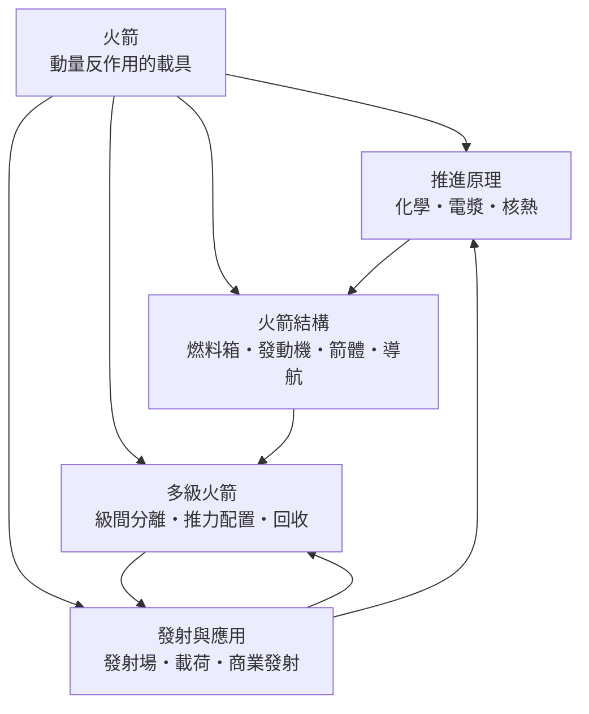

# 火箭

> 隸屬：第一層 [天]　·　相關分類：[航空工程]、[化學]、[載人航天]、[衛星]　·　子分類總表見 [README]

> 對應維基百科：[中文維基百科：火箭](https://zh.wikipedia.org/wiki/%E7%81%AB%E7%AE%AD)　·　[English Wikipedia: Rocket](https://en.wikipedia.org/wiki/Rocket)

火箭是**靠向後高速噴射物質而向前推進、且自身攜帶全部工質的飛行器**。「自己帶燃料」是它與飛機最根本的差別：飛機吸空氣裡的氧，所以離不開大氣；火箭連氧化劑一起帶，因此是唯一能把人造物體送入太空的工具。從 1926 年（見 [1926年]）[哥達德] 那枚只飛了 2.5 秒的液體火箭，到把 [加加林] 送入軌道、把人類送上月球、再到今日可回收重複使用的大型載具，火箭只用了不到一個世紀就改寫了「人類能到哪裡」這個問題的答案。

火箭的特別之處在於它是**理論先於工程、工程先於需求**的技術：齊奧爾科夫斯基在 1903 年（見 [1903年]）就已算清火箭要上軌道需要什麼質量比與噴氣速度，比第一枚液體火箭早了二十三年；而火箭最初的大規模發展竟出於戰爭（見 [1942年] 間的 V-2 與 [1942年] 條目），太空探索只是戰後軍備競賽的意外副產品。理解火箭，就是理解「如何把能量、質量與控制裝進同一支金屬長管，並讓它在烈火中不散架」——這是一門由物理、化學、材料與控制工程共同寫成的學科。

## 核心問題

火箭工程的一切都可以從一條方程與一個瓶頸推出。

1. **推進的來源**：動量守恆。以相對火箭的速度 $v_e$ 向後噴出質量，火箭就獲得向前的動量；推力 $F = \dot{m} v_e$ ，即質量流量乘噴氣速度。這就是 [牛頓第三定律] 的工程化身。
2. **速度的帳本**：齊奧爾科夫斯基火箭方程
   $$
   \Delta v = v_e \ln \frac{m_0}{m_f}
   $$
   速度增量只取決於噴氣速度與質量比（起飛質量除以燃盡質量）的對數。要把速度提高一倍，質量比必須平方——質量的代價是指數成長的。
3. **根本瓶頸**：入軌需要約 $9.4\,\mathrm{km/s}$ 的總速度增量（含重力與空氣損失），而最好的化學推進劑 $v_e$ 約 $4.4\,\mathrm{km/s}$ ，故質量比必須超過 8——即起飛質量的近九成是推進劑。這解釋了為什麼火箭又長又細又昂貴，也解釋了 [多級火箭] 為何是必然的工程答案。

三層的邏輯是：動量守恆給出推力，火箭方程把推力換算成速度，而速度需求與化學能極限之間的落差逼出了結構、多級與回收等全部工程分支。火箭工程的歷史，就是一場對指數壓迫的持續反擊。

## 因果鏈

1. **反作用的原理已知**：1687 年 [牛頓] 系統化了動量守恆；中國古代煙火與十九世紀的軍用固體火箭早有應用，但都停在經驗層次，速度與高度始終上不去。
2. **理論奠基**：1903 年（見 [1903年]）齊奧爾科夫斯基發表火箭方程與液體火箭構想，指出液氧—液氫是理論上最優的組合，並提出多級火箭的「火箭列車」概念——太空飛行第一次成為可計算的問題。
3. **工程首飛**：1926 年（見 [1926年]）[哥達德] 發射首枚液體火箭，並取得陀螺穩定、冷卻噴管、泵送供應等兩百餘項專利；火箭從紙面方案變成可操作的機器。
4. **戰爭催化**：1942 年（見 [1942年]）德國 V-2 實戰部署，是首枚彈道火箭；它以工業規模證明了大推力液體火箭的可行性，也把一批火箭工程師送進了戰後的美蘇兩國。
5. **太空競賽**：[科羅廖夫] 的 R-7 於 1957 年（見 [1957年]）發射 [斯普尼克一號]，1961 年把 [加加林] 送入軌道；美國以土星五號回敬，1969 年登月。火箭在二十五年間從射程武器躍升為載人載具。
6. **常態化與瓶頸**：1960 至 2000 年代，火箭成熟為航天工業的標準工具，但「一次性使用」使入軌成本停在每公斤上萬美元；發射頻率與太空應用的擴張都被成本鎖死。
7. **可回收革命**：2010 年代回收式火箭把入軌成本壓低一個數量級，發射頻率提高十倍以上，巨型星座與商業載人成為現實——火箭重新變成快速演化的技術。
8. **下一代的分岔**：電漿推進（深空長航）、核熱推進（縮短火星航程）、全回收重型載具（低成本大運力）三線並進；火箭正從「進入太空的階梯」演變為「太空交通的基礎設施」。

## 子分類的定位與相互驅動

- [推進原理] 是**能量層**：回答「用什麼推」——化學推進的噴氣速度極限、電漿推進的省工質長推力、核熱推進的折衷。火箭方程把這一層的每個選擇直接翻譯成任務能力。
- [火箭結構] 是**載體層**：把推進方案變成機器——貯箱、發動機、箭體與 [導航系統]。結構效率（乾重）每降低一公斤，都是對指數壓迫的直接減免。
- [多級火箭] 是**分身層**：用完即棄的空箱是純粹的累贅，多級化把「輕裝上陣」制度化；級間分離與推力配置是它的工程核心，回收則是把「棄」改回「用」的當代革命。
- [發射與應用] 是**舞台層**：發射場選址、載荷整合、商業模式與環境影響，把火箭放進經濟與社會的座標裡；需求端的變化反過來驅動推進與結構的研發方向。

四者的先後是嚴格的：沒有推進方案的極限數字，結構設計無從下手；結構做不到的乾重，多級再巧妙也救不回來；而沒有應用端的載荷與商業閉環，再好的火箭也只是昂貴的煙火。

## 範例

**範例一：火箭方程的威力。** 單級火箭想入軌需 $\Delta v = 9.4\,\mathrm{km/s}$ ，液氧—煤油 $v_e \approx 3.3\,\mathrm{km/s}$ ，則質量比 $\frac{m_0}{m_f} = e^{9.4/3.3} \approx 17.4$ ——乾重僅能佔起飛質量的 5.7%，低於貯箱、發動機、結構的實際下限，故單級化學火箭上不了軌道。改用三級，每級只需提供約 $\frac{9.4}{3} \approx 3.1\,\mathrm{km/s}$ ，對應質量比 $e^{3.1/3.3} \approx 2.6$ ——每級乾重可佔 38%，工程上輕鬆得多。多級火箭不是選項，是數學的必然。

**範例二：推力的帳。** 某火箭第一級發動機 $F = 7 \times 10^6\,\mathrm{N}$ （約 714 噸推力）， $v_e = 3.0\,\mathrm{km/s}$ ，則推進劑流量 $\dot{m} = \frac{F}{v_e} \approx 2333\,\mathrm{kg/s}$ ——每秒燒掉兩頭半成年鯨魚的質量。起飛質量 500 噸、其中 400 噸為推進劑時，全程燃燒時間僅約 $400000 / 2333 \approx 171\,\mathrm{s}$ ：火箭必須在不到三分鐘內完成最暴力的一段加速，這就是為什麼發射全程全靠程式化時序控制。

**範例三：回收的經濟學。** 假設一級推進劑成本 100 萬美元、硬體成本 4000 萬美元，一次性使用時硬體攤進每次發射；若硬體可重複使用 10 次，單次硬體成本降至 400 萬美元，再加翻修 200 萬美元，總成本從 4100 萬降到 530 萬美元——降幅近九成。這個帳解釋了為什麼 [回收] 是 2010 年代以來火箭工程的主戰場，也解釋了發射價格為何在同一時期腰斬再腰斬。

## 容易混淆之處

- **火箭不是「推空氣」**：推力來自噴出工質的反作用，與有沒有空氣無關；火箭在真空中反而工作得更好（噴管設計不再受背壓限制）。
- **推力大不等於效率高**：推力 $F = \dot{m} v_e$ 可以靠多燒工質堆起來，效率則看比衝（ $v_e / g_0$ ）；固體助推推力大但比衝低，氫氧發動機比衝高但推力密度低——兩者常在同一火箭上搭配。
- **速度增量不是速度**： $\Delta v$ 是火箭自己「能提供的速度變化總額」，還要扣掉重力損失與空氣阻力才是入軌速度；說「 $\Delta v$ $9.4\,\mathrm{km/s}$ 」時，真正到手的軌道速度只有約 $7.8\,\mathrm{km/s}$ 。
- **多級不是為了快**：分級是為了甩掉空箱、降低後續質量比的要求；級數過多會增加分離失敗風險與結構死重，三至四級是工程最優區。
- **回收不總是划算**：為了留燃料返航，回收版火箭的運載能力下降約三成；只有發射頻率夠高、硬體夠貴時，帳才合得起。

## 延伸閱讀

- [航空工程]：火箭所屬的工程母學科，氣動與結構方法的來源。
- [化學]：推進劑的燃燒化學與能量密度極限。
- [材料學]：貯箱與噴管的合金、複材與低溫技術。
- [載人航天]：火箭最主要的「乘客」，逃逸與可靠性的需求方。
- [衛星]：火箭最大的載荷類別，發射市場的支柱。
- [太空站]：需要持續補給與乘組輪換的常駐載荷。
- [齊奧爾科夫斯基]、[哥達德]、[科羅廖夫]：理論、首飛與工程化三個階段的關鍵人物。
- [1957年]、[1961年]、[1969年]：太空競賽三個轉折年份的條目。

## 連結定義

[天]: ../天/README.md
[README]: README.md
[航空工程]: ../航空工程/README.md
[化學]: ../化學/README.md
[材料學]: ../材料學/README.md
[載人航天]: ../載人航天/README.md
[衛星]: ../衛星/README.md
[太空站]: ../太空站/README.md
[推進原理]: 推進原理.md
[火箭結構]: 火箭結構.md
[多級火箭]: 多級火箭.md
[發射與應用]: 發射與應用.md
[牛頓第三定律]: 牛頓第三定律.md
[導航系統]: 導航系統.md
[回收]: 回收.md
[齊奧爾科夫斯基]: ../人/工程師/齊奧爾科夫斯基.md
[哥達德]: ../人/工程師/哥達德.md
[科羅廖夫]: ../人/工程師/科羅廖夫.md
[加加林]: ../人/宇航員/加加林.md
[牛頓]: ../人/物理學家/牛頓.md
[斯普尼克一號]: ../物/斯普尼克一號.md
[1926年]: ../時/1926年.md
[1903年]: ../時/1903年.md
[1942年]: ../時/1942年.md
[1957年]: ../時/1957年.md
[1961年]: ../時/1961年.md
[1969年]: ../時/1969年.md
