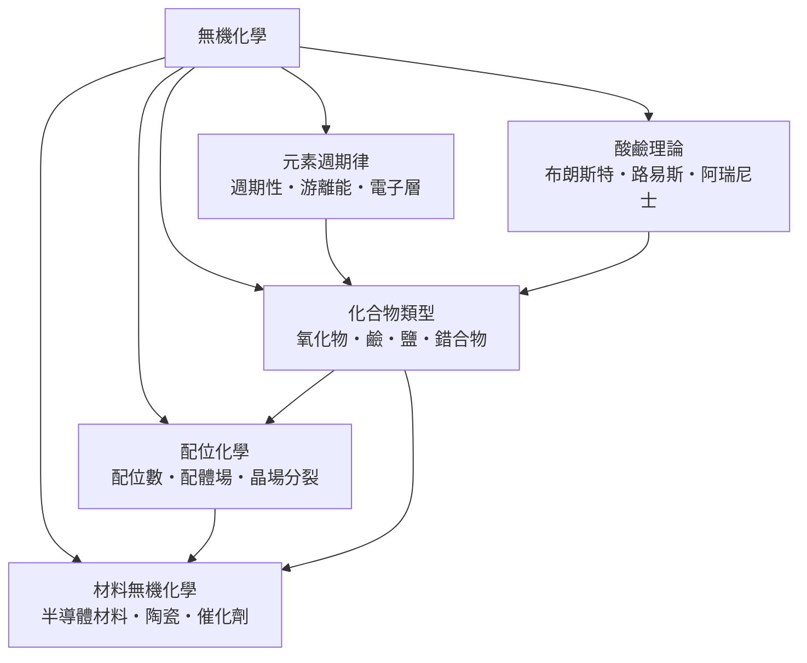

# 無機化學

> 隸屬：第一層 [理]　·　相關分類：[化學]、[有機化學]、[元素週期表]　·　子分類總表見 [README]

> 對應維基百科：[中文維基百科：無機化學](https://zh.wikipedia.org/wiki/%E6%97%A0%E6%9C%BA%E5%8C%96%E5%AD%A6)　·　[English Wikipedia: Inorganic chemistry](https://en.wikipedia.org/wiki/Inorganic_chemistry)

無機化學研究**碳骨架之外**的所有物質：元素本身、金屬與非金屬單質、氧化物、酸、鹼、鹽，以及金屬中心與配體結合而成的錯合物。它的理論支柱有兩根：一是 [元素週期表] 所體現的**週期律**——元素的性質隨原子序呈規律變化；二是**配位化學**——過渡金屬以特定配位數與配體結合，產生顏色、磁性與催化能力。

與有機化學「一個元素撐起一億種分子」不同，無機化學橫跨整個週期表的一百多種元素。它因此更像一張**地圖**：先掌握週期律，就能對任意元素的化學行為做出第一層預測；再掌握配位與酸鹼兩套理論，就能解釋從血液攜氧到半導體蝕刻的絕大部分無機現象。

## 核心問題

1. **元素為何有週期性**：原子結構（[電子層]）如何決定 [週期性]——原子半徑、[游離能]、電負度沿週期與族的變化，這是 [元素週期律] 的內容。
2. **元素如何結合成化合物**：金屬與非金屬成離子鍵、非金屬之間成共價鍵，產生 [氧化物]、[鹼]、[鹽] 等基本 [化合物類型]。
3. **金屬如何「再加一層」**：過渡金屬離子可再容納數個配體，形成 [錯合物]；[配位數]、[配體場] 與 [晶場分裂] 決定其幾何、顏色與反應性。
4. **質子與電子如何轉移**：[酸鹼理論] 的三個層次——[阿瑞尼士]、[布朗斯特]、[路易斯]——把「酸鹼」從水溶液推廣到一切電子對授受的場合。
5. **如何變成材料**：[材料無機化學] 把上述知識變成 [半導體材料]、[陶瓷] 與 [催化劑] 等功能材料。

## 因果鏈

1. **元素表的混亂**：十九世紀中已知六十餘種元素，性質零散無系統，尋找規律成為當務之急。
2. **門捷列夫的週期表（1869）**：[門捷列夫] 按原子量排列並留下空格，成功預測鎵、鍺等未知元素，週期律確立。
3. **原子結構的解釋**：二十世紀初波耳與量子力學揭示 [電子層] 結構，週期律從經驗規則變成電子組態的必然結果。
4. **酸鹼理論的層層擴充**：1884 年 [阿瑞尼士] 以水中解離定義酸鹼；1923 年 [布朗斯特] 改以質子授受、[路易斯] 再以電子對授受定義，理論適用範圍從水溶液擴大到整個化學。
5. **配位化學的誕生**：維爾納在 1890 年代解釋鈷氨錯合物的異構現象，建立配位理論；1930 年代的晶體場與配位場理論進一步用量子力學解釋錯合物的顏色與磁性。
6. **材料的時代**：對固態無機物的理解催生了半導體摻雜、陶瓷燒結與非均相催化，無機化學從描述自然轉為設計材料。

## 子分類的定位與相互驅動

- [元素週期律] 是**羅盤**：一切無機性質的預測都從週期表出發，游離能與電子層是它的微觀根據。
- [化合物類型] 是**詞彙**：氧化物、鹼、鹽、錯合物是組成無機世界的基本詞類。
- [配位化學] 是**過渡金屬的專章**：晶場分裂解釋了硫酸銅為何是藍色、血紅素為何能攜氧，是週期律對 d 區元素的深化。
- [酸鹼理論] 是**最通用的語言**：三個遞進的定義讓「酸性」概念能涵蓋從胃液到超臨界二氧化碳的場景。
- [材料無機化學] 是**出口**：把週期律、配位與酸鹼知識轉成矽晶圓、氧化鋁陶瓷與觸媒轉化器。

## 範例

**範例一：週期律的預測力**。鹼金屬第一游離能由鋰（520 kJ/mol）到銫（376 kJ/mol）遞減，因為最外層電子離核越遠、被內層電子遮蔽越多。因此鉀與水反應比鈉更劇烈、銫幾乎爆炸——這是從週期表直接讀出的結論。

**範例二：錯合物的顏色**。無水硫酸銅（ $\mathrm{CuSO_4}$ ）是白色，溶於水後 $\mathrm{Cu^{2+}}$ 與四個水分子配位成 $\mathrm{[Cu(H_2O)_4]^{2+}}$ ，晶場分裂使 d 電子吸收橙紅光躍遷，溶液呈藍色；加入氨則生成更深的 $\mathrm{[Cu(NH_3)_4]^{2+}}$ ，藍色加深——顏色變化直接反映配體場強度。

**範例三：三種酸鹼定義的對照**。鹽酸在水中的行為三者都能解釋（解離出 $\mathrm{H^+}$ 、捐出質子、接受電子對）；但氨與氯化氫在無水的氣相中反應生成白煙（氯化銨），阿瑞尼士定義失效、布朗斯特定義仍然成立；而三氟化硼與氨的結合不涉及質子，只有路易斯定義能涵蓋——理論的演進就是適用範圍的擴大。

## 容易混淆之處

- **無機化學不只是「不含碳的化學」**：碳酸鹽、氰化物、一氧化碳歸入無機，且金屬有機錯合物橫跨兩界。
- **鹽不等於食鹽**：鹽是「酸鹼中和產物」的通稱，硫酸銅、碳酸鈣都是鹽，多數與鹹味無關。
- **錯合物中的鍵不是普通共價鍵**：配位鍵的共用電子對由配體單方提供，這正是 [路易斯] 酸鹼的實例。
- **晶場分裂與配位場理論不同**：後者在前者的基礎上納入軌域重疊（共價性），對共價性強的錯合物才準確。
- **強酸不等於危險酸**：強弱指解離程度，濃度與腐蝕性是另一回事；稀鹽酸是強酸但可用於胃液。
- **催化劑不改變平衡**：它同時加速正逆反應，改變的是達到平衡的速度，不是平衡位置。

## 延伸閱讀

- [化學]：無機化學所屬的母學科。
- [有機化學]：以碳骨架為中心的姊妹學科。
- [元素週期表]：週期律的完整呈現。
- [礦物學]：天然無機化合物的世界。
- [材料學]：無機固體成為工程材料的橋樑。
- [物理學]：原子結構與量子理論的來源。

## 連結定義

[理]: ../理/README.md
[README]: README.md
[化學]: ../化學/README.md
[有機化學]: ../有機化學/README.md
[元素週期表]: ../元素週期表/README.md
[礦物學]: ../礦物學/README.md
[材料學]: ../材料學/README.md
[物理學]: ../物理學/README.md
[元素週期律]: 元素週期律.md
[週期性]: 週期性.md
[游離能]: 游離能.md
[電子層]: 電子層.md
[化合物類型]: 化合物類型.md
[氧化物]: 氧化物.md
[鹼]: 鹼.md
[鹽]: 鹽.md
[錯合物]: 錯合物.md
[配位化學]: 配位化學.md
[配位數]: 配位數.md
[配體場]: 配體場.md
[晶場分裂]: 晶場分裂.md
[酸鹼理論]: 酸鹼理論.md
[布朗斯特]: 布朗斯特.md
[路易斯]: 路易斯.md
[阿瑞尼士]: 阿瑞尼士.md
[材料無機化學]: 材料無機化學.md
[半導體材料]: 半導體材料.md
[陶瓷]: ../物/陶瓷.md
[催化劑]: 催化劑.md
[門捷列夫]: ../人/化學家/門捷列夫.md
