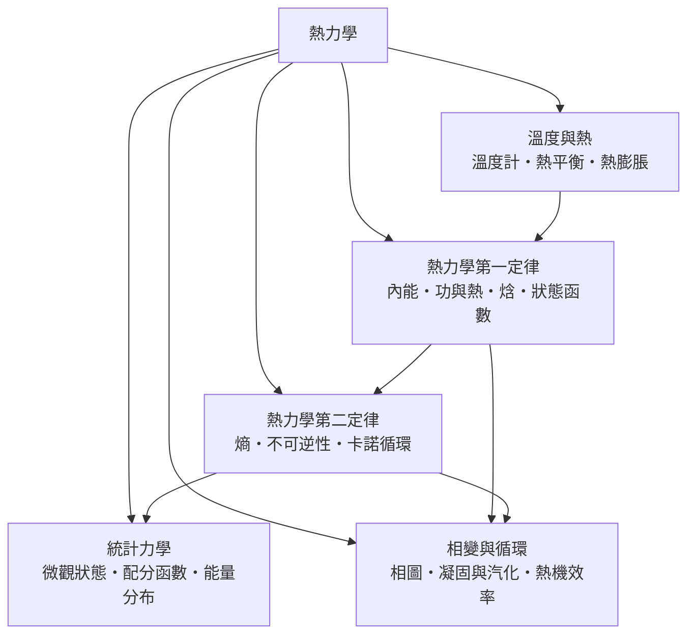

# 熱力學

> 隸屬：第一層 [理]　·　相關分類：[物理學]、[化學]、[機率統計]　·　子分類總表見 [README]

> 對應維基百科：[中文維基百科：热力学](https://zh.wikipedia.org/wiki/%E7%83%AD%E5%8A%9B%E5%AD%A6)　·　[English Wikipedia: Thermodynamics](https://en.wikipedia.org/wiki/Thermodynamics)

熱力學研究**能量、熱與物質狀態之間的轉換規律**。它的中樞是兩條定律：第一定律說能量守恆——

$$
\Delta U = Q - W
$$

系統內能的增加等於吸熱減去對外做功；第二定律說熵增——孤立系統的熵不會減少，熱自發地從高溫流向低溫，一切真實過程都有不可逆的代價。

熱力學誕生於蒸汽機的改良現場。18 世紀末 [瓦特] 的蒸汽機已能做工，卻沒有人能說清「熱是什麼、效率的極限在哪」。[卡諾] 於 1824 年證明熱機效率存在理論上限，[焦耳] 以實驗確立熱功當量，[克勞修斯] 與 [開爾文] 在 1850 年代把一切整理成第一與第二定律，[波茲曼] 與 [吉布斯] 再用統計方法把宏觀定律還原為微觀機率——熱力學因此從工程經驗成長為普適的物理理論。

## 核心問題

熱力學的核心問題分為四層。

1. **狀態的描述**：用溫度、壓力、體積等少數狀態量描述系統，狀態函數的變化只看始末、不問路徑——這是 [狀態函數] 的思想。
2. **能量收支**：熱與功如何轉換、內能如何變化？這是 [熱力學第一定律] 的工作。
3. **方向與極限**：哪些過程自發、熱機效率的極限是多少？這是 [熱力學第二定律] 與 [卡諾循環] 的答案： $\eta_{\max} = 1 - T_c/T_h$ 。
4. **微觀還原**：為什麼熵總是增加？這是 [統計力學] 的任務，[波茲曼] 的 $S = k\ln W$ 把熵解釋為微觀狀態數的對數。

四層的邏輯順序是：先能描述狀態，才能談能量的出入；先懂能量守恆，才會問「為何方向不能反轉」；問到方向性，就必須下潛到機率與統計。

## 因果鏈

1. **蒸汽機的誕生**：1712 年紐科門機、1769 年起 [瓦特] 的分離冷凝器改良，工業有了動力源，也留下「效率極限」的懸問。
2. **卡諾的理想循環**：1824 年 [卡諾] 提出可逆循環，證明效率只取決於兩個熱源的溫度比，任何真實熱機都不能超越——熱力學第二定律的胚胎。
3. **熱功當量**：[焦耳] 以槳輪攪水等實驗確立 $4.184$ J/cal，熱被證明是一種能量形式，「熱質說」崩潰。
4. **第一定律成形**：[邁爾] 與焦耳的工作由 [克勞修斯]（1850）與 [開爾文] 整理為能量守恆的正式表述，內能成為狀態函數。
5. **熵的引入**：克勞修斯定義 $dS = dQ_{\text{rev}}/T$ 並提出「宇宙的熵趨於極大」，第二定律有了定量語言。
6. **統計力學的還原**：[波茲曼] 以 $S = k\ln W$ 把熵解釋為微觀計數，[吉布斯] 建立系綜理論，熱力學與原子論合流。
7. **化學與工程應用**：吉布斯自由能判定化學反應方向，[內燃機]、冷凍循環與化工程序設計全部以熱力學為藍圖。
8. **現代延伸**：非平衡態熱力學、資訊熱力學（藍道爾原理）與黑洞熱力學，把「熵」推向資訊與重力的領域。

## 子分類的定位與相互驅動

- [溫度與熱] 是**起點**：溫度計與熱平衡的概念使「熱」可以被測量，是一切定量研究的先決條件。
- [熱力學第一定律] 是**帳本**：內能、功與熱的能量收支，[焓] 則是化學與工程最順手的帳目形式。
- [熱力學第二定律] 是**方向盤**：熵與不可逆性指出過程的方向，[卡諾循環] 給出效率的天花板。
- [統計力學] 是**微觀地基**：從分子運動推導溫度與熵，回答「為什麼」，也接通了 [機率統計] 的數學。
- [相變與循環] 是**應用舞台**：[相圖] 指引材料與化工，熱機效率的工程追逐推動了 [內燃機] 與冷凍技術。

## 範例

**範例一：第一定律的計算。** 氣體吸熱 $Q = 500$ J、對外做功 $W = 200$ J，內能變化 $\Delta U = 500 - 200 = 300$ J。反過來，理想氣體等溫膨脹時 $\Delta U = 0$ ，故 $Q = W$ ——吸進的熱全部變成功，但只在等溫（熵交換）時允許。

**範例二：卡諾效率。** 火力電廠蒸氣溫度 $T_h = 810$ K（約 $537^\circ$ C）、冷凝器 $T_c = 300$ K：

$$
\eta_{\max} = 1 - \frac{T_c}{T_h} = 1 - \frac{300}{810} \approx 63\%
$$

實際電廠因不可逆損耗只達 $40\%$ 上下——與理論上限的差距正是工程師的戰場。

**範例三：熵的微觀計數。** 把 10 枚硬幣丟在地上，全部正面的方式只有 1 種，5 正 5 反有 252 種。系統「自發」走向方式多的狀態（混合、均勻）；波茲曼公式 $S = k\ln W$ 中， $W$ 從 1 變 252，熵增加 $k\ln 252 \approx 5.5k$ ——宏觀的「不可逆」就是微觀的「計數懸殊」。

## 容易混淆之處

- **熱與溫度不是一回事**：溫度是分子平均動能的量度，熱是傳遞中的能量；一杯咖啡與一片海洋可以是同溫度，熱容量卻天差地遠。
- **內能只看狀態、熱與功只看過程**：「系統含有多少熱」是無意義的說法，熱是流動中的量。
- **第二定律不是「能量會用完」**：能量永遠守恆，被「用壞」的是品質——能量退化为不可用的低溫熱。
- **熵不等於「混亂」**：更準確的說法是微觀狀態數或能量在微觀自由度上的攤平；「混亂」只是教學比喻。
- **開放系統可以局部熵減**：冰箱、生命體都靠排出更多熵到環境來維持內部有序，不違反第二定律。

## 延伸閱讀

- [物理學]：熱力學所屬的母學科，[熱學] 條目為其概覽。
- [化學]：化學熱力學與反應方向判定。
- [機率統計]：統計力學的數學基礎。
- [流體力學]：熱力學與流動結合成流體工程的骨架。
- [全球暖化]：地球能量收支的熱力學帳本。
- [內燃機]：熱力學循環的最大宗工程應用。

## 連結定義

[理]: ../理/README.md
[README]: README.md
[物理學]: ../物理學/README.md
[熱學]: ../物理學/熱學.md
[化學]: ../化學/README.md
[機率統計]: ../機率統計/README.md
[流體力學]: ../流體力學/README.md
[全球暖化]: ../全球暖化/README.md
[內燃機]: ../物/內燃機.md
[溫度與熱]: 溫度與熱.md
[熱力學第一定律]: 熱力學第一定律.md
[熱力學第二定律]: 熱力學第二定律.md
[卡諾循環]: 卡諾循環.md
[狀態函數]: 狀態函數.md
[焓]: 焓.md
[統計力學]: 統計力學.md
[相圖]: 相圖.md
[瓦特]: ../人/工程師/詹姆斯·瓦特.md
[卡諾]: ../人/物理學家/卡諾.md
[焦耳]: ../人/物理學家/焦耳.md
[克勞修斯]: ../人/物理學家/克勞修斯.md
[開爾文]: ../人/物理學家/開爾文.md
[波茲曼]: ../人/物理學家/波茲曼.md
[吉布斯]: ../人/物理學家/吉布斯.md
[邁爾]: ../人/物理學家/邁爾.md
[相變與循環]: 相變與循環.md
