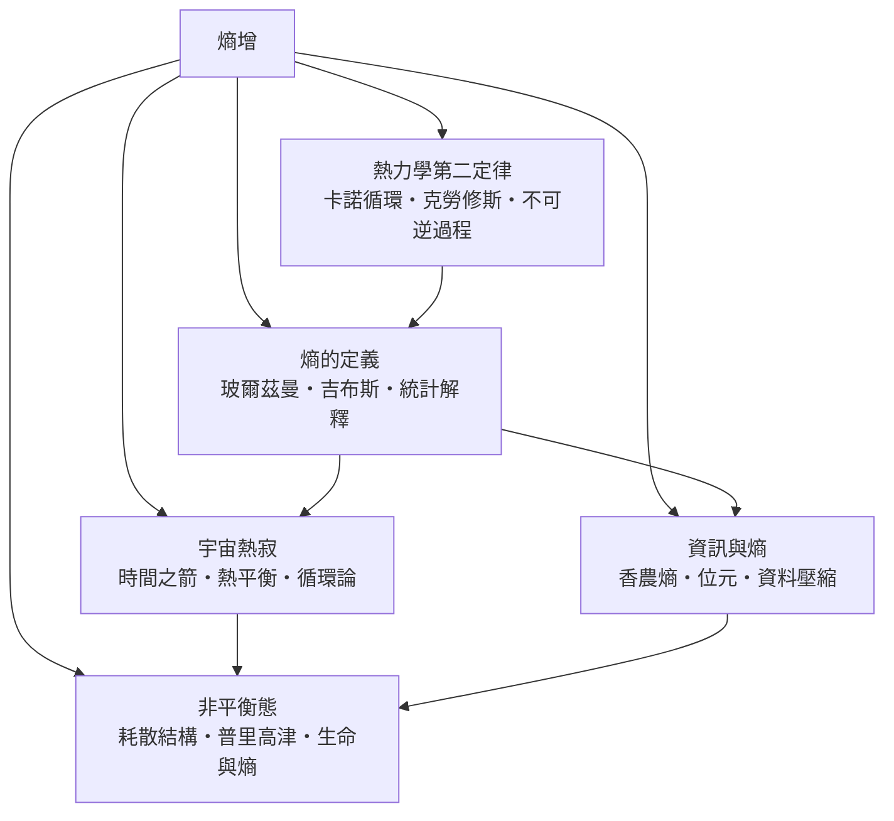

# 熵增

> 隸屬：第一層 [時]　·　相關分類：[熱力學]、[物理學]、[時間哲學]　·　子分類總表見 [README]

> 對應維基百科：[中文維基百科：熱力學第二定律](https://zh.wikipedia.org/wiki/%E7%83%AD%E5%8A%9B%E5%AD%A6%E7%AC%AC%E4%BA%8C%E5%AE%9A%E5%BE%8B)　·　[English Wikipedia: Entropy](https://en.wikipedia.org/wiki/Entropy)

**熵增**指的是孤立系統的熵只增不減、不可逆的宏觀過程必然自帶代價這件事本身。它不是「宇宙在變亂」的口號，而是一條可以量測、可以計算、可以拿來做工程判斷的定律。對隔離系統而言，總熵的變化恆非負：

$$
\Delta S \ge 0
$$

其中 $S$ 是熵，單位為 $\mathrm{J/K}$ ；等號成立時系統處於可逆過程或平衡態，大於零則代表真實的耗散。

熵增之所以重要，不只在於它約束了化學反應能否自發、電池能輸出多少電，而在於它是**時間方向的物理學解釋**：微觀的粒子運動在統計上可逆，宏觀的過程卻有明確的單向性。於是「過往與未來為何不同」這個哲學問題，被轉化成一條可在實驗室量測的等式。

## 核心問題

熵增要回答的核心問題有三層。

1. **方向**：為什麼熱會自發地從高溫流向低溫，卻不會自發地反向？這是 [熱力學第二定律] 的第一種表述，也是 [不可逆過程] 存在的理由。
2. **極限**：一部熱機的效率最高能到多少？答案是 $\eta_{\max} = 1 - T_c/T_h$ ，這是 [卡諾] 在 1824 年就給出的答案。
3. **量化**：如何用一個數把「不可逆的程度」寫下來？[克勞修斯] 定義

$$
dS = \frac{dQ_{\mathrm{rev}}}{T}
$$

而 [波茲曼] 給出更根本的統計版本 $S = k \ln W$ ，其中 $W$ 是宏觀態所對應的微觀狀態數，[吉布斯] 則以系綜理論把兩者接軌。

三層問題的關係是：先有方向的直覺，才有極限的計算；先有狀態函數的定義，才有統計的還原。反過來說，任何無法用 $\Delta S \ge 0$ 表達的說法，都不構成物理學意義上的熵增。

## 因果鏈

1. **蒸汽機的誘惑**：19 世紀的工廠需要把熱轉成功，但沒有人能說明效率的邊界在哪裡，「熱是流質」的直覺與能量守恆的直覺互相衝突。
2. **卡諾的理想循環**：1824 年 [卡諾] 提出可逆循環，證明效率只取決於高低溫熱源之比，真實熱機無法超越此上限——這是第二定律的第一塊基石。
3. **第二定律的表述**：1850 年 [克勞修斯] 發表循環過程的表述，宣稱熱不會自發從低溫流向高溫；能量守恆被升格為具有方向性的一對定律。
4. **熵的引入**：1865 年 [克勞修斯] 把「宇宙的熵趨於極大」寫下， $S$ 成為可計算的狀態函數，不可逆性獲得定量語言。
5. **統計還原**：[波茲曼] 以 $S = k\ln W$ 把熵解釋為相容微觀狀態數的對數，[吉布斯] 建立系綜理論，於是「為什麼」變成「因為另一側的狀態數多得多」。
6. **宇宙學推論**：把孤立系統放大到整個宇宙，得到熱平衡與熱寂的結局，[時間之箭] 因此獲得物理學的候選解釋。
7. **資訊的移植**：1948 年 [香農] 把不確定性度量寫成與熱力學熵同構的形式，熵從物理量擴張為資訊量。
8. **非平衡的反轉**：[普里高津] 指出遠離平衡的開放系統會湧現有序結構，[耗散結構] 讓生命不再是熱力學的例外。

## 子分類的定位與相互驅動

- [熱力學第二定律] 是**規則**：它給出方向與極限，是其餘四個子分類共同的前提。
- [熵的定義] 是**語言**：把規則寫成狀態函數，並用 [統計解釋] 說明其微觀意義；沒有這層，前者的表述只是口號。
- [宇宙熱寂] 是**尺度推論**：把局部的不可逆性放大到整個宇宙，並由此處理時間箭頭與循環論的挑戰。
- [資訊與熵] 是**外擴**：證明熵的數學形式不依賴物理系統，於是資訊處理、編碼與壓縮都能借用同一套工具。
- [非平衡態] 是**反轉**：把注意力從平衡態移到遠離平衡處，說明秩序可以在總熵增加的同時於局部出現。

## 範例

**範例一：一杯熱咖啡的降溫。** 咖啡從 $80^\circ\mathrm{C}$ 降到 $40^\circ\mathrm{C}$ ，若視為定壓冷卻且比熱 $c = 4.2\ \mathrm{J/(g\cdot K)}$ ，質量 $m = 200$ g，則系統的熵變化為

$$
\Delta S = mc\ln\frac{T_2}{T_1} \approx 200 \times 4.2 \times \ln\frac{313}{353} \approx -39.5\ \mathrm{J/K}
$$

咖啡本身熵減，但房間吸收了這份熱，總熵變為正——所謂「熵增」講的是總和，不是單一物體。

**範例二：兩枚硬幣的統計解釋。** 擲一枚硬幣，出正面的機率是 $1/2$ ；兩枚硬幣同時正面的機率是 $1/4$ 。若問「這枚硬幣的正反面各佔多少資訊」，答案是 $1$ bit；若問「兩枚硬幣的狀態有多少種可能」，答案是 4。狀態數越多， $S = k\ln W$ 越大，宏觀上「偏好某個狀態」其實只是數量大得多。

**範例三：電池放電的可逆性。** 鋅銅電池放電反應為 $\mathrm{Zn + Cu^{2+} \to Zn^{2+} + Cu}$ ，反應的吉布斯自由能變化為負，說明反應自發；但把電能全部轉成熱而放棄充電能力，就是把可用能量貶值的典型不可逆過程。

## 容易混淆之處

- **熵不是「混亂」**：更精確的說法是「相容微觀狀態數的多寡」，或「能量在微觀自由度上的攤平程度」。
- **熵增不是「能量消失」**：能量始終守恆，被消耗的是能量的**品質**——低溫的熱難以再全部轉回工作。
- **局部熵減不違反第二定律**：冰箱與生命體都靠向環境排出更多熵來維持內部有序。
- **熱寂不是「現在時」的必然**：它是孤立系統在充分長時間後的極限狀態，實際宇宙仍有引力聚集與恆星核合成等局部逆行過程。
- **熵與資訊熵單位不同**：物理熵以 $\mathrm{J/K}$ 計，資訊熵以 bit 計，兩者可藉波茲曼常數換算。

## 延伸閱讀

- [熱力學]：熵增所屬的母概念，含第一、第二定律與統計力學的完整敘述。
- [物理學]：更上位的學科框架。
- [時間哲學]：熵增作為時間箭頭解釋，與哲學論辯的交界面。
- [相對論]：討論宇宙尺度上的時空膨脹時不可或缺。
- [資訊時代]：熵的資訊論推廣在技術史上的位置。

## 連結定義

[時]: ../時/README.md
[README]: README.md
[熱力學]: ../熱力學/README.md
[物理學]: ../物理學/README.md
[時間哲學]: ../時間哲學/README.md
[相對論]: ../相對論/README.md
[資訊時代]: ../資訊時代/README.md
[熱力學第二定律]: 熱力學第二定律.md
[不可逆過程]: 不可逆過程.md
[卡諾]: ../人/物理學家/卡諾.md
[克勞修斯]: ../人/物理學家/克勞修斯.md
[波茲曼]: ../人/物理學家/波茲曼.md
[吉布斯]: ../人/物理學家/吉布斯.md
[香農]: ../人/數學家/香農.md
[普里高津]: ../人/物理學家/普里高津.md
[熵的定義]: 熵的定義.md
[統計解釋]: 統計解釋.md
[宇宙熱寂]: 宇宙熱寂.md
[時間之箭]: 時間之箭.md
[資訊與熵]: 資訊與熵.md
[非平衡態]: 非平衡態.md
[耗散結構]: 耗散結構.md
