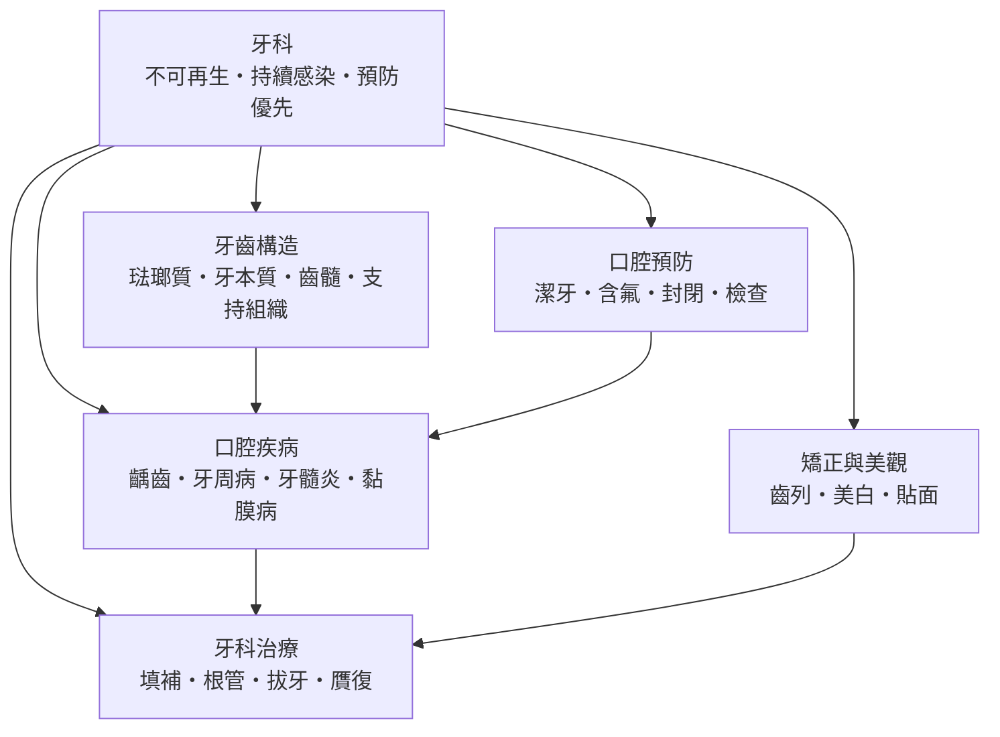

# 牙科

> 分類範圍：研究牙齒與口腔這個「終生使用的精密器械」的部門——牙齒的硬組織與支持組織如何構成、口腔疾病如何發生與演進、修復與治療的技術、排列與美觀的調整，以及把疾病擋在發生之前的預防體系。　·　隸屬第一層：[醫]　·　相關分類：[病理學]、[解剖學]、[微生物學]　·　子分類總表見 [README]

> 對應維基百科：[中文維基百科：牙医学](https://zh.wikipedia.org/wiki/%E7%89%99%E9%86%AB%E5%AD%B8)　·　[English Wikipedia: Dentistry](https://en.wikipedia.org/wiki/Dentistry)

牙科（牙醫學）是醫學中高度獨立的一支：口腔是消化與呼吸的入口、語言與表情的出口，而牙齒是人體少數**不會自我修復**的硬組織——琺瑯質一旦磨損或脫鈣，身體無法再生。這個特性決定了牙科的兩條主軸：一方面要靠**修復技術**（填補、根管治療、假牙）彌補身體做不到的再生，另一方面要靠**預防體系**（潔牙、含氟、窩溝封閉）讓損失根本不要發生。齲齒與牙周病都是由牙菌斑中的細菌引起的慢性感染，這使得牙科同時是微生物學、材料工程與公共衛生的交會點。

## 核心問題：不可再生的組織與持續進行的感染

牙科的中心事實有兩條：

1. **硬組織不可再生**：牙本質與牙骨質有有限的修補反應（第三期牙本質），但琺瑯質在牙齒萌發後即無細胞維護，任何脫鈣都只能靠唾液中的礦物質離子再礦化「表面修補」。
2. **菌斑是持續性疾病源**：牙菌斑是黏附在牙面的生物膜，其中的變異鏈球菌代謝糖類產酸（pH 可降至約 $5.5$ 以下而使琺瑯質脫鈣），而牙齦卟啉單胞菌等牙周致病菌則在齦下引發慢性發炎與骨頭破壞。

因此牙科的核心公式可以概括為：**疾病負擔 = 病原與時間 × 宿主抵抗力 − 預防介入**；所有子分類都在操縱這個式子的某一項。

## 因果鏈

1. **解剖學打底**：對牙體形態、咬合關係與顳顎關節的精確描述，讓修復與矯正有了可依循的藍圖。
2. **細菌病因的確認**：十九世紀末米勒提出化學寄生說，二十世紀關鍵實驗證明無菌動物不會齲齒，齲齒與牙周病被確認為細菌性疾病，預防才有了明確標的。
3. **含氟的革命**：流行病學觀察發現飲水含氟地區齲齒率顯著較低，氟化物使琺瑯質抗酸與促進再礦化的機制被闡明，公共衛生第一次大規模「讓牙齒不壞」。
4. **材料與器械的進步**：樹脂黏合、陶瓷與鈦金屬植入物的出現，使修復從「填洞」進步到「重建功能與美觀」。
5. **根管治療的系統化**：細菌在齒髓與根尖組織中的角色被確認後，徹底清創、成形與封填成為保留牙齒的標準流程。
6. **矯正的生物力學化**：骨頭受持續輕力會重塑的事實被量化，齒列移動從經驗技藝變成可計畫的工程。
7. **預防中心的翻轉**：牙科從「壞了再補」轉向以風險評估與定期照護為主的模式，兒童與高齡族群成為重點。
8. **數位化整合**：口內掃描、數位影像與電腦輔助設計把診斷、治療計畫與贋復製作串成一條數位流水線。

## 子分類的定位與相互驅動

- [牙齒構造] 是**地圖**：不了解各層組織的性質，就無法解釋疾病為何在某些層擴散得特別快，也無法選對修復材料。
- [口腔疾病] 是**敵情**：齲齒沿琺瑯質到齒髓的進展路徑、牙周病沿齦溝向根方的破壞路徑，決定了治療的急迫性與方法。
- [牙科治療] 是**修復**：把不可再生組織的損失，用材料與技術補回功能。
- [矯正與美觀] 是**排列與外觀**：透過骨重塑移動牙齒，並以美學考量設計修復。
- [口腔預防] 是**上游**：含氟、潔牙與定期檢查把疾病的發生率壓下來，直接決定下游治療量的多寡。

## 範例：一顆臼齒從健康到重建的完整歷程

以一名二十歲患者下顎第一大臼齒為例，五個子分類依序登場：

1. **構造**：這顆牙的咬合面有深窩溝，琺瑯質最厚處約 $2.5\ \text{mm}$ ，但窩溝底部琺瑯質極薄——這正是齲齒好發處。
2. **預防**：十二歲前後施行窩溝封閉並配合含氟牙膏，多數齲齒在此被攔截；患者因清潔疏忽，窩溝仍出現脫鈣白斑。
3. **疾病**：脫鈣區演變成齲洞，細菌沿牙本質小管向內侵犯，接近齒髓時引發可復性牙髓炎，冷熱敏感是警訊。
4. **治療**：若及時，樹脂填補即可；若延誤至細菌進入齒髓，則需根管治療，之後因牙齒變脆而以牙套贋復。
5. **矯正與美觀**：若該牙早年被拔除而未重建，鄰牙傾倒、對咬牙過長，咬合崩壞需要矯正重新分配空間——治療決策從來不只是單顆牙的事。

## 容易混淆之處

- **齲齒不是「蟲蛀」**：它是特定細菌代謝糖產酸造成的脫鈣與破壞，糖與細菌缺一不可。
- **牙齦出血不是「刷太用力」**：健康牙齦刷牙不會出血；出血幾乎總是發炎的徵兆，正確清潔反而能改善。
- **根管治療後的牙不是「死了就算了」**：失去齒髓與結構的牙齒更脆，不做贋復保護的失敗率顯著較高。
- **美白改變的是顏色不是結構**：漂白劑氧化色素分子，不會「補強」牙齒；過度使用反而造成敏感。
- **乳牙會換所以不必管**：乳牙齲齒會影響恆牙發育與齒列空間，預防從第一顆牙就開始。

## 延伸閱讀

- [病理學]：發炎與壞死機制，牙髓炎與牙周破壞的共同語言。
- [微生物學]：菌斑生物膜與致齲菌的研究基礎。
- [解剖學]：口腔與顎面結構的座標系。
- [公共衛生]：飲水加氟與學童塗氟政策的設計場域。
- [流行病學]：齲齒率調查與牙周病盛行率的方法學。
- [營養素]：糖攝取、鈣磷與維生素對牙齒健康的影響。
- **跨科合作**：嚴重牙周炎、顎面畸形與全身疾病患者需要跨專科共同計畫，牙科早已不是單打獨鬥的行業。
- **病歷與法律層面**：治療計畫、替代方案與風險的書面溝通，是現代牙科醫病關係的基礎設施。

## 連結定義

[醫]: ../醫/README.md
[README]: README.md
[病理學]: ../病理學/README.md
[解剖學]: ../解剖學/README.md
[微生物學]: ../微生物學/README.md
[公共衛生]: ../公共衛生/README.md
[流行病學]: ../流行病學/README.md
[營養素]: ../營養素/README.md
[牙齒構造]: 牙齒構造.md
[口腔疾病]: 口腔疾病.md
[牙科治療]: 牙科治療.md
[矯正與美觀]: 矯正與美觀.md
[口腔預防]: 口腔預防.md
