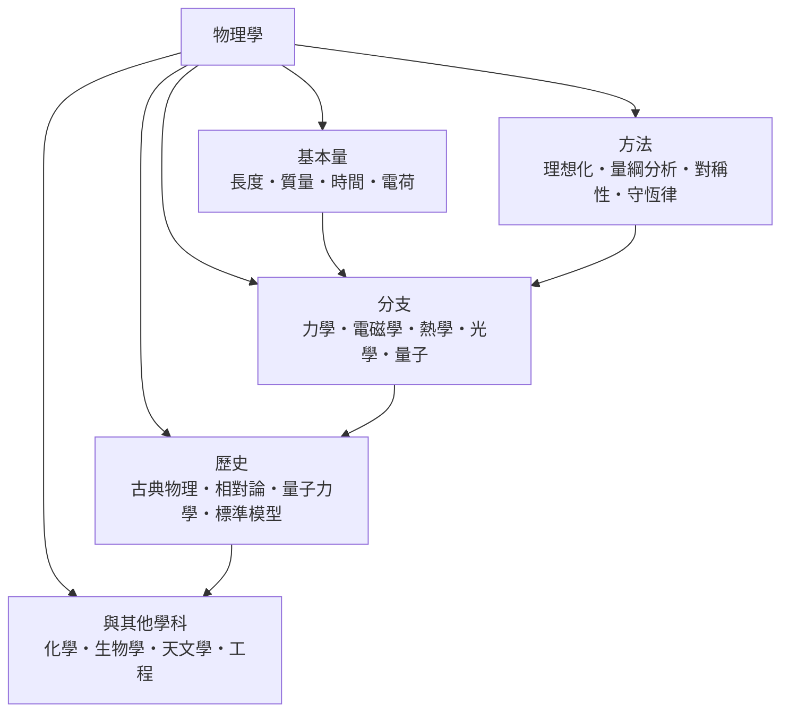

# 物理學

> 隸屬：第一層 [理]　·　相關分類：[數學]、[化學概念]、[天文學概念]　·　子分類總表見 [README]

> 對應維基百科：[中文維基百科：物理学](https://zh.wikipedia.org/wiki/%E7%89%A9%E7%90%86%E5%AD%A6)　·　[English Wikipedia: Physics](https://en.wikipedia.org/wiki/Physics)

物理學研究**物質、能量、空間與時間的基本性質及其交互作用**。它的野心是找出最少數的原理，去解釋最多數的現象：一條 $F = ma$ 能同時說明蘋果落地與月球繞行，一條 $E = mc^2$ 把質量與能量縫合成同一種東西。因此物理學常被稱為其他自然科學的地基——化學還原到電子與鍵結，生物學還原到分子與能量流，天文學還原到引力與輻射，追到最底層都是物理學的問題。

物理學的合法性來自**實驗與數學的雙重約束**。理論必須寫成數學形式才有預測力，預測必須通過可重複的測量才算數。1905 年 [愛因斯坦] 提出光電效應的量子解釋，十年後 [米立坎] 以油滴與光電實驗逐一驗證——理論與實驗這對齒輪，是物理學有別於自然哲學的關鍵。

## 核心問題

物理學的核心問題可以整理成四層：

1. **基本量**：描述自然需要哪些量？[長度]、[質量]、[時間]、[電荷] 是四塊基石，其餘物理量皆由它們組合而成。
2. **分支**：這些量在不同尺度下如何表現？小到粒子、大到星系，各尺度發展出 [力學]、[電磁學]、[熱學]、[光學]、[量子] 等分支。
3. **方法**：面對無法直接觀察的對象，如何推理？靠 [理想化]、[量綱分析]、[對稱性] 與 [守恆律] 這組思考工具。
4. **歷史與整合**：這些知識如何累積、如何被推翻與統一？見 [物理學的歷史]；它又如何滲入其他學科？見 [物理與其他學科]。

四層的關係是：基本量定義語言，分支累積定律，方法保證推理品質，歷史檢驗整體方向。

## 因果鏈

1. **測量的需求**：古代文明為了曆法與建築而測量星空與土地，[長度]、[時間] 的量度先於理論出現。
2. **伽利略的實驗方法**：[伽利略] 以斜面實驗量化運動，主張「自然之書以數學寫成」，物理學從思辨轉為測量。
3. **牛頓的綜合**：[牛頓] 在 [1687年] 出版《自然哲學的數學原理》，以三條運動定律與萬有引力統一天上與地上的力學。
4. **場的觀念**：19 世紀法拉第與馬克士威以「場」取代超距力，預言光即電磁波，[電磁學] 成形。
5. **兩朵烏雲**：19 世紀末，黑體輻射與邁克生—莫雷實驗無法用古典理論解釋，暴露古典物理的邊界。
6. **相對論的誕生**：[愛因斯坦] 在 [1905年] 發表狹義相對論，重定義時間與空間；[相對論] 取代牛頓理論成為高速與強引力的正確描述。
7. **量子的誕生**：普朗克 1900 年提出能量子，[薛丁格] 1926 年寫下波動方程，[量子力學] 描述微觀世界的機率規則。
8. **標準模型與凝聚態**：20 世紀後半，[標準模型] 整合已知粒子與三種作用力；凝聚態物理則把量子論應用到固體，催生半導體與雷射。

## 子分類的定位與相互驅動

- [物理學的基本量] 是**語言層**：沒有操作型定義的測量單位，任何定律都無法被檢驗。
- [物理學的分支] 是**定律層**：每個分支把基本量的關係寫成方程，是理論的主體。
- [物理學方法] 是**推理層**：當方程解不動、實驗做不了時，方法論決定物理學家往哪裡走。
- [物理學的歷史] 是**記憶層**：它記錄哪些理論被保留、哪些被限定適用範圍，避免重複犯錯。
- [物理與其他學科] 是**出口層**：物理學的方法與定律在化學、生物、天文與工程中被大量借用，也從這些學科得到新問題。

## 範例：從一顆蘋果到一顆衛星

1. **量測**：蘋果從 2 公尺高落下，用碼錶量得約 0.64 秒；由 $s = \tfrac{1}{2}gt^2$ 反推得 $g \approx 9.8 \ \mathrm{m/s^2}$ ，這就是把 [長度] 與 [時間] 化成數的過程。
2. **建模**：把蘋果視為質點、忽略空氣阻力——這是 [理想化]；只保留重力一個力。
3. **預測**：若同一顆蘋果被放到 400 公里高的軌道並給予水平速度 7.7 公里每秒，它永遠落不回地面——它成了 [人造衛星]。同一條 $F = ma$ ，輸入不同就得出不同世界。
4. **檢驗**：計算與觀測若不符，如水星近日點每百年多出 43 角秒的進動，就迫使理論升級——最終由廣義相對論解釋。
5. **回饋**：為了檢驗這些預測，工程界造出更精密的儀器，反過來讓物理學家能看到更小的尺度與更遠的宇宙。

## 容易混淆之處

- **物理學不等於自然科學的全部**：化學、生物學有各自的層次規律，並非只是「應用物理」。
- **理論被「取代」其實是被「限定」**：牛頓力學在低速弱引力下仍然精確，相對論是劃出其邊界而非宣告其無用。
- **物理量與其單位不同**：質量是性質，公斤是人為約定；混用會導致量綱錯誤。
- **對稱性是原理不是裝飾**：諾特定理指出每個連續對稱對應一個守恆量，對稱性直接決定定律的形式。
- **數學模型與真實的距離**：質點、理想氣體都是模型，把模型當實體是初學者最常見的誤解。

## 延伸閱讀

- [理]：物理學所屬的第一層分類。
- [數學]：物理學的語言與工具箱。
- [化學概念]：物質組合層次的科學。
- [天文學概念]：把物理定律推到宇宙尺度的學科。
- [力學]：物理學最早成形、也最基礎的分支。
- [熱力學]：能量與熵的巨觀理論。

## 連結定義
[1687年]: ../時/1687年.md
[1905年]: ../時/1905年.md
[README]: README.md
[人造衛星]: ../力學/人造衛星.md
[伽利略]: ../人/物理學家/伽利略.md
[光學]: 光學.md
[力學]: ../力學/力學.md
[化學概念]: ../化學/README.md
[天文學概念]: ../天文學/README.md
[守恆律]: 守恆律.md
[對稱性]: 對稱性.md
[愛因斯坦]: ../人/物理學家/愛因斯坦.md
[數學]: ../數學/README.md
[時間]: 時間.md
[標準模型]: 粒子物理.md
[熱力學]: ../熱力學/README.md
[熱學]: 熱學.md
[牛頓]: ../人/物理學家/牛頓.md
[物理學方法]: 物理學方法.md
[物理學的分支]: 物理學的分支.md
[物理學的基本量]: 物理學的基本量.md
[物理學的歷史]: 物理學的歷史.md
[物理與其他學科]: 物理與其他學科.md
[理]: ../理/README.md
[理想化]: 理想化.md
[相對論]: ../相對論/README.md
[米立坎]: ../人/物理學家/米立坎.md
[薛丁格]: ../人/物理學家/薛丁格.md
[質量]: 質量.md
[量子]: 量子.md
[量子力學]: ../量子力學/README.md
[量綱分析]: 量綱分析.md
[長度]: 長度.md
[電磁學]: 電磁學.md
[電荷]: 電荷.md
