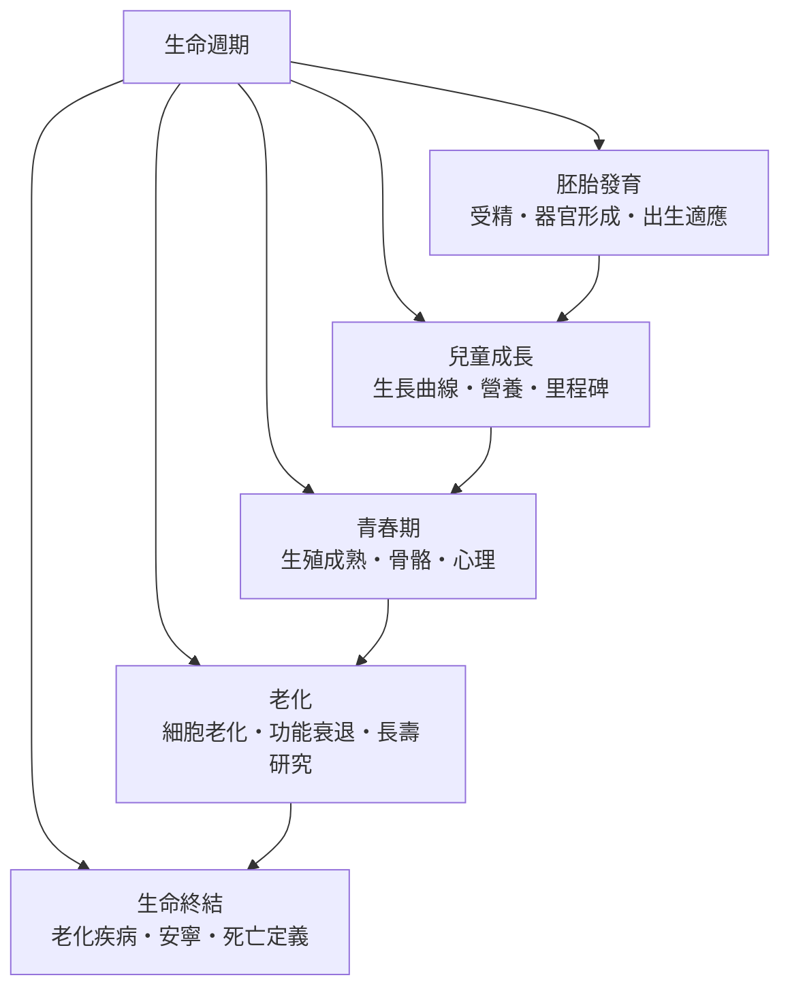

# 生命週期

> 分類範圍：從受精到死亡的完整歷程——胚胎發育、兒童成長、青春期、老化與生命終結——並說明每一階段的生物機制與社會環境如何交織。　·　隸屬第一層：[人]　·　相關分類：[生理學]、[解剖學]、[人口結構]、[心理學]　·　子分類總表見 [README]

> 對應維基百科：[中文維基百科：生命週期](https://zh.wikipedia.org/wiki/%E7%94%9F%E5%91%BD%E5%91%A8%E6%9C%9F)　·　[English Wikipedia: Life cycle](https://en.wikipedia.org/wiki/Life_cycle)

生命週期把「人」從出生到死亡的過程視為**一條有方向的曲線**：每一階段有它自己的生長速度、脆弱點與社會期待。它既是生物學的時序，也是社會的制度框架（學齡、兵役、退休、遺產）。本概念的問題是：**身體的時間表與社會的時間表如何互相校準，又在哪些地方彼此衝突**。

## 核心問題：三種時間

理解生命週期要先分清三種時間：

1. **生物時間**：受精後的天數、出生後的月數——受基因與環境調控，相對穩定。
2. **社會時間**：入學、畢業、就業、退休——由制度設定，可變但有慣性。
3. **世代時間**：一整代人的共同經歷（戰亂、疫情、數位化）——壓在每個人的生命曲線上。

多數生命週期的衝突都發生在三種時間不同步的地方。

## 因果鏈

1. **受精的軟體與硬體開關**：細胞的發育程式在受精時被啟動，之後沿著高度保守的時序進行。
2. **生長的躍升期**：出生後前兩年是神經系統的關鍵期，此時營養與互動的品質直接影響終身能力。
3. **青春期的第二次生長**：生長激素與性激素把停滯的兒童期推向成人的身體與心理重組。
4. **成年後的穩態與磨損**：成年前期身高停止而功能仍在累積；中後期累積的損傷開始壓過修復能力。
5. **老化的多因模型**：細胞複製性老化、幹細胞耗竭、蛋白質穩定性下降與免疫衰老等機制並行，沒有單一原因。
6. **生命終結的照護化**：醫療目標從「治病」轉向「減少痛苦」，安寧照護成為生命週期的最後一環。

## 子分類的定位與相互驅動

- [胚胎發育] 是**起點**：把單細胞變成一個可運作的系統。
- [兒童成長] 是**高速期**：身體與腦同時高速擴張，營養與環境的敏感度最高。
- [青春期] 是**轉型期**：身體、腦與社會身分三者同時重組，衝突最多的階段。
- [老化] 是**漸變期**：機制的累積與代償的失衡，時間尺度以十年計。
- [生命終結] 是**收束期**：把生理極限與照護選擇結合起來。

## 範例：從一張生長曲線讀出一段人生

以一張兒童生長曲線為例，看生物時間與社會時間如何交錯：

1. **測量與繪圖**：身高體重按年齡、性別的百分位排入生長曲線圖；百分位的追蹤比單一數值有意義。
2. **判讀**：持續沿同一百分位前進＝正常的生長模式；短期下沉再回到原軌＝暫時性因素；持續跨軌下降＝需要評估。
3. **與學校的接點**：入學年齡依據群體的成熟分布而非絕對年齡；生長落後的孩子在學校裡同時承受生理與社會的壓力。
4. **與遺傳的限制**：身高百分之八十由遺傳決定——追蹤曲線的斜率比終點更有預測價值。
5. **介入的時機**：營養與内分泌的問題越早發現、介入越有效；這是兒童成長研究最實用的結論。

## 容易混淆之處

- **生長與發育不同**：生長是量的增加，發育是能力的改變；兒童可以長高而發展遲緩。
- **里程碑有範圍而非死線**：多數能力的出現有正常區間，單一時間點未達不必然是異常。
- **青春期不是單一事件**：是一連串變化（生長衝刺、性成熟、認知與情緒重組）的重疊期，開始年齡的個體差異很大。
- **老化不是單一路徑**：功能 declines 的速度與模式因器官、族群、社會支持而異；「平均年齡」掩蓋巨大的個體差異。

## 技術要點

- **里程碑與年齡區間**：以「何時出現」為核心的發展里程碑，配合「是否出現」的評估工具（篩檢與轉介）。
- **生長的縱向量測**：單次量測不足，序列（同一工具、同一時間點、同一方法）才可比較；曲線的斜率比數值重要。
- **發育的可塑性**：早期營養、睡眠、互動與疾病史，會改變後續的軌跡；敏感期與關鍵期是「何時介入最有效」的答案。
- **荷爾蒙的階段性**：生長激素、甲状腺素、性激素的分泌時序，構成成長的三次躍升（嬰兒期、青春期的生長衝刺、更年期後的變化）。
- **臨床與教育的銜接**：發展評估的結論會影響入學安置與特殊教育；因此評估工具的敏感度與特異度即是公共政策問題。
- **生命的終結亦在生命週期之內**：安寧照護與死亡定義屬於生命週期的最後一段，不應被視為「醫學之外」的例外。

## 常見的論爭

1. **早教與介入的界線**：早期介入的效益在有發展風險的兒童最明確；對一般兒童是否有效、是否造成「過度_optimization」的焦慮，仍有爭論。
2. **里程碑的標準化與文化偏見**：以單一文化樣態訂定里程碑，可能對不同家庭背景的兒童不公平；量表的修訂因此持續進行。
3. **壽命延長的倫理**：抗衰老研究從延長健康壽命走向延後病理過程，但「是否應當追求」屬於價值判斷，學術只能提供資訊。

## 延伸閱讀

- [生理學]：各階段功能的生理機制。
- [解剖學]：結構隨發育改變的基礎。
- [人口結構]：個體生命曲線的群體版本。
- [心理學]：發展與老化的心理面向。

## 連結定義

[人]: ../人/README.md
[README]: README.md
[生理學]: ../生理學/README.md
[解剖學]: ../解剖學/README.md
[人口結構]: ../人口結構/README.md
[心理學]: ../心理學/README.md
[胚胎發育]: 胚胎發育.md
[兒童成長]: 兒童成長.md
[青春期]: 青春期.md
[老化]: 老化.md
[生命終結]: 生命終結.md
