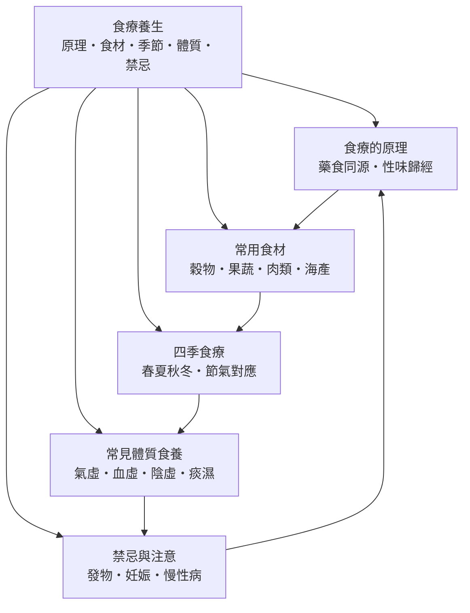

# 食療養生

> 隸屬：第一層 [醫]　·　相關分類：[中醫學]、[養生]、[營養素]　·　子分類總表見 [README]

> 對應維基百科：[中文維基百科：食藥同源](https://zh.wikipedia.org/wiki/%E9%A3%9F%E8%8D%AF%E5%90%8C%E6%BA%90)　·　[English Wikipedia: Chinese food therapy](https://en.wikipedia.org/wiki/Chinese_food_therapy)

食療養生是以日常飲食作為調養身體、預防與輔助治療疾病的理論與實踐。它站在兩個觀念之上：一是「藥食同源」——食物與藥物本出同源，日常入口之物本身就有性質偏向；二是「食療不愈，然後命藥」——[孫思邈] 在《備急千金要方》中確立的次序：先調飲食，飲食解決不了再用藥。因此這門學問的核心不是「吃什麼補什麼」，而是**依據身體狀態、季節與食材性質，把每天的飲食安排成最溫和的長期干預**。本分類的五個子分類，正好對應「原理先行、食材為材、季節為時、體質為人、禁忌為界」的完整結構。

## 核心問題

食療養生的核心問題是：**在不必吃藥的前提下，如何讓日常飲食成為健康的正向力量**。傳統理論用三組概念回答：

1. **性味歸經**：每種食物有寒熱溫涼之性、辛甘酸苦鹹之味，並傾向作用於特定臟腑；選材即是選性味。
2. **以平為補**：調養的目標是把身體拉回平衡，而非一味補益；熱者涼之、寒者溫之，「補」是矯偏，不是加碼。
3. **三因制宜**：因時（季節）、因地（地域）、因人（體質）而異，同一碗湯對不同人的意義完全不同。

現代營養學用另一套語言回答相近的問題：宏量與微量營養素的充足、膳食纖維與血糖負荷、鈉與飽和脂肪的限制。值得注意的是，兩套體系在「均衡、適量、多樣」上高度一致，分歧主要在解釋框架；這也是食療養生比針灸、方劑更容易與現代對話的原因。

## 因果鏈

1. **藥食不分的起源**：遠古採集與嘗試的經驗裡，食物與藥物沒有界線；《淮南子》所記神農「嘗百草之滋味……一日而遇七十毒」，正是這個階段的記憶——先有辨認什麼能吃、什麼能治的一體經驗。
2. **食治專卷的確立**：唐代 [孫思邈]《備急千金要方》設「食治」專卷，收載果實、菜蔬、穀米、鳥獸四類一百五十餘種食物的性能，並明言「食療不愈，然後命藥」——食物第一次被系統地當作一線手段。
3. **專書的成熟**：唐代孟詵《食療本草》是世界上現存較早的食療專著，逐味記載食性、功效與忌宜；元代《飲膳正要》則把宮廷營養配餐整理成制度。
4. **理論框架的嵌合**：食物被納入四氣五味、歸經與體質的框架，與中醫辨證體系接軌——食療從「經驗清單」升級為「辨證施膳」。
5. **季節與節氣的時間表**：隨著 [二十四節氣] 與民間補冬習俗的成熟，「春養肝、冬進補」成為全民操作的飲食曆法。
6. **藥膳的商品化**：藥膳餐廳、冬令進補與保健食品把食療推向大眾市場，規模擴大的同時也放大了誤用與誇大宣傳。
7. **現代營養學的檢驗**：熱量、蛋白質、維生素與膳食纖維的研究一方面證實了許多傳統主張（如全穀、蔬果的價值），另一方面也推翻了「以形補形」等機械類比。
8. **當代的整合**：今天的食療養生位於傳統食養、現代營養學與食品安全法規的交匯處——真正的課題不再是「食療有沒有用」，而是如何在證據分級與安全規範下使用它。

## 子分類的定位與相互驅動

### 食療的原理

食療的原理是整個體系的**理論地基**：「藥食同源」確立了食物可以入「藥」的地位，「性味歸經」提供了給食物分類的語言，「以平為補」給出了操作原則。沒有這一層，食療就退化成零散的偏方與食譜；反過來，食材與體質層面的成敗經驗，又不斷回頭修正原理的表述——例如「以形補形」正是在原理層面被淘汰的類比。

### 常用食材

常用食材是食療的**材料庫**：五穀提供主食的平和基底，果蔬補充維生素與膳食纖維，肉類與海產供給蛋白質與微量元素，[生薑]、[枸杞] 等藥膳材料則是食與藥之間的橋樑。食材的性味分類，正是原理層「性味歸經」的具體落實；沒有對食材的系統認識，季節與體質的方案都無從下手。

### 四季食療

四季食療是食療的**時間策略**：春升、夏清、秋潤、冬補的節奏，把「因時制宜」變成可執行的曆法。季節決定了外界環境對身體的壓力方向——夏季需防暑耗氣、冬季需抗寒補養——因此季節方案必須以食材庫為材料、以原理為準則。它也直接對接 [二十四節氣] 的時間框架，是食療中最貼近日常生活節奏的一層。

### 常見體質食養

常見體質食養是食療的**個體化方法**：氣虛者宜甘溫益氣、血虛者宜補血養營、陰虛者宜滋潤清補、痰濕者宜清淡化濕。體質辨識使「同一道菜對不同人效果不同」成為可說明、可操作的規則，是「三因制宜」中「因人」一項的具體化；它也把食療從大眾食譜推向個人化調養，是傳統食養與現代精準營養的對接面。

### 禁忌與注意

禁忌與注意是體系的**底線**：發物與疾病復發的關聯、妊娠期間的飲食禁忌、慢性病（如高血壓、糖尿病、腎病）的飲食限制，以及食物中毒與過敏等食源性風險，構成了食療不能越過的邊界。它不只消極地限制，也倒逼上游修正——正是慢性病飲食研究的推進，使「冬令大補」對代謝症候群者的風險被清楚認識；沒有這一層，前面四層的成果都無法被安全使用。

## 範例：一碗食療方的完整思路——以當歸生薑羊肉湯為例

1. **出典**：此方見於《金匱要略》，是食療傳統中最經典的藥膳之一，用途為溫中補血、祛寒止痛，適合冬日手足冰冷、面色蒼白的血虛有寒之人。
2. **食材**：羊肉溫補氣血（肉類），生薑溫散寒氣（藥膳材料），當歸補血活血（藥材入膳）——三味都是「常用食材」層的材料。
3. **季節**：冬季進補的代表作，對應「冬主藏、宜溫補」的四季食療原則；同樣的湯在炎夏飲用反而助熱。
4. **體質**：適合血虛與陽虛體質；陰虛內熱、容易口乾舌燥者不宜——同一碗湯因體質而異。
5. **禁忌**：外感發燒期間不宜；現代觀點下痛風與高血脂者亦須節制——禁忌與注意層把關。
6. **現代對照**：羊肉提供優質蛋白質與鐵，對缺鐵性貧血的食療價值與「補血」的傳統表述可互相印證；這正是傳統與現代都能讀懂的一張地圖。

## 容易混淆之處

- **食療不等於藥膳**：藥膳加入了藥材，屬食療中偏「治」的一支；日常的均衡飲食、清淡調養同樣是食療的主體。
- **食療不能替代治療**：「食療不愈，然後命藥」的次序有前提——疾病已確診者，治療方案必須交給醫療體系，食療只能輔助。
- **補不等於好**：「以平為補」的原則反對一味進補；痰濕體質者愈補愈滯，正是誤把「補」當萬能的結果。
- **以形補形不是原理**：「吃腰子補腎、吃腦補腦」是機械類比，不在性味歸經的體系之內，也多數得不到營養學支持。
- **天然食物也有風險**：發芽馬鈴薯、生豆漿、河豚都是「天然」的，食源性風險不因天然而消失。

## 延伸閱讀

- [中醫學]：食療所屬的理論體系，辨證是施膳的前提。
- [養生]：食療養生是養生四支柱（起居、飲食、導引、情志）中的飲食一支。
- [營養素]：現代營養學對食物成分的分析框架。
- [中草藥]：食與藥之間的橋樑，藥膳材料多出自本草傳統。
- [食材]：食材本身的分類與性狀總表。
- [食品安全檢驗]：現代對食源性風險的管理制度。
- [食療的原理]：本分類的理論地基。
- [常用食材]：本分類的材料庫。
- [四季食療]：本分類的時間策略。
- [常見體質食養]：本分類的個體化方法。
- [禁忌與注意]：本分類的底線。

## 連結定義

[醫]: ../../科技/README.md
[README]: README.md
[中醫學]: ../../生醫/中醫學/README.md
[養生]: ../養生/README.md
[營養素]: ../../科技/營養素/README.md
[中草藥]: ../../生醫/中草藥/README.md
[食材]: ../食材/README.md
[食品安全檢驗]: ../../科技/食品安全檢驗/README.md
[二十四節氣]: ../../時/二十四節氣/README.md
[食療的原理]: 食療的原理.md
[常用食材]: 常用食材.md
[四季食療]: 四季食療.md
[常見體質食養]: 常見體質食養.md
[禁忌與注意]: 禁忌與注意.md
[孫思邈]: ../../人/醫學家/孫思邈.md
[生薑]: ../../物/生薑.md
[枸杞]: ../../物/枸杞.md