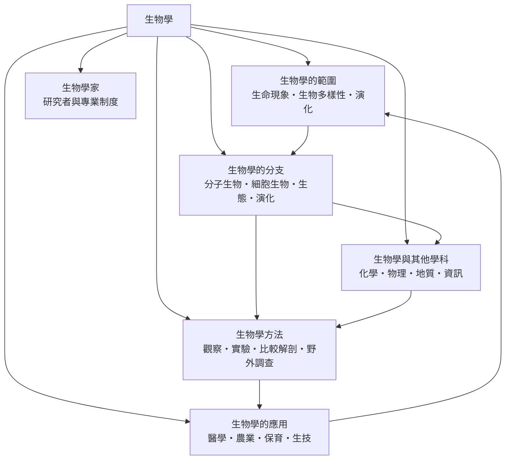

# 生物學

> 隸屬：第一層 [理]　·　相關分類：[化學]、[物理學]、[地球與大氣科學]、[地質學]　·　子分類總表見 [README]

> 對應維基百科：[中文維基百科：生物學](https://zh.wikipedia.org/wiki/%E7%94%9F%E7%89%A9%E5%AD%A6)　·　[English Wikipedia: Biology](https://en.wikipedia.org/wiki/Biology)

生物學研究**生命**——它的結構、運作、演化，以及它與環境的關係。它服務的對象極廣：從病毒、細菌到藍綠菌與多細胞動植物，從一個分子的摺疊到整個生物圈的物質循環。

生物學最特殊的地方，是它必須同時回答兩個問題：**生命如何運作**（機制）與**生命如何變成現在這樣**（演化）。前者可以用實驗回答，後者只能引入歷史。少了後半句，生物學就退化成 [化學] 與 [物理學] 的應用；少了前半句，演化論就只是一個沒有機制的說法。因此生物學家用同一套材料，一邊做分子實驗，一邊做比較與系統發育分析。

另一項特色是**多尺度**：同一個現象可以在 DNA 序列、蛋白質、細胞、器官、族群、個體、生境七個層次描述。生物學家最有價值的工作，往往不是蒐集資料，而是找出這些層次之間的對應——例如把某個基因的變異，連到族群數量的變化，再連到生態系的功能。

## 核心問題

1. **什麼是生命？** 這是 [生物學的範圍] 回答的問題：生命現象由哪些特徵構成（細胞結構、代謝、自我複製、對刺激的反應、恆定），[生物多樣性] 又如何被量化，以及 [演化] 為何是理解多樣性的關鍵。
2. **生命分哪些領域研究？** 這是 [生物學的分支] 回答的問題：從 [分子生物] 到細胞生物、生態與演化，分支不是行政分類，而是問題的層次分工。
3. **生命如何被研究？** 這是 [生物學方法] 回答的問題：觀察、[實驗]、[比較解剖] 與 [野外調查]，以及統計、建模與系統發育等現代手段。
4. **生命科學能做什麼？** 這是 [生物學的應用] 回答的問題：[醫學]、[農業]、[保育] 與 [生技] 如何把生命科學的成果轉成公共福祉。
5. **生命科學與其他學科如何互相改寫？** 這是 [生物學與其他學科] 回答的問題：化學、物理、地質與資訊科學如何滲入生物學，反過來又如何被生命系統的研究逼出新的問題。

五者構成閉環：範圍界定對象，分支切分問題，方法產生證據，應用回收成果，跨學科關係則提供工具與尺度。

## 因果鏈

1. **博物學與分類的累積**：18 世紀的標本收藏與田野記錄，使生物的種類可以被編目；[林奈] 在 1753 至 1758 年建立二名法與階層分類，讓「名稱」第一次可穩定引用。
2. **細胞學說的建立**：1839 年 [施旺] 與施萊登提出所有生物由細胞構成，生物學從整體描述轉為細胞層次的機制研究。
3. **演化論的提出**：[1859年] [達爾文] 出版《物種起源》，以自然選擇解釋多樣性；[華萊士] 獨立提出同一機制，使演化從觀念變成可檢驗的假說。
4. **遺傳學的統計化**：[孟德爾] 的豌豆實驗在 1866 年發表，1900 年被重新發現，分離律讓「性狀如何傳遞」第一次可用比例表達。
5. **分子生物的轉譯**：1953 年 DNA 雙螺旋結構解析後，基因的儲存與表現有了物理基礎；1961 年的操作子模型與 1973 年的重組 DNA 技術，使生命科學進入可設計的時代。
6. **統計與控制的標準化**：20 世紀中葉起，生物學家普遍採用對照、隨機化、重複與統計顯著性，實驗從「一次觀察」轉為「可重現的估計」。
7. **基因組學與計算**：1990 年人類基因體計畫啟動，2000 年代定序成本急降，資料量超過實驗處理速度，於是 [資訊] 與 [數學] 從配角變成生物學家的必備技能。
8. **設計與應用的轉向**：基因編輯、合成生物學、mRNA 疫苗與合成農業，使生命科學從「解讀生命」進一步走向「改寫生命」，同時也把倫理與監管的問題推到公共議程。

## 子分類的定位與相互驅動

- [生物學的範圍] 是**邊界**：先確定什麼是生命、多樣性如何計數、演化如何作為解釋框架，後面的分支才有共同對象。
- [生物學的分支] 是**版圖**：分子層次、細胞層次、個體與族群層次分工覆蓋生命的各個尺度，並共用同一套證據。
- [生物學方法] 是**可信度的來源**：對照、隨機化與統計是生物學結論能被接受的前提；沒有方法，就沒有可累積的知識。
- [生物學的應用] 是**出口與回饋**：疫苗、育種、保育與基因工程把知識帶到社會現場，應用中遇到的失敗又回頭改造基礎問題。
- [生物學與其他學科] 是**借力與被改造**：化學提供分子語言，物理提供量測，資訊提供演算法；同時生命系統的複雜性也不斷逼其他學科改進自身方法。
- [生物學家] 是**制度性的一環**：研究者的訓練、倫理規範與合作制度，決定了一門以活體為對象的學科能否持續獲得信任。

## 範例：用比例與卡方檢定把觀察變成推論

某實驗以兩對性狀的雜交，觀察到 315 株高莖綠花、108 株高莖白花、101 株矮莖綠花、32 株矮莖白花，總計 556 株。

1. **提出零假設**：若兩對性狀獨立分配且完全顯性，預期比例為 9：3：3：1，因此期望數為 $E_1 = 556 \times 9/16 \approx 312.75$ 、 $E_2 = 556 \times 3/16 \approx 104.25$ 、 $E_3 \approx 104.25$ 、 $E_4 = 556 \times 1/16 \approx 34.75$ 。
2. **計算卡方統計量**： $X^2 = \sum (O - E)^2 / E$ ，逐項代入後得 $X^2 \approx 0.51$ 。
3. **判讀**：自由度為 3，該統計量遠小於臨界值 7.81，因此不拒絕零假設；觀察比例與 9：3：3：1 相容。
4. **意義**：這正是 [孟德爾] 的結論在 20 世紀的統計語言中得以確立的過程——比例不是印象，而是可檢驗的量化主張。
5. **延伸**：同一套邏輯也用在群集抽樣、藥物對照試驗與生態樣方分析中，[生物學方法] 的核心就是這套「預測—量測—檢定」的循環。

## 容易混淆之處

- **生物學不等於「研究動物」**：植物、微生物、真菌與病毒同樣是生物學的對象。
- **生命與化學系統的界線不明確**：病毒是否算生命、隕石上有機物是否算生命，都是仍在討論的邊界問題。
- **個體與族群是不同層次**：基因比例的改變必須經過世代交替才成為演化，族群層次與個體層次不可混用。
- **相關不等於因果**：分子關聯（例如某基因與某疾病同時出現）不等於機制，實驗與縱貫研究才是因果推論的依據。
- **「自然」不等於「無害」**：野生動植物與本土微生物也可能造成入侵與公共衛生風險。
- **分類名稱不等於演化分支**：命名是人為的，演化分支是歷史的，兩者必須分開處理。

## 延伸閱讀

- [化學]：生命分子的物質語言。
- [物理學]：量測、力學與統計力學。
- [地質學]：生命史的時間座標與 [化石] 紀錄。
- [數學]、[資訊]：統計、演算法與資料分析。
- [分子生物]、[遺傳學]、[生物分類學]、[保育生物學]、[生態系統]：生物學的分支與相鄰領域。
- [達爾文]、[孟德爾]、[施旺]、[華萊士]、[林奈]：塑造現代生物學的人物。

## 連結定義

[理]: ../理/README.md
[README]: README.md
[化學]: ../化學/README.md
[物理學]: ../物理學/README.md
[地球與大氣科學]: ../地球與大氣科學/README.md
[地質學]: ../地質學/README.md
[數學]: ../數學/README.md
[資訊]: ../數學/資訊.md
[分子生物]: ../分子生物/README.md
[遺傳學]: ../遺傳學/README.md
[生物分類學]: ../生物分類學/README.md
[保育生物學]: ../保育生物學/README.md
[生態系統]: ../生態系統/README.md
[化石]: ../物/化石.md
[達爾文]: ../人/生物學家/達爾文.md
[孟德爾]: ../人/生物學家/孟德爾.md
[施旺]: ../人/生物學家/施旺.md
[華萊士]: ../人/生物學家/華萊士.md
[林奈]: ../人/生物學家/林奈.md
[1859年]: ../時/1859年.md
[生物學的範圍]: 生物學的範圍.md
[生物學的分支]: 生物學的分支.md
[生物學方法]: 生物學方法.md
[生物學的應用]: 生物學的應用.md
[生物學與其他學科]: 生物學與其他學科.md
[生物學家]: 生物學家.md
[演化]: 演化.md
[生物多樣性]: 生物多樣性.md
[醫學]: 醫學.md
[農業]: 農業.md
[保育]: 保育.md
[生技]: 生技.md
[實驗]: 實驗.md
[比較解剖]: 比較解剖.md
[野外調查]: 野外調查.md
