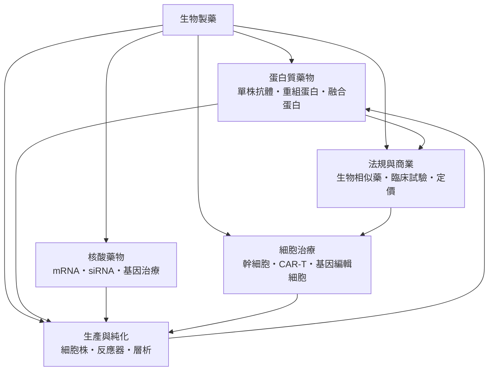

# 生物製藥

> 隸屬：第一層 [醫]　·　相關分類：[生物學]、[分子生物]、[遺傳學]　·　子分類總表見 [README]

> 對應維基百科：[中文維基百科：生物製藥](https://zh.wikipedia.org/wiki/%E7%94%9F%E7%89%A9%E8%A3%BD%E8%97%A5)　·　[English Wikipedia: Biopharmaceutical](https://en.wikipedia.org/wiki/Biopharmaceutical)

生物製藥研究**以生物體或其細胞為工廠生產的藥物**：蛋白質、核酸與細胞本身。它與傳統化學製藥的根本差異是「產品的複雜度」——阿斯匹靈的分子量約 180 道耳頓，[單株抗體] 約 150,000 道耳頓，且後者必須有正確的立體摺疊與醣基修飾才有藥效；你無法用化學合成「煮」出一個摺疊正確的蛋白質，只能讓活細胞替你製造。生物藥的生產核心是細胞培養的比生產速率與體積產率：

$$
q_p = \frac{\text{蛋白質生成速率}}{\text{細胞數}} \; , \qquad Q_p = q_p \times X_v
$$

其中 $q_p$ 是單細胞生產力， $X_v$ 是活細胞密度，兩者相乘決定反應器能榨出多少藥。生物製藥在藥學體系中是**新世代製造學**：它繼承 [藥學] 的品質與管理框架，但以 [生物學] 與 [分子生物] 為理論基礎。

生物製藥的時間軸清晰可考：1982 年重組人類 [胰島素]（Humulin）上市，是第一個基因工程藥物；1997 年起 [單株抗體] 進入爆發期，rituximab、trastuzumab、adalimumab 相繼問世；2017 年第一個 CAR-T 細胞治療（tisagenlecleucel）獲准；2020 年 mRNA [疫苗] 在一年內完成研發與全球配送；2023 年 CRISPR 基因編輯療法 exa-cel 獲准治療鐮刀型紅血球疾病。四十年間，藥物從「分子」擴展到「細胞」與「基因」。

## 核心問題

生物製藥的四個核心問題彼此嵌套。

1. **可表達**：這個蛋白質能不能被細胞大量、正確地製造？摺疊、醣基化、分泌效率決定成敗，是 [蛋白質藥物] 與 [生產與純化] 的交界。
2. **可遞送**：核酸與基因如何進入目標細胞而不被降解？脂質奈米粒、病毒載體是答案，是 [核酸藥物] 的核心瓶頸。
3. **可放大**：實驗室搖瓶到 2000 公升反應器，品質如何不變？細胞株、培養基與純化流程的工程化，是 [生產與純化] 的問題。
4. **可負擔**：百萬美元級的療法誰付錢？生物相似藥、給付模型與法規，是 [法規與商業] 的問題。

四者的邏輯順序：先讓細胞造得出來（可表達），才談得上量產（可放大）；治療原理超越蛋白質時（核酸、細胞），遞送成為新瓶頸（可遞送）；成本動輒百萬美元，商業與法規設計從輔助變成成敗關鍵（可負擔）。

## 因果鏈

1. **重組 DNA 技術**：1973 年重組 DNA 實驗成功，1980 年代 [胰島素]、生長激素以大腸桿菌量產——第一代生物藥解決了「動物來源原料稀缺且不安全」的問題（豬胰臟提取胰島素的時代結束）。
2. **雜交瘤技術**：1975 年 Kohler 與 Milstein 發明雜交瘤，使 [單株抗體] 可以無限增殖生產；1986 年第一個治療性單株抗體 muromonab 獲准。
3. **嵌合與人源化**：鼠源抗體引發人類免疫反應，嵌合抗體（1980 年代末）、人源化與全人源抗體技術（1990 年代至 2000 年代，噬菌體展示）把免疫原性降到可接受。
4. **CHO 細胞平台化**：中國倉鼠卵巢（CHO）細胞成為標準生產宿主，培養基無血清化與高密度培養使抗體產率從 0.5 g/L 提升到 5 g/L 以上，成本下降一個數量級。
5. **核酸遞送突破**：脂質奈米粒（LNP）與化學修飾解決 RNA 不穩定與免疫活化問題；2018 年 siRNA 藥物 patisiran 獲准，2020 年 mRNA [疫苗] 全球部署。
6. **細胞與基因治療**：CAR-T（2017 年獲准）證明「活的細胞」可以是藥；CRISPR 基因編輯療法（2023 年獲准）證明可以一次性矯正基因——治療對象從「症狀」轉向「病因」。
7. **生物相似藥時代**：專利懸崖與法規（歐盟 2004 年、美國 2010 年 BPCIA）使生物相似藥上市，價格降幅 20% 至 40%，市場從創新獨占走向競爭。
8. **個體化與高價挑戰**：每個病人的細胞都要分開生產，製造從「大量同一批」變成「一人一批」，[法規與商業] 必須發明新的定價與給付模型。

## 子分類的定位與相互驅動

- [蛋白質藥物] 是**主力部隊**：[單株抗體] 佔全球藥物銷售額前列，它的成功建立了整個產業的製造平台與法規語言。
- [細胞治療] 是**活體藥物**：CAR-T 把病人的免疫細胞改造成武器，證明藥物可以是活的、會增殖的、因人而異的個體化產品。
- [核酸藥物] 是**資訊層藥物**：mRNA 與 siRNA 不給蛋白質，而給「製造蛋白質的指令」；[疫苗] 的 mRNA 化是資訊藥物的最大規模驗證。
- [生產與純化] 是**工程地基**：細胞株、生物反應器、層析與無菌操作是所有子分類共享的平台；沒有它，任何概念都停在紙上。
- [法規與商業] 是**規則制定者**：生物相似藥、百萬美元定價與給付限制，決定哪些技術能存活；反過來，商業壓力也在推動製造成本下降。

## 範例：兩代胰島素，兩種製藥哲學

[胰島素] 的製造史就是生物製藥的縮影：

1. **動物提取時代**：1920 年代從豬、牛胰臟提取，一位病人一年需約 60 頭牲畜的胰臟；供應受限且動物蛋白引發過敏。
2. **重組時代**：1982 年 Humulin 上市——把人類胰島素基因轉入大腸桿菌，發酵罐裡「養菌產藥」；供應從牲畜數量變成發酵體積。
3. **類似物時代**：以蛋白質工程修改胺基酸序列，做出速效（aspart）與長效（glargine）類似物，改變的是「藥物動力學」而非來源。
4. **平台意義**：重組胰島素建立的「基因 → 微生物/細胞培養 → 純化 → 品質管制」流程，成為後來生長激素、紅血球生成素、[單株抗體] 的共同模板。

同樣一個藥，四十年內經歷提取、重組、工程化三代技術——這正是生物製藥「以生物為工廠」哲學的完整展示。

## 容易混淆之處

- **生物藥不等於天然藥**：生物藥是工程產品，只是由細胞製造；「生物等於溫和」是誤解，細胞激素風暴等風險反而更劇烈。
- **生物相似藥不等於學名藥**：化學藥可完全複製，生物藥只能「高度相似」；臨床可比性試驗的標準更複雜。
- **疫苗接種後感染不等於疫苗失效**：疫苗防的是重症與傳播力，保護力以統計降低率衡量，不是絕對屏障。
- **基因治療不等於基因編輯**：基因添加（把正常基因送進去）與基因編輯（改寫錯誤鹼基）是不同技術，風險與法規路徑也不同。
- **冷鏈問題不只是藥學問題**：超低溫 mRNA [疫苗] 的配送瓶頸在乾冰供應與基礎設施，是生物製藥與 [藥品供應鏈] 的聯合難題。
- **「一次性治癒」不等於「便宜」**：基因療法一次療程百萬美元，但可能取代終身用藥；攤提計算是 [法規與商業] 的新課題。

## 延伸閱讀

- [藥學]：品質、劑型與管理的母框架。
- [分子生物] 與 [遺傳學]：重組、表達與編輯的理論基礎。
- [生物學]：細胞生理與免疫系統的知識來源。
- [免疫系統]：單株抗體與細胞治療的作用舞台。
- [胰島素]：從提取到重組的標誌案例。

## 連結定義

[醫]: ../醫/README.md
[README]: README.md
[藥學]: ../藥學/README.md
[生物學]: ../生物學/README.md
[分子生物]: ../分子生物/README.md
[遺傳學]: ../遺傳學/README.md
[免疫系統]: ../免疫系統/README.md
[蛋白質藥物]: 蛋白質藥物.md
[細胞治療]: 細胞治療.md
[核酸藥物]: 核酸藥物.md
[生產與純化]: 生產與純化.md
[法規與商業]: 法規與商業.md
[單株抗體]: 單株抗體.md
[藥品供應鏈]: ../藥學/藥品供應鏈.md
[疫苗]: ../物/疫苗.md
[胰島素]: ../物/胰島素.md
