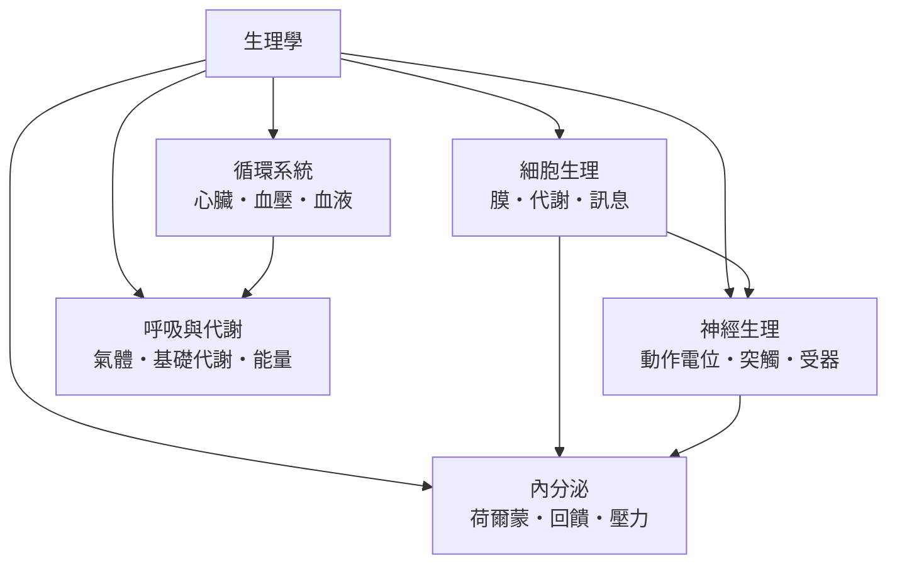

# 生理學

> 分類範圍：研究身體「如何運作」的部門——細胞與分子的運作規則、神經的訊號、循環的輸送、呼吸與代謝的能量收支，以及荷爾蒙的調控。　·　隸屬第一層：[醫]　·　相關分類：[解剖學]、[生物化學]、[神經科學]　·　子分類總表見 [README]

> 對應維基百科：[中文維基百科：生理学](https://zh.wikipedia.org/wiki/%E7%94%9F%E7%90%86%E5%AD%A6)　·　[English Wikipedia: Physiology](https://en.wikipedia.org/wiki/Physiology)

生理學研究身體的**功能**：在既定的結構下，各系統如何運作、如何彼此協調、以及在需求改變時如何調整。解剖學給出零件，生理學給出運轉規則。本概念的問題是：**一個活體如何維持恆定，又如何在恆定之外產生行動**。

## 核心問題：恆定與彈性

生理學的中心概念是**恆定**（homeostasis）——體溫、血糖、血壓、酸鹼值等變數被控制在狹窄範圍內。但恆定不是不變，而是**動態平衡**：變數持續偏離，校正機制持續把它拉回。

三個層次貫穿本分類：

1. **分子層**：膜的運輸、代謝途徑、訊息分子如何在細胞內協調。
2. **系統層**：神經、循環、呼吸、內分泌如何分工維持恆定。
3. **整體層**：能量攝取與消耗的平衡，以及壓力情境下的資源重新分配。

## 因果鏈

1. **細胞學說的確立**：把「功能」定位到細胞內，物理化學方法進入生物學。
2. **電生理的成熟**：膜電位的量測使神經衝動成為可計算的現象。
3. **內分泌的發現**：激素作為化學訊息，補上了神經調控在「慢而持久」上的缺口。
4. **穩態概念的系統化**：生理學從器官清單轉為以恆定為中心的一門學科。
5. **分子時代的擴張**：受體、訊息傳遞路徑與基因表現把生理學與分子生物學接成一體。

## 子分類的定位與相互驅動

- [細胞生理] 是**底層**：所有系統功能最終都由細胞的化學與物理規則實現。
- [神經生理] 處理**快速調控**：毫秒到秒級的訊息。
- [循環系統] 處理**輸送**：把氧、養分與激素送到目的地。
- [呼吸與代謝] 處理**能量**：把化學能轉換成可用功。
- [內分泌] 處理**慢速調控**：激素以分鐘到天的時間尺度改變狀態。

## 範例：血糖恆定的三系統協作

以飯後血糖升高為例，五個子分類同時參與：

1. **消化與吸收**：葡萄糖由消化道進入血液，血糖上升。
2. **細胞生理**：胰島β細胞感知血糖，葡萄糖經 [細胞膜與運輸] 進入細胞並觸發代謝與分泌。
3. **內分泌**：胰島素分泌增加（肝臟與肌肉細胞攝取葡萄糖），升血糖素相對減少。
4. **循環系統**：激素隨血流送達全身。
5. **時間軸**：數小時後血糖回落，低血糖時胰島素下降、升血糖素與腎上腺素上升——**回饋**使系統回到原點。

## 生理學的方法論

- **介入**：改變一個變數、觀察其餘是否變動（實驗的核心）。
- **量測的選擇**：血壓用袖帶與侵入性導管的數值不同，方法差異本身就是結論的一部分。
- **模型與類比**：模型系統（離體器官、細胞培養、動物模型）各有侷限；把結論外推回人體時必須交代這段距離。
- **時間尺度**：秒、刻、週、年級的機制不同；同一現象在不同尺度看會有不同解釋。

## 容易混淆之處

- **恆定不等於固定**：血糖的正常值是一個區間，並非一條線。
- **正、負回饋不是道德詞**：負回饋是穩定機制，正回饋是放大機制（如分娩）。
- **相關不等於因果**：生理學的實驗設計（介入）比統計相關更能支持因果。
- **「正常值」是統計概念**：多數人落在範圍內，但落在範圍內也可能生病。

## 延伸閱讀

- [解剖學]：結構的姊妹學科。
- [生物化學]：分子機制的上游。
- [神經科學]：神經功能的研究傳統。
- [病理學]：功能偏離正常的後果。

## 連結定義

[醫]: ../醫/README.md
[README]: README.md
[解剖學]: ../解剖學/README.md
[生物化學]: ../分子生物/README.md
[神經科學]: ../神經科學/README.md
[病理學]: ../病理學/README.md
[細胞生理]: 細胞生理.md
[神經生理]: 神經生理.md
[循環系統]: 循環系統.md
[呼吸與代謝]: 呼吸與代謝.md
[內分泌]: 內分泌.md
[細胞膜與運輸]: 細胞膜與運輸.md
