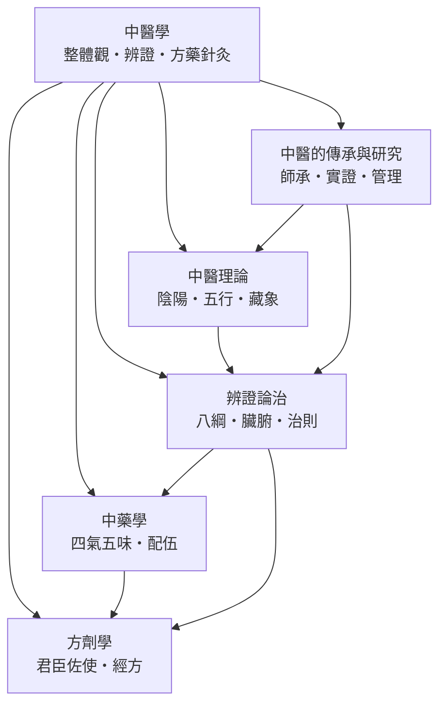

# 中醫學

> 分類範圍：以整體觀與辨證方法診治疾病的傳統醫學體系——陰陽五行的理論語言、藏象氣血的生理模型、望聞問切的診斷程序、方藥針灸的治療手段，以及這門學問如何在兩千年間傳承、演化並接受現代檢驗。　·　隸屬第一層：[醫]　·　相關分類：[生理學]、[病理學]、[中草藥]、[藥理學]　·　子分類總表見 [README]

> 對應維基百科：[中文維基百科：中醫學](https://zh.wikipedia.org/wiki/%E4%B8%AD%E5%8C%BB%E5%AD%A6)　·　[English Wikipedia: Traditional Chinese medicine](https://en.wikipedia.org/wiki/Traditional_Chinese_medicine)

中醫學是在中國大陸與東亞發展超過兩千年的醫學體系，它與現代醫學的差別不在「藥材不同」，而在**看問題的方式不同**：現代醫學先把疾病定位到器官、細胞與分子，再對因治療；中醫學則先觀察**病人的整體狀態**——寒熱、虛實、表裡、氣血——再以藥物、針灸與生活方式把失衡的狀態拉回平衡。本概念處理的問題是：**一個不依賴解剖與儀器的醫學體系，如何建立自洽的理論、有效的診斷程序與可傳承的治療技術**。

## 核心問題：整體觀與辨證

中醫學的核心假設是**整體觀**：人體是一個相互聯繫的整體，局部症狀是全身失衡的表現；同時人與環境（季節、氣候、情志）也構成一個更大的系統。要把「整體」變成可以操作的方法，必須先解決三件事：

1. **描述的語言**：用 [陰陽] 與 [五行] 提供一套分類與關係的模型，把紛雜的症狀歸入有限的類別。
2. **對應的生理模型**：以 [藏象] 把功能歸屬於五臟六腑，以氣血津液說明物質與能量的輸送——這裡的「臟腑」是**功能單位**，與解剖學的器官不完全對應。
3. **診斷與治療的程序**：以望聞問切收集資料，用 [八綱辨證] 與 [臟腑辨證] 歸納出「證」，再依「證」選定治法與方藥——這個「辨證論治」的迴路是中醫臨牀的引擎。

因此，中醫學的理論、診斷與治療是**同一套語言的三個層面**：陰陽五行既是生理模型，也是診斷分類，也是用藥原則，這是它與現代醫學「基礎—臨牀」分工模式最大的不同。

## 因果鏈

1. **經典的奠基**：戰國至西漢間成書的 [黃帝內經] 確立了陰陽五行、藏象經絡與治則的基本框架，把散落的醫療經驗整理成有系統的理論。
2. **辨證體系的形成**：東漢末年 [張仲景] 因宗族瘟疫而著 [傷寒雜病論]，提出「觀其脈證、知犯何逆、隨證治之」——把治療從「對症下藥」升級為「辨證施治」，並留下可重複使用的方劑。
3. **本草知識的累積**：歷代本草著作不斷增補藥物知識，到 [李時珍] 於 [1578年] 完成 [本草綱目]，收載藥物一千八百餘種，把藥物學整理成有分類體系的學科。
4. **針灸的系統化**：西晉 [皇甫謐] 整理《素問》《靈樞》與《明堂孔穴針灸治要》而成《針灸甲乙經》，使腧穴定位與刺法第一次有了統一標準，促成 [針灸] 成為獨立學科。
5. **學派與溫病的分化**：金元四大家各執一端（瀉火、補土、攻邪、滋陰），推動理論深化；明清溫病學派針對熱性傳染病另立衛氣營血辨證，補上《傷寒論》框架的不足。
6. **西學東漸的衝擊**：十九世紀末現代醫學進入東亞，中醫在制度上被邊緣化，也促使「中西醫匯通」與科學化研究的嘗試。
7. **制度化的重建**：二十世紀中葉起，中醫被納入高等教育與醫院體系，形成現代「中醫學」的教學、執照與研究框架。
8. **現代驗證與國際化**：隨機對照試驗、系統回顧與青蒿素的成功案例，把部分療法推向國際；同時理論概念（如「氣」）的可驗證性仍是持續的論爭場域。

## 子分類的定位與相互驅動

- [中醫理論] 是**語言層**：陰陽五行與藏象學說提供描述與分類的框架，所有其他子分類都在這套語言上運作；理論的每一次修訂（如金元各家學說）都會改變診斷與用藥的取向。
- [辨證論治] 是**決策層**：把理論語言變成臨牀程序——先辨「證」再定「治」，是連接理論與方藥的樞紐；方劑的選擇直接由辨證結果驅動。
- [中藥學] 是**武器庫**：四氣五味、歸經與配伍規則，把藥物性能也用同一套語言描述，使「證—藥」之間可以對號入座。
- [方劑學] 是**組合層**：單味藥力有不逮，君臣佐使的組方原則讓多味藥協同；經方（如桂枝湯、麻黃湯）是經過千年臨牀篩選的固定組合。
- [中醫的傳承與研究] 是**存續層**：師承教育讓技術與經驗跨代流傳，現代的臨牀實證、藥品管理與國際推廣則決定這門學問能否進入二十一世紀的醫療體系。

## 範例：一個風寒感冒的辨證論治迴路

以最常見的風寒感冒為例，五個子分類如何在一次診療中協作：

1. **理論**：依 [陰陽] 與 [藏象] 的框架，外感風寒屬「表證、寒證、實證」，肺主皮毛，故惡寒、無汗、脈浮緊。
2. **辨證**：望聞問切收集症狀（惡寒重、發熱輕、頭痛、流清涕），[八綱辨證] 判定為風寒表實證。
3. **中藥**：依 [四氣五味] 選辛溫解表藥——麻黃發汗、桂枝溫經、杏仁降氣。
4. **方劑**：組成麻黃湯，君藥麻黃、臣藥桂枝，發汗解表；若夾咳喘再加杏仁為佐。
5. **傳承與研究**：這個方劑、這套辨證理由都寫在教材與師承的臨牀帶教中；現代研究則以對照試驗檢驗其對感冒病程的實際效果，結果再回饋修正教材。

## 容易混淆之處

- **「證」不是「症」也不是「病」**：症是單一症狀，病是疾病名稱，「證」是對疾病某一階段整體狀態的概括；同一病在不同階段可有不同證，不同病也可出現相同證。
- **臟腑不是解剖器官**：「腎虛」不等於腎臟器質病變；藏象是功能模型，與西醫器官只有部分重疊。
- **中醫學不等於民間偏方**：本分類處理的是有理論體系、有文獻傳統的醫學體系；未經辨證的偏方不在其規範之內。
- **有效不等於理論正確**：青蒿素的例子說明，從傳統文獻中可以篩出有效成分，但這不自動證明陰陽五行模型本身；理論驗證與藥物驗證是兩件事。
- **中西醫不是二選一**：現代臨牀上中西醫常併用（如腫瘤的輔助治療），關鍵是藥物交互作用與適應症的評估。

## 延伸閱讀

- [生理學]：現代對「恆定」的研究，可與「平衡」觀念對照。
- [病理學]：疾病機制的另一套解釋語言。
- [中草藥]：藥用植物的植物學與栽培面向。
- [藥理學]：把中藥成分放進現代藥理框架的研究。
- [針灸]：同一理論體系下的非藥物療法。
- [公共衛生]：中醫在現代醫療制度中的位置。
- [哲學]：陰陽五行思想的哲學根源。

## 連結定義

[醫]: ../README.md
[README]: README.md
[生理學]: ../生理學/README.md
[病理學]: ../病理學/README.md
[中草藥]: ../中草藥/README.md
[藥理學]: ../藥理學/README.md
[公共衛生]: ../公共衛生/README.md
[針灸]: ../針灸/README.md
[哲學]: ../../社會/哲學/README.md
[陰陽]: 陰陽.md
[五行]: 五行.md
[八綱辨證]: 八綱辨證.md
[臟腑辨證]: 臟腑辨證.md
[藏象]: 藏象.md
[四氣五味]: 四氣五味.md
[中醫理論]: 中醫理論.md
[辨證論治]: 辨證論治.md
[中藥學]: 中藥學.md
[方劑學]: 方劑學.md
[中醫的傳承與研究]: 中醫的傳承與研究.md
[黃帝內經]: 黃帝內經.md
[傷寒雜病論]: 傷寒雜病論.md
[本草綱目]: 本草綱目.md
[張仲景]: ../../人/醫學家/張仲景.md
[李時珍]: ../../人/醫學家/李時珍.md
[皇甫謐]: ../../人/醫學家/皇甫謐.md
[1578年]: ../../時/1578年.md