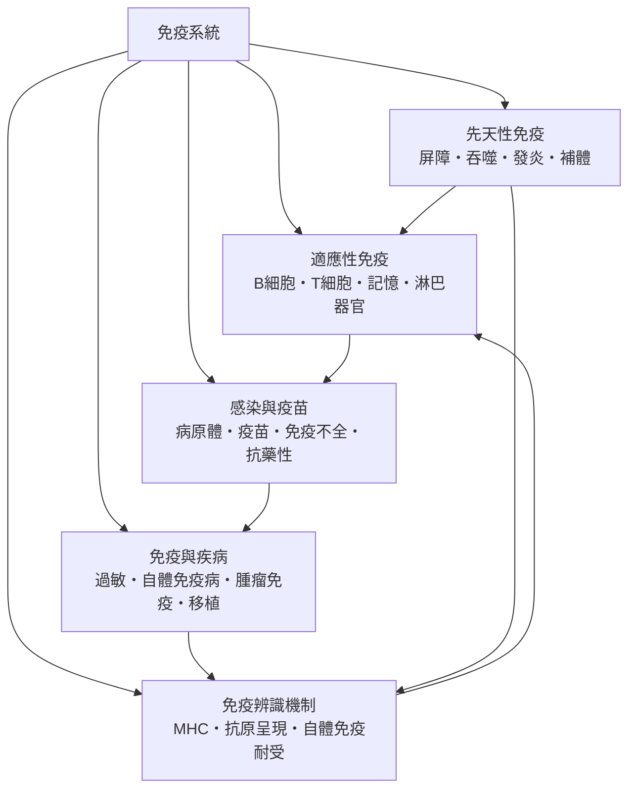

# 免疫系統

> 隸屬：第一層 [醫]　·　相關分類：[微生物學]、[病理學]、[公共衛生]、[藥理學]　·　子分類總表見 [README]

> 對應維基百科：[中文維基百科：免疫系統](https://zh.wikipedia.org/wiki/%E5%85%8D%E7%96%AB%E7%B3%BB%E7%BB%9F)　·　[English Wikipedia: Immune system](https://en.wikipedia.org/wiki/Immune_system)

免疫系統是動物體內**辨別「自己」與「非我」並消滅後者**的細胞、分子與器官網路。它面對的敵人包括 [病毒]、[細菌]、真菌、寄生蟲，以及體內叛變的癌細胞；它採用的手段從皮膚這道物理城牆，到能精準鎖定單一分子構型的抗體。

免疫學最核心的張力是**效力與自傷的平衡**：反應太弱，個體死於感染；反應太強或認錯目標，個體死於過敏、自體免疫與細胞激素風暴。因此整套系統天然分成兩層——反應快速但不記仇的 [先天性免疫]，與反應較慢卻能學習、記憶的 [適應性免疫]——兩層之間靠 [免疫辨識機制] 溝通，而這套機制的失靈與濫用，分別催生了 [感染與疫苗] 與 [免疫與疾病] 兩個應用領域。

## 核心問題

1. **身體如何分辨敵我？** [免疫辨識機制] 回答這個問題：模式辨識受體偵測病原共有的分子特徵，而抗原受體與 [主要組織相容性複合體] 則讓系統能辨識幾乎任何分子形狀。
2. **反應如何分層？** [先天性免疫] 是數分鐘到數小時內啟動的泛用防線；[適應性免疫] 需要數天展開，卻帶來特異性與記憶。
3. **記憶如何形成與利用？** [免疫記憶] 讓第二次遭遇同一病原時反應更快更強；[感染與疫苗] 正是把這份記憶「預先安裝」的工程。
4. **系統何時傷害自己？** [免疫與疾病] 處理辨識失準的代價：過敏、自體免疫病、移植排斥與腫瘤免疫逃脫。
5. **免疫知識如何變成公共衛生？** 從疫苗接種到羣體免疫，個體的免疫狀態加總成族羣層次的疾病屏障，這是免疫學與 [公共衛生]、[流行病學] 的交界。

## 因果鏈

1. **人痘到牛痘**：中國與鄂圖曼帝國早已施行人痘接種（接觸輕症天花病人材料，風險高但可行）；[1796年] 英國醫師 [詹納] 改用牛痘，證實可以在低風險下預防 [天花]，疫苗觀念就此誕生。
2. **病原論確立**：[巴斯德] 在 [1885年] 前後以減毒技術做出狂犬病等疫苗，[科赫] 則確立「何種微生物引起何種疾病」的準則；傳染病從天譴變成可研究的對象，免疫學有了明確的敵人清單。
3. **吞噬細胞與體液學派之爭**：[1883年] [梅契尼科夫] 發現白血球會吞噬細菌，提出細胞免疫；1890 年代貝令與北里柴三郎發現血清中的抗體可治療白喉，兩派競爭數十年後被證明是一體兩面。
4. **免疫特異性與耐受的理論化**：1957 年伯內特提出株落選擇學說——淋巴細胞受抗原刺激才增殖，並在胚胎期學會「刪除會攻擊自己」的株落；自體免疫從此有了機制解釋。
5. **辨識分子的解密**：1960 至 1980 年代，抗體的輕重鏈結構、[主要組織相容性複合體] 的功能、T 細胞受體基因先後被解析；「免疫細胞如何認得十億種形狀」由基因重組與選擇回答。
6. **分子工具與單株抗體**：1975 年單株抗體技術問世，抗體從試管工具變成診斷與治療藥物，免疫學直接餵養 [藥理學] 與 [病理學] 的檢測產業。
7. **免疫調控的臨牀時代**：1990 年代起，HIV/AIDS（[1981年] 首度被辨認）迫使免疫不全成為全球議題；免疫檢查點抑制劑、CAR-T 細胞療法與 mRNA 疫苗，則把免疫調控變成治療癌症與新興傳染病的主力手段。
8. **族羣尺度**：疫苗覆蓋率、羣體免疫門檻與抗藥性演化，使免疫學成為 [公共衛生] 政策的科學基礎；個體免疫與族羣免疫的互動，是當代疫情決策的核心模型。

## 子分類的定位與相互驅動

- [先天性免疫] 是**第一反應部隊**：皮膚與黏膜擋住大部分入侵者，吞噬細胞與補體在數小時內壓制殘餘者，發炎反應則是呼叫後援的警報系統。
- [適應性免疫] 是**精準打擊與記憶部隊**：B 細胞產生抗體，T 細胞殺傷受感染細胞並協調全域；兩者都依賴 [免疫辨識機制] 提供的「目標照片」。
- [免疫辨識機制] 是**情報中樞**：沒有抗原呈現與 MHC 限制，適應性免疫就無從啟動；沒有中樞與周邊耐受，系統就會把「自己」誤判為敵人，這正是 [自體免疫] 的根源。
- [感染與疫苗] 是**攻防的實戰面**：病原體不斷演化逃避免疫（[抗藥性]、抗原漂移），疫苗則把免疫記憶變成可量產的公共財，兩者的軍備競賽推動整個領域前進。
- [免疫與疾病] 是**系統失靈的病理學**：過敏是對無害物質的誤報，腫瘤免疫是免疫監視與逃脫的拉鋸，移植排斥則是把救命手術與免疫防衛放在對立面；理解失靈反而最深地揭露了正常機制。

## 範例：一次病毒感染中的免疫時間線

以鼻病毒引起的感冒為例，可以看見整個系統的分層運作。

1. **0 至數小時（屏障與模式辨識）**：病毒突破鼻黏膜，被上皮細胞的模式辨識受體偵測，釋出幹擾素與發炎介質，這是 [先天性免疫] 的立刻反應；流鼻水、喉嚨痛即是 [發炎反應] 的副作用。
2. **數小時至數天（非專一性清除）**： [吞噬細胞]（巨噬細胞、嗜中性球）吞食病毒與感染細胞殘骸，[補體] 標記並溶解部分病毒顆粒。
3. **第 3 至 7 天（適應性展開）**：樹突細胞攜帶病毒碎片前往淋巴結，經 [抗原呈現] 激活對應的 T 細胞與 B 細胞；抗體開始出現並中和遊離病毒，殺手 T 細胞清除受感染細胞。
4. **第 7 至 14 天（收尾與記憶）**：感染被壓制，多數效應細胞凋亡，留下記憶 B 細胞與記憶 T 細胞——下次遭遇同一型鼻病毒時，症狀可能輕微到不被察覺，這正是 [免疫記憶] 的價值。
5. **對比**：若這是初次接種 [疫苗] 後的模擬感染，整個第 3 步會在無症狀的情況下完成；若宿主是免疫不全病人，則第 2、3 步都會失效，感染可能演變成重症——同一段劇本的三種結局，界定了 [感染與疫苗] 與 [免疫與疾病] 的全部議題。

## 容易混淆之處

- **「免疫力」不是單一數值**：免疫是網路狀態而非補品等級，市售「增強免疫力」的說法多半缺乏機制依據。
- **發炎不等於感染**：發炎反應也可由過敏、外傷、自體免疫觸發；感染一定有病原，發炎不一定。
- **抗體陽性不等於現症感染**：抗體可能是過去感染或疫苗留下的記憶；診斷現症感染要看病原本身或 IgM 類抗體。
- **免疫記憶有時限與型別**：不是所有感染後都終身免疫（如流感病毒變異快、抗破傷風毒素抗體會隨年衰減，需定期補種）。
- **先天性免疫並非「低等」**：它是適應性免疫的必要引導者，沒有先天性訊號，T 細胞根本不會被激活。
- **羣體免疫不是人人免疫**：只要易感者比例低於門檻，傳播鏈就會斷裂；這是 [流行病學] 的統計現象，不要求每個人都有抗體。

## 延伸閱讀

- [微生物學]：敵人的構造、代謝與 [病毒]、[細菌] 的生活史。
- [病理學]：組織層次上免疫反應如何呈現為疾病。
- [公共衛生] 與 [流行病學]：疫苗政策、羣體免疫與疫情模型。
- [藥理學]：抗體藥物、免疫抑制劑與免疫檢查點抑制劑的作用。
- [詹納]、[巴斯德]、[梅契尼科夫]、[科赫]、[弗萊明]：把免疫學從經驗變成科學的關鍵人物。
- [天花]：第一個被人類以免疫手段消滅的傳染病，整門學科最好的紀念碑。

## 連結定義

[醫]: ../README.md
[README]: README.md
[微生物學]: ../../科技/微生物學/README.md
[病理學]: ../病理學/README.md
[公共衛生]: ../公共衛生/README.md
[藥理學]: ../藥理學/README.md
[流行病學]: ../流行病學/README.md
[病毒]: ../../科技/微生物學/病毒.md
[細菌]: ../../科技/微生物學/細菌.md
[先天性免疫]: 先天性免疫.md
[適應性免疫]: 適應性免疫.md
[免疫辨識機制]: 免疫辨識機制.md
[感染與疫苗]: 感染與疫苗.md
[免疫與疾病]: 免疫與疾病.md
[發炎反應]: 發炎反應.md
[吞噬細胞]: 吞噬細胞.md
[補體]: 補體.md
[抗原呈現]: 抗原呈現.md
[主要組織相容性複合體]: 主要組織相容性複合體.md
[免疫記憶]: 免疫記憶.md
[自體免疫]: 自體免疫.md
[抗藥性]: 抗藥性.md
[疫苗]: ../../物/疫苗.md
[天花]: 天花.md
[詹納]: ../../人/生物學家/詹納.md
[巴斯德]: ../../人/生物學家/巴斯德.md
[梅契尼科夫]: ../../人/生物學家/梅契尼科夫.md
[科赫]: ../../人/生物學家/科赫.md
[弗萊明]: ../../人/生物學家/弗萊明.md
[1796年]: ../../時/1796年.md
[1883年]: ../../時/1883年.md
[1885年]: ../../時/1885年.md
[1981年]: ../../時/1981年.md