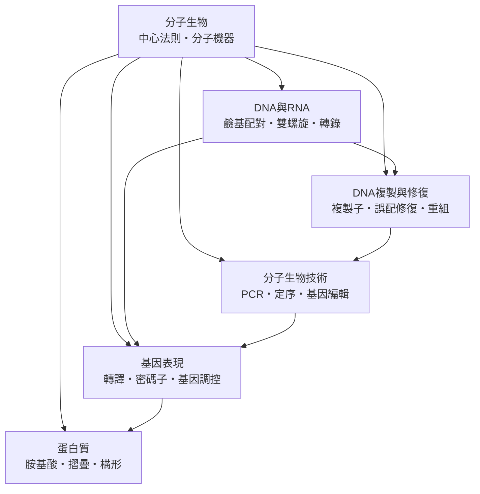

# 分子生物

> 隸屬：第一層 [理]　·　相關分類：[遺傳學]、[生物學]、[微生物學]、[化學]　·　子分類總表見 [README]

> 對應維基百科：[中文維基百科：分子生物學](https://zh.wikipedia.org/wiki/%E5%88%86%E5%AD%90%E7%94%9F%E7%89%A9%E5%AD%A6)　·　[English Wikipedia: Molecular biology](https://en.wikipedia.org/wiki/Molecular_biology)

分子生物研究**生命現象在分子層次的機制**：遺傳資訊儲存在什麼分子裡、如何被複製、如何被轉錄成 RNA、再如何被轉譯成蛋白質，以及這些分子如何互相辨識、修復與被人工操作。它與 [遺傳學] 的分工在於：遺傳學問「性狀如何傳遞」，分子生物問「傳遞的分子機器如何運轉」。本概念的問題是：**當生物學的解釋單位從細胞、組織下探到核酸與蛋白質，哪些原本只能描述的現象變成了可以預測、甚至可以改寫的對象**。

## 核心問題：一條資訊流與三個層次

分子生物的主線是**中心法則**——遺傳資訊由 DNA 經轉錄流向 RNA，再經轉譯流向蛋白質。圍繞這條主線有三個層次的問題：

### 一、結構層：分子長什麼樣

1953 年 [沃森] 與 [克里克] 提出 DNA 雙螺旋模型，核心是鹼基互補配對：A 對 T、G 對 C。這個結構的威力在於它**同時**解釋了兩件事——兩股互補的單鏈可以各自為模板，複製因此可以精確進行；序列本身可以編碼資訊，遺傳因此有物質載體。結構即功能，這是分子生物學方法論的範式：**先看懂分子的形狀，就能預測它的行為**。

### 二、機制層：資訊如何流動

有了結構，接下來的問題是流程：DNA 如何被複製（[DNA複製與修復]）、如何被抄成 mRNA（轉錄）、mRNA 上的密碼子如何被核糖體讀成胺基酸序列（[基因表現]）、最終摺疊成有功能的蛋白質（[蛋白質]）。每一環都是一羣酶與調控因子的協同工作，也各有校對與修錯機制——複製的錯誤率約為每代每鹼基 $10^{-9}$ 到 $10^{-10}$ ，靠的是聚合酶的校對活性與事後的誤配修復。

### 三、操作層：分子如何被改寫

1970 年代起，限制酶、連接酶、反轉錄酶相繼被發現與純化，人類開始能在試管裡剪接 DNA；PCR 讓微量序列可以放大，定序讓序列可以被讀出，[CRISPR] 讓序列可以被定點改寫。**分子生物因此從解釋性科學變成工程性科學**：讀基因、寫基因、改基因成為常規操作。

## 因果鏈

1. **遺傳物質之謎**：1944 年以前，學界多認為蛋白質（20 種單元、結構多樣）纔是遺傳物質。Avery 的肺炎鏈球菌轉化實驗指出 DNA 纔是轉化因子，但說服力不足——瓶頸在於「沒有結構，就沒有機制」。

2. **1953 年雙螺旋**：[克里克] 與 [沃森] 綜合化學分析與 X 光繞射資料，提出雙螺旋模型並配對出 A–T、G–C 的互補規則。這一步同時解決了結構問題與複製機制問題，遺傳物質之爭就此落幕。

3. **1958 年中心法則與複製的半保留驗證**：[克里克] 提出資訊流的方向性假設；同年 Meselson–Stahl 實驗以氮同位素標記證明複製是半保留的——雙螺旋的每一股各當一次模板。**假說與實驗在同一十年內閉環**。

4. **1961 年遺傳密碼的破解**：克里克與布倫納以移碼突變證明密碼是三聯體、從固定起點依序閱讀；Nirenberg 與 Khorana 隨後破譯全部 64 個密碼子。mRNA 上每三個鹼基對應一個胺基酸，**序列語言被完全翻譯**。

5. **1970 年代：工具酶與重組 DNA**：限制性內切酶（能在特定序列切斷 DNA）與連接酶的發現，使體外剪接成為可能；反轉錄酶的發現則修正了中心法則（RNA 可以回到 DNA）。[基因編輯] 與基因工程產業由此起步。

6. **1977 年定序與 intron 的發現**：Sanger 與 Gilbert 分別發表定序方法，讀序列成為常規；同年發現真核基因內部存在不編碼的內含子，顯示轉錄後還有剪接這一層加工。**讀出序列立刻揭露結構比預期更複雜**。

7. **1980–1990 年代：PCR 與基因組計畫**：PCR 使任何微量樣本的特定片段可被指數放大，臨牀檢測與古 DNA 研究成為可能；人類基因組計畫把「讀出一個物種的全部序列」變成工程項目。分子生物的資料量從「一個基因」跳到「一個基因組」。

8. **2000 年後：編輯時代**：RNA 幹擾揭示小 RNA 是普遍的調控層；2012 年 [CRISPR]/Cas9 被改造成通用基因編輯工具，2020 年相關工作獲諾貝爾化學獎。**中心法則的每一環都已有對應的人工幹預手段**：複製（PCR）、轉錄（表達載體）、轉譯（無細胞表現）、序列本身（編輯）。

## 子分類的定位與相互驅動

### DNA與RNA

這是**結構與模板層**：鹼基配對是整套學科的第一原理，雙螺旋是它的三維呈現，轉錄是資訊離開 DNA 的第一步，反轉錄則是RNA 病毒帶來的方向修正。沒有這一層，後續所有機制都沒有起點；它也直接供應 [分子生物技術] 的設計原理——PCR 引子、探針、引子設計全都依賴互補配對。

### 基因表現

這是**資訊的讀出層**：轉譯把密碼子翻成胺基酸，基因調控決定哪些基因、在何時、以多少量被讀出。它承上啟下——上游依賴 [DNA與RNA] 的轉錄產物，下游決定 [蛋白質] 的種類與數量。基因調控的發現（操縱子模型、之後的表觀遺傳）回答了「同一套基因組如何長出不同細胞」的問題。

### 蛋白質

這是**功能的執行層**：幾乎所有細胞工作——催化、運輸、結構支撐、訊號傳遞——都由蛋白質承擔。胺基酸的化學性質決定摺疊，摺疊決定構形，構形決定功能；理解這條鏈，反過來也讓蛋白質成為藥物設計的靶點。它與 [基因表現] 互為因果：酶表現量的調控是基因調控的一部分，而調控本身就是由蛋白質（轉錄因子）執行的。

### DNA複製與修復

這是**資訊的保真層**：複製子理論解釋複製如何起動與終止，誤配修復與各種修復途徑把複製與環境造成的損傷修回原樣，重組則在修復與減數分裂中交換資訊。這一層的失靈直接對應癌症與遺傳疾病，因此它也是 [遺傳學] 中疾病研究的分子基礎。

### 分子生物技術

這是**操作與工程層**：PCR、基因定序、[基因編輯] 與克隆，把前四個子分類的原理轉成可交付的工具。它與其他子分類是雙向驅動——技術依賴對機制的理解（Taq 聚合酶來自嗜熱細菌的複製機器），而技術又反過來加速機制研究（定序讓修復途徑可以被系統性搜尋）。

## 範例：從一次細菌感染看五個子分類

以噬菌體感染大腸桿菌為例，五個子分類依序登場：

1. **結構層（[DNA與RNA]）**：噬菌體把 DNA 注入細菌，蛋白外殼留在外面——這正是 1952 年 Hershey–Chase 實驗的設計，用放射性標記分別追蹤蛋白與 DNA，確認進入細胞的只有 DNA。

2. **複製層（[DNA複製與修復]）**：注入的 DNA 約 20 分鐘內被複製上百份。複製從特定起點（複製子）開始，DNA 聚合酶以每股為模板合成互補股；過程中的錯誤由誤配修復系統掃描修正。

3. **表現層（[基因表現]）**：噬菌體基因被轉錄成 mRNA，細菌核糖體按密碼子逐一讀出，合成噬菌體的外殼蛋白與溶菌酶。早期基因與晚期基因的先後表現，就是一場縮小版的基因調控示範。

4. **功能層（[蛋白質]）**：外殼蛋白自動摺疊並組裝成二十面體頭部與尾部；摺疊錯誤的次級體被降解。組裝完成的新噬菌體與原來的結構完全一致——**資訊經過了複製與表達兩道工序，仍在蛋白質構形上收斂回同一形狀**。

5. **操作層（[分子生物技術]）**：同一套噬菌體被科學家改造成載體——把目標基因接進其 DNA，讓它代為把基因送進細菌。1980 年代的克隆與文庫構建，用的正是這個原理；今天的 [CRISPR] 也源自細菌對噬菌體的免疫記憶。

## 容易混淆之處

- **分子生物不等於生物化學**：生物化學關注代謝與分子的化學反應，分子生物關注資訊的儲存與流動；兩者共用工具，但提問方式不同。
- **中心法則不是單行道**：反轉錄、RNA 自我複製、非編碼 RNA 調控都是已證實的例外；法則描述的是主流方向，不是絕對禁令。
- **基因表現不等於基因活性**：mRNA 量高不代表蛋白質量高，轉譯效率與蛋白質降解速率是另外兩個閘門。
- **「修復」不是完美還原**：某些修復途徑（如非同源末端接合）以犧牲序列資訊換取快速閉合，突變可能就此被固定。
- **PCR 放大不等於活菌培養**：PCR 檢出的核酸未必來自活的病原體；診斷判讀必須區分核酸存在與感染活性。
- **基因編輯不是替換整段基因**：Cas9 切斷後依靠細胞自身的修復機制帶入改變，效率、脫靶與嵌合體都是工程問題，不是「剪刀一剪就完成」。

## 延伸閱讀

- [遺傳學]：性狀傳遞的規律層，分子生物是其機制基礎。
- [生物學]：分子生物在生物學整體中的位置。
- [微生物學]：分子生物學的實驗材料多來自微生物，兩者互相餵養。
- [化學]：分子的化學鍵結與反應，是分子機制的底層語言。
- [表觀遺傳]：不改變序列的調控層，與基因調控互補。
- [CRISPR]：本概念最著名的技術實體。

## 連結定義

[理]: ../README.md
[README]: README.md
[遺傳學]: ../遺傳學/README.md
[生物學]: ../../科技/生物學/README.md
[微生物學]: ../../科技/微生物學/README.md
[化學]: ../../化學/README.md
[表觀遺傳]: ../遺傳學/表觀遺傳.md
[CRISPR]: CRISPR.md
[沃森]: ../../人/生物學家/沃森.md
[克里克]: ../../人/生物學家/克里克.md
[DNA與RNA]: DNA與RNA.md
[基因表現]: 基因表現.md
[蛋白質]: 蛋白質.md
[DNA複製與修復]: DNA複製與修復.md
[分子生物技術]: 分子生物技術.md
[基因編輯]: 基因編輯.md