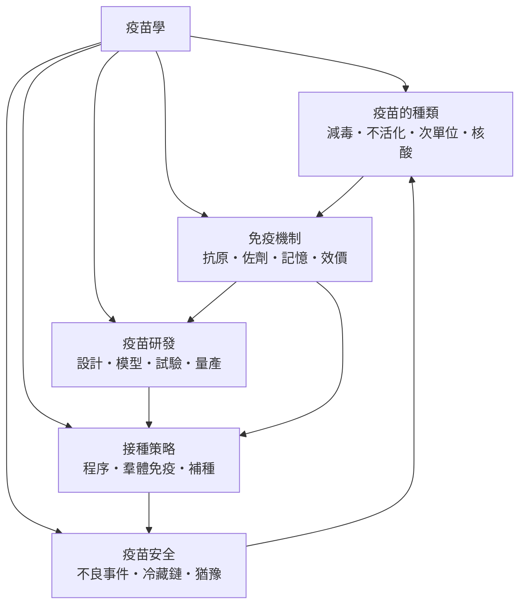

# 疫苗學

> 隸屬：第一層 [醫]　·　相關分類：[免疫系統]、[微生物學]、[流行病學]、[公共衛生]　·　子分類總表見 [README]

> 對應維基百科：[中文維基百科：疫苗](https://zh.wikipedia.org/wiki/%E7%96%AB%E8%8B%97)　·　[English Wikipedia: Vaccinology](https://en.wikipedia.org/wiki/Vaccine)

疫苗學是研究**如何在不致病的條件下，預先教會人體免疫系統辨認病原**的科學，涵蓋疫苗的種類設計、免疫機制、臨牀研發、接種策略與安全監測。它解決的核心問題是：直接感染雖能換來免疫力，卻要付出發病與死亡的代價；疫苗學的任務就是把「感染」這堂課改寫成一份安全的教材，讓身體只受訓、不流血。因此疫苗學是 [免疫系統] 的知識在公共衛生上的最大應用，也是人類史上拯救生命最多的醫療介入。

[疫苗] 一詞來自拉丁文 vacca（牛）：[1796年] 英國醫師 [詹納] 觀察到擠奶女工感染牛痘後不再患 [天花]，便以牛痘膿皰為人接種，並於 [1798年] 發表成果；[1885年] [巴斯德] 再以減毒技術製出狂犬病疫苗。兩百年後，[1980年] 世界衛生組織正式宣告天花被消滅——疫苗學從經驗技藝成長為能根除疾病的系統科學。

## 核心問題

1. **如何模擬感染而不致病？** 這是 [疫苗的種類] 的問題：從活性減毒、不活化、蛋白質次單位到核酸疫苗，每一代技術都在「像不像真感染」與「安不安全」之間取捨。
2. **免疫系統如何被訓練並留下記憶？** 這是 [免疫機制] 的問題：抗原如何被呈現、佐劑如何放大訊號、記憶細胞如何形成，以及保護效價如何衡量。
3. **如何從實驗室走到數十億劑的量產？** 這是 [疫苗研發] 的問題：抗原設計、動物模型、臨牀試驗與生產放大，每一步都可能淘汰一個候選疫苗。
4. **如何在族羣尺度部署免疫？** 這是 [接種策略] 的問題：免疫程序怎麼排、羣體免疫門檻怎麼算、補種與優先順序怎麼定。
5. **如何證明利遠大於弊？** 這是 [疫苗安全] 的問題：不良事件監測、特殊族羣接種、冷藏鏈與疫苗猶豫的應對。

一個關鍵的量化概念是**羣體免疫門檻**，其公式如下（ $R_0$ 為基本再生數）：

$$
V_c = 1 - \frac{1}{R_0}
$$

麻疹病毒的 $R_0$ 約為 12 至 18，代入後得門檻約 92% 至 95%；脊髓灰質炎的 $R_0$ 約為 5 至 7，門檻約 80% 至 86%。這條公式說明瞭為什麼疫苗學不只是個體醫學，更是 [流行病學] 與 [公共衛生] 的政策科學。

## 因果鏈

1. **人痘與牛痘的經驗期**：人痘接種（接觸輕症天花材料）在亞歐流傳數百年，風險約 1% 至 2%；[詹納] 在 [1796年] 改用牛痘，風險驟降，人類第一次能安全地「預約」免疫。
2. **病原論使疫苗可以量產**：[巴斯德] 確立「減毒」原理，[1885年] 製出狂犬病疫苗；此後傷寒、霍亂、白喉、破傷風疫苗在 1890 至 1920 年代相繼問世，疫苗從孤例變成工業。
3. **免疫學提供機制解釋**：抗體的發現（1890 年代）與株落選擇學說（1957 年）解釋了「為何接種會記得」；免疫記憶與免疫耐受的理論，反過來指導疫苗該刺激什麼、避免什麼。
4. **細胞培養技術解放病毒疫苗**：1949 年恩德斯等人以細胞培養繁殖脊髓灰質炎病毒，使 [1955年] [索爾克] 的不活化小兒麻痺疫苗上市、[1963年] 麻疹疫苗問世；沒有細胞培養，就沒有二十世紀中葉的疫苗黃金期。
5. **重組 DNA 與次單位時代**：[1986年] 基因工程 B 型肝炎疫苗（以酵母菌表現表面抗原）上市，疫苗可以只取病原的一件「外衣」而不含整個病原，安全性再上一層。
6. **根除策略登場**：[1967年] 世界衛生組織啟動天花根除計畫，結合冷鏈、監測與環狀接種，[1980年] 宣告天花絕跡；疫苗學第一次證明自己能消滅一個物種級的病原。
7. **結構生物學與 mRNA 革命**：抗原的原子級結構設計（如呼吸道融合病毒的融合前蛋白）與 [2020年] COVID-19 mRNA 疫苗在不到一年內完成臨牀試驗、[2021年] 大規模接種，把「設計→量產」的週期從十年壓縮到數月。
8. **新戰場：信任與公平**：技術不再是瓶頸，[疫苗猶豫] 與全球分配不均成為主要障礙；疫苗學因此跨入行為科學與衛生政策的領域，與 [公共衛生] 深度交纏。

## 子分類的定位與相互驅動

- [疫苗的種類] 是**技術光譜**：每一種平臺都在回答「要給免疫系統看多少病原」——活性減毒給整隻弱化的病原（最像感染，風險較高），核酸疫苗只給一張「列印藍圖」（最安全，需要佐劑或冷鏈配合）。
- [免疫機制] 是**原理層**：種類之所以有效，是因為抗原被呈現、T 細胞被激活、記憶被建立；保護效價則把機制翻譯成可測量的數字，成為審查新品種疫苗的橋樑。
- [疫苗研發] 是**工程層**：把「應該呈現什麼抗原」變成可執行的計畫；動物模型與臨牀試驗層層過濾，淘汰率高達九成以上，種類與機制的知識在這裡被實證檢驗。
- [接種策略] 是**部署層**：再好的疫苗，若接種率達不到羣體免疫門檻就形同虛設；免疫程序表的設計直接來自免疫機制（母親抗體幹擾、記憶需要加強）。
- [疫苗安全] 是**信任層**：不良事件監測與冷藏鏈保證每一劑都安全有效，而疫苗猶豫的應對決定了策略能否落地；安全數據又回饋到種類與研發的改良，形成閉環。

## 範例

以**小兒麻痺**的兩種疫苗對照，最能看清疫苗學的取捨邏輯：

1. **沙克疫苗（IPV，1955 年）**：[索爾克] 以福馬林殺死的三型病毒製成不活化疫苗，肌肉注射；優點是絕不會回復毒力，缺點是不誘發腸道黏膜免疫、無法阻斷糞口傳播鏈，且需注射。
2. **沙賓疫苗（OPV，1961 年起）**：[沙賓] 的口服活性減毒疫苗在腸道繁殖，同時誘發黏膜 IgA 與體液免疫，還能把疫苗株排出去「順便免疫」接觸者；缺點是疫苗株可能突變回復毒力，每約 200 萬劑首劑會導致一例疫苗相關小兒麻痺。
3. **實戰演繹**：全球根除計畫先用 OPV 壓制野株傳播（靠其羣體傳播優勢），野株近絕跡後再換回 IPV 以杜絕疫苗衍生毒株——同一疾病在不同階段選用不同種類，正是五個子分類知識的聯合運用。
4. **對照組**：麻疹疫苗（1963 年，減毒活疫苗，兩劑保護力約 97%）證明只要 $R_0$ 高的疾病維持 95% 覆蓋率，傳播即可持續中斷；這就是天花之後下一個潛在根除目標的資格審查。

## 容易混淆之處

- **「疫苗學」不等於「免疫學」**：免疫學研究免疫系統本身；疫苗學是以免疫學為基礎的應用工程，多了研發流程、量產、政策與監測的維度。
- **不良事件不等於不良反應**：接種後發生的頭痛可能是巧合；判定因果需要比較接種組與對照組的背景發生率，這是 [疫苗安全] 的方法論核心。
- **效力不等於效果**：臨牀試驗中的效力（efficacy）是理想條件下的數字；真實世界的效果（effectiveness）會因冷藏鏈、接種技術與受種者狀態而打折。
- **抗體滴度低不等於失去保護**：記憶 B 細胞可在再次遭遇時迅速擴增，有些疫苗（如 BCG）抗體本來就不是保護指標。
- **減毒疫苗的「弱」是相對的**：對免疫健全者是訓練，對嚴重免疫不全者可能是疾病；活性減毒疫苗多數禁用於此類族羣。
- **羣體免疫不保護未接種的羣聚**：只要易感者聚集成羣（如拒種社區），即使在全國覆蓋率達標的地區也可能爆發疫情。

## 延伸閱讀

- [免疫系統]：疫苗發揮作用的生物學舞臺，尤其是 [感染與疫苗] 條目。
- [微生物學]：[病毒] 與 [細菌] 的構造，決定了可被設計成抗原的分子。
- [流行病學] 與 [公共衛生]：羣體免疫、疫情監測與接種政策的量化基礎。
- [藥理學]：佐劑、免疫球蛋白製劑與疫苗佐劑的藥理學原理。
- [詹納]、[巴斯德]、[索爾克]、[希勒曼]：從牛痘到四十餘種疫苗的關鍵人物。
- [天花]：唯一被疫苗消滅的人類疾病，疫苗學的試金石。

## 連結定義

[醫]: ../README.md
[README]: README.md
[免疫系統]: ../免疫系統/README.md
[感染與疫苗]: ../免疫系統/感染與疫苗.md
[天花]: ../免疫系統/天花.md
[微生物學]: ../../科技/微生物學/README.md
[病毒]: ../../科技/微生物學/病毒.md
[細菌]: ../../科技/微生物學/細菌.md
[流行病學]: ../流行病學/README.md
[公共衛生]: ../公共衛生/README.md
[藥理學]: ../藥理學/README.md
[疫苗的種類]: 疫苗的種類.md
[免疫機制]: 免疫機制.md
[疫苗研發]: 疫苗研發.md
[接種策略]: 接種策略.md
[疫苗安全]: 疫苗安全.md
[疫苗猶豫]: 疫苗猶豫.md
[疫苗]: ../../物/疫苗.md
[詹納]: ../../人/生物學家/詹納.md
[巴斯德]: ../../人/生物學家/巴斯德.md
[索爾克]: ../../人/醫學家/索爾克.md
[沙賓]: ../../人/醫學家/沙賓.md
[希勒曼]: ../../人/醫學家/希勒曼.md
[1796年]: ../../時/1796年.md
[1798年]: ../../時/1798年.md
[1885年]: ../../時/1885年.md
[1986年]: ../../時/1986年.md
[1955年]: ../../時/1955年.md
[1963年]: ../../時/1963年.md
[1967年]: ../../時/1967年.md
[1980年]: ../../時/1980年.md
[2020年]: ../../時/2020年.md
[2021年]: ../../時/2021年.md