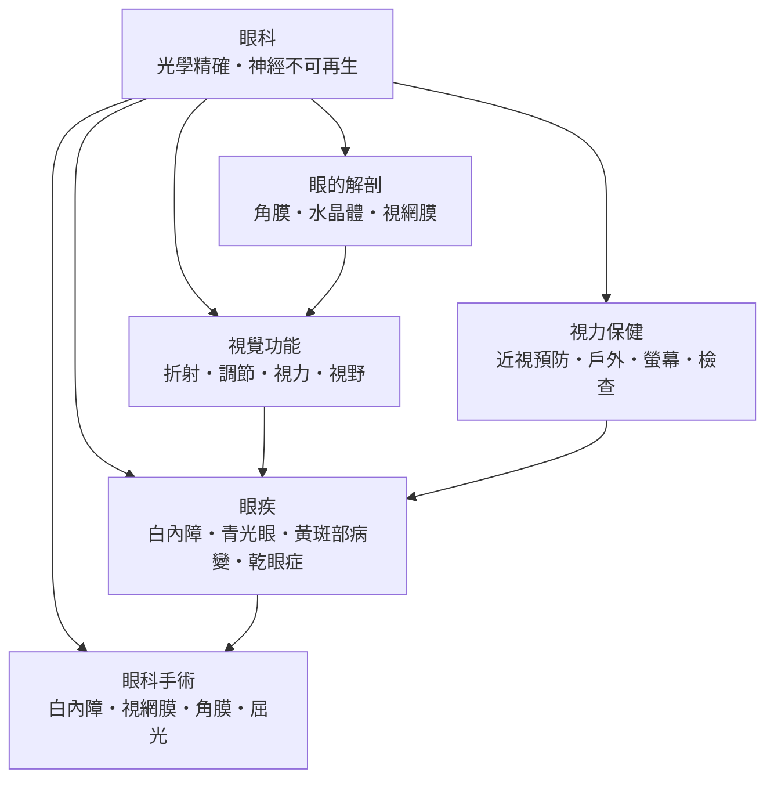

# 眼科

> 分類範圍：研究眼睛這個「身體最精緻的光學儀器」的部門——眼球各部構造如何組成、光線如何被折射與轉成神經訊號、常見眼疾如何破壞這套系統、手術如何修復，以及如何在損害發生前保護視力。　·　隸屬第一層：[醫]　·　相關分類：[解剖學]、[神經科學]、[生理學]　·　子分類總表見 [README]

> 對應維基百科：[中文維基百科：眼科學](https://zh.wikipedia.org/wiki/%E7%9C%BC%E7%A7%91%E5%AD%A6)　·　[English Wikipedia: Ophthalmology](https://en.wikipedia.org/wiki/Ophthalmology)

眼科（眼科學）處理的是一個獨特的問題：**視覺是身體與外界之間資訊量最大的通道**，而它的硬體一旦受損，神經細胞與光學介質大多無法再生。角膜、水晶體負責把光精確聚焦到視網膜；視網膜把光子轉成電訊號；這條光學—神經鏈的任何一環出錯，都以「看不清楚」或「看不見」呈現。因此眼科的五大子分類天然排成一條鏈：解剖是地圖、功能是規格、疾病是故障、手術是修理、保健是保養。它同時與光學物理、材料工程和公共衛生深度交會——近視大流行正是三者疊加的當代案例。

## 核心問題：光學精確度與不可再生的神經

眼科的中心事實有兩條：

1. **光學容差極小**：正視眼的焦點必須落在視網膜上，誤差超過約 $0.5$ 屈光度（D）就會明顯影響視力；角膜的屈光力（約 $43\ \text{D}$ ）遠大於水晶體，角膜表面的微小變化就足以大幅改變成像。
2. **視網膜神元不可再生**：感光細胞與神經節細胞死亡後無法補充，這決定了青光眼與黃斑部病變等疾病「預防重於治療」的根本邏輯——已失去的視野與視力回不來。

因此眼科的目標函數是：**在神經細胞耗損之前，維持光學路徑的清晰與眼內結構的完整**。

## 因果鏈

1. **光學原理的引入**：把光的折射定律應用到眼睛，遠視、近視與散光第一次被量化描述，眼鏡從飾品變成光學儀器。
2. **檢眼鏡與眼底的可視化**：十九世紀檢眼鏡讓醫師第一次直接看見活體視網膜，眼底成為全身血管疾病的一扇窗。
3. **眼壓與青光眼的關聯**：眼壓測量與視野檢查把青光眼從「致盲的黑門」變成可篩檢、可延緩的慢性病。
4. **顯微手術革命**：手術顯微鏡進入手術室，角膜移植、白內障摘除的精度躍升，眼科成為最早全面顯微化的專科之一。
5. **人工水晶體與超音波乳化**：白內障從「臥牀等待成熟、大切口摘除」變成當日門診、小切口置入人工水晶體的常規手術。
6. **雷射的全面應用**：從角膜屈光手術到視網膜光凝固，雷射同時解決了「改變屈光」與「封閉出血」兩類問題。
7. **藥物與生物製劑**：降眼壓藥物的演進，以及抗血管內皮生長因子注射，使濕性黃斑部病變從快速致盲轉為可控病程。
8. **影像與數位化**：光學同調斷層掃描把視網膜切開成毫米級斷面，診斷與追蹤進入定量時代。

## 子分類的定位與相互驅動

- [眼的解剖] 是**地圖**：光學路徑的每一段（角膜、前房、水晶體、玻璃體、視網膜）都對應特定的疾病與手術入路。
- [視覺功能] 是**規格**：折射、調節、視力與視野的定義與量測，是診斷與療效評估的單位。
- [眼疾] 是**故障清單**：白內障是光學介質混濁、青光眼是神經耗損、黃斑部病變是中心視力引擎的損壞、乾眼症是淚膜系統失衡。
- [眼科手術] 是**修理**：顯微手術與雷射把光學與神經結構的損害修復或止血。
- [視力保健] 是**保養**：近視預防與定期檢查把族羣層級的失明風險壓下來。

## 範例：一位六十五歲患者的視力旅程

1. **功能基線**：年輕時視力 $1.0$ ，四十多歲出現老花——調節力下降，需要閱讀輔助。
2. **解剖變化**：水晶體蛋白質隨年齡變性混濁——白內障形成，夜間開車畏光、視力滑落到 $0.3$ 。
3. **疾病併行**：同時有早期年齡相關性黃斑部病變，直線看起來扭曲——黃斑部的警示。
4. **手術介入**：超音波乳化摘除混濁水晶體、置入人工水晶體，術後視力回升；手術同時校正了既有的屈光誤差。
5. **保健與追蹤**：術後定期眼底檢查與視野追蹤，監測黃斑部病變進展與眼壓——眼科的照護是終身的，手術只是其中一站。

## 容易混淆之處

- **近視不只是「度數深」**：高度近視伴隨眼軸增長，視網膜裂孔、剝離與黃斑病變的風險隨之上升——它是結構疾病，不只是光學問題。
- **青光眼不等於眼壓高**：正常眼壓型青光眼存在；視野與視神經纔是診斷核心，眼壓只是可控的危險因子。
- **白內障不必「熟了才開」**：現代手術越早做風險越低，等「成熟」反而是舊時代的殘留觀念。
- **老花與近視會並存**：近視只是把焦點移前，調節力下降與否是另一回事，兩者疊加而非抵銷概念。
- **眼藥水不是萬能**：感染、發炎、眼壓、淚液各有不同的藥物邏輯，自行長期使用類固醇眼藥水可能升高眼壓、惡化感染。

## 延伸閱讀

- [解剖學]：眼眶、眼外肌與視路的大尺度結構。
- [神經科學]：視覺訊號從視網膜到腦的處理路徑。
- [生理學]：感光換能與瞳孔反射的機制。
- [病理學]：發炎、變性與腫瘤在眼部的表現。
- [醫療器材]：光學與影像診斷設計的工程基礎。
- [公共衛生]：近視盛行率監測與學童視力政策。
- **跨科銜接**：糖尿病、高血壓與自體免疫疾病患者由內科轉介眼底評估，眼科常是全身疾病的哨站。
- **政策與防盲**：盛行率監測、篩檢給付與學童視力政策，把診間知識放大為族羣級的護眼體系。
- **跨科銜接與政策**：糖尿病、高血壓與自體免疫疾病患者由內科轉介眼底評估；盛行率監測與學童視力政策把診間知識放大為族羣級的護眼體系，防盲因此是終身、跨科與公共的三層工程。

## 連結定義

[醫]: ../README.md
[README]: README.md
[解剖學]: ../解剖學/README.md
[神經科學]: ../神經科學/README.md
[生理學]: ../生理學/README.md
[病理學]: ../病理學/README.md
[醫療器材]: ../../物/醫療器材/README.md
[公共衛生]: ../公共衛生/README.md
[眼的解剖]: 眼的解剖.md
[視覺功能]: 視覺功能.md
[眼疾]: 眼疾.md
[眼科手術]: 眼科手術.md
[視力保健]: 視力保健.md