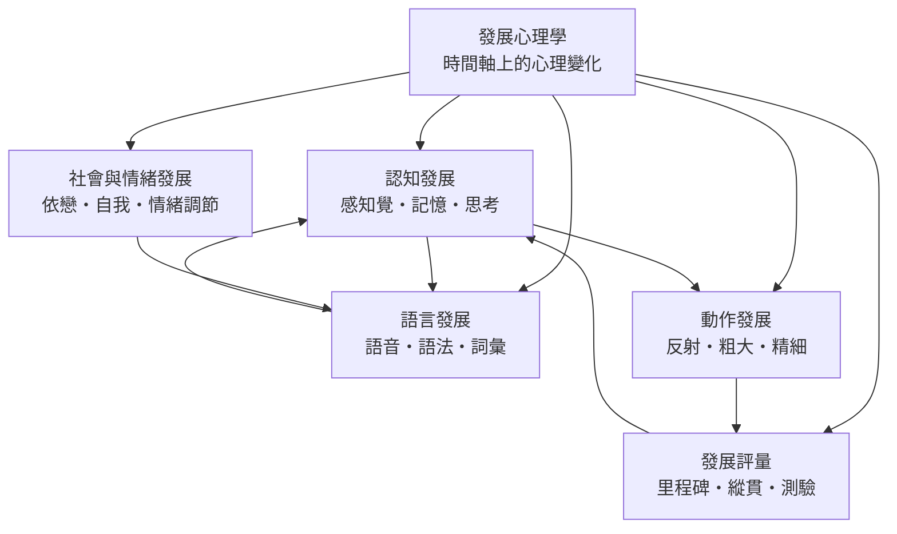

# 發展心理學

> 隸屬：第一層 [人]　·　相關分類：[心理學]、[認知科學]、[社會心理學]、[兒童發展]、[教學法]、[親職教育]　·　子分類總表見 [README]

> 對應維基百科：[中文維基百科：發展心理學](https://zh.wikipedia.org/wiki/%E5%8F%91%E5%B1%95%E5%BF%83%E7%90%86%E5%AD%A6)　·　[English Wikipedia: Developmental psychology](https://en.wikipedia.org/wiki/Developmental_psychology)

發展心理學研究的是：**同一個人（或同一種動物）在時間中的行為與心智如何改變，以及這種改變遵循什麼規律**。它的對象是「變化」本身——不是某一刻的心理狀態，而是從某個時間點到另一個時間點之間發生的差異。這一定位使它成為心理學中少數以**時間**為基本維度的分支，也使它與 [心理學] 的其他部分形成鮮明對比：實驗心理學以「此刻的反應」為單位，發展心理學則把「前後的差異」當作需要被解釋的現象。

本概念要處理的問題是三層的。第一層是**描述層**：兒童的認知、語言、動作、情緒與社會行為，各自遵循什麼時間型態——是階段式跳躍、還是連續漸變？第二層是**機制層**：推動變化的力量是成熟、學習、社會互動，還是三者的交互作用？第三層是**解釋與干預層**：既然知道規律，就能反過來設計介入——早期教育、特殊教育、親職諮商、復健與政策的依據都來自這一層。**三層互相牽制**：描述層的樣本與測量方式會決定機制層能提出什麼假設，而機制層的假設會決定介入層敢於做什麼。

## 核心問題

### 一、變化是階段跳躍還是連續漸變

這是本領域最古老也最未解的對立。[皮亞杰] 主張認知發展是**階段式**的：前運思、前具體運思、具體運思、形式運思，四個階段各有其結構，順序固定，兒童不會回到前一階段。[維果斯基] 則主張發展是**連續累積**的，且可以在教學下加速。兩者的差別不只是描述風格，而是實務上的差別：**若發展是階段式的**，落後於某階段的兒童需要整體重建；**若發展是連續的**，落後只需要在特定面向加速。

### 二、成熟與學習的比重

[桑代克] 在 [1905年] 提出學習律時，把學習解釋為刺激—反應聯結的改變，環境是主導；[葛塞爾] 的成熟論則主張發展主要由神經系統的成熟推動，環境只提供機會。這一組對立在二十世紀中葉之前並未被解決，直到遺傳學、雙生子研究與神經科學的證據累積，才形成現代的整合立場：**發展是基因設定的成熟軌道與經驗塑造的軌道在同一條系統上交互作用的產物**。

### 三、發展的可塑性與關鍵期

如果兒童在某個年齡窗口之後無法學會某項能力，那麼早期介入的黃金窗口就是政策議題的核心。歷來研究曾給出極不同的答案：語言的某些層次、情感依附、社群語言的語音辨識，確實存在相對緊縮的敏感期；但大量縱貫研究顯示，**多數認知與語言能力在青春期之後仍保有相當的可塑性**。如何分辨「真關鍵期」與「暫時延後」是本領域最重要的實證難題之一。

### 四、發展差異是「缺陷」還是「變異」

同一齡兒童之間的差異是巨大的。發展心理學必須回答：這種差異是反映能力高低，還是反映不同的發展路徑？這個問題直接決定臨床與教育介入的態度——[艾瑞克森] 的「心理社會危機」與依附理論的語言，把發展從「達到標準」轉向「解決任務的品質」，是這項轉向的早期代表。

## 因果鏈

1. **學習律的動物基礎**：[桑代克] 在 [1905年] 的《動物心理學》中以貓咪開迷箱的實驗建立準備律、練習律與效果律，證明**學習可以用實驗定量研究**。但研究對象是動物，測量的是行為次數，尚未涉及結構性的心智改變。

2. **兒童成為研究對象**：[皮亞杰] 自 1920 年代起在 [日內瓦] 以臨床訪談法與守候觀察記錄兒童對數、分類、空間與因果的判斷，於 [1923年] 出版《兒童的語言與思維》、[1936年] 出版《兒童的邏輯起源與發展》。**兒童從「被觀察的對象」變成「有結構的建構者」**，發展心理學的主題就此確立。

3. **社會軸線的加入**：[艾瑞克森] 在 [1950年] 的《童年與社會》中提出心理社會發展八階段，把每個階段定義為一組「危機」（如信任對不信任），並強調**發展在社會文化脈絡中進行**。此時發展不再只是認知結構的成熟，而是人格在關係中的形成。

4. **文化歷史取向的挑戰**：[維果斯基] 在 [1938年] 出版《思維與語言》，主張心智功能先存在於「心理間層次」（人與人之間），之後才內化為「心理內層次」，並提出**最近發展區**與「教學應走在發展前面」。這為「發展可被教學介入」提供了第一個理論基礎。

5. **教學論的介入**：[布魯納] 在 [1956年] 的《教育心理學》中以發現學習重寫教學理論，主張教材應螺旋式排列、讓學習者主動發現結構，**把發展研究與教學設計接上同一條線**。

6. **早期關係的可操作化**：[安斯沃斯] 等人在 [1962年] 發表的「陌生情境」研究，把依附關係變成可在短時間內觀察並分類的行為程序（安全型、迴避型、矛盾型），**使嬰幼兒期的關係品質成為可測量的變項**。

7. **跨國研究與政策的檢驗**：[1969年] 起在智利展開的學前教育擴張計畫，以及同期美國的 Head Start 評估，把「早期介入是否有效、效果能維持多久」變成可以用準實驗設計回答的實證問題；[1980年] [皮亞杰] 逝世後，階段論的普遍性在跨文化樣本中被系統性重新檢驗。

8. **可塑性與終身發展的整合**：[1990年] 之後，縱貫設計、多方法測量與神經科學證據共同支持**發展的終身性與可塑性**；[2000年] 之後，早期介入、腦可塑性與「逆境經驗」研究把發展研究推向公共衛生與教育政策的核心位置，也把「發展」從兒童期延伸至成年與老化。

## 子分類的定位與相互驅動

- **[認知發展]** 是**結構與機制**的分支：它問「心智的組織方式如何隨年齡改變」，並提供語言、動作與評量分支共同依賴的時間基準——例如工作記憶容量隨年齡上升、前額葉執行功能持續發展到二十歲出頭，都是後續分支的共同前提。

- **[社會與情緒發展]** 是**關係與情境**的分支：它處理「在誰的身邊、以誰為對象」如何決定發展的方向。依附研究與自我概念研究把發展的社會面向量化，使「早期關係品質」成為可被評估與介入的變項。

- **[語言發展]** 是**符號系統**的分支：語言既是社會互動的產物（大人對嬰兒說話），又是認知發展的推進器（語言把經驗固定成可累積的表徵）。它因此是 [認知發展] 與 [社會與情緒發展] 的交會點。

- **[動作發展]** 是**生物基礎與早期通道**的分支：姿勢控制、爬行與手指操作技能既受成熟制約，又開啟了探索、操作物件與語言學習的機會；它是「成熟 vs 學習」之爭最直接可觀察的戰場。

- **[發展評量]** 是**方法與證據**的分支：它不新增心理現象，而是提供測量發展的工具與典範——橫斷面、縱貫與臨床測驗各自能回答與不能回答的問題，決定了其他四個分支的結論有多可靠。

五者互相驅動：動作發展提供最早期的主動經驗來源，語言發展把經驗轉成可累積的符號，認知發展解釋符號如何組織成結構，社會與情緒發展說明這些結構在關係與文化中被強化或修正，而發展評量則為全部四者提供可檢驗的證據基礎。

## 範例：陌生情境中的十二分鐘

以 [安斯沃斯] 的「陌生情境」程序為例，可以看見發展心理學如何把一個抽象概念（依附品質）轉成可觀察、可分類、可預測的證據：

1. **設計**：程序固定為 8 回合、每回合約 3 分鐘，全程約 30 分鐘。陌生的實驗者與房間是刻意的安排：目的是製造**足以引發依戀系統的適度壓力**，而非引發強烈驚恐。

2. **依變項**：記錄的是**行為**，不是內在感受——重逢時的尋求接觸（接近、接觸、安慰的互動）、迴避（轉開視線、談話聚焦於玩偶）、以及對陌生人的選擇（陌生vs. 熟悉）。**依附被定義為情感關係，依附行為只是它的可觀察表現**，這一步區分是安斯沃斯方法的核心。

3. **結果**：三類型在後續跨樣本研究中呈現相對穩定的分布——**安全型約佔 60% 至 70%**（重逢時主動接觸並易被安慰）、**迴避型約 15% 至 20%**（重逢時表現疏離，壓力下轉向玩偶）、**矛盾型約 10% 至 15%**（同時尋求接觸又抗拒接觸，重逢後仍難以平復）。三者在同一程序中**互相對照**，因此分類具有鑑別力。

4. **推論**：若嬰兒在八次重逢中反覆表現疏離，則依戀關係很可能以「迴避」方式組織；若表現為矛盾型，則關係中可能同時存在被拒絕的經驗與強烈的尋求意願。**這些結論建立在可重複的程序與明確的行為編碼上，而非依賴訪談者的印象**。

5. **跨檢驗的教訓**：陌生情境在 1980 年代受到跨文化批評——在部分文化中，嬰兒在陌生情境中的分布與西方樣本不同（例如日本樣本中矛盾型比例較低），提示**行為形式的表現受文化規範影響**。此一批評迫使依附研究區分「依附關係的品質」與「依戀行為的文化腳本」，也讓 [發展評量] 的分支增加了文化敏感度這一向度。

## 容易混淆之處

- **發展心理學不等於兒童心理學**：後者常指以兒童為對象的臨床、教學與輔導工作；發展心理學是研究發展規律的學術領域，成人與老年期的發展同樣在範圍內。
- **「階段」不等於「年齡」**：階段描述的是結構組織的質性差異，里程碑描述的是達成的時間；把階段直接等同於年齡界線，是最常見的誤用。
- **常模不等於標準**：里程碑年齡多來自多數兒童樣本的分佈，落後於常模只表示「比多數晚」，不等於發展異常，判斷必須考量情境與其他面向。
- **相關不等於因果**：橫斷面研究發現的年齡差異，可能反映「不同年齡的人被不同時代養育」而非「人在變老」。
- **早不等於好**：某些能力提早出現可能以其他面向的發展為代價；「搶跑」在發展議題上並非無代價的策略。
- **依戀類型不是性格標籤**：安全型、迴避型、矛盾型描述的是關係中的行為模式，且會隨情境與年齡改變，不應作為對個人的固定判斷。

## 延伸閱讀

- [心理學]：發展心理學的母體領域，提供研究方法與統計的共同基礎。
- [認知科學]：把發展中的變化重新表述為資訊加工過程的改變。
- [社會心理學]：成人期的群體、態度與歸因研究，是發展研究的外推延伸。
- [兒童發展]：以兒童為核心的實務與政策面向。
- [教學法]、[親職教育]：發展研究成果轉為教育與家庭支持的出口。
- [行為科學]：學習與制約原理，是理解學習與習慣發展的基本框架。
- [心理測量]、[心理學方法]：測量工具與研究設計的方法學基礎。

## 連結定義

[人]: ../人/README.md
[README]: README.md
[心理學]: ../心理學/README.md
[認知科學]: ../認知科學/README.md
[社會心理學]: ../社會心理學/README.md
[兒童發展]: ../兒童發展/README.md
[教學法]: ../教學法/README.md
[親職教育]: ../親職教育/README.md
[行為科學]: ../行為科學/README.md
[心理測量]: ../心理學/心理測量.md
[心理學方法]: ../心理學/心理學方法.md
[認知發展]: 認知發展.md
[社會與情緒發展]: 社會與情緒發展.md
[語言發展]: 語言發展.md
[動作發展]: 動作發展.md
[發展評量]: 發展評量.md
[皮亞杰]: ../人/心理學家/皮亞杰.md
[維果斯基]: ../人/心理學家/維果斯基.md
[艾瑞克森]: ../人/心理學家/艾瑞克森.md
[布魯納]: ../人/心理學家/布魯納.md
[安斯沃斯]: ../人/心理學家/安斯沃斯.md
[桑代克]: ../人/心理學家/桑代克.md
[葛塞爾]: ../人/心理學家/葛塞爾.md
[日內瓦]: ../地/日內瓦.md
[1905年]: ../時/1905年.md
[1923年]: ../時/1923年.md
[1936年]: ../時/1936年.md
[1938年]: ../時/1938年.md
[1950年]: ../時/1950年.md
[1956年]: ../時/1956年.md
[1962年]: ../時/1962年.md
[1969年]: ../時/1969年.md
[1980年]: ../時/1980年.md
[1990年]: ../時/1990年.md
[2000年]: ../時/2000年.md
