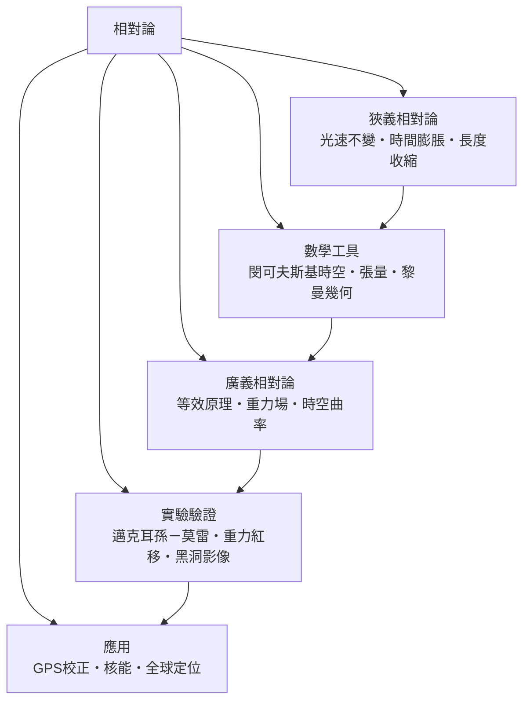

# 相對論

> 隸屬：第一層 [時]　·　相關分類：[物理學]、[數學]、[時空]、[黑洞]、[量子力學]　·　子分類總表見 [README]

> 對應維基百科：[中文維基百科：相對論](https://zh.wikipedia.org/wiki/%E7%9B%B8%E5%AF%B9%E8%AE%BA)　·　[English Wikipedia: Theory of relativity](https://en.wikipedia.org/wiki/Theory_of_relativity)

相對論是 [愛因斯坦] 在二十世紀初建立的時空與引力理論，分為**狹義相對論**（1905 年）與**廣義相對論**（1915 年）兩步。它要解決的核心問題是：當物體以接近光速運動、或身處強大引力場時，[牛頓力學]描述的絕對時間與絕對空間就失靈了。相對論的回答徹底而激進——時間與空間不是舞台，而是演員：兩者合起來構成四維的[時空]，而引力不是力，是時空彎曲的表現。

狹義相對論以兩條假設出發：物理定律在所有慣性系中形式相同（相對性原理），以及真空光速對所有觀察者都是同一個數值 $c \approx 299792458 \ \mathrm{m/s}$ 。從這兩條出發，「同時」變成相對的，運動的鐘走得慢、運動的尺變得短，而 [質量]與能量透過 $E = mc^2$ 等價。廣義相對論再把引力納入：等效原理說「在封閉電梯裡無法區分重力與加速度」，由此推出引力會彎曲時空，行星繞日其實是沿彎曲時空中的「直線」前進。因此相對論不只是新公式，而是對「時間是什麼、空間是什麼」的重新定義——這也是它與 [時間哲學] 在「時間物理與哲學」這個問題群中並肩而立的原因。

## 核心問題

相對論圍繞四個問題展開：

1. **同時性**：兩個事件「同時發生」是客觀事實，還是依觀察者而定？狹義相對論證明：在靜止的車站看，兩道閃電同時擊中列車兩端；在等速行駛的列車上看，前端那道先擊中。同時性是相對的。
2. **測量的不變量**：時間、長度都隨觀察者而變，那什麼才是客觀的？答案是**時空間隔**——把時間與空間合起來算出的量，對所有慣性觀察者都相同。
3. **引力的本質**：牛頓的萬有引力是「超距力」，但超距作用違背了狹義相對論「訊息不能超光速」的要求。廣義相對論以時空曲率取代超距力，引力以彎曲時空的幾何方式傳播。
4. **理論的檢驗**：這些反直覺的主張如何被證實？光線偏折、[水星進動]、[重力紅移]、重力波——每一步都有可重複的實驗證據。

把四個問題串起來，就是相對論的精神：**先放棄直覺中最不可靠的部分（絕對同時），再守住最可靠的不變量（光速與時空間隔），最後把引力從「力」改寫成「幾何」**。

## 因果鏈

1. **電磁學與牛頓力學的衝突**：馬克士威方程組預言電磁波以固定速度 $c$ 傳播，但「相對於什麼固定？」十九世紀物理學家假設有傳播介質「以太」，這是第一個瓶頸。
2. **邁克耳孫－莫雷實驗**：[實驗驗證] 中最著名的一場——1887 年 [邁克耳孫－莫雷實驗] 試圖測量地球穿過以太的速度，結果為零。以太假說動搖，物理學需要新的時空觀。
3. **愛因斯坦的兩條公設**：[愛因斯坦] 在 [1905年] 乾脆把「光速不變」提升為公設，放棄以太與絕對同時性，建立 [狹義相對論]。
4. **時間膨脹與長度收縮**：由兩條公設推出 [時間膨脹]（動鐘變慢）與 [長度收縮]（動尺變短），並導出 $E = mc^2$ ——質量與能量互換的鑰匙。
5. **閔可夫斯基的幾何化**：[閔可夫斯基]（愛因斯坦的老師）1908 年指出狹義相對論的數學本質是四維幾何，時空成為統一的舞台，這是 [數學工具] 層的躍升。
6. **等效原理**：愛因斯坦抓住「電梯內無法區分重力與加速度」這個洞察（1907 年），推斷引力會影響時間流逝，這是 [廣義相對論] 的起點。
7. **黎曼幾何與場方程**：愛因斯坦花八年學習 [黎曼幾何] 與 [張量分析]，在 [1915年] 寫下愛因斯坦場方程，把引力改寫為時空曲率，完成 [廣義相對論]。
8. **驗證與應用**：[1919年] 日食觀測證實光線偏折，讓愛因斯坦一夜成名；之後 [重力紅移]、重力波、[黑洞影像] 逐一驗證；[GPS校正] 與核能則把理論變成日常技術。

## 子分類的定位與相互驅動

- [狹義相對論] 是**基礎層**：它以兩條公設重建運動學，所有後續發展都建在其上；沒有它，就沒有「訊息不能超光速」這條鐵律。
- [廣義相對論] 是**引力層**：它把狹義相對論擴展到加速參考系與引力，用時空曲率解釋引力，是本概念理論上的頂點。
- [數學工具] 是**語言層**：[閔可夫斯基時空]、[張量分析]、[黎曼幾何] 提供把物理直覺寫成方程的語言；愛因斯坦若不補幾何課，廣義相對論寫不出來。
- [實驗驗證] 是**裁判層**：從 [邁克耳孫－莫雷實驗] 到 [黑洞影像]，每個反直覺預測都要過實驗這一關；驗證的成功反過來鞏固理論地位。
- [應用] 是**出口層**：[GPS校正] 每天都在修正相對論效應，核能來自 $E = mc^2$ ，理論物理就此滲入每個人的口袋與電網。

## 範例：GPS 裡的相對論

1. **問題**：GPS 衛星在 20200 公里高空以每秒約 3.9 公里飛行，其原子鐘必須與地面同步，否則定位誤差每累積 1 奈秒就換來 0.3 公尺偏差。
2. **狹義效應**：衛星相對地面運動，依 [時間膨脹]，衛星鐘每天慢約 7 微秒。
3. **廣義效應**：衛星離地心較遠、引力較弱，依 [重力紅移]，衛星鐘每天反而快約 45 微秒。
4. **淨效果**：兩者相加，衛星鐘每天快約 38 微秒——若不修正，定位每天漂移超過 10 公里，系統幾小時內就報廢。
5. **結論**：工程師在發射前就把衛星鐘的振盪頻率調低，讓它入軌後剛好與地面同步。你每次打開導航，其實都在使用兩種相對論效應的淨和。

## 容易混淆之處

- **「一切都是相對的」是誤解**：相對論的名字常被拿來當哲學口號，但它其實確立了光速與時空間隔這些絕對不變量；不變的比變的更核心。
- **時間膨脹不是鐘的機械問題**：不是原子鐘在動時「故障」，而是時間本身的流逝速率依參考系而定。
- **雙胞胎悖論不是真悖論**：出發與返回的太空人經歷了加速，兩人的處境不對稱，回來的太空人確實比較年輕，沒有矛盾。
- **廣義相對論不廢除牛頓力學**：在弱引力、低速下場方程退回牛頓重力；兩者是包含關係，不是推翻關係。
- **引力波不等於引力本身**：引力波是時空曲率的漣漪，如同水波之於水面，不能把兩者混為一談。
- **相對論與量子力學尚未完全調和**：兩者是二十世紀兩大支柱，但量子重力理論仍在建構中，別把兩者當成已完成的大一統。

## 延伸閱讀

- [時空]：時間與空間如何被閔可夫斯基合為四維整體。
- [黑洞]：廣義相對論最極端的預測與 2019 年的第一張影像。
- [量子力學]：同時期誕生的另一根物理支柱，描述微觀世界。
- [數學]：黎曼幾何與張量分析所在的母概念。
- [物理學]：相對論所屬的大分類，提供全部基本量與方法。
- [熵增]：與相對論共同構成「時間物理與哲學」的另一支柱。

## 連結定義
[1905年]: ../時/1905年.md
[1915年]: ../時/1915年.md
[1919年]: ../時/1919年.md
[GPS校正]: GPS校正.md
[README]: README.md
[實驗驗證]: 實驗驗證.md
[廣義相對論]: 廣義相對論.md
[張量分析]: 張量分析.md
[愛因斯坦]: ../人/物理學家/愛因斯坦.md
[應用]: 應用.md
[數學]: ../數學/README.md
[數學工具]: 數學工具.md
[時]: ../時/README.md
[時空]: ../時空/README.md
[時間哲學]: ../時間哲學/README.md
[時間膨脹]: 時間膨脹.md
[水星進動]: ../天文學/README.md
[熵增]: ../熵增/README.md
[牛頓力學]: ../力學/力學.md
[物理學]: ../物理學/README.md
[狹義相對論]: 狹義相對論.md
[質量]: ../物理學/質量.md
[邁克耳孫－莫雷實驗]: 邁克耳孫－莫雷實驗.md
[重力紅移]: 重力紅移.md
[量子力學]: ../量子力學/README.md
[長度收縮]: 長度收縮.md
[閔可夫斯基]: ../人/數學家/閔可夫斯基.md
[閔可夫斯基時空]: 閔可夫斯基時空.md
[黎曼幾何]: 黎曼幾何.md
[黑洞]: ../黑洞/README.md
[黑洞影像]: 黑洞影像.md
