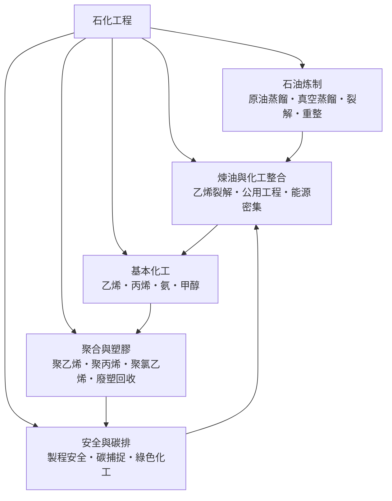

# 石化工程

> 隸屬：第一層 [工]　·　相關分類：[化學工程]、[有機化學]、[再生能源]　·　子分類總表見 [README]

> 對應維基百科：[中文維基百科：石油化工](https://zh.wikipedia.org/wiki/%E7%9F%B3%E6%B2%B9%E5%8C%96%E5%B7%A5)　·　[English Wikipedia: Petrochemical](https://en.wikipedia.org/wiki/Petrochemical)

石化工程是**以 [石油] 與天然氣為原料，把它們轉變成燃料、化學品與塑膠的工程學科**。它橫跨兩個世界：一端是煉油廠——把成分複雜的原油按沸點切成汽油、柴油、重油，再把重油分子「剪」成小分子；另一端是石化廠——把這些小分子（乙烯、丙烯、苯等）聚合成塑膠、纖維與橡膠的原料。因此石化工程可以看成 [化學工程] 在石油產業上的總應用：衡算、蒸餾、反應器設計、公用工程與安全管理的原則完全相同，只是規模、溫度與分子種類更極端。

這門學科的分量來自它支撐的經濟結構。1859 年賓州德雷克井開採現代石油以來，燃料始終占石油消費的大宗，但真正讓石化獨立成學科的是「副產品的翻身」：煉油原本只想要煤油與汽油，熱裂解產生的烯烴一度被當成廢氣燒掉；二十世紀初化學家發現這些不飽和小分子正是聚合反應的完美單體，1910 年代起 [美國] 與德國相繼把裂解氣導入化工生產，1920 年標準石油的新澤西廠從煉油氣生產異丙醇，被視為第一座現代石化廠。從此「煉油供分子、化工做產品」的整合模式成型，二次大戰後合成橡膠、合成纖維與塑膠的爆發式成長，把石化工程推成二十世紀最大的製造業之一。

它同時也是被檢視最嚴格的學科：石化產業是能源密集產業的代表，1973 年石油危機迫使製程全面節能，2015 年《巴黎協定》之後脫碳壓力又迫使它重新思考原料與能源來源。理解石化工程，就是理解現代物質文明的供應鏈如何從地底的黑油變成身邊的每一件塑膠，以及這條路徑正在如何被改寫。

## 核心問題

石化工程的核心問題可以拆成四層。

1. **切的問題**：原油是數千種碳氫化合物的混合物，怎麼按沸點與分子大小切出有用的餾分？答案是 [原油蒸餾]——常壓塔切輕質餾分，[真空蒸餾] 在低溫下切重質餾分以免分子受熱裂壞。
2. **變的問題**：切出來的分子比例跟市場要的比例永遠不匹配——汽油太多、輕烯烴不夠。怎麼把大分子變小（[裂解]）、把小分子重排成高辛烷值分子（[重整]）？這是煉油化學的核心。
3. **合的問題**：裂解與重整產生的小分子（乙烯、丙烯、丁二烯、芳烴、合成氣）怎麼變成塑膠、纖維與溶劑？這是 [基本化工] 與 [聚合與塑膠] 的領域，關鍵是觸媒、聚合反應器與精製純度。
4. **整合與底線的問題**：幾十套裝置如何共用蒸汽、電力與冷卻水？能量怎麼省？出事怎麼不升級？碳怎麼處理？這是 [煉油與化工整合] 與 [安全與碳排] 的領域。

四層的邏輯順序是「先切、再變、後合，整合貫穿全部」：蒸餾決定可用的分子池，轉化製程調整分子池的形狀，化工裝置把分子池變成產品，而整合與安全決定這一切能不能在經濟與法規之內長期運轉。

## 因果鏈

1. **照明驅動的起點**：十九世紀城市照明從鯨油轉向煤油，1859 年 [美國] 德雷克井成功鑽探，現代石油工業誕生；此時「煉油」只是把原油蒸餾出煤油，汽油反而是難處理的易燃副產品。
2. **內燃機改寫需求**：汽車普及讓汽油從廢料變成主產品，但直餾汽油太少又辛烷值太低；熱裂解（1913 年伯頓製程）與後來的催化重整被發明出來，專門把大分子變小、把鏈狀分子變環狀，煉油第一次擁有「主動改變分子」的能力。
3. **副產品的翻身**：裂解產生的乙烯、丙烯原本只能燒掉；化學家發現它們是不飽和的聚合單體，1920 年代石化廠出現，把煉油氣導入化工生產，「石油化工」一詞成型。
4. **戰爭與替代材料的推力**：二次大戰對合成橡膠與航空汽油的需求，使美國政府直接投資數十座丁二烯與裂解工廠；戰後這些產能轉民生，聚乙烯（1933 年英國發現、戰後量產）、聚丙烯（1954 年納塔）接連問世，塑膠時代開始。
5. **規模化與整合**：1950 年代起煉油廠與裂解廠合建，蒸汽、氫氣與中間原料在廠區內互供；規模經濟使單套裂解爐產能從年產 5 萬公噸放大到百萬公噸以上，這正是化學工程「放大」方法論的最大舞台。
6. **石油危機與節能**：1973 年 [1973年] 油價暴漲四倍，能源成本從背景雜費變成製程設計的第一約束；換熱網路最佳化、蒸餾節能與全廠能量整合從此成為石化工程的標準課題。
7. **安全法規化**：1984 年印度波帕毒氣事故與 1989 年德州帕薩迪納乙烯爆炸等事故之後，製程安全管理成為法定系統，危害與可操作性分析（HAZOP）從石油業輸出到全部流程工業。
8. **脫碳與轉型**：2015 年《巴黎協定》後，交通燃料需求見頂的預期迫使煉油商轉向化工原料與特用化學品；[碳捕捉]、電裂解爐、生物基原料與 [綠色化工] 成為學科的新前沿，石化工程第一次要回答「不燒化石燃料時我還剩下什麼」。

## 子分類的定位與相互驅動

- [石油炼制] 是**入口**：蒸餾切出分子池，裂解與重整改變分子池的形狀；沒有煉製，後面所有的化工都沒有原料。它對 [煉油與化工整合] 輸出氫氣、液化氣與蒸餾能量整合的機會。
- [基本化工] 是**轉運站**：乙烯、丙烯、合成氣與甲醇是整個石化體系的「樞紐分子」，一切下游塑膠與化學品都從這裡分流；它的產能規劃直接決定上游裂解爐的負荷與下游聚合廠的選址。
- [聚合與塑膠] 是**產品出口**：石化價值鏈八成以上的最終形態是聚合物；聚合技術（觸媒、分子量控制）決定塑膠的性價比，而 [廢塑回收] 又把產品的終點接回原料的起點，形成循環。
- [煉油與化工整合] 是**黏合劑**：蒸汽裂解爐把煉油與化工縫在一個廠區，公用工程與能量整合決定整個體系是否經濟；能源密集的特性使它成為每一輪油價與碳價衝擊的第一承受者。
- [安全與碳排] 是**底線與修正器**：[製程安全] 把事故經驗制度化為設計規範，碳捕捉與綠色化工則把環境約束轉成新的製程選項——這兩者回頭改寫前四個子分類的設計準則，是石化工程當前變化最快的部分。

## 範例：一瓶汽油的身世與一個塑膠袋的归途

**汽油**：一桶原油（約 159 公升）進入常壓蒸餾塔，按沸點切成約 40% 的汽油餾分；但市場要的汽油比例更高，於是石腦油與重油被送進流化催化裂解裝置，把長鏈分子剪成汽油範圍的小分子，再經催化重整提高辛烷值——最終一桶原油可以產出超過一半體積的汽油，這個「產率超過蒸餾上限」的現象，就是轉化製程存在的理由。

**塑膠袋**：裂解爐把乙烷在約 850°C 加熱零點幾秒，脫氫變成乙烯；乙烯經高壓（1000–3000 大氣壓）自由基聚合變成低密度聚乙烯，吹膜成袋。用過之後它有兩條路：進焚化爐（回收熱能但排碳）、或進機械回收（清洗、造粒、再成型，但每次分子鏈變短、性能下降）。這條「原油→裂解→聚合→廢棄」的單向鏈，正是當前脫碳與循環經濟改革的主戰場。

## 容易混淆之處

- **石化工程不等於煉油工程**：煉油（切與變）只是石化工程的上半場，下半場是化工（合）；只學蒸餾塔無法設計聚乙烯廠。
- **「石油化學品」與「石化燃料」不同**：燃料燒掉即消失，化學品中的碳暫時儲存在產品裡；兩者的碳排責任與減排路徑並不相同。
- **裂解與裂化常被混用**：中文語境下裂解多指以乙烯為目標的高溫蒸汽裂解，裂化（如催化裂化）則以汽油為目標；兩者溫度、觸媒與產品結構都不同。
- **乙烯產能不等於煉油產能**：衡量一國石化實力看乙烯產能，衡量燃料供應看煉油產能，兩套數字常被媒體混為一談。
- **回收塑膠不是無限循環**：機械回收每輪都會劣化分子鏈，真正的閉環還需要化學回收（裂解回單體）或原料替代，這不是既有技術的簡單延伸。

## 延伸閱讀

- [化學工程]：石化工程的方法論母體——衡算、單元操作與反應器設計。
- [有機化學]：烯烴、芳烴與聚合反應的分子理論基礎。
- [熱力學]：蒸餾設計與化學平衡計算的理論工具。
- [高分子塑膠]：聚合產品的分類與性質總覽。
- [合成纖維]：聚酯與尼龍——石化價值鏈在紡織業的出口。
- [全球暖化]：石化產業脫碳壓力的科學背景。
- [再生能源]：石化能源結構的挑戰者與未來原料選項。
- [元素週期表]：觸媒金屬（鉑、鎳、鈦）在表中的位置與角色。

## 連結定義

[工]: ../工/README.md
[README]: README.md
[化學工程]: ../化學工程/README.md
[有機化學]: ../有機化學/README.md
[再生能源]: ../再生能源/README.md
[熱力學]: ../熱力學/README.md
[高分子塑膠]: ../高分子塑膠/README.md
[合成纖維]: ../合成纖維/README.md
[全球暖化]: ../全球暖化/README.md
[元素週期表]: ../元素週期表/README.md
[石油]: ../物/石油.md
[美國]: ../地/美國.md
[1973年]: ../時/1973年.md
[石油炼制]: 石油炼制.md
[原油蒸餾]: 原油蒸餾.md
[真空蒸餾]: 真空蒸餾.md
[裂解]: 裂解.md
[重整]: 重整.md
[基本化工]: 基本化工.md
[聚合與塑膠]: 聚合與塑膠.md
[廢塑回收]: 廢塑回收.md
[煉油與化工整合]: 煉油與化工整合.md
[安全與碳排]: 安全與碳排.md
[製程安全]: 製程安全.md
[碳捕捉]: 碳捕捉.md
[綠色化工]: 綠色化工.md
