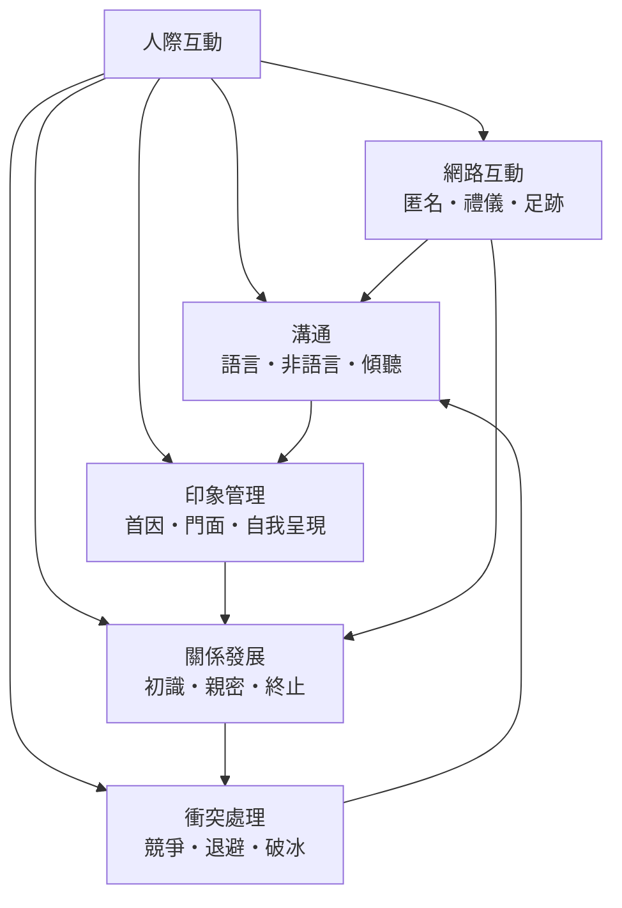

# 人際互動

> 隸屬：第一層 [人]　·　相關分類：[社會心理學]、[社會學]、[心理學]、[語言學]　·　子分類總表見 [README]

> 對應維基百科：中文與英文維基百科均無對應條目（參考：人際互動 相關主題文獻）

人際互動研究的是：**兩個或更多的人在場時，彼此如何傳遞訊息、管理對方眼中的自己、把短期接觸累積成長期關係、處理必然出現的分歧，以及當互動搬到螢幕上之後這一切如何被改寫**。它不問「這個人是什麼樣的人」，而問「這兩個人在這個場景裡對彼此做了什麼」；行為的單位不是個人，而是**兩人之間的往來回合**。因此，人際互動是一門把「見面」拆解成可分析步驟的學問：一次眼神、一句客套、一次道歉，都是它的資料。

本條目要處理的問題是：**為什麼同樣一句話，在不同關係、不同場合、不同媒介之下效果天差地遠；而我們又是靠哪些技巧與規則，把陌生人變成熟人、把分歧變成妥協、把誤會變成修正的機會**。

## 核心問題

人際互動的核心操作是**把互動拆成「訊息、面子、關係、衝突、媒介」五個可以分別研究的切面**。它假設：任何一次往來都同時在做五件事——傳遞內容、維持彼此的體面、調整關係的遠近、處理意見不一致、並且透過某種媒介（臉、聲音、文字）完成。

1. **訊息如何被傳遞與解讀**：說話者編碼、聽者解碼，兩者之間的落差就是誤解的來源。
2. **面子如何被管理**：互動能否持續，取決於雙方是否維持住彼此在對方眼中的形象。
3. **關係如何升級與降級**：從陌生到親密有一連串可辨識的階段，從親密到疏遠也有。
4. **分歧如何被處理**：競爭、退避、妥協、合作不是性格，而是可以在情境中被選擇的策略。
5. **媒介如何改寫規則**：線上互動抽掉了表情與語氣，卻也創造了匿名、留下紀錄等新的條件。

因此，人際互動同時是**描述性學科**（人實際上如何互動）與**規範性學科**（互動有哪些潛規則、違反會如何），後者使它深入禮儀、教育訓練、談判與網路產品設計。

## 因果鏈

1. **禮儀傳統的瓶頸**：十九世紀以前的互動知識以禮儀手冊的形式存在，只告訴人「該怎麼做」，卻無法解釋「為什麼違反禮儀會讓人難堪」。
2. **社會學的微觀轉向**：二十世紀初，[米德]與[库里]把「自我」重新定義為社會互動的產物——自我是從別人的反應中學來的，互動因此成為理論核心而非背景。
3. **擬劇論的出現**：[戈夫曼]於 [1959年] 出版《日常生活中的自我呈現》，把面對面的互動比擬成劇場表演，提出「門面」「前台」「後台」等概念，讓「給人看的樣子」成為可分析的對象。
4. **非語言訊息的量化**：1960 年代起，研究者開始系統測量表情、姿勢、人際距離與語調，證明情感訊息大部分不由語言承載，「會說話」之外的互動層被打了燈。
5. **傾聽與回饋技術化**：心理治療把「傾聽」從美德變成可訓練的技術（重述、澄清、回饋），並外推到教育、管理與談判訓練。
6. **衝突策略的分類**：1970 年代的研究把衝突反應整理成競爭、合作、妥協、退避等有限選項的組合，使「怎麼處理吵架」變成可比較、可教學的策略空間。
7. **關係階段模型的建立**：研究者把關係的開展與結束切成可命名的階段（初識、升級、維持、解體），使「為什麼分手」能被有系統地追蹤。
8. **媒介革命與再提問**：1990 年代起互動大量移入 [1993年] 前後普及的網路，面對面的預設被打破，匿名、非同步、留下數位紀錄等新條件迫使上述所有問題重新被問一次。

## 子分類的定位與相互驅動

- **[溝通]** 是**訊息層**的分類：它回答「訊息怎麼送達、怎麼被誤讀」，是其他四個分類的載體；沒有溝通，印象無從建立、關係無從累積。
- **[印象管理]** 是**形象層**的分類：它回答「我希望對方把我看成什麼樣的人」；溝通提供管道，印象管理決定管道裡送出的是什麼。
- **[關係發展]** 是**時間層**的分類：它把一次次的互動累積成歷史，回答「我們現在算什麼關係」；印象管理的成敗直接決定關係能否升級。
- **[衝突處理]** 是**張力層**的分類：它處理關係中的摩擦，回答「意見不合時怎麼辦」；處理方式又會回頭改寫雙方對彼此的印象。
- **[網路互動]** 是**媒介層**的分類：它把前四者搬到線上，觀察抽掉表情與身體之後，哪些規則崩壞、哪些新規則誕生。

五者互相驅動：溝通技術愈好，印象管理愈精細；印象管理決定初識的成敗，進而影響關係能否發展；關係愈深，衝突的賭注愈大，愈需要成熟的處理策略；而網路媒介同時改寫了溝通、印象、關係與衝突的所有預設，迫使整個循環重新適應。

## 範例：第一次見面時發生了什麼

以一次求職面談為例，逐步拆解人際互動的五個切面如何同時運作：

1. **溝通層**：應徵者的回答是語言溝通；坐姿、眼神接觸與語速是非語言溝通。主考官聽到的不只是答案內容，還有答案的「樣子」。
2. **印象管理層**：應徵者提前整理服裝、準備自我介紹，這是[戈夫曼]所說的「前台表演」；只有在朋友面前抱怨前一份工作，才是「後台」。
3. **首因效應層**：研究顯示，見面前幾分鐘形成的[第一印象]會成為之後所有訊息的解讀框架；主考官若前三分鐘判定「不夠沉穩」，後面的回答都會被往這個方向詮釋。
4. **關係層**：面談本身是一場「初識」，雙方都在評估是否要進入更長期的關係（僱用）；錄取後的互動才進入關係的維持與升級階段。
5. **衝突層**：當主考官質疑經歷中的空檔，應徵者可以競爭（反駁）、退避（含糊帶過）、妥協（部分承認）或合作（說明並提出解方）——選擇不同，結果不同。
6. **媒介層**：若面談改為視訊，眼神接觸的位置變了、延遲打斷了輪替節奏、履歷早已留下數位足跡——同樣的互動規則，在新的媒介下全部需要重新校準。

這個例子顯示：人際互動的分析單位不是「這個人表現如何」，而是「雙方在五個切面上各自做了什麼、又如何互相影響」。

## 容易混淆之處

- **互動不等於關係**：互動是單次的往來，關係是互動的歷史累積；一次愉快的互動不保證關係，長期關係也可能由許多平淡的互動構成。
- **印象管理不等於虛偽**：[戈夫曼]的分析指出，所有社會互動都帶有表演成分，包括最真誠的場合；表演是互動的必要條件，而非道德缺陷。
- **非語言訊息不是密碼**：坊間常見「雙手交叉＝防衛」式的解讀，但非語言線索高度依賴情境與個人習慣，單一線索不足以推斷內心狀態。
- **衝突處理策略沒有唯一正解**：合作並非永遠最佳，退避在某些高情緒、低重要性的場合反而是理性選擇；策略優劣取決於議題重要性與關係長期性。
- **線上互動不是面對面的降級版**：研究顯示，去線索環境不一定造成更糟的互動；匿名也可能促成比線下更誠實的自我揭露，媒介帶來的是規則改寫而非單純損失。

## 延伸閱讀

- [社會心理學]：提供從眾、歸因、態度等微觀社會行為的實驗證據。
- [社會學]：以結構與制度解釋互動所在的更大場景。
- [心理學]：知覺、記憶與情緒的機制，是互動歷程的內在層。
- [語言學]：語言結構與語用規則，是語言溝通的基礎。
- [發展心理學]：依附與社會能力的發展，說明互動技巧如何隨年齡養成。
- [米德]與[库里]的「鏡中自我」傳統：自我如何在互動中被建構。

## 連結定義

[人]: ../../人/README.md
[README]: README.md
[社會心理學]: ../社會心理學/README.md
[社會學]: ../社會學/README.md
[心理學]: ../心理學/README.md
[語言學]: ../語言學/README.md
[發展心理學]: ../發展心理學/README.md
[第一印象]: 首因效應.md
[溝通]: 溝通.md
[印象管理]: 印象管理.md
[關係發展]: 關係發展.md
[衝突處理]: 衝突處理.md
[網路互動]: 網路互動.md
[戈夫曼]: ../../人/社會學家/戈夫曼.md
[米德]: ../../人/社會學家/米德.md
[库里]: ../../人/社會學家/库里.md
[1959年]: ../../時/1959年.md
[1993年]: ../../時/1993年.md