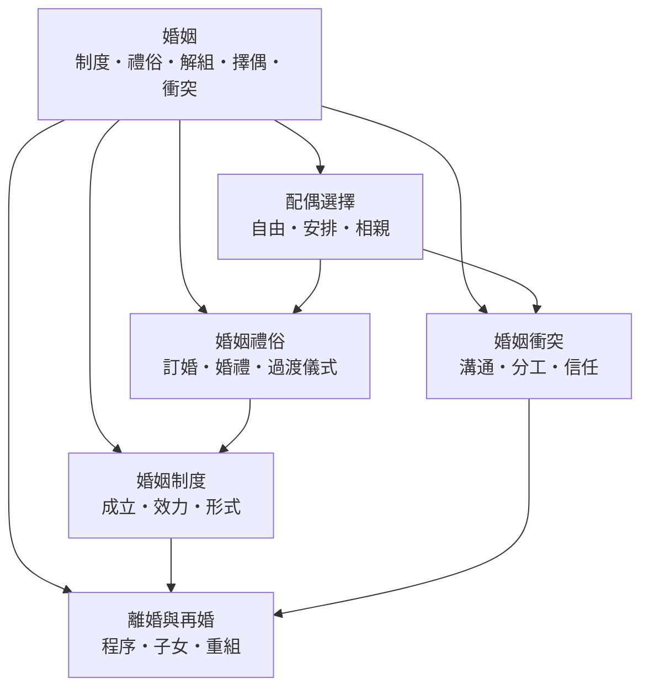

# 婚姻

> 隸屬：第一層 [人]　·　相關分類：[社會學]、[人類學]、[社會心理學]、[經濟學]、[民法]、[人口結構]、[兒童發展]、[家庭與家族]　·　子分類總表見 [README]

> 對應維基百科：中文與英文維基百科均無對應條目（參考：婚姻 相關主題文獻）

婚姻研究的是：**兩個人（或更多，視文化而定）的結合如何被社會承認，以及這個承認如何改變雙方的權利、義務、財產、親屬網絡與身分**。它不是單純的私人感情事件，而是一套橫跨法律、宗教、經濟與親屬制度的安排——[民法] 規定婚姻的成立與效力，[社會學] 分析它作為社會制度的變遷，[人類學] 比較不同文化的婚姻形式，而 [經濟學] 則把婚姻視為一種分工與資源共享的長期契約。

把婚姻當成概念來研究，核心張力在於：**它同時是最私密的親密關係，也是最公開的社會制度**。兩個人可以私下相愛而不需要任何人批准，但「結婚」必須經過登記、儀式或公示，因為婚姻改變的是第三方（子女、債權人、國家、親屬）可以主張的權利義務。這也是為什麼同居在情感上可以與婚姻幾乎相同，在制度上卻差異巨大。

本概念的組織方式如下：**婚姻制度** 處理婚姻作為法律與社會規範的骨架；**婚姻禮俗** 處理婚姻在文化層面的展演與過渡儀式；**離婚與再婚** 處理婚姻的解組與重組；**配偶選擇** 處理婚姻市場上「誰跟誰配對」的機制；**婚姻衝突** 處理婚姻存續期間的互動品質與失靈。五者對應婚姻的「規範—展演—解組—形成—維繫」五個側面。

## 核心問題

### 一、婚姻為什麼需要社會承認

如果婚姻只是兩人的感情承諾，為什麼需要登記與儀式？答案在於婚姻創造的是**可預期的長期義務**：扶養、繼承、代理、稅務與子女的親權。這些義務的相對人包括國家與第三人，因此必須有公示方法讓外界得以查證。這也解釋了為什麼各種文化不約而同發展出儀式、證人與登記——它們都是降低「這段關係是否有效」之爭議成本的技術。

### 二、婚姻內部的權利義務如何分配

傳統婚姻制度常預設固定的性別分工；現代法制則朝「分別財產制、扶養義務對等、親權共有」方向修訂。[貝克] 的婚姻市場模型把這個分配問題形式化：婚姻是一種兩人間的分工契約，其中一人專事市場工作、另一人專事家務工作，總產出因比較利益而增加。這個模型解釋了傳統分工的經濟理性，也預測了當女性市場工資上升時，分工契約與婚姻本身都會變得不穩定——這正是二十世紀後半離婚率上升的經濟解釋之一。

### 三、婚姻如何被成立、維繫與解散

婚姻的生命周期可以切成三段問題：**形成**（誰選擇誰、依什麼標準，見 [配偶選擇]）、**維繫**（日常互動如何累積滿意或怨懟，見 [婚姻衝突]）、**解組**（離婚程序與子女安排如何處理殘局，見 [離婚與再婚]）。三段互相牽制：擇偶機制決定配對品質的分布，互動品質決定婚姻存續機率，而解組制度的寬嚴又回頭改變人們進入婚姻的意願。

### 四、制度變遷的方向

二十世紀婚姻制度出現三個方向一致的變化：**從身分契約到意思契約**（結婚以雙方合意為準，不再是家族之間的交易）、**從義務婚姻到伴侶婚姻**（婚姻的目的從生育與經濟合作轉向情感滿足）、**從單一形式到多元承認**（事實婚、伴侶登記、同性婚姻相繼取得法律地位）。這三個變化共同造成「婚姻可選擇化」：婚姻從人生的預設選項變成眾多親密關係形式中的一種。

## 因果鏈

1. **親屬制度的需求**：在缺乏國家福利的社會，婚姻是連結兩個親屬群體、建立扶養與繼承秩序的核心技術，因此各文化都以禮俗與禁忌嚴格規範通婚範圍與程序，這是 [婚姻禮俗] 的起源。
2. **法律的接管**：隨著國家能力增強，婚姻從宗教與宗族的管轄轉入民事登記，成立要件、財產制與離婚事由被成文化，婚姻成為 [民法] 的一部分，這使婚姻爭議可以訴諸法院而非宗族裁決。
3. **經濟學的模型化**：[貝克] 自 1960 年代起把婚姻視為分工與配對的市場，用比較利益解釋婚姻內分工，用搜尋理論解釋擇偶，使婚姻成為可量化預測的對象，也預測了女性就業與離婚率的連動。
4. **社會學的型態分類**：[派森] 在 [1955年] 提出以核心家庭為工業化社會標準型態的功能論，把婚姻與家庭結構連結；此後的研究則顯示婚姻型態遠比「標準」多元，推動了 [多元婚姻形式] 與 [同居] 的制度化討論。
5. **無過失離婚的擴散**：[美國] 加州於 [1970年] 率先採行無過失離婚，此後各國相繼放寬離婚事由，離婚從「證明對方有錯」轉為「關係破裂即可」，大幅改變 [離婚與再婚] 的制度環境。
6. **互動研究的科學化**：[戈特曼] 以縱貫觀察與生理測量建立夫妻互動的預測模型，提出批評、鄙視、防衛、築牆四種預測離婚的溝通模式，使 [婚姻衝突] 從道德勸說轉為可診斷、可介入的對象。
7. **擇偶的去制度化**：教育擴張、都市化與網路媒介使擇偶從家庭安排轉為個人搜尋，[自由擇偶] 成為規範預設，[包辦婚姻] 退居部分地區，[相亲] 則以新型態（聯誼、交友軟體）延續。
8. **多元化與再制度化的當代課題**：晚婚、不婚、同居與再婚使「婚姻」不再等於「成家」，人口統計與福利制度被迫重新定義配偶與家屬，婚姻作為概念的研究對象也從單一制度擴展為一組並存的親密關係制度。

## 子分類的定位與相互驅動

- **[婚姻制度]** 是**規範層**的骨架：它界定什麼算婚姻、婚姻產生什麼權利義務。所有其他子分類都以它為前提——[一夫一妻] 與 [多元婚姻形式] 的差別是制度問題，[同居] 是否取得婚姻效力也是制度問題。
- **[婚姻禮俗]** 是**展演層**：[訂婚]、[婚禮]、[回門與安床] 把制度上的「成立」轉譯為親屬網絡可見的過渡儀式，使婚姻在社群中獲得正當性。禮俗變簡或消失時，制度仍運作，但婚姻的社會宣示功能減弱。
- **[離婚與再婚]** 是**解組與重組層**：[離婚程序] 處理法律終止，[子女安排] 處理解組後的親職分工，[再婚家庭] 則是重組後的新結構。離婚制度的寬嚴直接影響人們對婚姻的風險評估。
- **[配偶選擇]** 是**形成層**：[自由擇偶]、[包辦婚姻] 與 [相亲] 代表從家庭主導到個人主導、再到媒介平台媒合的光譜。擇偶機制決定配對的同質性與穩定性，回頭影響婚姻衝突的分布。
- **[婚姻衝突]** 是**維繫層**：[溝通模式]、[分工爭議] 與 [外遇與信任] 對應互動品質的三大風險源。衝突研究的進展使婚姻諮商成為離婚前的制度化選項。

五者的驅動關係是循環的：制度界定形式的可能集合 → 禮俗使選定形式獲得社會承認 → 擇偶機制決定誰進入哪種形式 → 互動品質決定存續 → 解組與再婚又改變制度需求的樣貌。理解婚姻因此需要同時看這五個環節，而不是把婚姻等同於婚禮或結婚證書。

## 範例：兩種婚姻成立路徑的對照

以 [台灣] 與 [丹麥] 為例，可以看出制度、禮俗與選擇機制如何交疊：

1. **台灣**：民法採登記婚，結婚須雙方書面約定並向戶政機關登記始生效力；民間仍普遍舉行訂婚與婚禮，提親、訂婚儀式與 [回門與安床] 等過渡環節常見於儀式流程。擇偶以自由戀愛為主，但 [相亲]（相親聯誼、長輩介紹）仍是重要的補充管道。
2. **丹麥**：同居極為普遍且多數享有類似配偶的法律地位，結婚率低但伴侶穩定；無過失離婚程序簡便，再婚與重組家庭常見。這顯示「婚姻的社會功能」可以由同居與伴侶登記分擔，而不必然由婚姻獨占。
3. **對照的啟示**：兩地的婚姻率與離婚率數字差異很大，但「長期穩定伴侶關係的比例」差距較小——這提示研究者：比較婚姻統計時，必須把同居與伴侶登記納入口徑，否則會把制度差異誤讀為關係品質差異。

## 容易混淆之處

- **婚姻不等於婚禮**：婚禮是展演儀式，婚姻是持續的法律與社會狀態；只辦婚禮未登記在多數法域不成立婚姻，反之美國部分州的普通法婚姻不需儀式也可成立。
- **婚姻不等於愛情**：歷史上多數婚姻以經濟合作、生育與聯盟為目的；「以愛情為婚姻的首要理由」是二十世紀才普及的規範，用它回頭評斷傳統婚姻會產生時代錯置。
- **同居不等於事實婚**：同居是居住安排，事實婚是法律上承認其有婚姻效力的制度；兩者在財產與繼承上的效果可能天差地遠。
- **離婚率上升不等於婚姻崩壞**：離婚率受制度（無過失離婚）、女性就業、壽命延長與統計口徑影響；同居普及本身就會壓低結婚率並改變離婚率的分母。
- **個人層次的擇偶偏好不等於總體配對模式**：個人宣稱想要什麼與實際和誰結婚是兩回事；同質婚（教育、社經背景相近者互婚）主要來自相遇結構與市場篩選，而非明言偏好。

## 延伸閱讀

- [社會學]：婚姻作為制度與社會變遷指標的分析。
- [人類學]：跨文化的婚姻形式、聘禮與親屬組織比較。
- [民法]：婚姻的成立、效力、財產制與離婚的規範基礎。
- [家庭與家族]：婚姻如何嵌入家庭結構與代間關係。
- [兒童發展]、[親職教育]：婚姻品質與離婚對子女的影響。
- [人口結構]：結婚率、離婚率與生育的統計關聯。

## 連結定義

[人]: ../../人/README.md
[README]: README.md
[社會學]: ../社會學/README.md
[人類學]: ../人類學/README.md
[社會心理學]: ../社會心理學/README.md
[經濟學]: ../經濟學/README.md
[民法]: ../民法/README.md
[人口結構]: ../人口結構/README.md
[兒童發展]: ../兒童發展/README.md
[親職教育]: ../親職教育/README.md
[家庭與家族]: ../家庭與家族/README.md
[貝克]: ../../人/經濟學家/貝克.md
[派森]: ../../人/社會學家/派森.md
[戈特曼]: ../../人/心理學家/戈特曼.md
[1955年]: ../../時/1955年.md
[1970年]: ../../時/1970年.md
[美國]: ../../地/美國.md
[丹麥]: ../../地/丹麥.md
[台灣]: ../../地/台灣.md
[婚姻制度]: 婚姻制度.md
[一夫一妻]: 一夫一妻.md
[多元婚姻形式]: 多元婚姻形式.md
[同居]: 同居.md
[婚姻禮俗]: 婚姻禮俗.md
[訂婚]: 訂婚.md
[婚禮]: 婚禮.md
[回門與安床]: 回門與安床.md
[離婚與再婚]: 離婚與再婚.md
[離婚程序]: 離婚程序.md
[子女安排]: 子女安排.md
[再婚家庭]: ../家庭與家族/再婚家庭.md
[配偶選擇]: 配偶選擇.md
[自由擇偶]: 自由擇偶.md
[包辦婚姻]: 包辦婚姻.md
[相亲]: 相亲.md
[婚姻衝突]: 婚姻衝突.md
[溝通模式]: 溝通模式.md
[分工爭議]: 分工爭議.md
[外遇與信任]: 外遇與信任.md