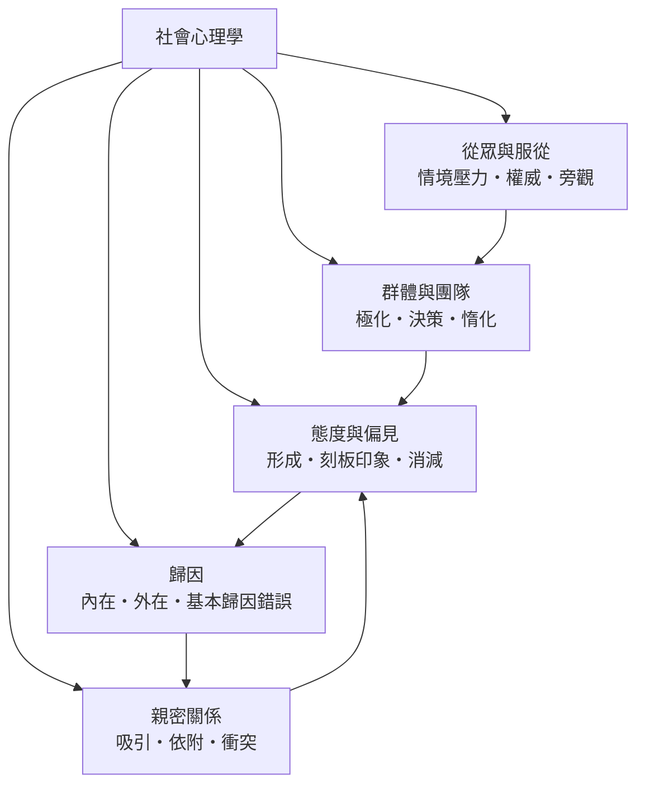

# 社會心理學

> 隸屬：第一層 [人]　·　相關分類：[心理學]、[認知科學]、[社會學]、[行為科學]　·　子分類總表見 [README]

> 對應維基百科：[中文維基百科：社会心理学](https://zh.wikipedia.org/wiki/%E7%A4%BE%E4%BC%9A%E5%BF%83%E7%90%86%E5%AD%A6)　·　[English Wikipedia: Social psychology](https://en.wikipedia.org/wiki/Social_psychology)

社會心理學研究的是：**人在別人面前、與別人一起、或為了別人而行動時，行動如何被改變**。它不把個人當成封閉的單位，而是把情境、群體、他人在場與文化規範當成實驗中可以操弄的變因。二十世紀初，當時主流心理學著重個體內在歷程（psychoanalysis、行為主義），社會心理學逐漸成形為獨立的經驗學科：它用實驗室方法測量「人在場」這件事本身的因果效力。

本條目要處理的問題是：**當我們說一個人的行為「是他自己的個性」時，情境因素被低估了多少；而當我們反過來說「都是環境造成的」時，個人責任又該如何安置**。

## 核心問題

社會心理學的核心操作是**把情境從背景移到前景**。它假設：可觀察行為由個人傾向與情境線索共同決定，而情境線索往往比個人傾向更有力、更可預測。

1. **個人傾向與情境的比重**：同一個人在不同的群體、不同的指令權威、不同的責任分散條件下，行為可以差異極大。
2. **可測量的社會影響**：從眾、服從、偏見、歸因偏差、群體決策偏差等，都可以用重複實驗的形式累積證據。
3. **應用外推的風險**：實驗室中的人工情境能否外推到真實生活，是這門學科最持久的方法論爭議。

因此，社會心理學同時是**描述性學科**（人在情境中如何反應）與**介入性學科**（如何設計情境以改變行為），後者使它廣泛進入教育、組織、廣告、醫療與公共政策。

## 因果鏈

1. **個體心理學的瓶頸**：1920 年代前的心理學多以個體為分析單位，無法解釋同一刺激在不同群體中引發不同反應的現象。
2. **情境取向的轉向**：早期實驗如睡眠者被叫醒（1924）、求援實驗（1929）證明「他人在場」本身即構成變因，社會心理學的問題意識就此成形。
3. **學科制度化**：1930 至 1940 年代，社會心理學在美國成為獨立的研究與教學單位，並形成「實驗室情境 + 實驗組與對照組」的方法慣例。
4. **從眾研究的示範作用**：[阿希]於 [1951年] 在斯沃斯莫爾學院所做的實驗，證明即使題目毫無疑義，多數受試者仍會屈從群體的錯誤答案，讓「群體壓力」成為可量化的變因。
5. **權威情境的量化**：[米爾格拉姆]於 [1963年] 在耶魯大學（[紐黑文]）所做的服從實驗，以合法的科學家身分與電擊裝置，量出服從行為的比例與臨界點。
6. **認知失調理論的提出**：[費斯汀格]於 [1957年] 指出，當行為與信念衝突時，人會改變信念而非行為——這把「情境影響」推進到「內在一致性需求」的層次。
7. **群體與歸因研究**：[謝頓]於 [1954年] 的野營實驗顯示，合作性目標能降低敵意；[海德]的歸因研究則解釋人如何為他人與自己的行為尋找理由。
8. **危機與複製浪潮**：二十世紀末的複製危機使部分經典效應的效量被重新估計，同時元分析與預註冊制度成為常規，學科的自我修正能力因此提升。

## 子分類的定位與相互驅動

- **[從眾與服從]** 是**情境壓力**的分類：它回答「當場上有人反對或命令時，我會怎樣」，是全科最基礎的實驗典範。
- **[態度與偏見]** 是**態度和標籤**的分類：它把個體內在的評價傾向與群體共享的刻板印象分開處理，並研究偏見如何被設計出來的條件減弱。
- **[群體與團隊]** 是**集體層級**的分類：它把個人放進群體，觀察群體如何改變個人的判斷、貢獻與投入。
- **[歸因]** 是**解釋機制**的分類：它研究人如何解釋自己與他人的行為，是偏見、衝突與親密關係的共同底層。
- **[親密關係]** 是**關係層級**的分類：它把實驗室裡的效應放進長期關係中，考驗短期效應能否累積成穩定模式。

五者互相驅動：從眾與服從提供最基本的群體壓力證據；群體與團隊把壓力推展到決策與貢獻；歸因解釋人為何接受或抵抗壓力；態度與偏見把個體反應與群體共享信念接起來；親密關係則是所有效應最長期的實地考驗。

## 範例：一次公開的反對有多難

以[阿希]在 [1951年] 的線索判斷實驗為例，逐步說明社會心理學如何把「情境壓力」變成可量化的事實：

1. **設計**：18 名受試者每人參與 18 輪簡單的線索判斷題；每題由一位受試者與一名假扮受試者的同伴作答，同伴在 12 題中故意給出明顯錯誤的答案。
2. **依變項**：受試者每次是否同意同伴的錯誤答案，即「從眾率」。
3. **結果**：公開作答的受試者中，約四分之三至少順從過一次錯誤答案；在關鍵題上，個人從眾的比例大致落在三成上下。
4. **關鍵變項**：若改成私下書寫答案後再公開，或讓作答者不發聲，順從率大幅下降——可見壓力來自「被群體即時回應所否定的恐懼」，而非題目本身含糊。
5. **推論**：多數人並非不知道正確答案；情境的作用是把「正確」的成本提高到足以被放棄。
6. **應用**：對應到組織與公共議題，公開表態的程序設計（先私下徵詢、匿名投票）能有效降低多數人實際上持有的判斷被少數人的即時壓力覆蓋的風險。

## 容易混淆之處

- **社會影響不等於無腦順從**：多數經典實驗都顯示受試者仍保留拒絕的能力；情境改變的是**門檻與成本**，不是取消意願。
- **效應量大小需重新估計**：部分經典研究在大型重複實驗中效量縮小甚至難以重現，引用時應說明樣本與情境條件。
- **相關不等於因果**：實驗室外的態度與行為關係長期偏弱，觀察研究難以支持「態度決定行為」的強命題。
- **基本歸因錯誤不是「歸因謬誤」的全集**：它特指高估內在因素、低估情境因素的那一種偏差。
- **偏差不全是壞事**：確認偏誤、從眾與風險趨近有演化上的功能，批評時應區分「不準確」與「不適合當下情境」。

## 延伸閱讀

- [心理學]：學科母體，提供方法與統計的共同基礎。
- [認知科學]：注意、記憶與推理的模型，是解釋社會效應的內在歷程層。
- [社會學]：以結構與制度解釋社會現象，與微觀層互補。
- [行為科學]：制約與強化原理，是情境設計的操作語彙。
- [發展心理學]：依附與親密關係研究的歷史起點之一。
- [心理學方法]：複製危機、元分析與預註冊制度的討論。

## 連結定義

[人]: ../人/README.md
[README]: README.md
[心理學]: ../心理學/README.md
[認知科學]: ../認知科學/README.md
[社會學]: ../社會學/README.md
[行為科學]: ../行為科學/README.md
[發展心理學]: ../發展心理學/README.md
[心理學方法]: ../心理學/心理學方法.md
[從眾與服從]: 從眾與服從.md
[態度與偏見]: 態度與偏見.md
[群體與團隊]: 群體與團隊.md
[歸因]: 歸因.md
[親密關係]: 親密關係.md
[阿希]: ../人/心理學家/阿希.md
[米爾格拉姆]: ../人/心理學家/米爾格拉姆.md
[費斯汀格]: ../人/心理學家/費斯汀格.md
[謝頓]: ../人/心理學家/謝頓.md
[海德]: ../人/心理學家/海德.md
[1951年]: ../時/1951年.md
[1954年]: ../時/1954年.md
[1957年]: ../時/1957年.md
[1963年]: ../時/1963年.md
[紐黑文]: ../地/紐黑文.md
