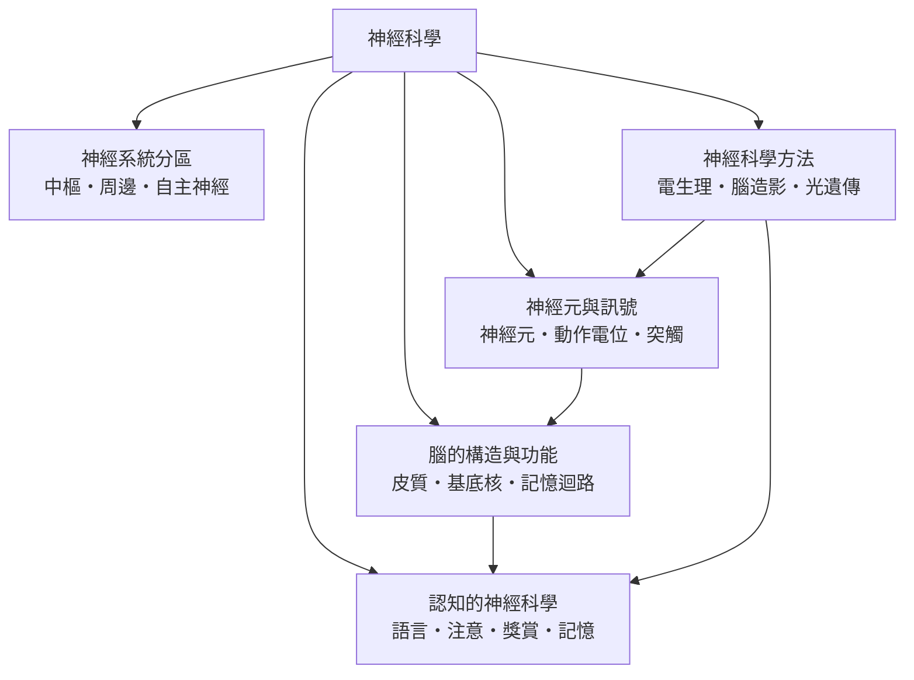

# 神經科學

> 隸屬：第一層 [醫]　·　相關分類：[生理學]、[心理學]、[解剖學]、[分子生物]　·　子分類總表見 [README]

> 對應維基百科：[中文維基百科：神經科學](https://zh.wikipedia.org/wiki/%E7%A5%9E%E7%BB%8F%E7%A7%91%E5%AD%A6)　·　[English Wikipedia: Neuroscience](https://en.wikipedia.org/wiki/Neuroscience)

神經科學研究神經系統的結構與功能：神經元如何產生與傳遞訊號、這些訊號如何被整合成知覺與行動、腦這個器官如何支持記憶與語言，以及我們用什麼方法「看見」活體腦的運作。它橫跨分子到行為的多個尺度——同一顆腦，可以在離子通道、突觸、腦區、網絡與行為五個層次上被提問。本概念的問題是：**一團細胞如何變成會感覺、會記得、會決定的系統**。

## 核心問題

神經科學的中心問題是**訊息**：神經系統把外界刺激編碼成電與化學訊號，再解碼成運動、情緒與認知。理解它需要三組基本事實：

1. **電訊號**：神經元的膜電位約為 $-70\ \text{mV}$ （靜息），動作電位去極化可達約 $+40\ \text{mV}$ ，傳導速度在無髓鞘軸突約 $0.5$ 至 $2\ \text{m/s}$ ，有髓鞘可達約 $120\ \text{m/s}$ 。
2. **化學訊號**：突觸是神經元之間的主要通訊點，神經傳遞物（如麩胺酸、GABA、多巴胺）在突觸間隙（約 $20$ 至 $40\ \text{nm}$ ）擴散並結合受體。
3. **結構**：人腦約有 $860$ 億個神經元，每個神經元平均與數千個其他神經元形成突觸。

白話地說：神經科學要回答的不是「腦裡有什麼」（那是解剖學），而是「腦在做什麼、怎麼做、我們怎麼知道」。

## 因果鏈

1. **神經元學說的確立**：十九世紀末，[卡哈爾]以改良的染色法證明神經系統由獨立的細胞組成，而非連成一片的網絡——這奠定了所有後續研究的單位。
2. **電生理的成熟**：二十世紀中葉，微電極與電壓鉗技術讓動作電位與突觸電流成為可量測的數值，機制層次的解釋成為可能。
3. **化學傳遞的證實**：神經傳遞物與受體的發現把突觸變成藥理學的戰場，[藥理學]的大多數神經作用藥物都建立在這一層。
4. **系統神經科學的擴張**：從感覺與運動通路，推進到記憶（海馬迴）、情緒（杏仁核）與獎賞（多巴胺系統）的定位。
5. **腦造影革命**：功能性磁振造影使人類可以在不開顱的情況下觀察腦區活動，認知神經科學因而興起。
6. **分子與遺傳工具**：光遺傳學等技術讓研究者在特定細胞類型上以毫秒精度開關活動，因果層次的檢驗回到動物模型。
7. **計算與模型的匯流**：神經網路模型把「編碼與解碼」變成可計算的問題，也反向餵養[人工智慧]的發展。

## 子分類的定位與相互驅動

- [神經元與訊號] 是**細胞層的基礎**：沒有動作電位與突觸，其他層次的解釋都沒有著力點。
- [神經系統分區] 提供**地圖**：訊號沿著哪些結構走，症狀與病灶如何對應。
- [腦的構造與功能] 把地圖細化到**腦區層**：皮質分區、基底核與情緒記憶迴路各司其職。
- [認知的神經科學] 是**功能層**：把腦區與訊號對應到語言、注意、獎賞與記憶等心智能力。
- [神經科學方法] 是**工具層**：方法的極限決定各層能回答什麼問題——反過來，各層的新問題也驅動新工具的發明。

## 範例：從碰到手燙到縮手的五層解釋

手碰到熱鍋瞬間縮回，可以在本分類的五個層次上同時解釋：

1. **神經元與訊號**：皮膚的傷害受器把熱刺激轉成動作電位，沿感覺神經纖維傳向脊髓。
2. **神經系統分區**：訊號進入脊髓後角，經反射迴路直接驅動運動神經元——這一段不經過腦，所以反應快（約數十毫秒）。
3. **腦的構造與功能**：同時，訊號上行經丘腦抵達體感覺皮質與扣帶回，產生「燙、痛」的知覺。
4. **認知的神經科學**：痛的情緒成分與記憶（下次小心）分別涉及杏仁核與海馬迴的參與。
5. **方法**：上述分工正是靠電生理（單細胞記錄）與腦造影（觀察人類腦區活動）互相印證而得知。

## 容易混淆之處

- **神經科學不等於腦科學**：神經系統包含脊髓與周邊神經，很多重要工作在腦外完成。
- **「腦區負責某功能」不是一對一對應**：功能由網絡實現，同一腦區常參與多種功能。
- **相關不等於因果**：造影看到某腦區活化，不代表它是該功能的「原因」。
- **人腦與模式動物不能直接外推**：小鼠與人類共享細胞層機制，但認知層的結論要小心。
- **動作電位不是「電流沿著電線跑」**：它是膜上離子通道依序開關的再生性事件，方向與速度由膜的性質決定。
- **腦造影的顏色圖不是腦活動本身**：它是統計處理後的間接指標，解讀時必須回到原始設計與統計方法。

## 延伸閱讀

- [生理學]：恆定與系統功能的姊妹學科，神經生理是其中一枝。
- [解剖學]：神經系統的結構描述。
- [心理學]：行為與心智層的提問者，認知神經科學是兩者的橋樑。
- [藥理學]：突觸與受體是大多數神經藥物的作用點。
- [分子生物]：離子通道與受體的分子基礎。

## 連結定義

[醫]: ../醫/README.md
[README]: README.md
[生理學]: ../生理學/README.md
[心理學]: ../心理學/README.md
[解剖學]: ../解剖學/README.md
[分子生物]: ../分子生物/README.md
[藥理學]: ../藥理學/README.md
[人工智慧]: ../人工智慧/README.md
[神經元與訊號]: 神經元與訊號.md
[神經系統分區]: 神經系統分區.md
[腦的構造與功能]: 腦的構造與功能.md
[認知的神經科學]: 認知的神經科學.md
[神經科學方法]: 神經科學方法.md
[卡哈爾]: ../人/生物學家/卡哈爾.md
